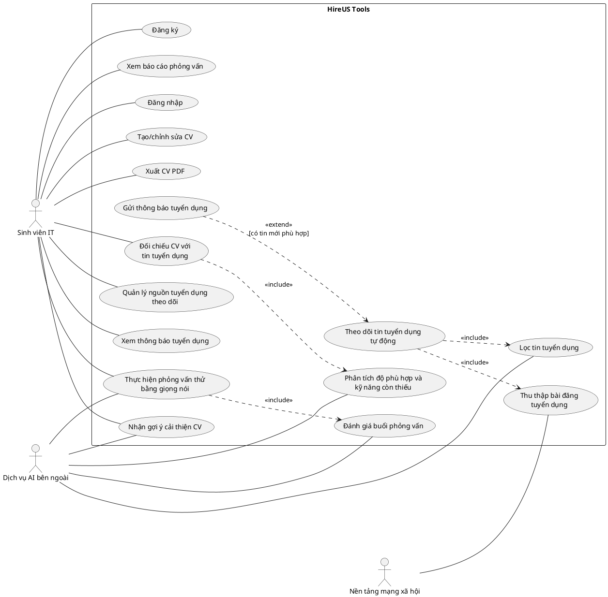
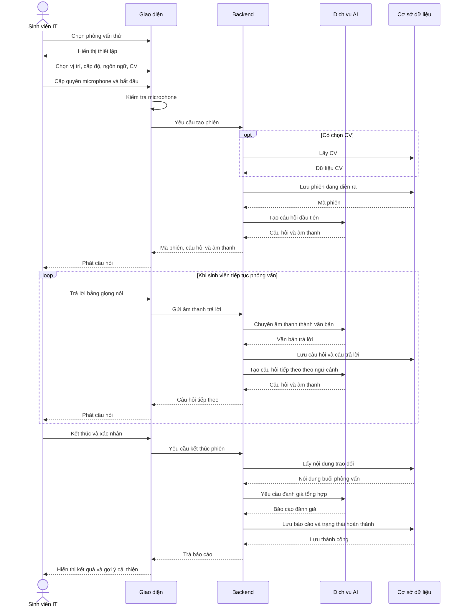

# BÀI TẬP MÔ HÌNH HÓA HỆ THỐNG HIREUS TOOLS

## 1. Yêu cầu bài tập

Bài tập dựa trên đồ án môn học HireUS Tools, gồm:

1. Vẽ biểu đồ use case thể hiện tương tác giữa các actor và hệ thống.
2. Viết đặc tả cho **1 use case quan trọng nhất** theo yêu cầu đã được điều chỉnh trên lớp.
3. Vẽ biểu đồ tuần tự cho use case được chọn.

**Tài liệu tham chiếu:** [Project Proposal](Week01/Submission/Project_Proposal.md).

**Use case được chọn:** Thực hiện phỏng vấn thử bằng giọng nói. Proposal xác định đây là tính năng nổi bật của dự án, giúp sinh viên IT luyện phản xạ phỏng vấn và nhận đánh giá năng lực.

Các bước xử lý chi tiết trong tài liệu này là đề xuất làm rõ từ proposal, cần được nhóm thống nhất khi triển khai.

## 2. Biểu đồ use case tổng quát

### 2.1. Actor và các use case liên quan

| Actor | Các use case liên kết |
|---|---|
| **Sinh viên IT** | Đăng ký; Đăng nhập; Tạo/chỉnh sửa CV; Xuất CV PDF; Nhận gợi ý cải thiện CV; Thực hiện phỏng vấn thử bằng giọng nói; Xem báo cáo phỏng vấn; Đối chiếu CV với tin tuyển dụng; Quản lý nguồn tuyển dụng theo dõi; Xem thông báo tuyển dụng |
| **Dịch vụ AI bên ngoài** | Nhận gợi ý cải thiện CV; Thực hiện phỏng vấn thử bằng giọng nói; Đánh giá buổi phỏng vấn; Phân tích độ phù hợp và kỹ năng còn thiếu; Lọc tin tuyển dụng |
| **Nền tảng mạng xã hội** | Thu thập bài đăng tuyển dụng |

### 2.2. Các quan hệ giữa use case

```text
(Đối chiếu CV với tin tuyển dụng)
    ── «include» ──> (Phân tích độ phù hợp và kỹ năng còn thiếu)

(Theo dõi tin tuyển dụng tự động)
    ── «include» ──> (Thu thập bài đăng tuyển dụng)
    ── «include» ──> (Lọc tin tuyển dụng)

(Gửi thông báo tuyển dụng)
    ── «extend» ──> (Theo dõi tin tuyển dụng tự động)
    Điều kiện: phát hiện tin tuyển dụng mới phù hợp

(Thực hiện phỏng vấn thử bằng giọng nói)
    ── «include» ──> (Đánh giá buổi phỏng vấn)
```

### 2.3. Mã biểu đồ PlantUML

Khối dưới đây có thể được dựng bằng công cụ hỗ trợ PlantUML hoặc dùng làm mẫu để vẽ trên giấy.



### 2.4. Lưu ý khi vẽ

- Actor nằm ngoài khung hệ thống; use case là hình elip nằm trong khung **HireUS Tools**.
- Mũi tên `include` hướng về use case được sử dụng; mũi tên `extend` hướng về use case được mở rộng.
- Sinh viên quản lý nguồn theo dõi và xem thông báo; hệ thống thực hiện thu thập, lọc tin định kỳ.
- FastAPI, Backend và cơ sở dữ liệu thuộc nội bộ HireUS Tools nên không vẽ thành actor. Actor dịch vụ AI chỉ đại diện cho dịch vụ nằm ngoài phạm vi hệ thống.
- Đăng nhập có thể là tiền điều kiện của chức năng, không cần nối `include` từ mọi use case.

## 3. Đặc tả use case UC-01

### 3.1. Thông tin chung

| Thuộc tính | Nội dung |
|---|---|
| **Mã use case** | UC-01 |
| **Tên use case** | Thực hiện phỏng vấn thử bằng giọng nói |
| **Actor chính** | Sinh viên IT |
| **Actor phụ** | Dịch vụ AI bên ngoài |
| **Mục tiêu** | Luyện trả lời phỏng vấn kỹ thuật bằng giọng nói và nhận đánh giá để cải thiện năng lực |
| **Kích hoạt** | Sinh viên chọn chức năng “Phỏng vấn thử” |
| **Tiền điều kiện** | Sinh viên đã đăng nhập; thiết bị có microphone, loa hoặc tai nghe và kết nối Internet |
| **Hậu điều kiện thành công** | Buổi phỏng vấn kết thúc; nội dung trao đổi và báo cáo đánh giá được lưu, sinh viên xem được kết quả |
| **Hậu điều kiện khi thất bại** | Hệ thống thông báo nguyên nhân; buổi phỏng vấn chưa hoàn tất không được ghi nhận là hoàn thành |

### 3.2. Luồng chính

| Bước | Sinh viên | Hệ thống |
|---|---|---|
| 1 | Chọn “Phỏng vấn thử”. | Hiển thị màn hình thiết lập buổi phỏng vấn. |
| 2 | Chọn vị trí ứng tuyển, cấp độ, ngôn ngữ và CV dùng làm ngữ cảnh. | Kiểm tra thông tin đã chọn. |
| 3 | Cho phép truy cập microphone và chọn “Bắt đầu”. | Kiểm tra microphone, tạo và lưu phiên phỏng vấn. |
| 4 | Nghe câu hỏi. | Sử dụng thông tin thiết lập và CV để tạo câu hỏi, phát câu hỏi bằng giọng nói. |
| 5 | Trả lời bằng giọng nói. | Tiếp nhận âm thanh, chuyển thành văn bản và lưu câu trả lời. |
| 6 | Tiếp tục trả lời. | Phân tích ngữ cảnh, tạo câu hỏi tiếp theo. Lặp lại bước 4–6 khi phiên chưa kết thúc. |
| 7 | Chọn “Kết thúc” và xác nhận. | Kết thúc phần hỏi đáp, tổng hợp nội dung buổi phỏng vấn. |
| 8 | Xem kết quả. | Tạo, lưu và hiển thị báo cáo gồm đánh giá, điểm mạnh, kiến thức còn thiếu và gợi ý cải thiện. |

### 3.3. Luồng thay thế và ngoại lệ

| Mã | Tình huống | Xử lý |
|---|---|---|
| A1 – tại bước 2 | Sinh viên không chọn CV | Hệ thống phỏng vấn theo vị trí, cấp độ và ngôn ngữ đã chọn; không cá nhân hóa theo CV. |
| E1 – tại bước 3 | Microphone không khả dụng hoặc bị từ chối quyền | Hệ thống hướng dẫn kiểm tra/cấp quyền; sinh viên thử lại hoặc hủy. Phiên chưa bắt đầu. |
| E2 – tại bước 5 | Âm thanh không rõ hoặc không nhận diện được câu trả lời | Hệ thống đề nghị trả lời lại và chưa chuyển sang câu hỏi tiếp theo. |
| E3 – trong phần hỏi đáp | Mất kết nối hoặc dịch vụ AI gặp lỗi | Hệ thống thông báo gián đoạn; cho phép thử lại hoặc kết thúc phiên với trạng thái chưa hoàn tất. |
| E4 – tại bước 8 | Không tạo được báo cáo | Lưu phần trao đổi đã có, đánh dấu báo cáo chưa tạo thành công và cho phép thử tạo lại. |

## 4. Biểu đồ tuần tự cho UC-01

Biểu đồ thể hiện luồng thành công chính. Thành phần **Dịch vụ AI** có thể bao gồm dịch vụ FastAPI và lời gọi đến nhà cung cấp AI.



Nếu cần thể hiện ngoại lệ, có thể bổ sung khung `alt` tại bước nhận diện giọng nói: **nhận diện thành công → tiếp tục**, **không nhận diện được → yêu cầu trả lời lại**.
