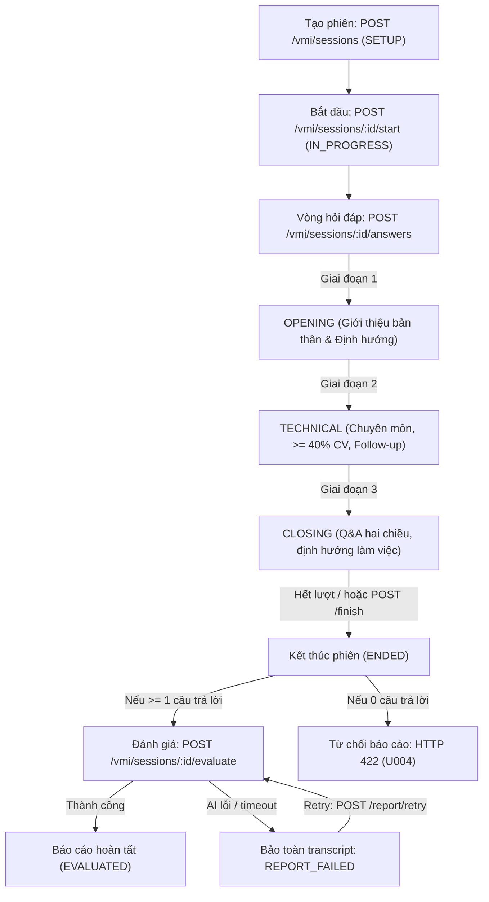
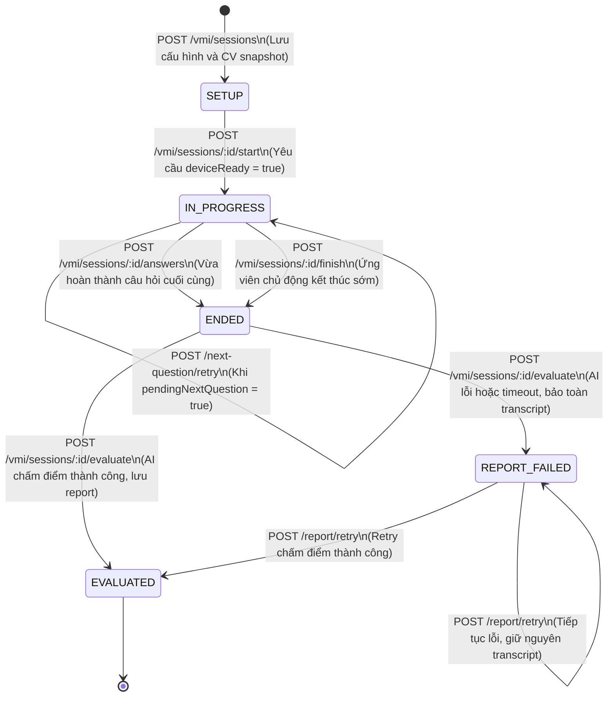

# Bối cảnh & Đặc tả Kỹ thuật Toàn diện: Phân hệ Voice Mock Interview (VMI)

> **Dự án:** HireUS Tools — Đồ án môn Nhập môn Công nghệ Phần mềm (Trường ĐH Khoa học Tự nhiên, ĐHQG-HCM)<br>
> **Nhóm thực hiện:** Nhóm 02 (GVLT: Thầy Phạm Minh Tuấn — GVTH: Thầy Ngô Ngọc Đăng Khoa)<br>
> **Thành viên phụ trách VMI:** Võ Nguyễn Việt Hoàng (MSSV: 24120249)<br>
> **Cập nhật:** 14/11/2026 (OpenAPI v0.8.0: Task 7–8 có code/test; đã đo STT CPU, TTS CPU còn thiếu toolchain)<br>
> **Tài liệu nguồn chuẩn:** [Requirements_Analysis.md](Week02/Submission/Requirements_Analysis.md), [PROJECT_CONTEXT.md](PROJECT_CONTEXT.md), `backend/contracts/vmi.openapi.yaml`

---

## 1. Tổng quan Nghiệp vụ & Phạm vi (Executive Summary)

### 1.1. Mục tiêu Phân hệ VMI
**Voice Mock Interview (VMI)** là một trong 4 phân hệ cốt lõi của nền tảng **HireUS Tools**, hỗ trợ sinh viên ngành Công nghệ Thông tin (đặc biệt là đối tượng Intern và Fresher) rèn luyện kỹ năng phỏng vấn kỹ thuật 1:1 theo thời gian thực bằng giọng nói (song ngữ Việt/Anh).

Hệ thống đóng vai trò như một Nhà tuyển dụng Kỹ thuật (Technical Interviewer) thông minh:
1. Khởi tạo câu hỏi mở đầu và ngữ cảnh chuyên sâu dựa trên vị trí tuyển dụng, cấp độ và bản chụp CV của ứng viên (nếu có).
2. Lắng nghe câu trả lời của ứng viên, phân tích chất lượng kỹ thuật và đưa ra các câu hỏi đào sâu (follow-up) bám sát ngữ cảnh thực tế theo 3 giai đoạn tiêu chuẩn.
3. Tổng hợp toàn văn biên bản hỏi đáp (transcript), tính điểm 3 tiêu chí cốt lõi bằng công thức trọng số cố định tại Backend, phân loại năng lực và xuất báo cáo phản hồi chi tiết (điểm mạnh, lỗ hổng kiến thức, gợi ý trả lời, chủ đề ôn tập).
4. Lưu trữ lịch sử phiên phỏng vấn để ứng viên theo dõi tiến bộ hoặc thực hiện phỏng vấn lại với cấu hình tương tự.

---

## 2. Đặc tả Ca sử dụng & Yêu cầu Nghiệp vụ (Use Cases & Requirements)

### 2.1. Danh mục Ca sử dụng (Use Cases)

| Mã Use Case | Tên Ca sử dụng | Tác nhân chính | Mục tiêu & Luồng chính |
| --- | --- | --- | --- |
| **U001** | Thiết lập & Chuẩn bị phỏng vấn | Ứng viên | Chọn vị trí (`FRONTEND`, `BACKEND`, `FULLSTACK`, `MOBILE`, `AI_DATA`), cấp độ (`INTERN`, `FRESHER`), ngôn ngữ (`vi`, `en`), số câu hỏi (`5–8`), gắn CV tùy chọn; kiểm tra tín hiệu microphone; xác nhận sẵn sàng (`deviceReady: true`) để bắt đầu. |
| **U002** | Tiến hành phỏng vấn hỏi đáp bằng giọng nói | Ứng viên, Hệ thống AI | Hệ thống phát âm câu hỏi qua TTS; ứng viên có tối đa 180 giây/câu để suy nghĩ và trả lời; hệ thống STT nhận diện văn bản tạm để ứng viên xác nhận/nói lại trước khi nộp; AI sinh câu hỏi tiếp theo hoặc kết thúc phiên. |
| **U003** | Xử lý sự cố & Khôi phục phiên | Ứng viên, Hệ thống | Khi gặp sự cố mạng hoặc AI timeout/quá tải, hệ thống bảo toàn 100% transcript đã lưu, bật cờ chịu lỗi (`pendingNextQuestion` hoặc `REPORT_FAILED`), cho phép gọi retry mà không mất dữ liệu hay bị điểm 0. |
| **U004** | Kết thúc phỏng vấn & Xem báo cáo | Ứng viên, Hệ thống AI | Kết thúc khi hết số câu hỏi hoặc khi ứng viên chủ động bấm kết thúc sớm (`/finish`). Nếu có ít nhất 1 câu trả lời, hệ thống chấm điểm và xuất báo cáo. Nếu kết thúc khi 0 có câu trả lời nào, từ chối tạo báo cáo (`422`). |
| **U005** | Quản lý lịch sử & Phỏng vấn lại | Ứng viên | Xem danh sách phiên đã thực hiện (sắp xếp mới nhất trước, phân trang `limit/offset`); xem chi tiết transcript + báo cáo + snapshot CV lịch sử; lấy cấu hình cũ để bắt đầu phiên phỏng vấn mới. |

---

### 2.2. Danh mục Yêu cầu Chức năng (Functional Requirements)

| Mã FR | Tên yêu cầu | Mô tả chi tiết | Lớp phụ trách | Trạng thái |
| --- | --- | --- | --- | --- |
| **FR-VMI-01** | Chọn vị trí ứng tuyển | Hỗ trợ 5 vị trí: Frontend, Backend, Fullstack, Mobile, AI/Data Engineer. | Backend & Frontend | Đã xong (Task 2) |
| **FR-VMI-02** | Chọn cấp độ | Hỗ trợ 2 cấp độ: Intern (thực tập sinh) và Fresher (mới tốt nghiệp). | Backend & Frontend | Đã xong (Task 2) |
| **FR-VMI-03** | Chọn CV từ SeekerBot | Cho phép gắn hồ sơ CV đã tạo từ phân hệ CV Builder. | Backend (Interface) | Chờ Task 9 (DB thật) |
| **FR-VMI-04** | Phỏng vấn không CV | Cho phép phỏng vấn theo khung kỹ năng chuẩn khi không gắn CV (`cvId` rỗng). | Backend & Frontend | Đã xong (Task 2) |
| **FR-VMI-05** | Tạo câu hỏi theo bối cảnh | AI tạo kế hoạch phỏng vấn bám sát vị trí, cấp độ và CV của ứng viên. | Backend (AiProvider) | Đã xong (Task 1) |
| **FR-VMI-06** | Chọn ngôn ngữ | Hỗ trợ song ngữ độc lập: Tiếng Việt (`vi`) hoặc Tiếng Anh (`en`). | Backend & Frontend | Đã xong (Task 2) |
| **FR-VMI-07** | Xin quyền Microphone | Trình duyệt yêu cầu quyền truy cập micro trước khi phỏng vấn. | Frontend (Browser API) | Thuộc Frontend |
| **FR-VMI-08** | Kiểm tra tín hiệu Microphone | Hiển thị thước đo âm lượng thực tế (visualizer) để xác nhận mic hoạt động. | Frontend (Web Audio) | Thuộc Frontend |
| **FR-VMI-09** | Hướng dẫn xử lý lỗi Microphone | Hiển thị hướng dẫn khắc phục khi mic không có tín hiệu hoặc bị từ chối quyền. | Frontend | Thuộc Frontend |
| **FR-VMI-10** | Cổng xác nhận sẵn sàng | Chỉ cho phép bắt đầu phiên (`/start`) khi có xác nhận `deviceReady: true`. | Backend | Đã xong (Task 2) |
| **FR-VMI-11** | Phát âm câu hỏi (TTS) | Đọc câu hỏi phỏng vấn bằng giọng nói tự nhiên theo ngôn ngữ phiên. | Backend (TtsProvider) | Có code/test Task 7: ZONOS3-Mini; chưa đo CPU thực tế |
| **FR-VMI-12** | Nhận diện câu trả lời (STT) | Chuyển đổi giọng nói câu trả lời của ứng viên thành văn bản. | Backend (SttProvider) | Có code/test Task 8: faster-whisper small trên mọi thiết bị |
| **FR-VMI-13** | Xác nhận văn bản câu trả lời | Cho phép ứng viên kiểm tra text nhận diện, chỉnh sửa hoặc nói lại trước khi nộp. | Frontend & Backend | Task 3 + Task 8: draft STT tách khỏi /answers |
| **FR-VMI-14** | Giới hạn thời gian trả lời | Đồng hồ đếm ngược 180s/câu; quá giờ đánh dấu `timedOut: true` nhưng vẫn ghi nhận. | Backend & Frontend | Đã xong (Task 3) |
| **FR-VMI-15** | Đào sâu kỹ thuật (Follow-up) | AI phân tích câu trả lời vừa xong để đặt câu hỏi đào sâu hoặc xoáy vào lỗ hổng. | Backend (AiProvider) | Đã xong (Task 3) |
| **FR-VMI-16** | Kết thúc phiên phỏng vấn | Tự động kết thúc khi hết lượt câu hỏi hoặc kết thúc bất kỳ lúc nào qua `/finish`. | Backend | Đã xong (Task 3) |
| **FR-VMI-17** | Tổng hợp Transcript | Lưu trữ đầy đủ 100% các lượt hỏi - đáp kèm mốc thời gian và thời lượng trả lời. | Backend | Đã xong (Task 4) |
| **FR-VMI-18** | Chấm điểm thành phần | Chấm điểm 3 tiêu chí: Kiến thức kỹ thuật, Kỹ năng giải quyết vấn đề, Giao tiếp. | Backend (AiProvider) | Đã xong (Task 4) |
| **FR-VMI-19** | Nhận xét chuyên sâu | Trích xuất điểm mạnh, lỗ hổng kiến thức, gợi ý câu trả lời tốt hơn, chủ đề ôn tập. | Backend (AiProvider) | Đã xong (Task 4) |
| **FR-VMI-20** | Miễn trừ trách nhiệm | Bắt buộc đính kèm disclaimer khẳng định kết quả chỉ mang tính tham khảo rèn luyện. | Backend & Frontend | Đã xong (Task 4) |
| **FR-VMI-21** | Danh sách lịch sử phỏng vấn | Xem danh sách các phiên đã hoàn thành kèm điểm tổng hợp và mức phân loại. | Backend | Đã xong (Task 5) |
| **FR-VMI-22** | Xem chi tiết phiên lịch sử | Xem lại toàn bộ câu hỏi, câu trả lời, thời gian phản hồi và báo cáo đánh giá cũ. | Backend | Đã xong (Task 5) |
| **FR-VMI-23** | Bảo toàn bản chụp CV (Snapshot)| Lưu bản chụp CV tại thời điểm tạo phiên; sửa CV gốc sau này không đổi lịch sử. | Backend | Đã xong (Task 2 & 5) |
| **FR-VMI-27** | Khôi phục câu hỏi tiếp theo | Endpoint retry sinh lại câu hỏi khi gặp sự cố AI mà không làm trùng lượt hỏi. | Backend | Đã xong (Task 6) |
| **FR-VMI-28** | Khôi phục tạo báo cáo | Endpoint retry đánh giá lại từ transcript đã lưu khi báo cáo trước đó bị lỗi. | Backend | Đã xong (Task 6) |

---

### 2.3. Quy tắc Nghiệp vụ Cốt lõi (Business Rules)



#### BR-VMI-01: Phân bổ nội dung & Độ sâu câu hỏi
- **Độ bao phủ CV:** Nếu phiên có gắn CV, ít nhất **40% số câu hỏi kỹ thuật** phải khai thác trực tiếp từ các dự án, công nghệ hoặc kinh nghiệm được liệt kê trong CV.
- **Độ sâu câu hỏi theo cấp độ:**
  - *Intern:* Tập trung vào kiến thức nền tảng vững chắc (Data structures, OOP, SQL cơ bản, vòng đời request, tư duy logic).
  - *Fresher:* Yêu cầu kiến thức hệ thống thực tế (Database design, Indexing, Transaction ACID, tối ưu query, REST API design, Clean Code, CI/CD, Unit/Integration Test).

#### BR-VMI-02: Kiểm tra thiết bị âm thanh
- Mức âm lượng bằng 0 trong suốt quá trình thử nghiệm micro ở Frontend phải kích hoạt cảnh báo người dùng.
- Backend từ chối kích hoạt phiên phỏng vấn (HTTP `400 Bad Request`) nếu request bắt đầu thiếu cờ `{ "deviceReady": true }`.

#### BR-VMI-03: Cấu trúc 3 giai đoạn & Giới hạn 180s
- Buổi phỏng vấn gồm tổng cộng từ **5 đến 8 câu hỏi** (mặc định 6 câu), phân chia nghiêm ngặt:
  1. **Giai đoạn Mở đầu (`OPENING`):** 1 câu (giới thiệu bản thân, mục tiêu nghề nghiệp).
  2. **Giai đoạn Chuyên môn (`TECHNICAL`):** Chiếm đa số câu hỏi (kiến thức kỹ thuật trọng tâm, câu hỏi tình huống, follow-up đào sâu câu trả lời trước).
  3. **Giai đoạn Kết thúc (`CLOSING`):** 1 câu (ứng viên đặt câu hỏi cho nhà tuyển dụng hoặc chia sẻ định hướng hòa nhập đội ngũ).
- **Giới hạn thời gian:** Mỗi câu hỏi có tối đa **180 giây** để trả lời. Nếu `elapsedSeconds > 180`, Backend đánh dấu `timedOut: true` nhưng **vẫn ghi nhận câu trả lời** và chuyển tiếp bình thường (không hủy phiên).

#### BR-VMI-04: Công thức tính điểm Backend (Service sở hữu công thức)
Điểm thành phần do AI chấm thang điểm 0–100 cho 3 tiêu chí:
- `technical` (Kiến thức chuyên môn): Trọng số **50%** (hệ số 0.5)
- `problemSolving` (Tư duy giải quyết vấn đề): Trọng số **30%** (hệ số 0.3)
- `communication` (Kỹ năng giao tiếp & phản xạ): Trọng số **20%** (hệ số 0.2)

$$\text{rawScore} = (\text{technical} \times 0.5) + (\text{problemSolving} \times 0.3) + (\text{communication} \times 0.2)$$

> **Nguyên tắc kỹ thuật sống còn:** Backend tính toán `rawScore` độc lập bằng mã TypeScript thuần tại `backend/src/vmi/utils/vmi-scoring.util.ts`, **tuyệt đối không tin tưởng hay sử dụng con số tổng hợp từ model AI**.

#### BR-VMI-05: Phân loại năng lực (`band`) theo điểm chưa làm tròn
Việc xếp loại `band` được quyết định dựa trên giá trị `rawScore` **chưa làm tròn**:
- $\text{rawScore} < 50$: **`RED`** (Cần củng cố nhiều; chưa đạt yêu cầu cơ bản).
- $50 \le \text{rawScore} < 75$: **`YELLOW`** (Khá; kiến thức cơ bản ổn, cần rèn luyện tính súc tích và giải quyết vấn đề thực chiến).
- $\text{rawScore} \ge 75$: **`GREEN`** (Tốt; phản xạ giao tiếp tự tin, kiến thức chuyên sâu vững vàng, sẵn sàng phỏng vấn doanh nghiệp).

> **Lưu ý làm tròn:** Điểm `overallScore` chỉ được làm tròn thành số thập phân 2 chữ số (hoặc số nguyên hiển thị) khi serialize trả về response cho client. Các mốc biên `49.99` (vẫn là `RED`) và `74.99` (vẫn là `YELLOW`) đã được kiểm chứng bằng test suite nghiêm ngặt.

---

### 2.4. Yêu cầu Phi chức năng (Non-Functional Requirements)

- **NFR-VMI-01 (Độ trễ phản hồi):** Khi mạng ổn định, mỗi lần chờ không quá 10 giây: (a) từ lúc gửi audio đến lúc nhận văn bản STT, với clip trả lời thông thường đến khoảng 30 giây; (b) từ lúc nộp POST /answers đến khi có audio câu hỏi tiếp theo, gồm AI sinh câu hỏi và TTS. Không tính thời gian người dùng xác nhận/chỉnh sửa văn bản giữa hai bước.
- **NFR-VMI-02 (Tính đồng bộ song ngữ):** Đồng bộ 100% ngôn ngữ đã chọn (`vi` hoặc `en`) xuyên suốt từ câu hỏi mở đầu, follow-up, STT, TTS, báo cáo nhận xét và câu từ chối trách nhiệm.
- **NFR-VMI-03 (Bảo mật & Cô lập dữ liệu):**
  - Khóa API (`GEMINI_API_KEY`) lưu trữ an toàn trong biến môi trường server, tuyệt đối không lộ qua client hoặc log.
  - Phân quyền sở hữu chặt chẽ: Ứng viên chỉ được truy cập, nộp câu trả lời, xem transcript và báo cáo của các phiên do chính mình sở hữu.
  - Nghiêm cấm ghi log nội dung CV, transcript, hoặc câu trả lời của ứng viên vào file log hệ thống.
- **NFR-VMI-04 (Khả năng chịu lỗi & Phục hồi):**
  - Mất kết nối mạng hoặc lỗi AI không được phép làm mất transcript đã tích lũy.
  - Khi AI timeout/quá tải, hệ thống chuyển sang trạng thái chờ khôi phục (`pendingNextQuestion = true` hoặc `REPORT_FAILED`), cung cấp endpoint retry riêng biệt để tiếp tục ngay tại điểm dừng.

---

## 3. Kiến trúc Kỹ thuật & Thiết kế Module Backend

### 3.1. Cấu trúc Thư mục Module VMI (`backend/src/vmi/`)

```text
backend/src/vmi/
├── decorators/
│   └── current-user.decorator.ts       # Trích xuất userId từ request context
├── dto/
│   ├── create-vmi-session.dto.ts       # Body tạo phiên (position, level, lang, targetQuestionCount, cvId)
│   ├── start-vmi-session.dto.ts        # Body bắt đầu phiên ({ deviceReady: true })
│   ├── submit-vmi-answer.dto.ts        # Body nộp câu trả lời ({ questionId, answerText })
│   └── list-vmi-sessions-query.dto.ts  # Query phân trang lịch sử ({ limit, offset })
├── guards/
│   └── temp-auth.guard.ts              # Guard xác thực tạm thời (chỉ đọc x-mock-user-id khi NODE_ENV=test)
├── interfaces/
│   ├── ai-provider.interface.ts        # Hợp đồng trừu tượng AI (init, nextQuestion, evaluate)
│   ├── stt-provider.interface.ts       # Draft STT + duration nội bộ
│   ├── tts-provider.interface.ts       # Hợp đồng WAV TTS tách khỏi AiProvider
│   ├── cv-provider.interface.ts        # Hợp đồng đọc dữ liệu CV từ phân hệ SeekerBot
│   └── vmi-session-repository.interface.ts # Hợp đồng lưu trữ phiên phỏng vấn & phân trang lịch sử
├── providers/
│   ├── whisper-stt.provider.ts         # Gọi FastAPI multipart, language từ phiên
│   ├── fake-stt.provider.ts            # Draft fixture cho test
│   ├── zonos-tts.provider.ts           # Native /v1/audio/speech; Wyatt vi/en
│   ├── fake-tts.provider.ts            # Fixture kiểm thử, không đăng ký production
│   ├── empty-cv.provider.ts            # Provider CV rỗng (fallback khi chưa tích hợp phân hệ CV thật)
│   ├── gemini-ai.provider.ts           # Implementation gọi Google Gemini API (model gemini-3.1-flash-lite)
│   └── gemini-ai.provider.spec.ts      # Unit tests kiểm chứng prompt, timeout, chống lộ API key
├── repositories/
│   └── in-memory-vmi-session.repository.ts # Repository lưu RAM dùng structuredClone (chuẩn bị thay bằng Prisma)
├── types/
│   └── vmi.types.ts                    # Toàn bộ Enums và Interfaces miền nghiệp vụ VMI
├── utils/
│   ├── tts-text-normalizer.util.ts     # Chuẩn hóa bản đọc, không đổi câu hỏi lưu
│   ├── vmi-scoring.util.ts             # Thuật toán tính điểm trọng số, phân loại band, disclaimer
│   └── vmi-scoring.util.spec.ts        # Unit test kiểm tra mốc biên tính điểm (49.99, 74.99, ...)
├── vmi.controller.ts                   # 13 REST operations theo OpenAPI v0.8.0, ánh xạ mã lỗi HTTP
├── vmi.service.ts                      # Logic nghiệp vụ trung tâm, điều phối State Machine & Concurrency Lock
└── vmi.module.ts                       # Khai báo NestJS Module, liên kết DI Providers, APP_PIPE toàn cục
```

---

### 3.2. Máy trạng thái Phiên phỏng vấn (VMI Session State Machine)



---

### 3.3. Cơ chế Chịu lỗi & Idempotency (Fault-Tolerance Pattern)

1. **Vòng hỏi đáp (`POST /answers` & `POST /next-question/retry`):**
   - Khi nhận câu trả lời, Service **lưu câu trả lời vào lượt hiện tại** và bật cờ `pendingNextQuestion = true` xuống Database/Repository **trước khi** phát lệnh gọi AI sinh câu hỏi tiếp theo.
   - Nếu Gemini API phản hồi thành công: Lưu câu hỏi mới vào transcript, tắt cờ `pendingNextQuestion = false`.
   - Nếu Gemini API timeout (`504`) hoặc lỗi (`503`): Ném HTTP Exception sạch (`VMI_AI_TIMEOUT` hoặc `VMI_AI_UNAVAILABLE`). Câu trả lời của ứng viên vẫn được bảo toàn nguyên vẹn trong Database kèm cờ `pendingNextQuestion = true`.
   - Endpoint `POST /next-question/retry` chỉ cho phép gọi khi `pendingNextQuestion === true`. Khi retry thành công, câu hỏi mới được nối vào danh sách mà không làm nhân đôi câu hỏi hay xáo trộn transcript.

2. **Khóa chống gọi đồng thời (Concurrency In-Memory Guard):**
   - Service duy trì hai `Set<string>` nội bộ: `generatingSessions` và `evaluatingSessions`.
   - Ngăn chặn triệt để tình trạng người dùng click đúp hoặc gửi nhiều request retry song song làm lãng phí token AI hoặc ghi đè trạng thái phiên.

---

## 4. Đặc tả Hợp đồng REST API (OpenAPI v0.8.0)

Hợp đồng chính thức sở hữu bởi Backend tại file `backend/contracts/vmi.openapi.yaml`.

| Endpoint | Method | Tóm tắt chức năng | Request Body / Params chính | Phản hồi thành công (200 / 201) | Mã lỗi chính |
| --- | --- | --- | --- | --- | --- |
| `/vmi/sessions/:id/questions/:questionId/audio` | `GET` | Đọc/phát lại câu hỏi của chủ phiên SETUP/IN_PROGRESS | UUID phiên/câu hỏi đã lưu | WAV PCM16 mono 44100 Hz | `400`, `404`, `502`, `503`, `504` |
| `/vmi/sessions/:id/transcribe` | `POST` | Draft STT để xác nhận; không lưu vào transcript | Multipart file `audio` | `{ text, language }` | `400`, `404`, `413`, `415`, `422`, `502`, `503`, `504` |
| `/vmi/options` | `GET` | Lấy danh mục cấu hình hợp lệ | Không | `{ positions, levels, languages, targetQuestionCount: { min: 5, max: 8, default: 6 } }` | `500` |
| `/vmi/sessions` | `POST` | Khởi tạo phiên phỏng vấn mới | `{ position, level, language, targetQuestionCount?, cvId? }` | `201 Created`: Cấu hình ở trạng thái `SETUP`, snapshot CV nếu có; chưa tạo câu hỏi | `400`, `404` (nếu có `cvId` không tồn tại) |
| `/vmi/sessions/:id/start` | `POST` | Xác nhận thiết bị & bắt đầu | `{ deviceReady: true }` | `200 OK`: Chuyển sang `IN_PROGRESS`, trả câu hỏi `OPENING` | `400` (thiếu deviceReady / sai trạng thái), `404` |
| `/vmi/sessions/:id/answers` | `POST` | Nộp câu trả lời & lấy câu hỏi tiếp | `{ questionId: UUID, answerText: string }` | `200 OK`: `{ completed: boolean, question?, acceptedAnswer: { elapsedSeconds, timedOut } }` | `400` (sai lượt / câu hỏi), `404`, `502`, `503`, `504` |
| `/vmi/sessions/:id/finish` | `POST` | Chủ động kết thúc phỏng vấn sớm | `{}` | `200 OK`: Chuyển sang `ENDED`, `{ completed: true }` | `400` (không ở IN_PROGRESS), `404` |
| `/vmi/sessions/:id/evaluate` | `POST` | Tổng hợp transcript & tạo báo cáo | `{}` | `200 OK`: Chuyển sang `EVALUATED`, trả trọn bộ `transcript` và `report` hoàn chỉnh | `400` (chưa ENDED), `404`, `422` (0 câu trả lời), `502`, `503`, `504` |
| `/vmi/sessions/:id/report` | `GET` | Đọc báo cáo của phiên đã đánh giá | Không | `200 OK`: Trả kết quả `report` và `transcript` | `404` (chưa có report hoặc khác chủ sở hữu) |
| `/vmi/sessions/:id/next-question/retry` | `POST` | Thử lại sinh câu hỏi bị lỗi | `{}` | `200 OK`: Thêm câu hỏi tiếp theo, tắt cờ `pendingNextQuestion` | `400` (không có cờ pending), `404`, `502`, `503`, `504` |
| `/vmi/sessions/:id/report/retry` | `POST` | Thử lại tạo báo cáo bị lỗi | `{}` | `200 OK`: Chuyển `EVALUATED`, trả báo cáo hoàn tất | `400` (không ở REPORT_FAILED), `404`, `502`, `503`, `504` |
| `/vmi/sessions` | `GET` | Danh sách lịch sử phỏng vấn | Query: `limit` (1–50, mặc định 20), `offset` (mặc định 0) | `200 OK`: `{ items: HistorySessionSummary[], total, limit, offset }` (Lọc bỏ SETUP & 0 câu trả lời) | `400` (limit/offset sai định dạng) |
| `/vmi/sessions/:id` | `GET` | Xem chi tiết phiên lịch sử | Không | `200 OK`: `SessionDetails` (Cấu hình, `cvSnapshot`, toàn bộ `transcript`, `report`) | `400` (ID sai định dạng), `404` (không tồn tại hoặc khác chủ sở hữu) |

> **Quy ước phỏng vấn lại (Replay):** Theo thiết kế OpenAPI v0.7.0, không có endpoint riêng `POST /vmi/sessions/:id/replay`. Frontend lấy thông tin cấu hình từ `GET /vmi/sessions/:id` (`position`, `level`, `language`, `targetQuestionCount`, `cvId?`), rồi gọi `POST /vmi/sessions` để tạo phiên mới ở trạng thái `SETUP`. Cách làm này đảm bảo CV snapshot lịch sử cũ không bị ảnh hưởng và hệ thống tự động kiểm tra tính hợp lệ của CV hiện tại.

---

## 5. Thiết kế Prompt Engineering & Quy tắc Đánh giá (Task 4b)

### 5.1. Triết lý Prompting Nghiêm ngặt (Strict Evidence Evaluation)
Hệ thống sử dụng model `gemini-3.1-flash-lite` với chỉ thị đánh giá cực kỳ chặt chẽ trong `backend/src/vmi/providers/gemini-ai.provider.ts`:

1. **Bám sát bằng chứng thực tế trong Transcript (Evidence-based):**
   - Chỉ được chấm điểm và đưa ra nhận xét dựa trên những gì ứng viên **thực sự nói** được ghi trong transcript.
   - Tuyệt đối không suy diễn, không tự bổ sung kiến thức hộ ứng viên, không chấm điểm cao cho các câu trả lời ngắn ngủn, mơ hồ (ví dụ: *"em chưa rõ lắm"*, *"em sẽ restart server"*) hoặc sai lệch kỹ thuật.
2. **Thận trọng khi thiếu dữ liệu (Incomplete Data Penalization):**
   - Nếu phiên kết thúc sớm (ví dụ ứng viên chỉ trả lời 1 câu chào hỏi rồi kết thúc), điểm tiêu chí thiếu bằng chứng (`technical`, `problemSolving`) **bắt buộc phải dưới 50 điểm**.
   - Trong `knowledgeGaps` và nhận xét, AI bắt buộc phải ghi rõ: *"Chưa đủ dữ liệu đánh giá kiến thức kỹ thuật chuyên sâu do ứng viên chưa phản hồi các câu hỏi kỹ thuật"* thay vì bịa ra điểm số.
3. **Quy tắc cô lập CV (Anti-Hallucination Rule):**
   - Khi phiên phỏng vấn **không có CV** (`cvSnapshot` rỗng/undefined): Prompt AI được nhúng chỉ thị cấm: **TUYỆT ĐỐI KHÔNG ĐƯỢC nhắc đến CV, hồ sơ, kinh nghiệm ghi trong CV hay dự án trong CV** ở bất kỳ trường nào của báo cáo (`strengths`, `knowledgeGaps`, `suggestedAnswers`, `reviewTopics`, `recommendation`).
   - Chỉ thị nhắc CV chỉ được phép kích hoạt khi ứng viên thực sự gắn hồ sơ CV vào phiên.

---

## 6. Tích hợp âm thanh: quyết định ngày 13/11/2026

Thay khảo sát Google/PhoWhisper trước đó bằng quyết định mới của người dùng:
TTS dùng **Zyphra/ZONOS3-Mini** tự host; STT hiện dùng **Whisper small trên mọi thiết bị** (quyết định 14/11/2026)
qua faster-whisper. Không dùng các con số RAM/độ trễ ước đoán của khảo sát cũ làm
kết quả đo thực tế.

Native Zonos có `/v1/audio/speech`, `/v2/health`, `/v2/speakers`; trả WAV PCM16
mono 44100 Hz khi chọn `response_format: wav`. Mã ngôn ngữ là `vi` và `en_us`.
Bộ 27 giọng không có preset Việt; người dùng đã chọn **Wyatt** cho cả hai ngôn ngữ,
ID `default_34370fd91e3484ef`. Chưa xác nhận chất lượng đọc tiếng Việt thực tế.

Xem `backend/docs/vmi/tts-stt-integration-notes.md`
cho API, build CPU, giấy phép, giới hạn chuẩn hóa và số đo thực sự có được.
Task 7–8 có build, **305 unit/8 suites**, **160 e2e/7 suites**, **20 Python test** và **3 test script đo**
pass. Đã đo STT CPU int8, 2 thread: **8735.207 / 7501.165 / 7148.860 ms** cho
WAV Việt tự tạo; đây là số đo lịch sử clip ngắn trước review. NFR hiện áp dụng 10s riêng cho STT và AI+TTS. TTS chưa đo vì
thiếu CMake/compiler C++/Rust; AI chưa đo vì môi trường shell không có key.
Python service ở `backend/services/stt-whisper/`, có `/health`, `/transcribe`;
giới hạn 15 MiB/195 giây mặc định; 422 khi quá thời lượng hoặc text rỗng.

---

### 6.3. Sau review: CPU và vòng đời tài nguyên

Mặc định **small cho CPU/CUDA/auto**: CPU int8, CUDA float16; số thread auto tối
đa 4 theo core visible/quota. Có cấu hình model, thread, compute type và beam; mặc định
beam5/VAD false/conditioning true vì profile nhanh làm WER synthetic small xấu hơn.
HTTP deadline mặc định 60s độc lập NFR 10s; alias mới `VMI_STT_TIMEOUT_MS` ưu tiên
khi không rỗng, biến cũ `WHISPER_STT_TIMEOUT_MS` vẫn được hỗ trợ.

Bảng đo lịch sử 5/15/30/60s, ba lần/mốc cho small và large/fast được giữ tham khảo. Small max ở
5/15/30s: 1.527/1.418/1.679s; large/fast: 5.940/5.488/5.151s. Cả hai đều dưới
10s trong mẫu nhưng WER cao, không suy ra chất lượng trên giọng người thật.
Teardown đóng worker pool, unload CTranslate2 và clear VAD cache. Khóa tqdm dùng
thread lock cho service không multiprocessing; smoke model thật xong SIGTERM
không còn cảnh báo semaphore. Chi tiết và nguồn API nằm trong notes backend.

### 6.4. Re-review 14/11/2026

Chỉ dùng small làm mặc định cho mọi thiết bị. Số đo do người dùng cung cấp tới
180s: CPU small tối đa khoảng 7,6s, đáp ứng phần chờ STT của NFR 10s trong các
mẫu đó; chưa đo lại ở lượt sửa này, chưa xác nhận phần chờ AI + TTS. Tiếng Việt
và thuật ngữ IT chưa kiểm chứng bằng giọng người thật; medium là hướng dự phòng
chưa đo độ trễ. Dữ liệu large-v3-turbo chỉ là lịch sử, không còn khuyến nghị;
phép đo large 180s trong re-review bị nhiễu do chạy song song tác vụ khác.

Giữ override env để tương thích nhưng không tự chọn model lớn. Nest/smoke và
benchmark request deadline mặc định 60s; hai phase ffprobe/ffmpeg 10s là timeout
xử lý, không phải thời lượng audio. Giữ cap audio 195s và budget startup 600s
ngoài lần chờ request. Nếu chủ động chọn model lớn trên CPU phải tăng timeout.

Baseline re-review thực tế: 289 unit/160 e2e/19 Python; sau sửa: 305/160/20,
script Python giữ 3 test. Không có thay đổi test local chưa commit ở đầu lượt;
regex IPv4 đã được reviewer sửa trong `098c979`, chỉ bổ sung regression và đo chuỗi dài.

## 7. Bảng tổng hợp Tiến độ Triển khai (Tasks Status)

| Task ID | Nội dung công việc | Commit hash | Trạng thái |
| --- | --- | --- | --- |
| **Task 0** | Nền tảng Backend, khung `VmiModule`, `TempAuthGuard`, Domain types, In-Memory Repository | `a2ffca3` | **Hoàn thành** |
| **Task 1** | Tích hợp `GeminiAiProvider` (`initInterviewContext`), kiểm soát timeout và bảo mật API key | `dcc0dff` | **Hoàn thành** |
| **Task 2** | OpenAPI Contract, API danh mục options, tạo phiên (`POST /sessions`), bắt đầu (`POST /start`) | `e0814de` | **Hoàn thành** |
| **Task 3** | Vòng hỏi đáp Text (`POST /answers`), giới hạn 180s, cờ `pendingNextQuestion`, kết thúc sớm (`POST /finish`) | `a4f7e09` | **Hoàn thành** |
| **Task 4** | Tổng hợp transcript, tính điểm trọng số `vmi-scoring.util.ts`, phân loại band, `POST /evaluate`, `GET /report` | `a4f7e09` | **Hoàn thành** |
| **Task 6** | Cơ chế khôi phục sự cố: `POST /next-question/retry`, `POST /report/retry`, khóa chống gọi đồng thời | `2c0ed15` | **Hoàn thành** |
| **Task 4b** | Tinh chỉnh prompt đánh giá không nhắc CV, siết chặt bằng chứng, kiểm chứng Gemini thật | `6d0a932` | **Hoàn thành** |
| **Task 5** | API Lịch sử phiên (`GET /sessions`), chi tiết lịch sử (`GET /sessions/:id`), phân trang canonical | `134112b` | **Hoàn thành** |
| **Merge Main** | Đồng bộ tích hợp nhánh `hoang/voice-mock-interview` với `origin/main` mới nhất | `526a138` | **Hoàn thành** |
| **Task 7** | TTS ZONOS3-Mini tự host, Wyatt cho vi/en | `3e01bd9` | Code/test pass; chưa chạy runtime CPU |
| **Task 8** | Whisper qua FastAPI/faster-whisper; hiện dùng small mọi thiết bị | `b93e591` | Code/test pass; STT CPU đo được 7.15–8.74s |
| **Review số** | Chuẩn hóa số vi/en, giữ URL/semver/ngày/IP | `9fb9d7a` | Build/unit pass |
| **Review CPU** | Cấu hình Whisper + ma trận HTTP hai model | `74698e6` | Có số đo thật; synthetic WER cao |
| **Review shutdown/NFR** | Đóng worker/model/cache; NFR 10s cho mỗi lần chờ | `34515aa` | Hai model thật SIGTERM không còn warning |
| **Re-review 14/11** | IPv4 regression, NFR hiện hành, STT 60s, small CPU/CUDA/auto | `9f135b2`, `7798094`, `5917532`, `55e5238` | Build + 305 unit/160 e2e/20 Python + 3 script pass |
| **Task 9** | Tích hợp PostgreSQL/Prisma DB thật, JWT Auth thật và CV SeekerBot thật | — | *Chờ module từ các thành viên khác* |

---

## 8. Hướng dẫn Môi trường, Kiểm thử & Vận hành

### 8.1. Yêu cầu Môi trường
- **Node.js:** Phiên bản `>= 24.9` (Khuyến nghị dùng `nvm use 24`, hiện tại máy dev đạt `v24.22.3`).
- **File môi trường (`backend/.env`):**
  ```env
  PORT=3000
  GEMINI_API_KEY=your_google_gemini_api_key_here
  GEMINI_MODEL=gemini-3.1-flash-lite
  GEMINI_TIMEOUT_MS=15000
  ```
  *(Lưu ý: Tuyệt đối không commit file `.env` chứa key thật lên Git).*

Cấu hình âm thanh: xem `backend/.env.example`,
`backend/docs/vmi/tts-stt-integration-notes.md` và
`backend/services/stt-whisper/README.md`. Export biến Python
riêng; khởi chạy Zonos ở 1919 và Whisper ở 8001. Frontend xin quyền mic và hiển thị
bản nháp; chỉ khi ứng viên xác nhận mới gửi văn bản qua `/answers`.

### 8.2. Bộ lệnh Kiểm thử Chuẩn hóa

Từ thư mục `backend/`:
```bash
# 1. Biên dịch TypeScript
npm run build

# 2. Chạy toàn bộ 305 Unit Tests (8 suites)
npm test -- --runInBand

# 3. Chạy toàn bộ 160 End-to-End Tests (7 suites)
npm run test:e2e -- --runInBand

# 4. Khởi chạy server phát triển
npm run start:dev
```

Từ thư mục gốc dự án:
```bash
# Kiểm tra tính nhất quán toàn bộ workspace HireUS Tools
python3 .agents/scripts/check_workspace.py

# Kiểm tra unit test cho scripts
python3 -m unittest discover -s .agents/scripts/tests -v
```
