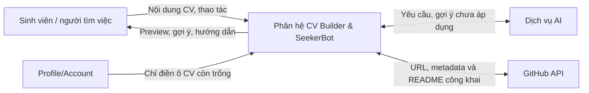

# 1. Mô tả kĩ bài toán

Sinh viên IT ứng tuyển Intern/Fresher thường khó chọn và trình bày kinh nghiệm học tập, dự án, thành tựu trong CV, nhất là khi cần điều chỉnh cách diễn đạt cho từng vị trí. **CV Builder & SeekerBot** hỗ trợ tạo, sửa, lưu CV theo mẫu và xem Live Preview. Thông tin cơ bản từ Profile của đúng tài khoản chỉ điền vào ô CV còn trống; dữ liệu đã lưu không bị ghi đè. Tutorial hướng dẫn thao tác và có thể mở lại hoặc bỏ qua.

SeekerBot hướng dẫn viết CV, gợi ý cải thiện theo STAR và điều chỉnh **nội dung đã có** theo JD; người dùng duyệt trước khi áp dụng. Ngân hàng thành tựu giúp dùng lại nội dung; GitHub Import lấy repository công khai làm bản nháp, cần xác nhận đóng góp cá nhân. CV có bản Việt/Anh và **Print Preview** theo trang in để rà soát, quay lại Editor. SCRUM-49 không dùng AI kiểm lỗi; việc in/xuất PDF (SCRUM-16) còn chờ xác nhận.

Phân hệ dự kiến chạy trên trình duyệt và dùng Frontend/Backend HireUS Tools; gợi ý AI được gọi qua phía máy chủ. Chấm điểm CV–JD và Skill Gap thuộc Epic Job Matching, ngoài phạm vi này.

> **Phạm vi:** SCRUM-10, 14, 15, 17, 18, 19, 49, 50, 52, 54, 55 (11 Story; subtask gộp vào Story chính). SCRUM-16 chưa được xác nhận trong phạm vi này.

# 2. Các bên liên quan (Stakeholder)

| Stakeholder | Vai trò |
| --- | --- |
| Sinh viên / người tìm việc | Tạo/sửa/lưu CV; duyệt gợi ý. |
| Nhóm phát triển | Phát triển, kiểm thử, bảo trì. |
| Giảng viên hướng dẫn / đánh giá | Đánh giá tài liệu và prototype. |
| Dịch vụ AI, GitHub API | Cung cấp gợi ý hoặc dữ liệu repository công khai. |
| Phân hệ Profile/Account | Cấp thông tin đúng tài khoản cho ô CV còn trống; không ghi đè CV. |

# 3. Đặc tả yêu cầu chức năng

## Quy ước mã

`FR-CV-xx`: yêu cầu chức năng; `BR-CV-xx`: quy tắc nghiệp vụ; `SCRUM-xx`: Story Jira. Subtask gộp vào Story chính.

## a. Tạo, chỉnh sửa, xem trước và lưu CV

| Mã | Yêu cầu chức năng | Story |
| --- | --- | --- |
| FR-CV-01 | Tạo CV theo các mục; tự điền ô cơ bản còn trống theo FR-CV-25. | SCRUM-10 |
| FR-CV-02 | Thêm/sửa từng mục và cập nhật Live Preview. | SCRUM-10 |
| FR-CV-03 | Kiểm tra trường bắt buộc, định dạng và báo lỗi tại trường. | SCRUM-10 |
| FR-CV-04 | Lưu CV và mở lại để tiếp tục sửa. | SCRUM-14 |
| FR-CV-05 | Chọn mẫu, xem Preview mà không mất nội dung CV. | SCRUM-15 |

## b. SeekerBot và cải thiện nội dung CV

| Mã | Yêu cầu chức năng | Story |
| --- | --- | --- |
| FR-CV-06 | Yêu cầu SeekerBot hướng dẫn viết một mục CV. | SCRUM-17 |
| FR-CV-07 | Chọn đoạn dự án/kinh nghiệm để gợi ý viết lại theo STAR. | SCRUM-18 |
| FR-CV-08 | Nhập JD để nhận gợi ý diễn đạt hoặc nhấn mạnh thông tin CV liên quan. | SCRUM-19 |
| FR-CV-09 | Đặt gợi ý cạnh bản gốc để người dùng duyệt, sửa hoặc bỏ qua trước khi áp dụng. | SCRUM-17/18/19 |
| FR-CV-10 | AI không phản hồi: báo lỗi và giữ nguyên CV. | SCRUM-17/18/19 |

## c. Tutorial hướng dẫn người mới sử dụng

| Mã | Yêu cầu chức năng | Story |
| --- | --- | --- |
| FR-CV-11 | Tutorial giới thiệu tạo/mở CV, chọn mẫu, sửa, xem trước và lưu. | SCRUM-50 |
| FR-CV-12 | Mở lại hoặc bỏ qua Tutorial để vào Editor; không nhập CV trong Tutorial. | SCRUM-50 |

## d. Ngân hàng thành tựu và nhập dự án GitHub

| Mã | Yêu cầu chức năng | Story |
| --- | --- | --- |
| FR-CV-13 | Tạo, xem, sửa, xóa thành tựu cá nhân đã lưu. | SCRUM-52 |
| FR-CV-14 | Chép thành tựu đã chọn vào CV để sửa riêng. | SCRUM-52 |
| FR-CV-15 | Nhập URL repository GitHub công khai và lấy dữ liệu truy cập được. | SCRUM-55 |
| FR-CV-16 | Xem dữ liệu GitHub, xác nhận đóng góp và sửa trước khi thêm vào CV. | SCRUM-55 |
| FR-CV-17 | Báo lỗi URL sai, repository riêng tư/không tồn tại hoặc không truy xuất được. | SCRUM-55 |

## e. Nội dung CV song ngữ Việt – Anh

| Mã | Yêu cầu chức năng | Story |
| --- | --- | --- |
| FR-CV-18 | Lưu và chuyển xem hai bản Việt/Anh của cùng CV. | SCRUM-54 |
| FR-CV-19 | Tạo bản nháp ngôn ngữ còn lại; chỉ thay nội dung sau khi người dùng duyệt. | SCRUM-54 |
| FR-CV-20 | Báo bản dịch cần kiểm tra lại khi nội dung nguồn thay đổi. | SCRUM-54 |
| FR-CV-21 | Giữ cấu trúc mục và cập nhật Preview theo ngôn ngữ chọn. | SCRUM-54 |

## f. Xem trước CV trước khi in

| Mã | Yêu cầu chức năng | Story |
| --- | --- | --- |
| FR-CV-22 | Mở **Print Preview** để xem CV theo trang in trước khi in/xuất ở chức năng liên quan. | SCRUM-49 |
| FR-CV-23 | Hiển thị nội dung, mẫu, ngôn ngữ và phân trang; cho quay lại Editor. | SCRUM-49 |
| FR-CV-24 | Print Preview dùng dữ liệu CV hiện có, không AI kiểm lỗi hoặc tự yêu cầu bổ sung. | SCRUM-49 |

## g. Tự điền thông tin cơ bản từ Profile/Account

| Mã | Yêu cầu chức năng | Story |
| --- | --- | --- |
| FR-CV-25 | Khi tạo CV, chỉ điền ô cơ bản còn trống từ Profile đúng tài khoản; người dùng kiểm tra và sửa được. | SCRUM-10 |
| FR-CV-26 | Khi mở CV đã lưu, giữ giá trị CV đã có; Profile chỉ điền ô cơ bản còn trống, không ghi đè. | SCRUM-14 |

## Các quy tắc nghiệp vụ áp dụng

### BR-CV-01 — Quyền sở hữu CV và thành tựu

Người dùng chỉ được xem, sửa, xóa CV và thành tựu thuộc quyền truy cập của mình.

### BR-CV-02 — AI chỉ đưa ra gợi ý

Gợi ý SeekerBot/STAR/JD chỉ áp dụng sau khi người dùng duyệt; không tự tạo dự án, vai trò, số liệu, chứng chỉ hoặc kinh nghiệm.

### BR-CV-03 — Phạm vi điều chỉnh theo JD

Điều chỉnh theo JD chỉ dùng **thông tin CV đã có** để cải thiện cách diễn đạt; không chấm điểm hoặc phân tích Skill Gap.

### BR-CV-04 — Dữ liệu CV dùng chung

Editor, Template, Live Preview và Print Preview dùng cùng dữ liệu CV. Đổi mẫu không xóa nội dung; lưu/mở lại giữ nội dung và mẫu. Tutorial không tạo CV riêng.

### BR-CV-05 — Tái sử dụng thành tựu

Thành tựu được chép vào CV tại thời điểm chọn; sửa mục trong thư viện sau đó không tự sửa CV đã có.

### BR-CV-06 — Nhập nội dung GitHub

Chỉ lấy dữ liệu repository công khai. Metadata/README không chứng minh đóng góp cá nhân; người dùng xem, sửa và xác nhận trước khi thêm vào CV.

### BR-CV-07 — Chuyển đổi ngôn ngữ

Hai bản Việt/Anh dùng cùng cấu trúc mục nhưng lưu nội dung riêng. Gợi ý dịch không ghi đè bản đã duyệt; bản dịch cần được rà soát khi bản nguồn đổi.

### BR-CV-08 — Phạm vi Print Preview

SCRUM-49 chỉ **xem trước bố cục trang in** theo nội dung và mẫu hiện tại; không có AI kiểm lỗi. In/xuất PDF thuộc quyết định riêng về SCRUM-16.

### BR-CV-09 — Dữ liệu Profile và CV

Chỉ lấy thông tin cơ bản từ **Profile của tài khoản đang đăng nhập** để điền ô CV tương ứng còn trống khi tạo/mở CV. Người dùng sửa được giá trị trên CV; thay đổi Profile không ghi đè CV đã lưu. Ánh xạ trường chờ đối chiếu schema Profile.

# 4. Đặc tả yêu cầu phi chức năng

| Mã | Nhóm | Yêu cầu phi chức năng |
| --- | --- | --- |
| NFR-CV-01 | Dễ sử dụng | Form chỉ rõ mục đang sửa; Preview dễ đọc; lỗi nêu cách sửa. |
| NFR-CV-02 | Bảo mật | Chỉ tài khoản có quyền truy cập CV/thành tựu; khóa AI/GitHub giữ ở máy chủ. |
| NFR-CV-03 | Tin cậy | AI/GitHub lỗi không làm mất CV; gợi ý chưa duyệt không tự áp dụng. |
| NFR-CV-04 | Nhất quán | Editor, mẫu, ngôn ngữ, Print Preview dùng cùng CV; Tutorial không lưu CV; Profile đúng tài khoản. |
| NFR-CV-05 | Khả năng đọc | Trang in không cắt hoặc chồng lấn nội dung quan trọng trong mẫu hỗ trợ. |
| NFR-CV-06 | Khả năng bảo trì | Lỗi AI/GitHub được xử lý riêng, không làm hỏng thao tác lưu/sửa CV. |

# 5. Đặc tả yêu cầu

## 5.1 Sơ đồ Use Case

Sơ đồ gồm U001–U009 cho 11 Story, không tách subtask. Người tìm việc là tác nhân chính; AI, GitHub API và Profile/Account hỗ trợ.

## 5.2 Đặc tả Use Case

### 5.2.1. Tạo, chỉnh sửa và xem trước CV

| Thành phần | Đặc tả |
| --- | --- |
| **Use Case ID** | U001 |
| **Tên Use Case** | Tạo, chỉnh sửa và xem trước CV |
| **Tóm tắt** | Nhập CV, tự điền ô trống từ Profile và xem Live Preview. |
| **Tác nhân** | Sinh viên/người tìm việc (tác nhân chính); phân hệ Profile/Account (hệ thống hỗ trợ cung cấp thông tin cơ bản để tự điền vào CV). |
| **Điều kiện tiên quyết** | Người dùng đã đăng nhập. |
| **Kết quả** | Dữ liệu phiên chỉnh sửa hiển thị trên Live Preview. |
| **Kịch bản chính** | 1. Tạo hoặc mở CV. 2. Điền ô cơ bản còn trống từ Profile đúng tài khoản; giữ dữ liệu CV đã lưu. 3. Người dùng kiểm tra và sửa các mục. 4. Live Preview cập nhật theo dữ liệu hợp lệ. |
| **Kịch bản phụ** | • Profile thiếu dữ liệu: người dùng nhập tay. • Dữ liệu sai: báo trường cần sửa. • Rời trang khi chưa lưu: cảnh báo mất thay đổi. |
| **Ràng buộc phi chức năng** | NFR-CV-01, 04, 05. |

### 5.2.2. Lưu và mở lại CV

| Thành phần | Đặc tả |
| --- | --- |
| **Use Case ID** | U002 |
| **Tên Use Case** | Lưu và mở lại CV |
| **Tóm tắt** | Lưu và mở lại CV để tiếp tục sửa. |
| **Tác nhân** | Sinh viên/người tìm việc. |
| **Điều kiện tiên quyết** | Người dùng đã đăng nhập và có CV cần lưu/mở. |
| **Kết quả** | CV và mẫu được lưu hoặc mở lại đúng tài khoản. |
| **Kịch bản chính** | 1. Chọn Lưu CV. 2. Hệ thống lưu nội dung và mẫu thuộc tài khoản. 3. Người dùng chọn CV đã lưu trên Dashboard. 4. Editor hiển thị dữ liệu và Preview tương ứng. |
| **Kịch bản phụ** | • Lưu lỗi: báo chưa lưu, cho thử lại. • Không có quyền: từ chối mở CV. |
| **Ràng buộc phi chức năng** | NFR-CV-02, 03. |

### 5.2.3. Chọn mẫu trình bày CV

| Thành phần | Đặc tả |
| --- | --- |
| **Use Case ID** | U003 |
| **Tên Use Case** | Chọn mẫu trình bày CV |
| **Tóm tắt** | Chọn mẫu trình bày mà giữ nguyên nội dung CV. |
| **Tác nhân** | Sinh viên/người tìm việc. |
| **Điều kiện tiên quyết** | Người dùng đang chỉnh sửa CV. |
| **Kết quả** | Preview áp dụng mẫu đã chọn. |
| **Kịch bản chính** | 1. Mở danh sách mẫu khả dụng. 2. Chọn mẫu. 3. Preview cập nhật; nội dung CV được giữ. |
| **Kịch bản phụ** | • Mẫu lỗi: giữ mẫu cũ và thông báo. |
| **Ràng buộc phi chức năng** | NFR-CV-01, 04. |

### 5.2.4. Nhận và duyệt gợi ý từ SeekerBot

| Thành phần | Đặc tả |
| --- | --- |
| **Use Case ID** | U004 |
| **Tên Use Case** | Nhận và duyệt gợi ý từ SeekerBot |
| **Tóm tắt** | Xem và duyệt gợi ý hướng dẫn, STAR hoặc điều chỉnh theo JD. |
| **Tác nhân** | Sinh viên/người tìm việc; dịch vụ AI bên ngoài (hỗ trợ). |
| **Điều kiện tiên quyết** | Có mục CV cần hỗ trợ; chế độ theo JD cần JD. |
| **Kết quả** | Chỉ gợi ý được duyệt mới cập nhật CV. |
| **Kịch bản chính** | 1. Chọn Hướng dẫn, STAR hoặc Theo JD. 2. Gửi ngữ cảnh cần thiết tới dịch vụ AI. 3. Xem nội dung gốc và gợi ý. 4. Chấp nhận, sửa hoặc bỏ qua. 5. Chỉ đoạn được duyệt mới cập nhật CV. |
| **Kịch bản phụ** | • Thiếu dữ liệu/JD: yêu cầu bổ sung. • AI lỗi: giữ CV, cho thử lại. • Gợi ý sai thực tế: sửa hoặc bỏ qua. |
| **Ràng buộc phi chức năng** | NFR-CV-02, 03, 06. |

### 5.2.5. Xem tutorial hướng dẫn sử dụng CV Builder

| Thành phần | Đặc tả |
| --- | --- |
| **Use Case ID** | U005 |
| **Tên Use Case** | Xem tutorial hướng dẫn sử dụng CV Builder |
| **Tóm tắt** | Giới thiệu thao tác CV Builder, không tạo CV riêng. |
| **Tác nhân** | Sinh viên/người tìm việc. |
| **Điều kiện tiên quyết** | Người dùng mở CV Builder. |
| **Kết quả** | Người dùng có thể vào Editor hoặc mở lại hướng dẫn sau. |
| **Kịch bản chính** | 1. Mở Tutorial từ lần đầu sử dụng hoặc Help. 2. Xem các bước tạo/mở CV, chọn mẫu, sửa, Live Preview và lưu. 3. Dùng Next/Back để xem tiếp/quay lại. 4. Kết thúc và vào Editor. |
| **Kịch bản phụ** | • Skip/Close: thoát mà không đổi CV; có thể mở lại từ Help. |
| **Ràng buộc phi chức năng** | NFR-CV-01, 04. |

### 5.2.6. Quản lý ngân hàng thành tựu cá nhân

| Thành phần | Đặc tả |
| --- | --- |
| **Use Case ID** | U006 |
| **Tên Use Case** | Quản lý ngân hàng thành tựu cá nhân |
| **Tóm tắt** | Quản lý và dùng lại thành tựu trong các CV. |
| **Tác nhân** | Sinh viên/người tìm việc. |
| **Điều kiện tiên quyết** | Người dùng đã đăng nhập. |
| **Kết quả** | Thành tựu được quản lý hoặc bản sao được chèn vào CV. |
| **Kịch bản chính** | 1. Mở thư viện. 2. Tạo, sửa hoặc xóa thành tựu. 3. Chọn mục cần dùng. 4. Chép mục đã chọn vào CV để sửa riêng. |
| **Kịch bản phụ** | • Thư viện trống: hướng dẫn tạo mục. • Không có quyền: từ chối thao tác. |
| **Ràng buộc phi chức năng** | NFR-CV-02, 04. |

### 5.2.7. Nhập dự án từ GitHub

| Thành phần | Đặc tả |
| --- | --- |
| **Use Case ID** | U007 |
| **Tên Use Case** | Nhập dự án từ GitHub |
| **Tóm tắt** | Tạo bản nháp dự án từ repository công khai. |
| **Tác nhân** | Sinh viên/người tìm việc; GitHub API (hỗ trợ). |
| **Điều kiện tiên quyết** | Người dùng đã đăng nhập và cung cấp URL repository công khai hợp lệ. |
| **Kết quả** | Dự án được thêm vào CV sau xác nhận. |
| **Kịch bản chính** | 1. Nhập URL repository công khai. 2. Lấy metadata/README khả dụng. 3. Xem bản nháp. 4. Xác nhận đóng góp và sửa mô tả. 5. Chọn thêm vào CV. |
| **Kịch bản phụ** | • URL sai/repository riêng tư/không tồn tại: báo lỗi. • Thiếu README: dùng metadata khả dụng. • API lỗi: thử lại hoặc nhập tay. |
| **Ràng buộc phi chức năng** | NFR-CV-02, 03, 06. |

### 5.2.8. Chuyển đổi nội dung CV Việt – Anh

| Thành phần | Đặc tả |
| --- | --- |
| **Use Case ID** | U008 |
| **Tên Use Case** | Chuyển đổi nội dung CV Việt – Anh |
| **Tóm tắt** | Quản lý bản Việt và Anh của cùng CV. |
| **Tác nhân** | Sinh viên/người tìm việc; dịch vụ AI bên ngoài (hỗ trợ). |
| **Điều kiện tiên quyết** | Người dùng đã có CV và chọn ngôn ngữ đích. |
| **Kết quả** | Preview hiển thị ngôn ngữ chọn; bản dịch chỉ lưu sau duyệt. |
| **Kịch bản chính** | 1. Chọn VI/EN. 2. Xem bản tương ứng hoặc bản nháp dịch. 3. Rà soát, sửa bản dịch. 4. Xác nhận lưu; Preview cập nhật. |
| **Kịch bản phụ** | • Dịch lỗi: giữ hai bản hiện có. • Bản nguồn đổi: đánh dấu bản dịch cần rà soát. |
| **Ràng buộc phi chức năng** | NFR-CV-03, 04, 05. |

### 5.2.9. Xem trước CV trước khi in

| Thành phần | Đặc tả |
| --- | --- |
| **Use Case ID** | U009 |
| **Tên Use Case** | Xem trước CV trước khi in |
| **Tóm tắt** | Xem CV theo bố cục trang in. |
| **Tác nhân** | Sinh viên/người tìm việc. |
| **Điều kiện tiên quyết** | Người dùng có CV đang mở trong Editor. |
| **Kết quả** | Print Preview theo mẫu/ngôn ngữ hiện tại; có thể quay lại sửa. |
| **Kịch bản chính** | 1. Chọn Xem trước khi in. 2. Hệ thống dựng trang in từ CV hiện có, gồm nội dung và phân trang. 3. Người dùng rà soát bố cục. 4. Quay lại Editor để sửa nếu cần. |
| **Kịch bản phụ** | • CV trống: hướng dẫn quay lại Editor. • Dựng trang lỗi: báo lỗi, cho thử lại; không đổi CV. |
| **Ràng buộc phi chức năng** | NFR-CV-01, 04, 05. |

# 6. Bản mẫu (Prototype)

Sáu frame Figma và các trạng thái phụ minh họa thao tác; **chưa chứng minh chức năng FE/BE đã triển khai**. Lưu, AI, GitHub Import và duyệt bản dịch trong prototype dùng dữ liệu mẫu.

**File thiết kế:** [HireUS — CV Builder & SeekerBot](https://www.figma.com/design/bMbUlGzrU298Icu0HoERU3/HireUS?node-id=55-184).

| Frame | Màn hình | Story liên quan |
| --- | --- | --- |
| F01 | CV Dashboard | SCRUM-14, SCRUM-50 |
| F02 | CV Editor + Live Preview; tự điền trường cơ bản còn trống từ Profile | SCRUM-10, SCRUM-14, SCRUM-15 |
| F03 | CV Editor + AI Panel | SCRUM-17, 18, 19 |
| F04 | Tutorial bốn bước (Next/Back/Skip/Help) | SCRUM-50 |
| F05 | Achievement Library + GitHub Import | SCRUM-52, 55 |
| F06 | Editor VI/EN + Print Preview (không có AI quality check) | SCRUM-49, 54 |

### Hình chụp các frame Figma

**F01 — Dashboard:** tạo/mở CV, Tutorial.

**F02 — Editor:** Profile mẫu, Live Preview, chọn mẫu.

**F03 — SeekerBot:** STAR, Hướng dẫn, Theo JD.

**F04 — Tutorial:** bốn bước với Next/Back/Skip.

**F05 — Thành tựu/GitHub:** chọn mục, duyệt nháp hoặc xem lỗi URL.

**F06 — Song ngữ/Print Preview:** trang in, bản Anh mẫu, duyệt dịch; không xuất PDF.

Các liên kết đã được kiểm tra trong cấu trúc Figma; cần thử thao tác trong **Present** trước khi khẳng định luồng chạy được. Ảnh là trạng thái minh họa, không chứng minh lưu dữ liệu, gọi AI/GitHub hoặc in thật.

---

*Cần nhóm chốt SCRUM-16, mẫu CV, Tutorial và ánh xạ Profile; thử Present. Bảng đánh giá thành viên thuộc báo cáo chung, chưa khai % đóng góp.*
