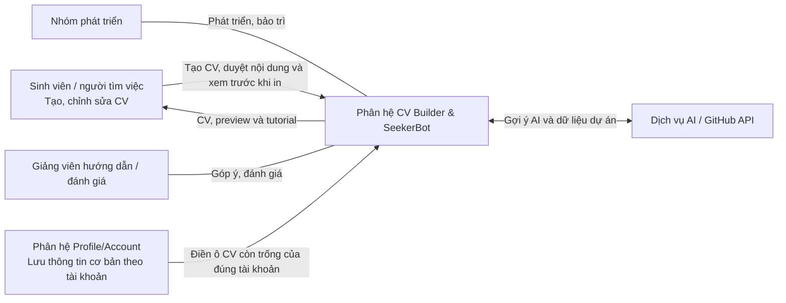
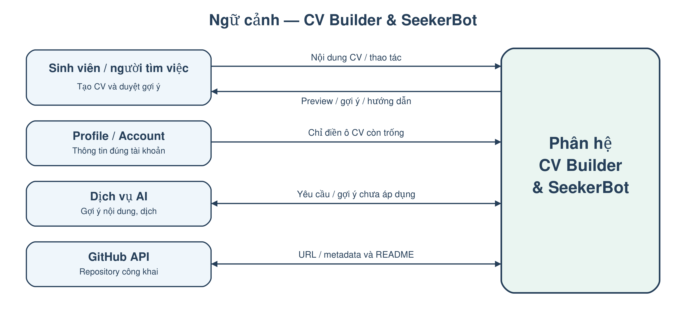
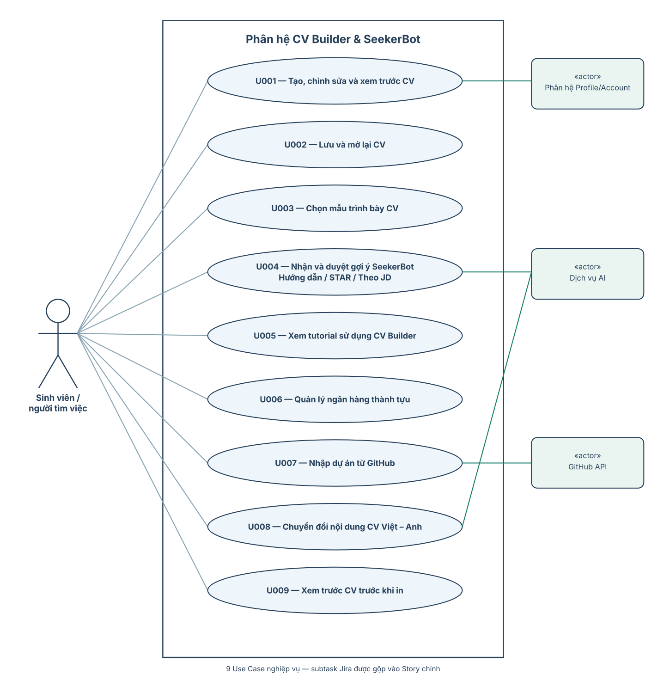
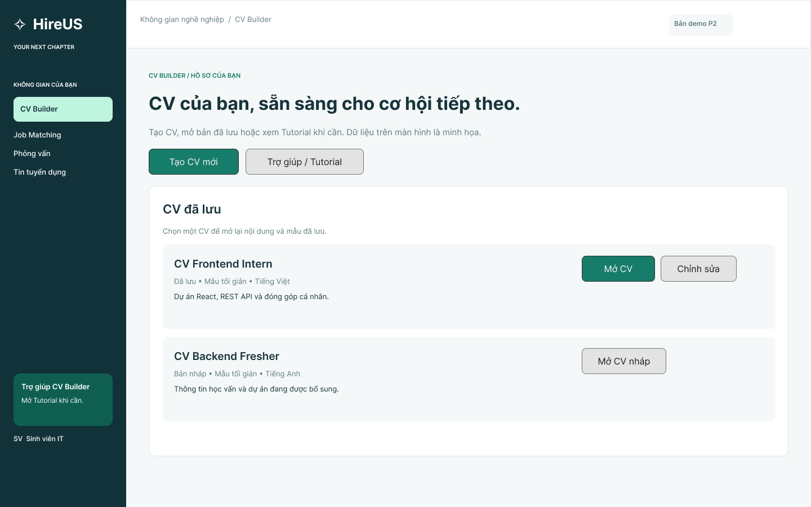
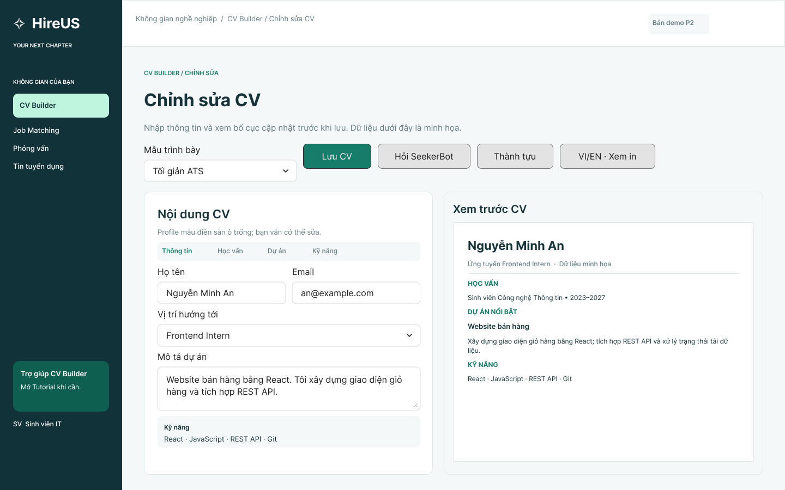
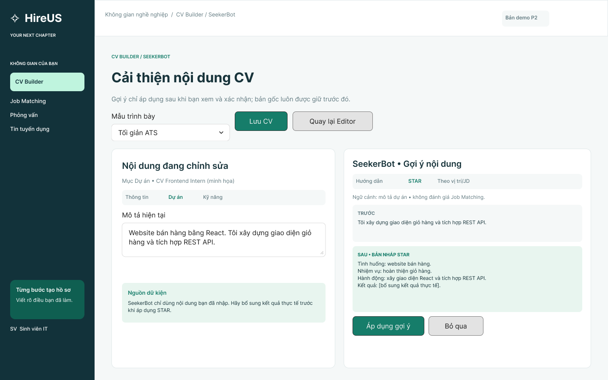
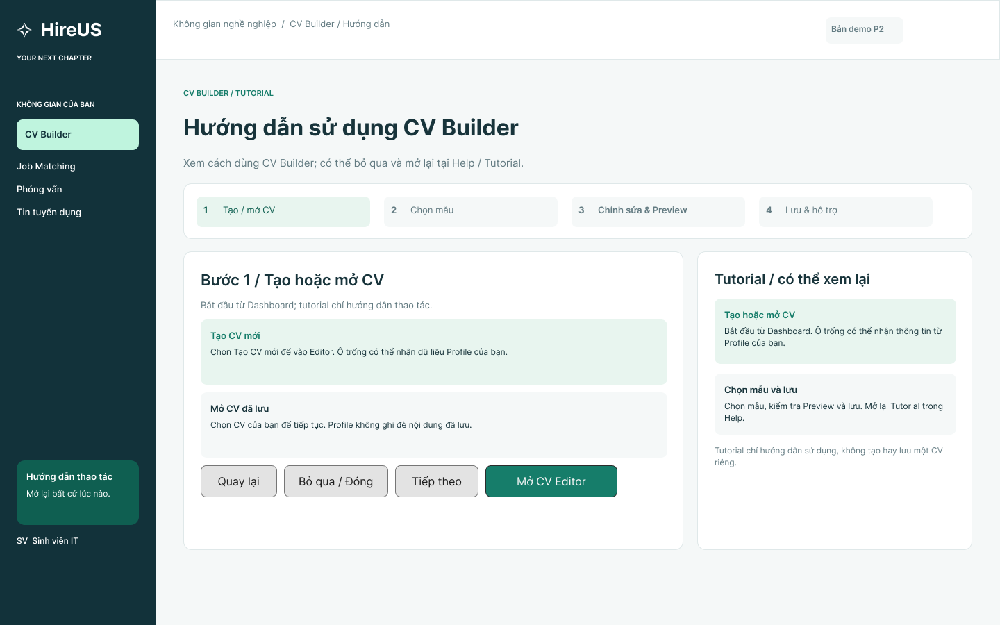
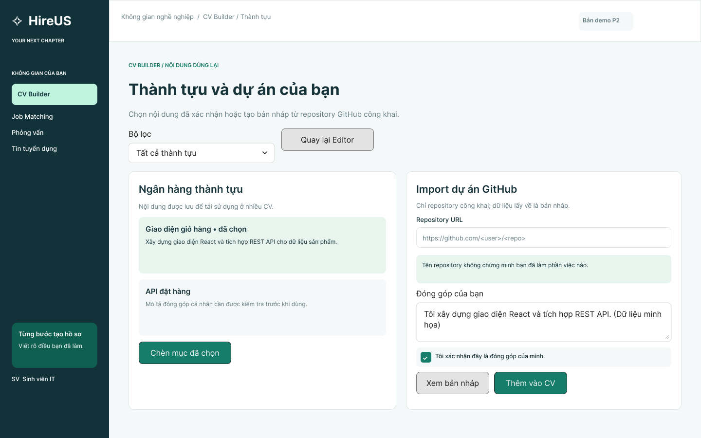
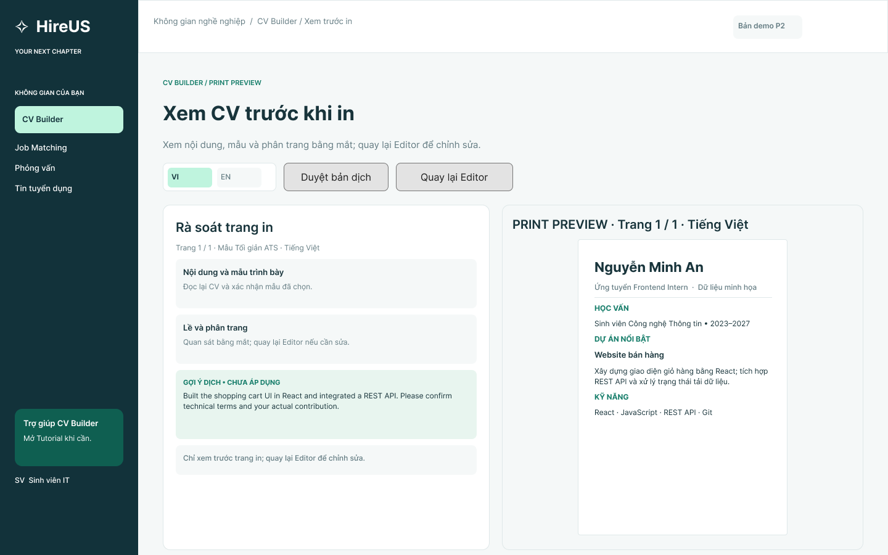

# 1. Mô tả kĩ bài toán

Sinh viên IT, đặc biệt là người chuẩn bị ứng tuyển thực tập hoặc vị trí Fresher, thường gặp khó khăn khi xây dựng CV: chưa biết chọn thông tin nào, mô tả dự án ra sao, trình bày thành tựu thế nào và điều chỉnh nội dung cho từng vị trí. Các công cụ tạo CV thông thường hỗ trợ điền biểu mẫu nhưng chưa chắc giúp người mới chuyển kinh nghiệm học tập, đồ án thành nội dung rõ ràng, trung thực và phù hợp.

Phân hệ **CV Builder & SeekerBot** của HireUS Tools hỗ trợ tạo, chỉnh sửa, xem trước và lưu CV theo mẫu. Khi tạo CV hoặc mở CV để tiếp tục chỉnh sửa, hệ thống lấy **thông tin cơ bản từ Profile của chính người dùng** để tự điền các trường tương ứng còn trống, giúp tránh nhập lại; thông tin đã lưu/chỉnh sửa trong CV không bị tự động ghi đè. Với người mới, hệ thống cung cấp **tutorial hướng dẫn sử dụng CV Builder** (có thể mở lại hoặc bỏ qua), không phải một quy trình nhập CV độc lập. SeekerBot hỗ trợ hướng dẫn viết nội dung, cải thiện mô tả theo STAR và gợi ý diễn đạt theo JD. Mọi nội dung AI đề xuất chỉ áp dụng sau khi người dùng xác nhận.

Để tái sử dụng nội dung, phân hệ quản lý ngân hàng thành tựu cá nhân và hỗ trợ nhập thông tin dự án từ **repository GitHub công khai**. Thông tin GitHub là dữ liệu tham khảo, không tự chứng minh người dùng đã trực tiếp phát triển toàn bộ dự án. Phân hệ cũng hỗ trợ nội dung CV tiếng Việt và tiếng Anh. **Trước khi in**, người dùng được mở chế độ xem trước bố cục CV theo trang in để rà soát và quay lại chỉnh sửa nếu cần. SCRUM-49 **không** sử dụng AI để dò lỗi hay yêu cầu bổ sung nội dung; chức năng xuất PDF/in thật (SCRUM-16) vẫn cần được nhóm xác nhận riêng.

Hệ thống dự kiến hoạt động trên trình duyệt web, với giao diện và xử lý nghiệp vụ qua Frontend/Backend của HireUS Tools. Các chức năng cần dịch hoặc gợi ý nội dung có thể sử dụng dịch vụ AI bên ngoài thông qua phía máy chủ. Phân hệ **không** thực hiện chấm điểm phù hợp CV–JD, phân tích Skill Gap hoặc quyết định khả năng tuyển dụng; các nghiệp vụ đó thuộc Epic Job Matching & Skill Gap.

> **Phạm vi:** 11 Story đã giao: `SCRUM-10`, `14`, `15`, `17`, `18`, `19`, `49`, `50`, `52`, `54`, `55`. Việc xuất PDF (`SCRUM-16`) là điểm cần xác nhận với nhóm/Jira, không mặc định đã thuộc phạm vi.

# 2. Các bên liên quan (Stakeholder)

| Stakeholder | Vai trò |
| --- | --- |
| Sinh viên / người tìm việc | Người dùng chính; nhập, chỉnh sửa, lưu CV và xác nhận gợi ý. |
| Nhóm phát triển | Phân tích, triển khai, kiểm thử và bảo trì phân hệ. |
| Giảng viên hướng dẫn / đánh giá | Đánh giá tài liệu, nghiệp vụ và prototype của đồ án. |
| Dịch vụ AI, GitHub API | Hệ thống ngoài cung cấp hỗ trợ gợi ý hoặc dữ liệu dự án, không phải người dùng cuối. |
| Phân hệ Profile/Account | Cung cấp thông tin cơ bản của đúng tài khoản để điền ô CV còn trống khi tạo hoặc mở lại; không ghi đè giá trị CV đã có. |

# 3. Đặc tả yêu cầu chức năng

## Quy ước mã

- **FR** (*Functional Requirement*): yêu cầu chức năng; ví dụ `FR-CV-01`.
- **CV**: phân hệ CV Builder & SeekerBot.
- **BR** (*Business Rule*): quy tắc nghiệp vụ; ví dụ `BR-CV-01`.
- **SCRUM-xx**: mã Story trong Jira; các subtask được gộp vào nghiệp vụ của Story chính.

## a. Tạo, chỉnh sửa, xem trước và lưu CV

| Mã | Yêu cầu chức năng | Story |
| --- | --- | --- |
| FR-CV-01 | Hệ thống cho phép tạo CV theo các mục thông tin; những trường cơ bản có dữ liệu tương ứng trong Profile được tự điền để người dùng kiểm tra/chỉnh sửa. | SCRUM-10 |
| FR-CV-02 | Hệ thống cho phép thêm/sửa nội dung từng mục và phản ánh thay đổi trên Live Preview. | SCRUM-10 |
| FR-CV-03 | Hệ thống kiểm tra trường bắt buộc, định dạng dữ liệu cơ bản và báo lỗi tại vị trí cần sửa. | SCRUM-10 |
| FR-CV-04 | Hệ thống cho phép lưu CV của người dùng và mở lại để tiếp tục chỉnh sửa. | SCRUM-14 |
| FR-CV-05 | Hệ thống cho phép chọn mẫu trình bày và xem trước mẫu mà không làm mất nội dung CV. | SCRUM-15 |

## b. SeekerBot và cải thiện nội dung CV

| Mã | Yêu cầu chức năng | Story |
| --- | --- | --- |
| FR-CV-06 | Hệ thống cho phép người dùng yêu cầu SeekerBot hướng dẫn viết nội dung trong CV. | SCRUM-17 |
| FR-CV-07 | Hệ thống cho phép chọn mô tả dự án/kinh nghiệm và yêu cầu đề xuất cải thiện theo cấu trúc STAR. | SCRUM-18 |
| FR-CV-08 | Hệ thống cho phép cung cấp JD để nhận gợi ý điều chỉnh cách diễn đạt hoặc nhấn mạnh thông tin CV liên quan. | SCRUM-19 |
| FR-CV-09 | Hệ thống hiển thị gợi ý và nội dung gốc để người dùng xem, chấp nhận hoặc bỏ qua trước khi sửa CV. | SCRUM-17/18/19 |
| FR-CV-10 | Khi dịch vụ AI không phản hồi, hệ thống thông báo và giữ nguyên nội dung CV hiện có. | SCRUM-17/18/19 |

## c. Tutorial hướng dẫn người mới sử dụng

| Mã | Yêu cầu chức năng | Story |
| --- | --- | --- |
| FR-CV-11 | Hệ thống cung cấp tutorial giới thiệu cách sử dụng CV Builder cho người mới: tạo CV, chọn mẫu, chỉnh sửa, xem trước và lưu CV. | SCRUM-50 |
| FR-CV-12 | Hệ thống cho phép người dùng mở lại hoặc bỏ qua tutorial và chuyển đến CV Editor mà không cần nhập dữ liệu trong tutorial. | SCRUM-50 |

## d. Ngân hàng thành tựu và nhập dự án GitHub

| Mã | Yêu cầu chức năng | Story |
| --- | --- | --- |
| FR-CV-13 | Hệ thống cho phép người dùng tạo, xem, sửa và xóa các thành tựu cá nhân đã lưu. | SCRUM-52 |
| FR-CV-14 | Hệ thống cho phép đưa bản sao một thành tựu đã chọn vào CV để người dùng chỉnh sửa riêng. | SCRUM-52 |
| FR-CV-15 | Hệ thống cho phép nhập đường dẫn repository GitHub công khai và lấy thông tin dự án có thể truy cập. | SCRUM-55 |
| FR-CV-16 | Hệ thống hiển thị thông tin lấy từ GitHub để người dùng xác nhận vai trò/đóng góp và sửa nội dung trước khi thêm vào CV. | SCRUM-55 |
| FR-CV-17 | Hệ thống xử lý URL không hợp lệ, repository riêng tư/không tồn tại hoặc lỗi truy xuất bằng thông báo phù hợp. | SCRUM-55 |

## e. Nội dung CV song ngữ Việt – Anh

| Mã | Yêu cầu chức năng | Story |
| --- | --- | --- |
| FR-CV-18 | Hệ thống hỗ trợ lưu và chuyển xem nội dung tiếng Việt, tiếng Anh của cùng một CV. | SCRUM-54 |
| FR-CV-19 | Hệ thống cho phép tạo bản nháp nội dung ngôn ngữ còn lại và yêu cầu người dùng duyệt trước khi thay thế nội dung tương ứng. | SCRUM-54 |
| FR-CV-20 | Khi nội dung nguồn thay đổi, hệ thống phải giúp nhận biết bản dịch có thể đã cũ để người dùng kiểm tra lại. | SCRUM-54 |
| FR-CV-21 | Hệ thống giữ cấu trúc mục CV và cập nhật bản xem trước theo ngôn ngữ được chọn. | SCRUM-54 |

## f. Xem trước CV trước khi in

| Mã | Yêu cầu chức năng | Story |
| --- | --- | --- |
| FR-CV-22 | Hệ thống cho phép mở chế độ **Print Preview** để xem toàn bộ CV dưới bố cục trang in trước khi thực hiện thao tác in/xuất ở chức năng liên quan. | SCRUM-49 |
| FR-CV-23 | Hệ thống thể hiện bố cục, số trang/ngắt trang và nội dung thực tế theo template và ngôn ngữ đang chọn; cho phép người dùng quay lại Editor. | SCRUM-49 |
| FR-CV-24 | Print Preview dùng lại dữ liệu và bộ dựng CV/Preview, không kiểm tra nội dung bằng AI hoặc tự yêu cầu bổ sung thông tin. | SCRUM-49 |

## g. Tự điền thông tin cơ bản từ Profile/Account

| Mã | Yêu cầu chức năng | Story |
| --- | --- | --- |
| FR-CV-25 | Khi người dùng bắt đầu tạo CV, hệ thống chỉ lấy các trường cơ bản tương ứng từ Profile thuộc tài khoản đã đăng nhập (ví dụ: họ tên, email, số điện thoại), tự điền vào biểu mẫu để người dùng kiểm tra và sửa. | SCRUM-10 |
| FR-CV-26 | Khi người dùng mở CV đã lưu để chỉnh sửa, hệ thống giữ giá trị đã lưu/chỉnh sửa trong CV và tự điền các trường thông tin cơ bản còn trống từ Profile; không âm thầm ghi đè giá trị đã có trong CV. | SCRUM-14 |

## Các quy tắc nghiệp vụ áp dụng

### BR-CV-01 — Quyền sở hữu CV và thành tựu

Người dùng chỉ được xem, chỉnh sửa hoặc xóa CV và thành tựu thuộc quyền truy cập của mình; dữ liệu khác không tự động hiển thị.

### BR-CV-02 — AI chỉ đưa ra gợi ý

Gợi ý SeekerBot/STAR/JD phải được người dùng xem và chủ động áp dụng. Hệ thống không tự bịa dự án, vai trò, số liệu, chứng chỉ hoặc kinh nghiệm làm việc.

### BR-CV-03 — Phạm vi điều chỉnh theo JD

Điều chỉnh CV theo JD nhằm cải thiện **cách trình bày thông tin đã có**, không tính điểm phù hợp, không xác định Skill Gap và không thay thế phân hệ Job Matching.

### BR-CV-04 — Dữ liệu CV dùng chung

Editor, Template, Preview và chế độ xem trước khi in sử dụng cùng dữ liệu CV. Tutorial chỉ hướng dẫn sử dụng, không tạo hoặc lưu một CV riêng. Đổi template không được xóa nội dung; lưu và mở lại phải giữ nội dung đã lưu.

### BR-CV-05 — Tái sử dụng thành tựu

Khi đưa thành tựu vào CV, hệ thống sử dụng một bản sao nội dung tại thời điểm chọn. Việc sửa thành tựu trong thư viện về sau không tự sửa các CV đã có.

### BR-CV-06 — Nhập nội dung GitHub

Chỉ dùng dữ liệu repository công khai theo phạm vi truy cập được cấp. Metadata/README không tự chứng minh đóng góp cá nhân; người dùng phải xem và xác nhận trước khi đưa nội dung vào CV.

### BR-CV-07 — Chuyển đổi ngôn ngữ

Nội dung tiếng Việt và tiếng Anh được quản lý tách biệt theo cùng cấu trúc mục. Gợi ý dịch không tự ghi đè nội dung đã được người dùng duyệt; bản dịch cần được kiểm tra lại khi nội dung gốc thay đổi.

### BR-CV-08 — Phạm vi Print Preview

SCRUM-49 chỉ cho phép **xem trước CV theo bố cục trang in**, dùng chung nội dung và template của CV Editor. Không có cơ chế AI tự tìm lỗi hoặc yêu cầu người dùng bổ sung nội dung. Việc in thực tế/xuất PDF được xác nhận riêng với SCRUM-16.

### BR-CV-09 — Dữ liệu Profile và CV

Thông tin cơ bản được lấy từ **Profile thuộc tài khoản đang đăng nhập** khi tạo hoặc tiếp tục chỉnh sửa CV và chỉ tự điền vào trường tương ứng còn trống. Người dùng có thể chỉnh sửa riêng trên CV. Hệ thống không ghi đè những giá trị đã chỉnh sửa/lưu trong CV bằng thay đổi Profile mà không có xác nhận. Danh sách trường và ánh xạ cụ thể cần đối chiếu với schema Profile trước khi triển khai.

# 4. Đặc tả yêu cầu phi chức năng

| Mã | Nhóm | Yêu cầu phi chức năng |
| --- | --- | --- |
| NFR-CV-01 | Dễ sử dụng | Người dùng có thể xác định mục đang chỉnh sửa và thấy bản xem trước rõ ràng; thông báo lỗi có hướng dẫn khắc phục. |
| NFR-CV-02 | Bảo mật | CV và thành tựu được kiểm soát truy cập theo tài khoản; khóa dịch vụ AI/GitHub không được công khai ở Frontend. |
| NFR-CV-03 | Tin cậy | Nếu AI hoặc GitHub API lỗi, CV đã lưu vẫn giữ nguyên; không tự áp dụng nội dung chưa được người dùng duyệt. |
| NFR-CV-04 | Nhất quán | Editor, Template, chuyển ngôn ngữ và Print Preview dùng cùng dữ liệu CV; Tutorial không lưu CV; Profile phải thuộc đúng tài khoản. |
| NFR-CV-05 | Khả năng đọc | Print Preview phải hiển thị bố cục rõ ràng theo trang in, không cắt hoặc làm chồng lấn nội dung quan trọng trong phạm vi template hỗ trợ. |
| NFR-CV-06 | Khả năng bảo trì | Chức năng gợi ý AI và nhập GitHub được tách khỏi nghiệp vụ lưu/chỉnh sửa CV để xử lý lỗi độc lập. |

# 5. Đặc tả yêu cầu

## 5.1 Sơ đồ Use Case

Sơ đồ mô tả chín Use Case nghiệp vụ chính, bao phủ 11 Story. **Sinh viên/người tìm việc** là tác nhân chính; **dịch vụ AI**, **GitHub API** và **phân hệ Profile/Account** là các hệ thống hỗ trợ. Không có Use Case riêng cho subtask hoặc các thao tác giao diện thuần túy.

## 5.2 Đặc tả Use Case

### 5.2.1. Tạo, chỉnh sửa và xem trước CV

| Thành phần | Đặc tả |
| --- | --- |
| **Use Case ID** | U001 |
| **Tên Use Case** | Tạo, chỉnh sửa và xem trước CV |
| **Tóm tắt** | Tạo/chỉnh sửa CV, tự điền thông tin cơ bản từ Profile và xem trước nội dung trong Editor. |
| **Tác nhân** | Sinh viên/người tìm việc (tác nhân chính); phân hệ Profile/Account (hệ thống hỗ trợ cung cấp thông tin cơ bản để tự điền vào CV). |
| **Điều kiện tiên quyết** | Người dùng đã đăng nhập. |
| **Kết quả** | Nội dung CV được cập nhật trong phiên chỉnh sửa và hiển thị ở Preview. |
| **Kịch bản chính** | 1. Người dùng tạo CV hoặc mở CV có sẵn. 2. Hệ thống lấy thông tin cơ bản từ Profile để điền các trường tương ứng còn trống; dữ liệu CV đã lưu được ưu tiên giữ nguyên. 3. Người dùng kiểm tra, nhập hoặc chỉnh sửa các mục CV. 4. Hệ thống cập nhật Live Preview theo dữ liệu đang chỉnh sửa. |
| **Kịch bản phụ** | • Profile chưa có thông tin: để trống các trường tương ứng để người dùng nhập. • Thiếu/sai định dạng: báo trường cần sửa. • Người dùng rời trang khi chưa lưu: cảnh báo mất thay đổi nếu phù hợp. |
| **Ràng buộc phi chức năng** | NFR-CV-01, 04, 05. |

### 5.2.2. Lưu và mở lại CV

| Thành phần | Đặc tả |
| --- | --- |
| **Use Case ID** | U002 |
| **Tên Use Case** | Lưu và mở lại CV |
| **Tóm tắt** | Lưu nội dung và tiếp tục chỉnh sửa ở lần truy cập sau. |
| **Tác nhân** | Sinh viên/người tìm việc. |
| **Điều kiện tiên quyết** | Người dùng đã đăng nhập và có CV cần lưu/mở. |
| **Kết quả** | CV được lưu vào tài khoản hoặc được tải để chỉnh sửa. |
| **Kịch bản chính** | 1. Người dùng chọn lưu CV. 2. Hệ thống ghi nội dung thuộc tài khoản. 3. Người dùng mở danh sách CV và chọn bản đã lưu. 4. Hệ thống hiển thị nội dung và Preview tương ứng. |
| **Kịch bản phụ** | • Lưu thất bại: báo lỗi và cho thử lại, không báo thành công giả. • CV không thuộc quyền truy cập: từ chối mở. |
| **Ràng buộc phi chức năng** | NFR-CV-02, 03. |

### 5.2.3. Chọn mẫu trình bày CV

| Thành phần | Đặc tả |
| --- | --- |
| **Use Case ID** | U003 |
| **Tên Use Case** | Chọn mẫu trình bày CV |
| **Tóm tắt** | Chuyển cách trình bày mà giữ nguyên nội dung. |
| **Tác nhân** | Sinh viên/người tìm việc. |
| **Điều kiện tiên quyết** | Người dùng đang chỉnh sửa CV. |
| **Kết quả** | Preview áp dụng mẫu đã chọn. |
| **Kịch bản chính** | 1. Người dùng mở danh sách template. 2. Hệ thống hiển thị mẫu khả dụng. 3. Người dùng chọn một mẫu. 4. Hệ thống cập nhật Preview tương ứng. |
| **Kịch bản phụ** | • Mẫu không khả dụng: giữ mẫu hiện tại và thông báo. |
| **Ràng buộc phi chức năng** | NFR-CV-01, 04. |

### 5.2.4. Nhận và duyệt gợi ý từ SeekerBot

| Thành phần | Đặc tả |
| --- | --- |
| **Use Case ID** | U004 |
| **Tên Use Case** | Nhận và duyệt gợi ý từ SeekerBot |
| **Tóm tắt** | Hướng dẫn viết, cải thiện theo STAR hoặc đề xuất diễn đạt theo JD. |
| **Tác nhân** | Sinh viên/người tìm việc; dịch vụ AI bên ngoài (hỗ trợ). |
| **Điều kiện tiên quyết** | Người dùng có nội dung CV hoặc thông tin cần được hướng dẫn; với gợi ý theo JD thì đã cung cấp JD. |
| **Kết quả** | Người dùng xem và tùy chọn áp dụng gợi ý. |
| **Kịch bản chính** | 1. Người dùng chọn chế độ hướng dẫn/STAR/điều chỉnh theo JD. 2. Hệ thống gửi ngữ cảnh cần thiết tới dịch vụ AI. 3. Hệ thống hiển thị nội dung gốc và gợi ý. 4. Người dùng chấp nhận hoặc bỏ qua. 5. Khi được chấp nhận, nội dung liên quan trong CV được cập nhật. |
| **Kịch bản phụ** | • Thiếu dữ liệu hoặc JD: yêu cầu bổ sung. • AI lỗi: giữ nguyên CV và cho thử lại. • Gợi ý không đúng sự thật: người dùng bỏ qua/sửa trước khi áp dụng. |
| **Ràng buộc phi chức năng** | NFR-CV-02, 03, 06. |

### 5.2.5. Xem tutorial hướng dẫn sử dụng CV Builder

| Thành phần | Đặc tả |
| --- | --- |
| **Use Case ID** | U005 |
| **Tên Use Case** | Xem tutorial hướng dẫn sử dụng CV Builder |
| **Tóm tắt** | Hướng dẫn người mới hiểu các bước sử dụng công cụ, không tạo luồng nhập CV riêng. |
| **Tác nhân** | Sinh viên/người tìm việc. |
| **Điều kiện tiên quyết** | Người dùng mở CV Builder. |
| **Kết quả** | Người dùng hiểu cách thao tác và có thể vào Editor tạo/sửa CV. |
| **Kịch bản chính** | 1. Người dùng lần đầu vào CV Builder hoặc chọn mục Trợ giúp/Tutorial. 2. Hệ thống hiển thị các bước minh họa: tạo CV, chọn template, nhập/chỉnh sửa, xem trước và lưu. 3. Người dùng xem tiếp hoặc kết thúc hướng dẫn. 4. Hệ thống đưa người dùng về Dashboard/Editor. |
| **Kịch bản phụ** | • Người dùng chọn Skip/Đóng: thoát tutorial mà không làm mất dữ liệu CV. • Muốn xem lại: có thể mở tutorial từ mục trợ giúp. |
| **Ràng buộc phi chức năng** | NFR-CV-01, 04. |

### 5.2.6. Quản lý ngân hàng thành tựu cá nhân

| Thành phần | Đặc tả |
| --- | --- |
| **Use Case ID** | U006 |
| **Tên Use Case** | Quản lý ngân hàng thành tựu cá nhân |
| **Tóm tắt** | Lưu và dùng lại thông tin thành tựu trong các CV. |
| **Tác nhân** | Sinh viên/người tìm việc. |
| **Điều kiện tiên quyết** | Người dùng đã đăng nhập. |
| **Kết quả** | Thành tựu được quản lý hoặc bản sao được đưa vào CV. |
| **Kịch bản chính** | 1. Người dùng mở thư viện thành tựu. 2. Người dùng tạo/sửa/xóa thành tựu. 3. Người dùng chọn thành tựu muốn sử dụng. 4. Hệ thống chép nội dung đã chọn vào CV để tiếp tục chỉnh sửa. |
| **Kịch bản phụ** | • Thư viện trống: hiển thị hướng dẫn tạo mới. • Không có quyền: từ chối thao tác. |
| **Ràng buộc phi chức năng** | NFR-CV-02, 04. |

### 5.2.7. Nhập dự án từ GitHub

| Thành phần | Đặc tả |
| --- | --- |
| **Use Case ID** | U007 |
| **Tên Use Case** | Nhập dự án từ GitHub |
| **Tóm tắt** | Dùng dữ liệu repository công khai làm bản nháp mô tả dự án CV. |
| **Tác nhân** | Sinh viên/người tìm việc; GitHub API (hỗ trợ). |
| **Điều kiện tiên quyết** | Người dùng đã đăng nhập và cung cấp URL repository công khai hợp lệ. |
| **Kết quả** | Thông tin đã được duyệt được đưa vào mục dự án của CV. |
| **Kịch bản chính** | 1. Người dùng nhập URL repository. 2. Hệ thống lấy metadata và README khả dụng. 3. Hệ thống hiển thị bản nháp để kiểm tra. 4. Người dùng xác nhận vai trò, đóng góp và sửa mô tả. 5. Người dùng chọn đưa nội dung vào CV. |
| **Kịch bản phụ** | • URL sai/repository riêng tư/không tồn tại: báo lỗi. • Không có README: vẫn hiển thị metadata khả dụng. • API lỗi hoặc giới hạn truy cập: cho thử lại/nhập tay. |
| **Ràng buộc phi chức năng** | NFR-CV-02, 03, 06. |

### 5.2.8. Chuyển đổi nội dung CV Việt – Anh

| Thành phần | Đặc tả |
| --- | --- |
| **Use Case ID** | U008 |
| **Tên Use Case** | Chuyển đổi nội dung CV Việt – Anh |
| **Tóm tắt** | Duy trì hai phiên bản ngôn ngữ của cùng CV. |
| **Tác nhân** | Sinh viên/người tìm việc; dịch vụ AI bên ngoài (hỗ trợ). |
| **Điều kiện tiên quyết** | Người dùng đã có CV và chọn ngôn ngữ đích. |
| **Kết quả** | Nội dung ngôn ngữ đích được xem hoặc được người dùng duyệt/cập nhật. |
| **Kịch bản chính** | 1. Người dùng chọn VI/EN. 2. Hệ thống hiển thị bản tương ứng hoặc đề xuất tạo bản nháp dịch. 3. Người dùng xem và chỉnh bản dịch. 4. Người dùng xác nhận lưu; Preview hiển thị theo ngôn ngữ đã chọn. |
| **Kịch bản phụ** | • Dịch thất bại: giữ phiên bản hiện có. • Bản nguồn thay đổi: đánh dấu nội dung dịch cần xem lại. |
| **Ràng buộc phi chức năng** | NFR-CV-03, 04, 05. |

### 5.2.9. Xem trước CV trước khi in

| Thành phần | Đặc tả |
| --- | --- |
| **Use Case ID** | U009 |
| **Tên Use Case** | Xem trước CV trước khi in |
| **Tóm tắt** | Hiển thị CV theo bố cục trang in để người dùng rà soát lần cuối. |
| **Tác nhân** | Sinh viên/người tìm việc. |
| **Điều kiện tiên quyết** | Người dùng có CV đang mở trong Editor. |
| **Kết quả** | Print Preview hiển thị theo template/ngôn ngữ hiện tại; người dùng có thể quay lại sửa nội dung. |
| **Kịch bản chính** | 1. Người dùng chọn Xem trước khi in. 2. Hệ thống dùng dữ liệu CV hiện có để dựng bố cục trang in, hiển thị phân trang và nội dung CV. 3. Người dùng xem lại tổng thể bố cục. 4. Người dùng quay về Editor hoặc tiếp tục tác vụ in/xuất nếu chức năng đó đã được xác nhận riêng. |
| **Kịch bản phụ** | • CV chưa có nội dung: hiển thị trang trống hoặc hướng dẫn quay lại Editor. • Dựng preview lỗi: thông báo và cho thử lại, không thay đổi dữ liệu CV. |
| **Ràng buộc phi chức năng** | NFR-CV-01, 04, 05. |

# 6. Bản mẫu (Prototype)

Prototype Figma được xây dựng ở mức **low/mid-fidelity**, thể hiện luồng tương tác chứ chưa phải chức năng ứng dụng đã triển khai. Các nút Apply/Add/Save trong prototype có thể chỉ mô phỏng điều hướng.

**File thiết kế:** [HireUS — CV Builder & SeekerBot](https://www.figma.com/design/bMbUlGzrU298Icu0HoERU3/HireUS?node-id=55-184).

| Frame | Màn hình | Story liên quan |
| --- | --- | --- |
| F01 | CV Dashboard | SCRUM-14, SCRUM-50 |
| F02 | CV Editor + Live Preview; tự điền trường cơ bản còn trống từ Profile | SCRUM-10, SCRUM-14, SCRUM-15 |
| F03 | CV Editor + AI Panel | SCRUM-17, 18, 19 |
| F04 | Tutorial hướng dẫn sử dụng CV Builder (Next/Skip/Help) | SCRUM-50 |
| F05 | Achievement Library + GitHub Import | SCRUM-52, 55 |
| F06 | Editor VI/EN + Print Preview (không có AI quality check) | SCRUM-49, 54 |

### Hình chụp các frame Figma

**F01 — CV Dashboard:** tạo/mở CV và mở lại Tutorial.

**F02 — CV Editor + Live Preview:** ví dụ các trường cơ bản còn trống được điền từ Profile; người dùng có thể sửa.

**F03 — CV Editor + AI Panel:** mô phỏng việc xem và duyệt gợi ý SeekerBot.

**F04 — Tutorial:** hướng dẫn thao tác CV Builder; các nút Back/Next hiện mới là mô phỏng hình ảnh.

**F05 — Achievement Library + GitHub Import:** mô phỏng chọn thành tựu và rà soát dữ liệu repository.

**F06 — CV Việt–Anh + Print Preview:** xem bố cục trang in theo ngôn ngữ đang chọn; chưa thể hiện thao tác in/xuất PDF.

**Luồng mẫu cần thử trên Figma:** F01 → F02 (đã có thông tin cơ bản từ Profile nếu có) → F03 → F02; F01 → F04 (tutorial, có Skip) → F02; F02 → F05 → F02; F02 → F06 (Print Preview/VI–EN) → F02. Các nút mô phỏng điều hướng, không chứng minh dữ liệu được lưu hoặc in thực tế.

---

*Ghi chú rà soát trước nộp: (1) xác nhận phạm vi SCRUM-16; (2) thử các liên kết trong Figma Present, nhất là Tutorial và Print Preview, rồi thống nhất nội dung các bước; (3) đối chiếu ánh xạ trường với schema Profile; (4) nếu tài liệu được ghép vào báo cáo toàn nhóm, đưa bảng đánh giá thành viên theo template vào phần đầu của báo cáo chung, không tự khai % đóng góp.*
