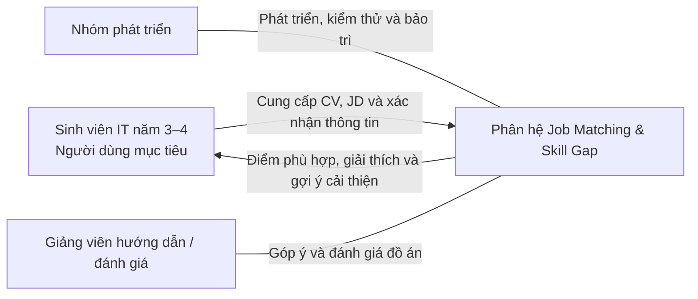
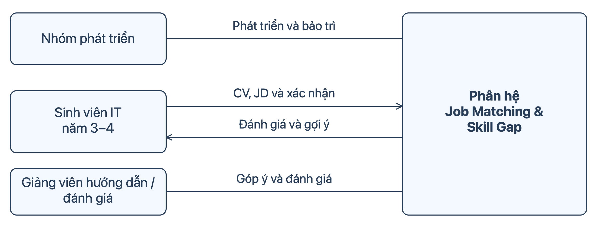
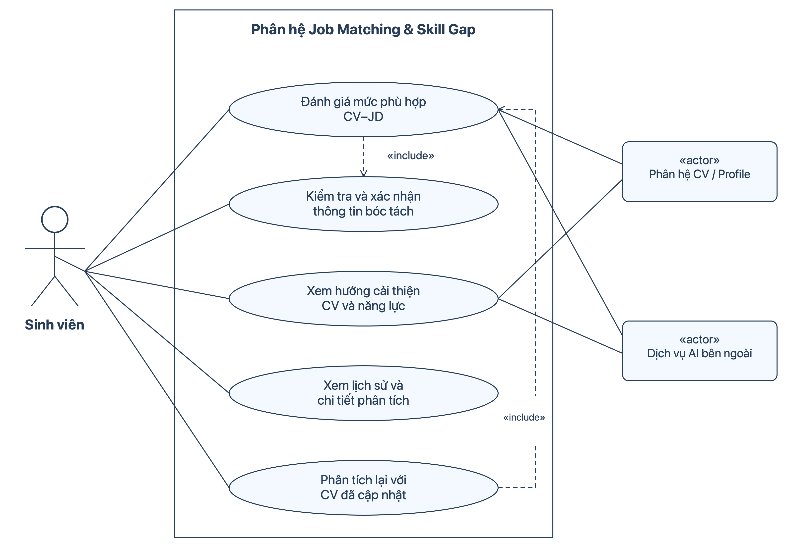

# 1. Mô tả kĩ bài toán

Sinh viên công nghệ thông tin năm 3–4 khi tìm kiếm vị trí thực tập hoặc Fresher thường đã có CV và lựa chọn được tin tuyển dụng phù hợp với định hướng chuyên môn. Tuy nhiên, việc tự đối chiếu CV với mô tả công việc còn gặp khó khăn do yêu cầu tuyển dụng được diễn đạt theo nhiều cách, bao gồm kỹ năng chuyên môn, kỹ năng mềm, kinh nghiệm, dự án, ngoại ngữ và học vấn. Sinh viên khó xác định CV hiện tại đã thể hiện mức độ đáp ứng như thế nào, còn thiếu bằng chứng cho yêu cầu nào và cần ưu tiên cải thiện điều gì.

Phân hệ Job Matching & Skill Gap hỗ trợ người dùng lựa chọn CV hiện có trong hệ thống và cung cấp nội dung mô tả công việc thuộc cùng nhóm vị trí. Hệ thống đối chiếu các yêu cầu tuyển dụng với thông tin được thể hiện trong CV, đưa ra điểm đánh giá theo phần trăm và phân loại kết quả thành ba mức. Mức đỏ khuyến nghị ưu tiên cải thiện trước khi ứng tuyển; mức vàng khuyến khích cân nhắc ứng tuyển đồng thời bổ sung những điểm còn thiếu; mức xanh thể hiện CV đáp ứng tốt các yêu cầu được đánh giá. Kết quả đi kèm giải thích cho từng yêu cầu. Nếu còn yêu cầu bắt buộc chưa có bằng chứng đáp ứng, kết quả tối đa ở mức vàng dù điểm tổng đạt ngưỡng xanh.

Sau bước đánh giá, hệ thống sử dụng thông tin trong profile kết hợp xác nhận của người dùng để phân biệt năng lực đã có nhưng chưa được thể hiện rõ trong CV với năng lực cần tiếp tục bổ sung. Đối với trường hợp thứ nhất, hệ thống chỉ ra vị trí cần cải thiện và cung cấp ví dụ trình bày dựa trên thông tin đã xác nhận. Đối với trường hợp thứ hai, hệ thống đề xuất nội dung cần học, hoạt động thực hành và nguồn tài liệu có thể kiểm chứng, ưu tiên theo yêu cầu của công việc. Người dùng chủ động cập nhật CV và thực hiện phân tích lại để nhận kết quả mới.

Điểm đánh giá phản ánh mức độ đáp ứng được thể hiện trong CV tại thời điểm phân tích, không phải xác suất được tuyển dụng. Thông tin bổ sung trong profile phục vụ việc hướng dẫn cải thiện và không tự làm thay đổi điểm của CV hiện tại.

# 2. Các bên liên quan (Stakeholder)





# 3. Đặc tả yêu cầu chức năng

## Quy ước mã

- **FR** (*Functional Requirement*): yêu cầu chức năng.
- **JM** (*Job Matching*): phân hệ Job Matching & Skill Gap.
- **FR-JM-01**: yêu cầu chức năng số 01 của phân hệ.
- **BR** (*Business Rule*): quy tắc nghiệp vụ; ví dụ `BR-JM-01`.

## a. Tiếp nhận dữ liệu và xác định hướng chuyên môn

|     Mã    | Yêu cầu chức năng |
|---|---|
| FR-JM-01 | Hệ thống phải cho phép người dùng lựa chọn một CV hiện có trong tài khoản để phân tích. |
| FR-JM-02 | Hệ thống phải cho phép người dùng nhập nội dung mô tả công việc (JD) cần đối chiếu. |
| FR-JM-03 | Hệ thống phải kiểm tra dữ liệu đầu vào và thông báo những nội dung cần bổ sung khi chưa có CV, JD hoặc dữ liệu không đủ để phân tích. |
| FR-JM-04 | Hệ thống phải đề xuất hướng chuyên môn của CV và JD dựa trên title và nội dung, đồng thời cho phép người dùng xác nhận hoặc sửa kết quả nhận diện. |
| FR-JM-05 | Hệ thống phải cho phép tiếp tục phân tích khi CV và JD có cùng hướng chuyên môn hoặc có phần chuyên môn giao nhau. Nếu khác hướng hoàn toàn, hệ thống phải giải thích và yêu cầu lựa chọn lại CV hoặc JD. |
| FR-JM-06 | Khi CV và JD có phần chuyên môn giao nhau, hệ thống phải đánh giá toàn bộ yêu cầu trong JD và chỉ rõ phần liên quan cũng như phần yêu cầu mở rộng so với CV. |

## b. Bóc tách và xác nhận thông tin

| Mã | Yêu cầu chức năng |
|---|---|
| FR-JM-07 | Hệ thống phải nhận diện các yêu cầu được nêu trong JD, bao gồm kỹ năng chuyên môn, kỹ năng mềm, kinh nghiệm, dự án, ngoại ngữ, học vấn và các điều kiện liên quan. |
| FR-JM-08 | Hệ thống phải phân loại từng yêu cầu thành bắt buộc, ưu tiên hoặc không nêu rõ mức độ, dựa trên nội dung JD. |
| FR-JM-09 | Hệ thống phải nhận diện thông tin trong CV có thể làm bằng chứng đáp ứng từng yêu cầu và lưu đoạn nội dung nguồn tương ứng. |
| FR-JM-10 | Hệ thống phải chuẩn hóa các cách viết có cùng nghĩa và nhận diện quan hệ “và”, “hoặc” giữa các điều kiện trong yêu cầu. |
| FR-JM-11 | Hệ thống phải hiển thị dữ liệu bóc tách cùng nội dung nguồn để người dùng kiểm tra và xác nhận trước khi đánh giá. |
| FR-JM-12 | Hệ thống phải cho phép sửa lỗi bóc tách dựa trên thông tin có trong CV/JD gốc. Thông tin bổ sung chưa có trong CV không được sử dụng để tăng điểm của CV đang phân tích. |

## c. Đánh giá mức độ phù hợp

| Mã | Yêu cầu chức năng |
|---|---|
| FR-JM-13 | Hệ thống phải đối chiếu từng yêu cầu trong JD với bằng chứng trong CV và xác định mức đáp ứng theo quy tắc đánh giá. |
| FR-JM-14 | Đối với yêu cầu về năng lực thực hành, hệ thống phải đánh giá nội dung công việc và đóng góp cá nhân trong dự án hoặc kinh nghiệm làm việc; việc chỉ liệt kê tên kỹ năng, dự án hoặc chức danh không được xem là bằng chứng đáp ứng đầy đủ. |
| FR-JM-15 | Hệ thống phải tính điểm phù hợp theo phần trăm dựa trên trọng số yêu cầu và mức đáp ứng, đồng thời áp dụng giới hạn điểm khi yêu cầu bắt buộc chưa được đáp ứng đầy đủ. |
| FR-JM-16 | Hệ thống phải phân loại kết quả thành ba mức đỏ, vàng và xanh dựa trên điểm cuối. |
| FR-JM-17 | Hệ thống phải hiển thị bảng đối chiếu, mức đáp ứng và bằng chứng cho từng yêu cầu, đồng thời giải thích cách hình thành điểm và lý do áp dụng giới hạn điểm nếu có. |
| FR-JM-18 | Hệ thống phải cung cấp khuyến nghị ứng tuyển tương ứng với mức phân loại và thông báo rằng kết quả không phải xác suất được tuyển dụng. |

## d. Xác định khoảng trống và hướng cải thiện

| Mã | Yêu cầu chức năng |
|---|---|
| FR-JM-19 | Hệ thống phải xác định các yêu cầu chưa có bằng chứng đáp ứng đầy đủ trong CV và sắp xếp các yêu cầu bắt buộc trước các yêu cầu còn lại. |
| FR-JM-20 | Hệ thống phải tham chiếu profile để tìm thông tin năng lực liên quan chưa được thể hiện rõ trong CV, đồng thời cho phép người dùng xác nhận hoặc bổ sung tình trạng năng lực của mình. |
| FR-JM-21 | Dựa trên profile và xác nhận của người dùng, hệ thống phải phân biệt trường hợp cần cải thiện cách thể hiện trong CV với trường hợp cần học hoặc thực hành thêm. Nếu chưa đủ thông tin, hệ thống phải thể hiện trạng thái chưa xác định. |
| FR-JM-22 | Với năng lực đã có nhưng CV thể hiện chưa đầy đủ, hệ thống phải chỉ rõ nội dung cần bổ sung và cung cấp ví dụ trình bày dựa trên thông tin được xác nhận. |
| FR-JM-23 | Với năng lực cần bổ sung, hệ thống phải đề xuất nội dung học và hoạt động thực hành phù hợp với yêu cầu JD. |
| FR-JM-24 | Khi cung cấp tài liệu học tập, hệ thống phải hiển thị nguồn và đường dẫn đã được kiểm tra, có liên quan đến nội dung đề xuất; không cung cấp đường dẫn chưa kiểm chứng. |
| FR-JM-25 | Hệ thống không được tự động sửa CV hoặc tạo thêm kinh nghiệm, kỹ năng, chứng chỉ và thành tích không có căn cứ từ thông tin người dùng cung cấp. Thông tin ngoài CV chỉ phục vụ hướng dẫn cải thiện, không tự làm thay đổi điểm hiện tại. |

## e. Lưu lịch sử và phân tích lại

| Mã | Yêu cầu chức năng |
|---|---|
| FR-JM-26 | Hệ thống phải lưu nội dung CV/JD tại thời điểm phân tích, dữ liệu bóc tách đã xác nhận, bảng đối chiếu, điểm ban đầu, điểm cuối, mức phân loại và các gợi ý đã tạo. |
| FR-JM-27 | Hệ thống phải cho phép người dùng xem danh sách và chi tiết các lần phân tích của mình. |
| FR-JM-28 | Hệ thống phải cho phép tạo lần phân tích mới sau khi người dùng cập nhật CV, bao gồm khả năng sử dụng lại JD đã phân tích trước đó. |
| FR-JM-29 | Hệ thống phải giữ nguyên dữ liệu và kết quả lịch sử khi CV gốc được chỉnh sửa. |

## f. Xử lý trường hợp không thể hoàn thành phân tích

| Mã | Yêu cầu chức năng |
|---|---|
| FR-JM-30 | Khi dữ liệu không đủ hoặc quá trình phân tích thất bại, hệ thống phải thông báo chưa thể đánh giá, nêu lý do và cho phép bổ sung dữ liệu hoặc thử lại; không trả điểm 0% như một kết quả đánh giá. |
| FR-JM-31 | Khi chỉ bước tạo gợi ý hoặc lấy nguồn tài liệu thất bại, hệ thống phải giữ và hiển thị kết quả matching đã có, đồng thời cho phép thử lại phần bị lỗi. |

## Các quy tắc nghiệp vụ áp dụng

### BR-JM-01 — Xác định hướng chuyên môn

CV và JD không cần có title trùng nhau. Hai bên được phép phân tích khi có cùng hướng chuyên môn hoặc có phần chuyên môn giao nhau.

Ví dụ:

- React Developer và Angular Intern: cùng hướng Frontend.
- Frontend và Fullstack: có phần chuyên môn giao nhau; phải đánh giá cả các yêu cầu Backend trong JD.
- Frontend và Backend: khác hướng nếu không có nội dung chuyên môn giao nhau.

### BR-JM-02 — Diễn giải yêu cầu kết hợp

- Với quan hệ **“và”**, từng điều kiện phải được đánh giá; chỉ đáp ứng đầy đủ khi tất cả điều kiện được đáp ứng.
- Với quan hệ **“hoặc”**, chỉ cần đáp ứng đầy đủ một lựa chọn; không trừ điểm vì thiếu các lựa chọn còn lại.

### BR-JM-03 — Trọng số yêu cầu

| Loại yêu cầu | Trọng số |
|---|---:|
| Bắt buộc | 2 |
| Ưu tiên | 1 |
| Không nêu rõ | 1 |

Yêu cầu không nêu rõ mức độ không được tự xem là bắt buộc để áp dụng giới hạn điểm.

### BR-JM-04 — Mức đáp ứng

| Mức đáp ứng | Căn cứ đánh giá |
|---|---|
| **0%** | Chưa có bằng chứng liên quan trong CV. |
| **25%** | Có nhắc đến nhưng chưa chứng minh đáp ứng yêu cầu. |
| **50%** | Có bằng chứng cụ thể nhưng chỉ đáp ứng một phần yêu cầu. |
| **100%** | Có bằng chứng cụ thể đáp ứng đầy đủ yêu cầu. |

Bằng chứng phải phù hợp với nội dung yêu cầu. Mô tả dài hoặc có tên dự án không tự động được đánh giá cao. Với học vấn, ngoại ngữ và các điều kiện khác, sử dụng thông tin tương ứng trong CV.

### BR-JM-05 — Công thức điểm và giới hạn

```text
Điểm ban đầu =
Σ(trọng số yêu cầu × mức đáp ứng)
÷ Σ(trọng số yêu cầu)
× 100
```

Mức đáp ứng trong công thức sử dụng các giá trị `0`, `0.25`, `0.5` và `1`.

Nếu có bất kỳ yêu cầu bắt buộc nào chưa đáp ứng đầy đủ:

```text
Điểm cuối = min(Điểm ban đầu, 79%)
```

Nếu tất cả yêu cầu bắt buộc được đáp ứng đầy đủ, điểm cuối bằng điểm ban đầu.

### BR-JM-06 — Phân loại và khuyến nghị

| Mức | Điểm cuối | Khuyến nghị |
|---|---|---|
| **Đỏ** | Dưới 50% | Ưu tiên cải thiện trước khi ứng tuyển. |
| **Vàng** | Từ 50% đến dưới 80% | Khuyến khích cân nhắc ứng tuyển, đồng thời cải thiện những điểm còn thiếu. |
| **Xanh** | Từ 80% trở lên | CV thể hiện mức đáp ứng tốt đối với các yêu cầu được đánh giá. |

Điểm phản ánh **bằng chứng được thể hiện trong CV tại thời điểm phân tích**, không khẳng định toàn bộ năng lực thực tế của người dùng. Các trọng số và ngưỡng trên là quy tắc dự kiến của đồ án, cần được kiểm tra bằng bộ CV/JD mẫu.


# 4. Đặc tả yêu cầu phi chức năng

| Mã | Nhóm | Yêu cầu phi chức năng |
|---|---|---|
| NFR-JM-01 | Dễ sử dụng | Giao diện phải sử dụng tiếng Việt dễ hiểu, giải thích điểm và mức đánh giá bằng cả nhãn chữ lẫn màu sắc. |
| NFR-JM-02 | Bảo mật | CV, profile và lịch sử phân tích chỉ được truy cập bởi người có quyền; khóa dịch vụ AI phải được giữ ở phía máy chủ. |
| NFR-JM-03 | Nhất quán | Cùng dữ liệu đối chiếu đã xác nhận và cùng phiên bản công thức phải cho cùng điểm và mức phân loại. |
| NFR-JM-04 | Tin cậy | Khi bước tạo gợi ý hoặc lấy tài liệu thất bại, hệ thống phải giữ kết quả matching đã hoàn thành và lưu thành công. |


# 5. Đặc tả yêu cầu

## 5.1 Sơ đồ Use Case



## 5.2 Đặc tả Use Case 

### 4.2.1. Đánh giá mức phù hợp CV–JD

| Thành phần | Đặc tả |
|---|---|
| **Use Case ID** | U001 |
| **Tên Use Case** | Đánh giá mức phù hợp CV–JD |
| **Tóm tắt** | Đối chiếu CV với JD, trả điểm phù hợp, mức phân loại và giải thích. |
| **Tác nhân** | Sinh viên; phân hệ CV/Profile; dịch vụ AI bên ngoài. |
| **Điều kiện tiên quyết** | Sinh viên đã đăng nhập và có CV trong hệ thống. |
| **Kết quả** | Kết quả đánh giá được hiển thị và lưu vào lịch sử. |
| **Kịch bản chính** | 1. Sinh viên chọn CV và nhập JD.<br>2. Hệ thống bóc tách thông tin, đề xuất hướng chuyên môn.<br>3. Thực hiện **U002 – Kiểm tra và xác nhận thông tin bóc tách**.<br>4. Hệ thống kiểm tra tính liên quan chuyên môn, đối chiếu và tính điểm theo quy tắc nghiệp vụ.<br>5. Hệ thống hiển thị điểm, mức màu, bằng chứng, giải thích và lưu kết quả. |
| **Kịch bản phụ** | • Thiếu dữ liệu: yêu cầu bổ sung.<br>• Khác hướng hoàn toàn: yêu cầu chọn lại CV hoặc JD.<br>• Phân tích thất bại: thông báo và cho thử lại, không trả điểm 0%. |
| **Ràng buộc phi chức năng** | Bảo vệ dữ liệu; kết quả có nhãn chữ và màu; cùng dữ liệu đối chiếu và phiên bản công thức cho cùng điểm. |

### 4.2.2. Kiểm tra và xác nhận thông tin bóc tách

| Thành phần | Đặc tả |
|---|---|
| **Use Case ID** | U002 |
| **Tên Use Case** | Kiểm tra và xác nhận thông tin bóc tách |
| **Tóm tắt** | Cho sinh viên kiểm tra và sửa lỗi đọc hiểu trước khi hệ thống đánh giá. |
| **Tác nhân** | Sinh viên. |
| **Điều kiện tiên quyết** | Hệ thống đã bóc tách được thông tin CV/JD. |
| **Kết quả** | Dữ liệu được sinh viên xác nhận để sử dụng khi đánh giá. |
| **Kịch bản chính** | 1. Hệ thống hiển thị hướng chuyên môn, yêu cầu JD và bằng chứng CV kèm nội dung nguồn.<br>2. Sinh viên kiểm tra và sửa lỗi nếu có.<br>3. Sinh viên xác nhận thông tin.<br>4. Hệ thống tiếp tục quá trình đánh giá. |
| **Kịch bản phụ** | • Thông tin chưa rõ: sinh viên điều chỉnh theo nội dung gốc.<br>• Sinh viên chưa xác nhận hoặc hủy: hệ thống chưa tính điểm. |
| **Ràng buộc phi chức năng** | Thông tin dễ hiểu, có thể đối chiếu với nguồn; chỉ người có quyền được truy cập. |

Việc sửa dữ liệu chỉ khắc phục lỗi bóc tách. Thông tin chưa có trong CV không được bổ sung tại đây để tăng điểm, và CV gốc không tự thay đổi.

### 4.2.3. Xem hướng cải thiện CV và năng lực

| Thành phần | Đặc tả |
|---|---|
| **Use Case ID** | U003 |
| **Tên Use Case** | Xem hướng cải thiện CV và năng lực |
| **Tóm tắt** | Xác định nội dung cần bổ sung vào CV hoặc năng lực cần học và thực hành thêm. |
| **Tác nhân** | Sinh viên; phân hệ CV/Profile; dịch vụ AI bên ngoài. |
| **Điều kiện tiên quyết** | Sinh viên đã có kết quả đánh giá CV–JD. |
| **Kết quả** | Hướng cải thiện được hiển thị và lưu cùng lần phân tích. |
| **Kịch bản chính** | 1. Sinh viên yêu cầu xem hướng cải thiện.<br>2. Hệ thống xác định các yêu cầu chưa đáp ứng đầy đủ và tham chiếu profile.<br>3. Sinh viên xác nhận tình trạng năng lực.<br>4. Hệ thống đề xuất bổ sung cách trình bày CV hoặc nội dung học, thực hành và nguồn tham khảo, ưu tiên yêu cầu bắt buộc.<br>5. Hệ thống hiển thị và lưu gợi ý. |
| **Kịch bản phụ** | • Chưa đủ thông tin năng lực: ghi rõ chưa xác định, không kết luận người dùng chưa biết.<br>• Không có khoảng trống: thông báo không ghi nhận yêu cầu cần bổ sung.<br>• Lỗi tạo gợi ý hoặc lấy nguồn: giữ kết quả matching, cho thử lại phần lỗi. |
| **Ràng buộc phi chức năng** | Bảo vệ profile; gợi ý dễ hiểu; lỗi gợi ý không làm mất kết quả matching đã lưu. |

Gợi ý không tự sửa CV hoặc làm thay đổi điểm hiện tại. Nguồn tài liệu chỉ được cung cấp khi đã kiểm chứng.

### 4.2.4. Xem lịch sử và chi tiết phân tích

| Thành phần | Đặc tả |
|---|---|
| **Use Case ID** | U004 |
| **Tên Use Case** | Xem lịch sử và chi tiết phân tích |
| **Tóm tắt** | Cho sinh viên xem lại các lần phân tích đã lưu. |
| **Tác nhân** | Sinh viên. |
| **Điều kiện tiên quyết** | Sinh viên đã đăng nhập. |
| **Kết quả** | Danh sách hoặc chi tiết kết quả phân tích được hiển thị. |
| **Kịch bản chính** | 1. Sinh viên mở lịch sử phân tích.<br>2. Hệ thống hiển thị các lần phân tích của sinh viên.<br>3. Sinh viên chọn một lần phân tích.<br>4. Hệ thống hiển thị CV/JD đã sử dụng, điểm, giải thích và các gợi ý đã lưu. |
| **Kịch bản phụ** | • Chưa có lịch sử: hiển thị thông báo.<br>• Không có quyền truy cập: từ chối hiển thị kết quả. |
| **Ràng buộc phi chức năng** | Chỉ truy cập kết quả thuộc quyền người dùng; dữ liệu lịch sử giữ nguyên khi CV gốc thay đổi. |

### 4.2.5. Phân tích lại với CV đã cập nhật

| Thành phần | Đặc tả |
|---|---|
| **Use Case ID** | U005 |
| **Tên Use Case** | Phân tích lại với CV đã cập nhật |
| **Tóm tắt** | Đánh giá CV đã chỉnh sửa với JD của một lần phân tích trước. |
| **Tác nhân** | Sinh viên; phân hệ CV/Profile; dịch vụ AI bên ngoài. |
| **Điều kiện tiên quyết** | Sinh viên đã đăng nhập, có kết quả phân tích trước và đã cập nhật CV. |
| **Kết quả** | Một kết quả phân tích mới được tạo; kết quả cũ được giữ nguyên. |
| **Kịch bản chính** | 1. Sinh viên mở kết quả trước và chọn phân tích lại.<br>2. Hệ thống sử dụng lại JD, cho sinh viên chọn CV đã cập nhật.<br>3. Thực hiện **U001 – Đánh giá mức phù hợp CV–JD**.<br>4. Hệ thống hiển thị và lưu kết quả thành lần phân tích mới. |
| **Kịch bản phụ** | • CV không khả dụng: yêu cầu chọn lại.<br>• Không thể đánh giá: xử lý theo các kịch bản phụ của U001. |
| **Ràng buộc phi chức năng** | Bảo vệ dữ liệu; không ghi đè kết quả cũ; tính điểm nhất quán theo dữ liệu và phiên bản công thức. |