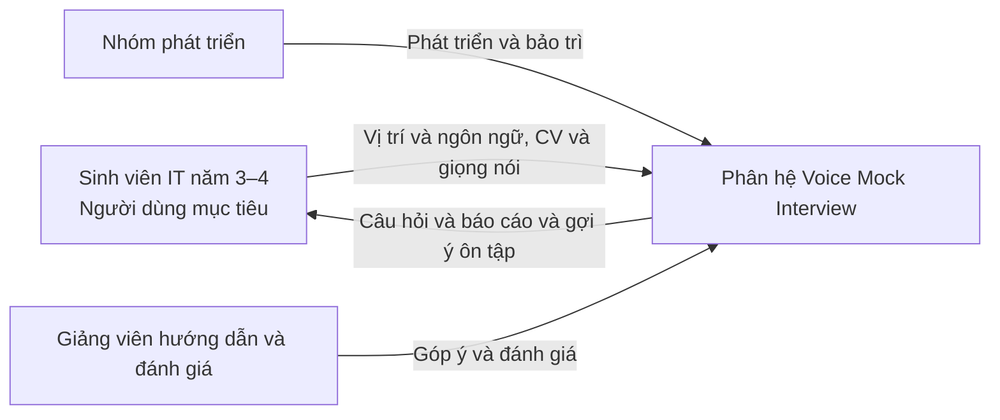

# 1. Mô tả kĩ bài toán

Sinh viên công nghệ thông tin năm 3–4 khi chuẩn bị ứng tuyển các vị trí thực tập (Intern) hoặc Fresher thường gặp khó khăn lớn trong các vòng phỏng vấn kỹ thuật (Technical Interview). Dù đã tích lũy kiến thức qua các môn học chuyên ngành và hoàn thành đồ án, sinh viên phần lớn thiếu kinh nghiệm thực chiến và ít có cơ hội tham gia các buổi phỏng vấn mô phỏng 1:1 có áp lực như thực tế. Khi bước vào phỏng vấn, sinh viên dễ bị động, mất tự tin, khả năng phản xạ và diễn đạt câu trả lời kỹ thuật bằng lời nói còn lúng túng, đặc biệt là khi phỏng vấn bằng tiếng Anh hoặc khi người phỏng vấn đặt câu hỏi đào sâu vào các quyết định kỹ thuật trong dự án cá nhân.

Các nền tảng luyện phỏng vấn hiện nay thường bộc lộ những hạn chế đối với sinh viên IT Việt Nam: phần lớn chỉ hỗ trợ giao diện văn bản (text), công cụ có hỗ trợ giọng nói thì chỉ áp dụng tiếng Anh và giới hạn thời lượng nghiêm ngặt ở các gói miễn phí, hoặc câu hỏi được tạo theo kịch bản khuôn mẫu chung chung, hoàn toàn tách rời với CV và dự án kỹ thuật thực tế của ứng viên. Hơn nữa, sau khi kết thúc phỏng vấn, sinh viên không nhận được phản hồi chi tiết về việc câu trả lời của mình đã đạt hay chưa, còn thiếu hụt khái niệm chuyên môn nào và cần ưu tiên ôn tập nội dung gì để cải thiện.

Phân hệ Voice Mock Interview thuộc nền tảng HireUS Tools giải quyết bài toán trên bằng cách cung cấp môi trường phòng phỏng vấn kỹ thuật 1:1 tương tác hai chiều bằng giọng nói theo thời gian thực giữa sinh viên và AI Tech Lead. Hệ thống cho phép sinh viên thiết lập phiên phỏng vấn với các thông số cụ thể: lựa chọn vị trí chuyên môn (Frontend, Backend, Fullstack, Mobile, AI/Data, v.v.), cấp độ ứng tuyển (Intern hoặc Fresher), ngôn ngữ phỏng vấn (tiếng Việt hoặc tiếng Anh) và lựa chọn một CV hiện có trong hệ thống để cung cấp ngữ cảnh cá nhân hóa. Trước khi bắt đầu, hệ thống thực hiện kiểm tra thiết bị microphone và âm thanh nhằm đảm bảo chất lượng thu nhận tín hiệu.

Trong quá trình phỏng vấn, hệ thống chuyển câu hỏi từ văn bản sang giọng nói (Text-to-Speech) và phát cho sinh viên nghe. Sinh viên trả lời trực tiếp bằng giọng nói qua microphone; âm thanh được tiếp nhận và chuyển đổi thành văn bản (Speech-to-Text). Dịch vụ AI bên ngoài đóng vai trò Tech Lead sẽ phân tích nội dung câu trả lời dựa trên ngữ cảnh CV và vị trí ứng tuyển, từ đó đặt câu hỏi tiếp theo hoặc đặt câu hỏi đào sâu (follow-up questions) nhằm kiểm tra bản chất hiểu biết của sinh viên. Sau khi phiên phỏng vấn kết thúc, hệ thống tự động tổng hợp toàn bộ transcript hỏi đáp, đánh giá năng lực theo các tiêu chí kỹ thuật, tư duy giải quyết vấn đề và kỹ năng diễn đạt, đồng thời xuất báo cáo chi tiết chỉ rõ điểm mạnh, lỗ hổng kiến thức và gợi ý ôn tập trọng tâm. Toàn bộ phiên phỏng vấn và báo cáo được lưu trữ vào lịch sử để sinh viên theo dõi tiến trình cải thiện năng lực qua thời gian.

Kết quả đánh giá và điểm số trong báo cáo phản ánh chất lượng câu trả lời của sinh viên tại thời điểm diễn ra buổi phỏng vấn mô phỏng, phục vụ mục đích rèn luyện phản xạ và củng cố kiến thức chuyên môn; kết quả này không phải là sự cam kết hay khẳng định xác suất trúng tuyển tại các doanh nghiệp thực tế.

# 2. Các bên liên quan (Stakeholder)




### Bảng mô tả vai trò các bên liên quan

| STT | Bên liên quan (Stakeholder) | Vai trò và tương tác với phân hệ |
|:---:|---|---|
| 1 | **Sinh viên IT năm 3–4** | Người dùng mục tiêu trực tiếp của phân hệ. Cung cấp thông tin cấu hình phỏng vấn (vị trí, cấp độ, ngôn ngữ), lựa chọn CV làm ngữ cảnh và tương tác trả lời bằng giọng nói qua microphone; tiếp nhận câu hỏi âm thanh từ hệ thống, xem transcript, nhận báo cáo đánh giá năng lực và các gợi ý ôn tập để cải thiện kỹ năng phỏng vấn. |
| 2 | **Nhóm phát triển** | Chịu trách nhiệm phân tích yêu cầu, thiết kế kiến trúc, lập trình giao diện Web Audio, xây dựng backend điều phối phiên, tích hợp mô hình AI âm thanh và ngôn ngữ, kiểm thử và bảo trì hệ thống vận hành ổn định. |
| 3 | **Giảng viên hướng dẫn và đánh giá** | Đóng vai trò giám sát học thuật, đánh giá tính đúng đắn của quy trình phân tích và đặc tả phần mềm, góp ý về kiến trúc kỹ thuật và đánh giá chất lượng sản phẩm qua các đợt nghiệm thu đồ án môn học. |

# 3. Đặc tả yêu cầu chức năng

## Quy ước mã

- **FR** (*Functional Requirement*): yêu cầu chức năng.
- **VMI** (*Voice Mock Interview*): phân hệ Voice Mock Interview.
- **FR-VMI-xx**: yêu cầu chức năng số xx của phân hệ.
- **BR** (*Business Rule*): quy tắc nghiệp vụ; ví dụ `BR-VMI-01`.

## a. Thiết lập buổi phỏng vấn

| Mã | Yêu cầu chức năng |
|---|---|
| FR-VMI-01 | Hệ thống phải cho phép người dùng lựa chọn vị trí chuyên môn ứng tuyển (Frontend, Backend, Fullstack, Mobile, AI/Data) và cấp độ ứng tuyển (Intern hoặc Fresher). |
| FR-VMI-02 | Hệ thống phải cho phép người dùng lựa chọn ngôn ngữ phỏng vấn (tiếng Việt hoặc tiếng Anh). |
| FR-VMI-03 | Hệ thống phải liên kết với Phân hệ CV / Profile để lấy danh sách các bản CV hiện có của người dùng và cho phép người dùng chọn một CV làm ngữ cảnh phỏng vấn. |
| FR-VMI-04 | Hệ thống phải cho phép người dùng lựa chọn chế độ phỏng vấn tiêu chuẩn theo vị trí mà không bắt buộc đính kèm CV khi tài khoản chưa có hồ sơ. |
| FR-VMI-05 | Hệ thống phải gửi thông tin cấu hình (vị trí, cấp độ, ngôn ngữ, dữ liệu tóm tắt CV) đến Dịch vụ AI bên ngoài để khởi tạo ngữ cảnh phiên phỏng vấn và bộ khung câu hỏi phù hợp. |
| FR-VMI-06 | Hệ thống phải kiểm tra tính hợp lệ của dữ liệu thiết lập trước khi chuyển sang bước kiểm tra thiết bị và khởi tạo phiên phỏng vấn. |

## b. Kiểm tra microphone và âm thanh

| Mã | Yêu cầu chức năng |
|---|---|
| FR-VMI-07 | Hệ thống phải yêu cầu quyền truy cập microphone từ trình duyệt và kiểm tra tính khả dụng của thiết bị thu âm trước khi bắt đầu phỏng vấn. |
| FR-VMI-08 | Hệ thống phải cung cấp giao diện trực quan đo cường độ tín hiệu âm thanh đầu vào để người dùng kiểm tra mức độ thu âm của microphone. |
| FR-VMI-09 | Hệ thống phải phát một đoạn âm thanh mẫu để người dùng kiểm tra thiết bị phát (loa hoặc tai nghe). |
| FR-VMI-10 | Hệ thống phải hiển thị thông báo lỗi cụ thể và hướng dẫn cấp lại quyền hoặc đổi thiết bị khi microphone không khả dụng hoặc bị người dùng từ chối cấp quyền. |
| FR-VMI-11 | Hệ thống chỉ cho phép bắt đầu phiên phỏng vấn khi bước kiểm tra thiết bị âm thanh đạt yêu cầu hoặc khi người dùng đã xác nhận sẵn sàng tiếp tục. |

## c. Tham gia phỏng vấn bằng giọng nói

| Mã | Yêu cầu chức năng |
|---|---|
| FR-VMI-12 | Hệ thống phải chuyển văn bản câu hỏi từ AI thành giọng nói (Text-to-Speech) và tự động phát âm thanh câu hỏi cho người dùng nghe theo ngôn ngữ đã thiết lập. |
| FR-VMI-13 | Hệ thống phải tiếp nhận âm thanh giọng nói trả lời của người dùng qua microphone khi người dùng bắt đầu nói. |
| FR-VMI-14 | Hệ thống phải gửi dữ liệu âm thanh trả lời đến Dịch vụ AI bên ngoài để chuyển đổi thành văn bản (Speech-to-Text). |
| FR-VMI-15 | Hệ thống phải hiển thị nội dung văn bản nhận diện được từ giọng nói để người dùng theo dõi và hỗ trợ xác nhận gửi câu trả lời hoặc yêu cầu nói lại nếu nhận diện bị lỗi do tiếng ồn. |
| FR-VMI-16 | Hệ thống phải gửi nội dung câu trả lời của người dùng đến Dịch vụ AI bên ngoài để phân tích theo ngữ cảnh phỏng vấn, bám sát các dự án và kỹ năng trong CV (nếu có chọn CV). |
| FR-VMI-17 | Hệ thống phải sinh câu hỏi tiếp theo theo diễn tiến logic của buổi phỏng vấn, bao gồm câu hỏi đào sâu kỹ thuật (follow-up) dựa trên câu trả lời trước đó hoặc chuyển tiếp sang chủ đề chuyên môn tiếp theo. |
| FR-VMI-18 | Hệ thống phải cho phép người dùng yêu cầu AI nhắc lại câu hỏi nếu chưa nghe rõ. |
| FR-VMI-19 | Hệ thống phải hiển thị trực quan trạng thái của phiên phỏng vấn (số thứ tự câu hỏi, thời gian diễn ra, trạng thái AI đang nói / đang nghe / đang phân tích). |
| FR-VMI-20 | Hệ thống phải cho phép người dùng chủ động bấm kết thúc buổi phỏng vấn bất kỳ lúc nào hoặc tự động chuyển sang bước đánh giá khi hoàn thành đủ số câu hỏi quy định. |

## d. Tổng hợp, đánh giá buổi phỏng vấn

| Mã | Yêu cầu chức năng |
|---|---|
| FR-VMI-21 | Khi buổi phỏng vấn kết thúc, hệ thống phải tổng hợp toàn bộ transcript gồm danh sách các câu hỏi của AI và các câu trả lời tương ứng của người dùng. |
| FR-VMI-22 | Hệ thống phải gửi transcript và ngữ cảnh cấu hình đến Dịch vụ AI bên ngoài để thực hiện phân tích và đánh giá năng lực toàn diện. |
| FR-VMI-23 | Hệ thống phải tính điểm và đánh giá chi tiết theo các tiêu chí: Kiến thức kỹ thuật chuyên môn, Tư duy giải quyết vấn đề, Kỹ năng diễn đạt và phản xạ giao tiếp. |
| FR-VMI-24 | Hệ thống phải phân tích và chỉ rõ các điểm mạnh (strengths) thể hiện tốt trong câu trả lời và các lỗ hổng kiến thức hoặc điểm yếu cần khắc phục (skill gaps). |
| FR-VMI-25 | Hệ thống phải đề xuất định hướng trả lời tốt hơn cho những câu hỏi người dùng trả lời chưa đầy đủ, kèm theo danh mục các chủ đề kiến thức kỹ thuật cần ôn tập bổ sung. |
| FR-VMI-26 | Hệ thống phải hiển thị báo cáo đánh giá hoàn chỉnh và nêu rõ kết quả mang tính chất tham khảo rèn luyện, không khẳng định xác suất trúng tuyển thực tế tại doanh nghiệp. |

## e. Xem lịch sử phỏng vấn

| Mã | Yêu cầu chức năng |
|---|---|
| FR-VMI-27 | Hệ thống phải lưu trữ đầy đủ dữ liệu của từng phiên phỏng vấn đã thực hiện (thời điểm, vị trí, cấp độ, ngôn ngữ, bản CV sử dụng, transcript hỏi đáp, điểm số và toàn văn báo cáo đánh giá). |
| FR-VMI-28 | Hệ thống phải hiển thị danh sách các phiên phỏng vấn của người dùng, sắp xếp theo thứ tự thời gian mới nhất. |
| FR-VMI-29 | Hệ thống phải cho phép người dùng xem lại chi tiết nội dung transcript hỏi đáp và báo cáo đánh giá của bất kỳ phiên phỏng vấn nào trong lịch sử. |
| FR-VMI-30 | Hệ thống phải cho phép người dùng tái sử dụng cấu hình (vị trí, ngôn ngữ, CV) của một phiên phỏng vấn cũ để khởi tạo nhanh một buổi phỏng vấn luyện tập mới. |
| FR-VMI-31 | Hệ thống phải giữ nguyên dữ liệu lịch sử và kết quả đánh giá cũ khi CV gốc của người dùng được chỉnh sửa hoặc cập nhật. |

## f. Xử lý sự cố và gián đoạn phiên phỏng vấn

| Mã | Yêu cầu chức năng |
|---|---|
| FR-VMI-32 | Khi xảy ra mất kết nối mạng hoặc Dịch vụ AI bên ngoài gặp sự cố trong phiên phỏng vấn, hệ thống phải thông báo nguyên nhân cụ thể và lưu lại toàn bộ các câu hỏi và câu trả lời đã hoàn tất trước đó. |
| FR-VMI-33 | Hệ thống phải cho phép người dùng thử lại lượt hỏi đáp bị gián đoạn hoặc chọn kết thúc sớm để nhận đánh giá trên phần câu hỏi đã hoàn thành; không tự động hủy phiên hoặc trả điểm 0%. |
| FR-VMI-34 | Khi bước tạo báo cáo tổng hợp đánh giá bị gián đoạn, hệ thống phải lưu trữ transcript an toàn và cho phép người dùng kích hoạt tạo lại báo cáo đánh giá mà không phải thực hiện lại buổi phỏng vấn. |

## Các quy tắc nghiệp vụ áp dụng

### BR-VMI-01 — Cá nhân hóa câu hỏi theo ngữ cảnh và cấp độ

Nội dung câu hỏi phỏng vấn được điều chỉnh linh hoạt theo thông tin thiết lập ban đầu:

- **Khi có CV ngữ cảnh:** Ít nhất 40% câu hỏi chuyên môn của phiên phỏng vấn phải được khai thác trực tiếp từ các dự án, công nghệ và kinh nghiệm được thể hiện trong CV (ví dụ: vai trò cụ thể trong dự án, lý do lựa chọn công nghệ, giải pháp xử lý lỗi hoặc tối ưu).
- **Cấp độ Intern:** Tập trung đánh giá kiến thức nền tảng (lập trình hướng đối tượng, cấu trúc dữ liệu và giải thuật, cú pháp ngôn ngữ, hiểu biết cơ bản về luồng hoạt động của framework hoặc thư viện phổ biến).
- **Cấp độ Fresher:** Mở rộng đánh giá tư duy thiết kế kiến trúc cơ bản, khả năng gỡ lỗi, kiểm thử phần mềm, kiến thức về cơ sở dữ liệu, tối ưu hiệu năng và quy trình làm việc nhóm (Git, Agile/Scrum).

### BR-VMI-02 — Điều kiện kiểm tra thiết bị âm thanh

- Quyền truy cập microphone là điều kiện bắt buộc trước khi bắt đầu phỏng vấn hai chiều bằng giọng nói.
- Nếu microphone không ghi nhận tín hiệu âm thanh (mức âm lượng bằng 0 trong suốt quá trình thử), hệ thống cảnh báo và yêu cầu kiểm tra lại thiết bị nhằm tránh tạo ra phiên phỏng vấn rỗng.

### BR-VMI-03 — Cấu trúc và thời lượng phiên phỏng vấn

Một phiên phỏng vấn chuẩn gồm 5 đến 8 câu hỏi, được cấu trúc theo 3 giai đoạn:
1. **Giai đoạn mở đầu (1 câu):** Chào hỏi và yêu cầu giới thiệu bản thân hoặc tóm tắt định hướng nghề nghiệp.
2. **Giai đoạn chuyên môn & tình huống (3–6 câu):** Các câu hỏi kỹ thuật cốt lõi, câu hỏi đào sâu theo CV và câu hỏi tình huống xử lý vấn đề kỹ thuật.
3. **Giai đoạn kết thúc (1 câu):** Câu hỏi tổng kết hoặc tạo cơ hội cho ứng viên đặt câu hỏi/nêu quan điểm.

Thời gian trả lời tối đa cho mỗi câu hỏi được quy định là **3 phút** để rèn luyện phản xạ trình bày súc tích, đúng trọng tâm. Hết thời gian quy định, hệ thống thông báo và đề nghị người dùng gửi câu trả lời để chuyển câu hỏi tiếp theo.

### BR-VMI-04 — Tiêu chí và công thức tính điểm đánh giá

Tổng điểm buổi phỏng vấn được tính theo thang điểm 100, dựa trên 3 tiêu chí chính với trọng số quy định:

| Tiêu chí | Trọng số | Nội dung đánh giá |
|---|:---:|---|
| **Kiến thức kỹ thuật (Technical Knowledge)** | 50% | Tính chính xác của các khái niệm, độ sâu hiểu biết về công nghệ, khả năng giải thích bản chất vấn đề kỹ thuật. |
| **Tư duy giải quyết vấn đề (Problem Solving)** | 30% | Cách tiếp cận bài toán logic, phương pháp phân tích yêu cầu, tư duy phản biện và khả năng xử lý tình huống phát sinh. |
| **Kỹ năng diễn đạt & Phản xạ (Communication & Fluency)** | 20% | Tính mạch lạc, rõ ràng, đúng trọng tâm của câu trả lời, sự tự tin và độ chuẩn xác khi sử dụng thuật ngữ chuyên môn theo ngôn ngữ phỏng vấn (Việt/Anh). |

Công thức tính điểm tổng hợp:

```text
Điểm phỏng vấn = (Điểm kỹ thuật × 0.5) + (Điểm tư duy × 0.3) + (Điểm diễn đạt × 0.2)
```

Mỗi tiêu chí thành phần được chấm trên thang điểm 100 dựa trên toàn bộ các câu trả lời trong transcript.

### BR-VMI-05 — Phân loại kết quả và định hướng ôn tập

Dựa trên điểm tổng hợp, kết quả phỏng vấn được phân thành 3 mức:

| Mức phân loại | Điểm tổng hợp | Khuyến nghị định hướng |
|:---:|:---:|---|
| **Đỏ (Cần cải thiện nhiều)** | Dưới 50 điểm | Nền tảng chuyên môn còn thiếu hụt hoặc phản xạ diễn đạt chưa rõ ràng; khuyến nghị ôn tập lại các khái niệm kỹ thuật cốt lõi và luyện tập trả lời các bộ câu hỏi cơ bản trước khi phỏng vấn thực tế. |
| **Vàng (Đạt mức cơ bản)** | Từ 50 đến dưới 75 điểm | Nắm được kiến thức căn bản nhưng câu trả lời chưa sâu, thiếu dẫn chứng cụ thể từ dự án hoặc diễn đạt còn ấp úng; khuyến nghị rà soát kỹ các chi tiết trong dự án CV và rèn luyện kỹ năng tóm tắt câu trả lời. |
| **Xanh (Tốt / Tự tin)** | Từ 75 điểm trở lên | Thể hiện kiến thức vững vàng, lập luận có chiều sâu và phản xạ giao tiếp tốt; sẵn sàng tham gia các vòng phỏng vấn kỹ thuật tại doanh nghiệp. |

Điểm số phản ánh phần thể hiện của sinh viên qua các câu trả lời trong phiên phỏng vấn cụ thể, không đại diện hay bảo đảm kết quả tuyển dụng chính thức của doanh nghiệp.

# 4. Đặc tả yêu cầu phi chức năng

| Mã | Nhóm | Yêu cầu phi chức năng |
|---|---|---|
| NFR-VMI-01 | Thời gian phản hồi (Performance) | Thời gian từ khi sinh viên hoàn thành câu trả lời đến khi hệ thống nhận diện xong văn bản (STT) và bắt đầu phát âm thanh câu hỏi tiếp theo (TTS) không vượt quá 4 giây trong điều kiện mạng ổn định. |
| NFR-VMI-02 | Dễ sử dụng (Usability) | Giao diện phải cung cấp trực quan hóa sóng âm thanh (audio visualizer) hiển thị rõ trạng thái đang nghe/đang nói; hỗ trợ song ngữ tiếng Việt và tiếng Anh đồng bộ từ câu hỏi, phiên âm đến báo cáo đánh giá. |
| NFR-VMI-03 | Bảo mật và quyền riêng tư (Security) | Dữ liệu âm thanh, transcript và báo cáo đánh giá phỏng vấn chỉ được truy cập bởi tài khoản sở hữu; khóa API của các dịch vụ AI bên ngoài phải được lưu trữ và bảo vệ nghiêm ngặt tại backend, không lộ ở phía client. |
| NFR-VMI-04 | Độ tin cậy và khôi phục (Reliability) | Khi phiên phỏng vấn bị ngắt quãng do sự cố đường truyền hoặc lỗi dịch vụ AI, hệ thống phải bảo toàn toàn bộ dữ liệu trao đổi trước đó và cho phép khôi phục tạo báo cáo mà không bị mất dữ liệu. |

# 5. Đặc tả yêu cầu

## 5.1 Sơ đồ Use Case


## 5.2 Đặc tả Use Case

### 4.2.1. Thiết lập buổi phỏng vấn

| Thành phần | Đặc tả |
|---|---|
| **Use Case ID** | U001 |
| **Tên Use Case** | Thiết lập buổi phỏng vấn |
| **Tóm tắt** | Cho phép sinh viên lựa chọn vị trí chuyên môn, cấp độ ứng tuyển, ngôn ngữ phỏng vấn và CV ngữ cảnh để hệ thống khởi tạo phiên phỏng vấn phù hợp. |
| **Tác nhân** | Sinh viên; Phân hệ CV / Profile; Dịch vụ AI bên ngoài. |
| **Điều kiện tiên quyết** | Sinh viên đã đăng nhập vào hệ thống HireUS Tools. |
| **Kết quả** | Cấu hình buổi phỏng vấn được xác nhận và phiên phỏng vấn được khởi tạo sẵn sàng cho bước kiểm tra thiết bị. |
| **Kịch bản chính** | 1. Sinh viên chọn chức năng "Phỏng vấn thử bằng giọng nói" từ giao diện chính.<br>2. Hệ thống hiển thị màn hình thiết lập buổi phỏng vấn.<br>3. Hệ thống gửi yêu cầu sang **Phân hệ CV / Profile** để tải danh sách các bản CV hiện có của sinh viên.<br>4. Sinh viên chọn vị trí ứng tuyển (Frontend, Backend, Mobile, Data/AI, v.v.), chọn cấp độ (Intern hoặc Fresher), chọn ngôn ngữ phỏng vấn (tiếng Việt hoặc tiếng Anh) và chọn 1 bản CV làm ngữ cảnh.<br>5. Sinh viên nhấn "Xác nhận và tiếp tục".<br>6. Hệ thống kiểm tra tính hợp lệ của cấu hình, gửi dữ liệu thiết lập sang **Dịch vụ AI bên ngoài** để chuẩn bị ngữ cảnh phỏng vấn.<br>7. Hệ thống chuyển sang màn hình kiểm tra thiết bị âm thanh. |
| **Kịch bản phụ** | • Sinh viên chưa có CV trong tài khoản: Hệ thống cho phép chọn chế độ phỏng vấn kiến thức chung theo vị trí mà không cần đính kèm CV.<br>• Dữ liệu chưa hợp lệ: Hệ thống thông báo các mục thông tin còn thiếu để sinh viên hoàn thiện.<br>• Dịch vụ AI không phản hồi: Hệ thống thông báo lỗi kết nối và cho phép sinh viên thử lại. |
| **Ràng buộc phi chức năng** | Giao diện lựa chọn rõ ràng, tải danh sách CV nhanh chóng; bảo vệ tính riêng tư của dữ liệu hồ sơ CV. |

Thông tin thiết lập là căn cứ để AI cá nhân hóa câu hỏi bám sát kinh nghiệm và dự án thực tế của ứng viên.

---

### 4.2.2. Tham gia phỏng vấn bằng giọng nói

| Thành phần | Đặc tả |
|---|---|
| **Use Case ID** | U002 |
| **Tên Use Case** | Tham gia phỏng vấn bằng giọng nói |
| **Tóm tắt** | Sinh viên tham gia quá trình hỏi đáp kỹ thuật trực tiếp bằng giọng nói hai chiều với AI Tech Lead và hoàn tất phiên phỏng vấn. |
| **Tác nhân** | Sinh viên; Dịch vụ AI bên ngoài. |
| **Điều kiện tiên quyết** | Buổi phỏng vấn đã được thiết lập (U001) thành công. |
| **Kết quả** | Buổi phỏng vấn hoàn thành; toàn bộ transcript hỏi đáp và báo cáo đánh giá được lưu trữ vào hệ thống. |
| **Kịch bản chính** | 1. Hệ thống thực hiện use case `<<include>>` **U003 – Kiểm tra microphone và âm thanh**.<br>2. Sau khi thiết bị sẵn sàng, hệ thống bắt đầu phiên phỏng vấn và hiển thị giao diện phòng phỏng vấn trực tuyến.<br>3. **Dịch vụ AI bên ngoài** sinh câu hỏi đầu tiên; hệ thống chuyển thành âm thanh (TTS) và phát cho sinh viên nghe.<br>4. Sinh viên lắng nghe câu hỏi và trả lời bằng giọng nói qua microphone.<br>5. Hệ thống thu âm thanh, gửi đến **Dịch vụ AI bên ngoài** để chuyển đổi thành văn bản (STT) và hiển thị cho sinh viên theo dõi.<br>6. Sinh viên xác nhận câu trả lời (hoặc hết thời gian trả lời quy định).<br>7. Hệ thống gửi nội dung trả lời đến **Dịch vụ AI bên ngoài** để phân tích và sinh câu hỏi tiếp theo (bao gồm câu hỏi đào sâu hoặc đổi chủ đề).<br>8. Lặp lại các bước 3–7 cho đến khi hoàn thành các câu hỏi trong phiên hoặc sinh viên chọn kết thúc.<br>9. Sinh viên chọn "Kết thúc phỏng vấn" và xác nhận.<br>10. Hệ thống thực hiện use case `<<include>>` **U004 – Tổng hợp, đánh giá buổi phỏng vấn**.<br>11. Hệ thống hiển thị báo cáo đánh giá hoàn chỉnh cho sinh viên. |
| **Kịch bản phụ** | • Nhận diện giọng nói chưa chính xác: Sinh viên chọn nói lại trước khi gửi câu trả lời.<br>• Sinh viên nghe chưa rõ câu hỏi: Sinh viên nhấn nút yêu cầu AI nhắc lại câu hỏi.<br>• Gián đoạn kết nối giữa phiên: Hệ thống lưu lại các câu hỏi/câu trả lời đã hoàn thành, hiển thị thông báo lỗi mạng và cho phép kết nối lại hoặc kết thúc sớm.<br>• Sinh viên hủy phiên phỏng vấn: Hệ thống cảnh báo phiên chưa hoàn thành sẽ không được tính điểm chính thức. |
| **Ràng buộc phi chức năng** | Độ trễ xử lý âm thanh hai chiều không quá 4 giây; hiển thị trực quan sóng âm thanh (audio visualizer); bảo mật đường truyền âm thanh. |

---

### 4.2.3. Kiểm tra microphone và âm thanh

| Thành phần | Đặc tả |
|---|---|
| **Use Case ID** | U003 |
| **Tên Use Case** | Kiểm tra microphone và âm thanh |
| **Tóm tắt** | Kiểm tra quyền truy cập thiết bị thu âm (microphone) và thiết bị phát âm thanh (loa/tai nghe) trước khi bước vào phỏng vấn. |
| **Tác nhân** | Sinh viên. |
| **Điều kiện tiên quyết** | Sinh viên đã hoàn tất thiết lập buổi phỏng vấn (U001). |
| **Kết quả** | Thiết bị âm thanh được xác nhận hoạt động bình thường, sinh viên được phép vào phòng phỏng vấn. |
| **Kịch bản chính** | 1. Hệ thống yêu cầu quyền truy cập microphone trên trình duyệt của sinh viên.<br>2. Sinh viên đồng ý cấp quyền truy cập.<br>3. Hệ thống hiển thị thanh đo âm lượng trực quan và yêu cầu sinh viên thử nói vào micro.<br>4. Sinh viên nói thử và quan sát mức dao động của thanh âm lượng.<br>5. Hệ thống tự động phát một đoạn âm thanh mẫu ngắn và yêu cầu sinh viên xác nhận đã nghe rõ qua loa/tai nghe.<br>6. Sinh viên xác nhận âm thanh rõ ràng và nhấn "Sẵn sàng phỏng vấn".<br>7. Hệ thống lưu trạng thái thiết bị hợp lệ và chuyển quyền điều khiển lại cho use case **U002**. |
| **Kịch bản phụ** | • Trình duyệt bị từ chối cấp quyền: Hệ thống hiển thị hướng dẫn chi tiết cách mở lại quyền microphone trong cài đặt trình duyệt.<br>• Không nhận được tín hiệu âm thanh: Hệ thống khuyến nghị kiểm tra lại kết nối micro hoặc đổi thiết bị đầu vào.<br>• Sinh viên không nghe thấy âm thanh mẫu: Hệ thống hướng dẫn kiểm tra âm lượng loa hoặc chọn thiết bị đầu ra khác. |
| **Ràng buộc phi chức năng** | Giao diện hướng dẫn trực quan, phản ứng đo âm lượng tức thì theo thời gian thực (real-time feedback). |

Use case này là bước bắt buộc (`<<include>>`) trong use case U002 nhằm loại trừ các sự cố kỹ thuật âm thanh làm ảnh hưởng đến chất lượng phỏng vấn.

---

### 4.2.4. Tổng hợp, đánh giá buổi phỏng vấn

| Thành phần | Đặc tả |
|---|---|
| **Use Case ID** | U004 |
| **Tên Use Case** | Tổng hợp, đánh giá buổi phỏng vấn |
| **Tóm tắt** | Phân tích transcript buổi phỏng vấn, tính điểm theo các tiêu chí và sinh báo cáo đánh giá năng lực chi tiết kèm định hướng cải thiện. |
| **Tác nhân** | Sinh viên; Dịch vụ AI bên ngoài. |
| **Điều kiện tiên quyết** | Phiên phỏng vấn kết thúc (đã hoàn thành các câu hỏi hoặc sinh viên chủ động kết thúc sau khi đã trả lời). |
| **Kết quả** | Báo cáo đánh giá hoàn chỉnh được tạo, hiển thị cho sinh viên và lưu trữ vào cơ sở dữ liệu. |
| **Kịch bản chính** | 1. Hệ thống tổng hợp toàn văn transcript của phiên phỏng vấn (gồm danh sách câu hỏi và các câu trả lời tương ứng).<br>2. Hệ thống gửi transcript cùng cấu hình phỏng vấn đến **Dịch vụ AI bên ngoài**.<br>3. **Dịch vụ AI bên ngoài** phân tích dữ liệu, chấm điểm theo các tiêu chí (Kiến thức kỹ thuật, Tư duy giải quyết vấn đề, Kỹ năng diễn đạt) và xác định điểm mạnh, điểm yếu.<br>4. **Dịch vụ AI bên ngoài** tạo các gợi ý trả lời mẫu và danh mục chủ đề kiến thức cần ôn tập bổ sung.<br>5. Hệ thống tiếp nhận kết quả, tính toán điểm tổng hợp theo quy tắc nghiệp vụ BR-VMI-04 và phân loại mức kết quả theo BR-VMI-05.<br>6. Hệ thống lưu báo cáo đánh giá kèm trạng thái hoàn thành vào cơ sở dữ liệu.<br>7. Hệ thống hiển thị báo cáo chi tiết cho sinh viên trên giao diện. |
| **Kịch bản phụ** | • Dịch vụ AI gặp sự cố khi tạo báo cáo: Hệ thống lưu trữ an toàn transcript đã có, hiển thị thông báo chưa thể tạo báo cáo và cung cấp nút "Tạo lại báo cáo đánh giá".<br>• Phiên phỏng vấn kết thúc quá sớm (chưa trả lời câu nào): Hệ thống thông báo không đủ dữ liệu để đánh giá năng lực và không lưu kết quả đánh giá. |
| **Ràng buộc phi chức năng** | Báo cáo trình bày rõ ràng, phân loại bằng màu sắc (Đỏ/Vàng/Xanh); công thức tính điểm nhất quán; thông tin đánh giá mang tính khách quan và xây dựng. |

Báo cáo phỏng vấn là sản phẩm đầu ra cốt lõi của use case U002, giúp sinh viên nhận diện rõ lỗ hổng kiến thức để có kế hoạch ôn tập đúng trọng tâm.

---

### 4.2.5. Xem lịch sử phỏng vấn

| Thành phần | Đặc tả |
|---|---|
| **Use Case ID** | U005 |
| **Tên Use Case** | Xem lịch sử phỏng vấn |
| **Tóm tắt** | Cho phép sinh viên xem lại danh sách và nội dung chi tiết của các buổi phỏng vấn đã thực hiện trước đây. |
| **Tác nhân** | Sinh viên. |
| **Điều kiện tiên quyết** | Sinh viên đã đăng nhập vào hệ thống HireUS Tools. |
| **Kết quả** | Danh sách lịch sử hoặc báo cáo chi tiết của một phiên phỏng vấn trong quá khứ được hiển thị. |
| **Kịch bản chính** | 1. Sinh viên chọn mục "Lịch sử phỏng vấn" trên thanh điều hướng.<br>2. Hệ thống truy vấn cơ sở dữ liệu và hiển thị danh sách các phiên phỏng vấn của sinh viên (gồm ngày thực hiện, vị trí ứng tuyển, ngôn ngữ, điểm tổng hợp và mức phân loại).<br>3. Sinh viên chọn một phiên phỏng vấn cụ thể để xem chi tiết.<br>4. Hệ thống hiển thị toàn bộ nội dung của phiên đã chọn: thông tin thiết lập, bản CV đã sử dụng, transcript chi tiết từng câu hỏi - câu trả lời và toàn văn báo cáo đánh giá.<br>5. Sinh viên có thể chọn tính năng "Phỏng vấn lại với cấu hình này" để khởi tạo một buổi phỏng vấn mới dựa trên thông số của phiên cũ. |
| **Kịch bản phụ** | • Tài khoản chưa có lịch sử phỏng vấn: Hệ thống hiển thị thông báo trống kèm nút điều hướng đến chức năng tạo phỏng vấn mới.<br>• Không có quyền truy cập: Hệ thống từ chối hiển thị dữ liệu không thuộc tài khoản của người dùng. |
| **Ràng buộc phi chức năng** | Dữ liệu lịch sử được bảo toàn nguyên vẹn ngay cả khi CV gốc bị sửa đổi; chỉ người dùng sở hữu tài khoản mới có quyền truy cập lịch sử của mình. |

