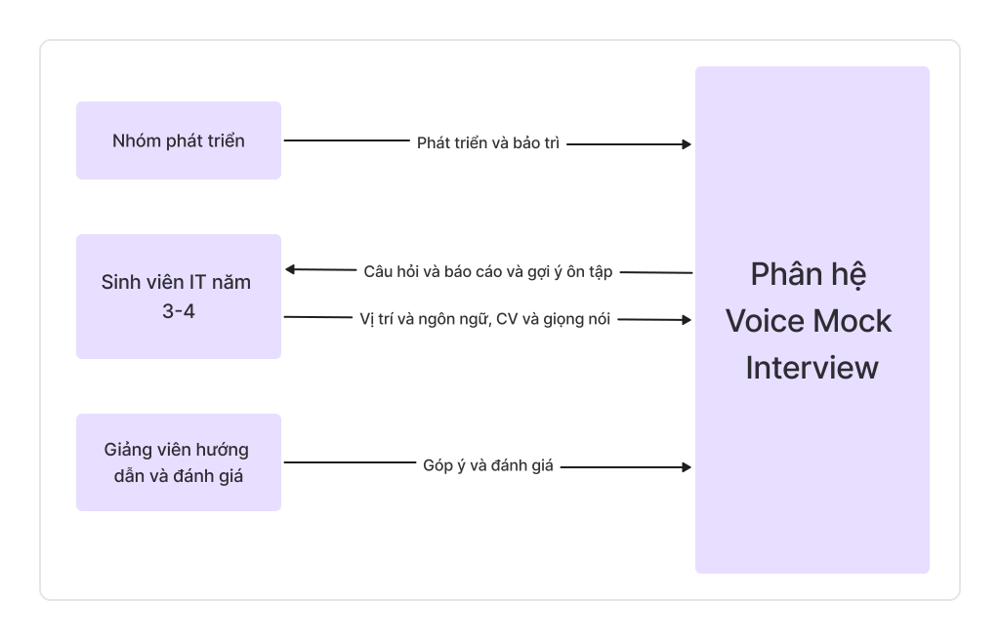
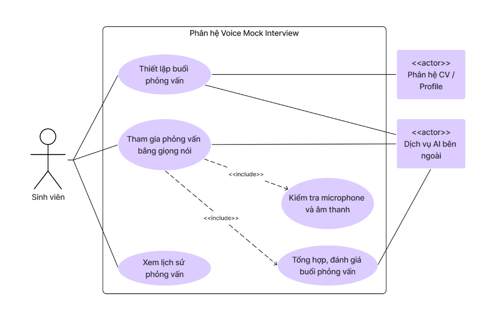

# 1. Mô tả bài toán

Sinh viên công nghệ thông tin năm 3–4 khi ứng tuyển Intern hoặc Fresher thường thiếu kinh nghiệm luyện tập phỏng vấn kỹ thuật 1:1 có áp lực như thực tế. Dù đã tích lũy kiến thức chuyên ngành, nhiều sinh viên vẫn lúng túng khi phải trình bày câu trả lời bằng lời nói, đặc biệt khi phỏng vấn bằng tiếng Anh hoặc bị hỏi đào sâu vào quyết định kỹ thuật trong dự án cá nhân.

Các nền tảng luyện phỏng vấn hiện tại còn nhiều hạn chế: phần lớn chỉ hỗ trợ giao diện văn bản, nền tảng có giọng nói thì giới hạn thời lượng miễn phí và sinh câu hỏi khuôn mẫu chung chung, không bám sát CV và dự án thực tế của ứng viên. Sinh viên cũng không nhận được phản hồi chi tiết về những lỗ hổng kiến thức cần ưu tiên khắc phục.

Phân hệ Voice Mock Interview cung cấp phòng phỏng vấn kỹ thuật 1:1 tương tác hai chiều bằng giọng nói theo thời gian thực giữa sinh viên và AI Tech Lead. Sinh viên thiết lập phiên với vị trí chuyên môn, cấp độ (Intern/Fresher), ngôn ngữ (tiếng Việt/tiếng Anh) và CV ngữ cảnh. Hệ thống kiểm tra thiết bị, phát câu hỏi qua TTS, ghi nhận câu trả lời qua STT, sinh câu hỏi đào sâu theo ngữ cảnh CV và tổng hợp báo cáo đánh giá sau phiên gồm điểm mạnh, lỗ hổng kiến thức và gợi ý ôn tập. Lịch sử phiên được lưu để theo dõi tiến trình cải thiện.

Kết quả đánh giá phản ánh chất lượng câu trả lời tại thời điểm phỏng vấn mô phỏng, không khẳng định xác suất trúng tuyển thực tế.

# 2. Các bên liên quan (Stakeholder)



# 3. Đặc tả yêu cầu chức năng

## Quy ước mã

- **FR** (*Functional Requirement*): yêu cầu chức năng.
- **VMI** (*Voice Mock Interview*): phân hệ Voice Mock Interview.
- **FR-VMI-xx**: yêu cầu chức năng số xx của phân hệ.
- **BR** (*Business Rule*): quy tắc nghiệp vụ; ví dụ `BR-VMI-01`.

## a. Thiết lập buổi phỏng vấn

| Mã | Yêu cầu chức năng |
|---|---|
| FR-VMI-01 | Hệ thống phải cho phép người dùng lựa chọn vị trí chuyên môn (Frontend, Backend, Fullstack, Mobile, AI/Data) và cấp độ ứng tuyển (Intern hoặc Fresher). |
| FR-VMI-02 | Hệ thống phải cho phép người dùng lựa chọn ngôn ngữ phỏng vấn (tiếng Việt hoặc tiếng Anh). |
| FR-VMI-03 | Hệ thống phải liên kết với Phân hệ CV / Profile để lấy danh sách CV hiện có và cho phép người dùng chọn một bản CV làm ngữ cảnh phỏng vấn. |
| FR-VMI-04 | Hệ thống phải cho phép chế độ phỏng vấn theo vị trí mà không bắt buộc đính kèm CV khi tài khoản chưa có hồ sơ. |
| FR-VMI-05 | Hệ thống phải gửi cấu hình (vị trí, cấp độ, ngôn ngữ, dữ liệu tóm tắt CV) đến Dịch vụ AI bên ngoài để khởi tạo ngữ cảnh phiên và bộ khung câu hỏi phù hợp. |
| FR-VMI-06 | Hệ thống phải kiểm tra tính hợp lệ của dữ liệu thiết lập trước khi chuyển sang bước kiểm tra thiết bị. |

## b. Kiểm tra microphone và âm thanh

| Mã | Yêu cầu chức năng |
|---|---|
| FR-VMI-07 | Hệ thống phải yêu cầu quyền truy cập microphone từ trình duyệt và kiểm tra tính khả dụng của thiết bị thu âm trước khi bắt đầu phỏng vấn. |
| FR-VMI-08 | Hệ thống phải cung cấp giao diện đo cường độ tín hiệu âm thanh đầu vào theo thời gian thực để người dùng kiểm tra microphone. |
| FR-VMI-09 | Hệ thống phải hiển thị thông báo lỗi cụ thể và hướng dẫn cấp lại quyền hoặc đổi thiết bị khi microphone không khả dụng. |
| FR-VMI-10 | Hệ thống chỉ cho phép bắt đầu phiên phỏng vấn khi bước kiểm tra thiết bị đạt yêu cầu hoặc người dùng xác nhận sẵn sàng tiếp tục. |

## c. Tham gia phỏng vấn bằng giọng nói

| Mã | Yêu cầu chức năng |
|---|---|
| FR-VMI-11 | Hệ thống phải chuyển câu hỏi từ văn bản sang giọng nói (TTS) và phát theo ngôn ngữ đã thiết lập. |
| FR-VMI-12 | Hệ thống phải tiếp nhận âm thanh trả lời của người dùng qua microphone và gửi đến Dịch vụ AI để chuyển đổi thành văn bản (STT). |
| FR-VMI-13 | Hệ thống phải hiển thị văn bản nhận diện từ giọng nói để người dùng theo dõi, xác nhận gửi hoặc yêu cầu nói lại. |
| FR-VMI-14 | Hệ thống phải gửi nội dung câu trả lời đến Dịch vụ AI để phân tích theo ngữ cảnh CV và vị trí ứng tuyển. |
| FR-VMI-15 | Hệ thống phải sinh câu hỏi tiếp theo theo diễn tiến logic, bao gồm câu hỏi đào sâu kỹ thuật (follow-up) dựa trên câu trả lời trước đó. |
| FR-VMI-16 | Hệ thống phải cho phép người dùng kết thúc buổi phỏng vấn bất kỳ lúc nào hoặc tự động chuyển sang đánh giá khi đủ số câu hỏi quy định. |

## d. Tổng hợp, đánh giá buổi phỏng vấn

| Mã | Yêu cầu chức năng |
|---|---|
| FR-VMI-17 | Khi buổi phỏng vấn kết thúc, hệ thống phải tổng hợp toàn bộ transcript gồm câu hỏi của AI và câu trả lời của người dùng. |
| FR-VMI-18 | Hệ thống phải gửi transcript và cấu hình phiên đến Dịch vụ AI bên ngoài để đánh giá năng lực theo các tiêu chí kỹ thuật, tư duy giải quyết vấn đề và kỹ năng diễn đạt. |
| FR-VMI-19 | Hệ thống phải chỉ rõ điểm mạnh và lỗ hổng kiến thức, đề xuất định hướng trả lời tốt hơn và danh mục chủ đề cần ôn tập. |
| FR-VMI-20 | Hệ thống phải hiển thị báo cáo đánh giá hoàn chỉnh và nêu rõ kết quả mang tính chất tham khảo rèn luyện, không khẳng định xác suất trúng tuyển. |

## e. Xem lịch sử phỏng vấn

| Mã | Yêu cầu chức năng |
|---|---|
| FR-VMI-21 | Hệ thống phải lưu trữ dữ liệu từng phiên phỏng vấn (thời điểm, vị trí, cấp độ, ngôn ngữ, CV đã dùng, transcript, điểm số và toàn văn báo cáo). |
| FR-VMI-22 | Hệ thống phải hiển thị danh sách phiên phỏng vấn theo thứ tự thời gian mới nhất và cho phép xem lại transcript cùng báo cáo của từng phiên. |
| FR-VMI-23 | Hệ thống phải giữ nguyên dữ liệu và kết quả lịch sử khi CV gốc được chỉnh sửa. |

## f. Xử lý sự cố và gián đoạn

| Mã | Yêu cầu chức năng |
|---|---|
| FR-VMI-27 | Khi mất kết nối hoặc Dịch vụ AI gặp sự cố, hệ thống phải thông báo và lưu lại các hỏi đáp đã hoàn tất; không tự hủy phiên hoặc trả điểm 0%. |
| FR-VMI-28 | Khi bước tạo báo cáo bị gián đoạn, hệ thống phải lưu transcript an toàn và cho phép người dùng kích hoạt tạo lại mà không cần thực hiện lại buổi phỏng vấn. |

## Các quy tắc nghiệp vụ áp dụng

### BR-VMI-01 — Cá nhân hóa câu hỏi theo ngữ cảnh và cấp độ

- **Khi có CV ngữ cảnh:** Ít nhất 40% câu hỏi chuyên môn khai thác trực tiếp từ dự án, công nghệ và kinh nghiệm trong CV.
- **Cấp độ Intern:** Tập trung kiến thức nền tảng (OOP, cấu trúc dữ liệu, cú pháp ngôn ngữ, luồng hoạt động cơ bản của framework).
- **Cấp độ Fresher:** Mở rộng sang tư duy thiết kế kiến trúc, gỡ lỗi, kiểm thử, cơ sở dữ liệu, tối ưu hiệu năng và quy trình nhóm (Git, Agile/Scrum).

### BR-VMI-02 — Điều kiện kiểm tra thiết bị âm thanh

Quyền truy cập microphone là điều kiện bắt buộc. Nếu microphone không ghi nhận tín hiệu (mức âm bằng 0 trong suốt bài thử), hệ thống cảnh báo và yêu cầu kiểm tra lại thiết bị.

### BR-VMI-03 — Cấu trúc và thời lượng phiên phỏng vấn

Một phiên chuẩn gồm 5–8 câu hỏi theo 3 giai đoạn:
1. **Mở đầu (1 câu):** Giới thiệu bản thân hoặc định hướng nghề nghiệp.
2. **Chuyên môn & tình huống (3–6 câu):** Câu hỏi kỹ thuật cốt lõi và đào sâu theo CV.
3. **Kết thúc (1 câu):** Tổng kết hoặc cơ hội ứng viên đặt câu hỏi.

Thời gian trả lời tối đa **3 phút/câu**. Hết thời gian, hệ thống thông báo và đề nghị gửi câu trả lời để chuyển câu tiếp theo.

### BR-VMI-04 — Tiêu chí và công thức tính điểm đánh giá

Tổng điểm theo thang 100, dựa trên 3 tiêu chí:

| Tiêu chí | Trọng số |
|---|:---:|
| Kiến thức kỹ thuật (Technical Knowledge) | 50% |
| Tư duy giải quyết vấn đề (Problem Solving) | 30% |
| Kỹ năng diễn đạt & Phản xạ (Communication & Fluency) | 20% |

```text
Điểm phỏng vấn = (Điểm kỹ thuật × 0.5) + (Điểm tư duy × 0.3) + (Điểm diễn đạt × 0.2)
```

Mỗi tiêu chí được chấm trên thang 100 dựa trên toàn bộ câu trả lời trong transcript.

### BR-VMI-05 — Phân loại kết quả và định hướng ôn tập

| Mức | Điểm tổng hợp | Khuyến nghị |
|:---:|:---:|---|
| **Đỏ** | Dưới 50 | Ôn tập lại khái niệm kỹ thuật cốt lõi và luyện bộ câu hỏi cơ bản trước khi phỏng vấn thực tế. |
| **Vàng** | 50 đến dưới 75 | Rà soát chi tiết dự án trong CV và rèn luyện kỹ năng tóm tắt câu trả lời súc tích hơn. |
| **Xanh** | Từ 75 trở lên | Thể hiện kiến thức vững và phản xạ giao tiếp tốt; sẵn sàng tham gia phỏng vấn kỹ thuật tại doanh nghiệp. |

Điểm phản ánh phần thể hiện trong phiên phỏng vấn cụ thể, không bảo đảm kết quả tuyển dụng thực tế.

# 4. Đặc tả yêu cầu phi chức năng

| Mã | Nhóm | Yêu cầu phi chức năng |
|---|---|---|
| NFR-VMI-01 | Hiệu năng | Độ trễ từ khi sinh viên hoàn thành câu trả lời đến khi phát câu hỏi tiếp theo (STT → TTS) không quá 5 giây trong điều kiện mạng ổn định. |
| NFR-VMI-02 | Dễ sử dụng | Giao diện cung cấp trực quan hóa sóng âm (audio visualizer) thể hiện trạng thái đang nghe/đang nói; hỗ trợ song ngữ từ câu hỏi, phiên âm đến báo cáo đánh giá. |
| NFR-VMI-03 | Bảo mật | Âm thanh, transcript và báo cáo chỉ được truy cập bởi tài khoản sở hữu; API key của dịch vụ AI phải lưu và bảo vệ tại backend. |
| NFR-VMI-04 | Độ tin cậy | Khi phiên bị ngắt quãng, hệ thống bảo toàn dữ liệu trao đổi và cho phép khôi phục tạo báo cáo mà không mất dữ liệu. |

# 5. Đặc tả yêu cầu

## 5.1 Sơ đồ Use Case



## 5.2 Đặc tả Use Case

### 4.2.1. Thiết lập buổi phỏng vấn

| Thành phần | Đặc tả |
|---|---|
| **Use Case ID** | U001 |
| **Tên Use Case** | Thiết lập buổi phỏng vấn |
| **Tóm tắt** | Sinh viên lựa chọn vị trí, cấp độ, ngôn ngữ và CV ngữ cảnh để khởi tạo phiên phỏng vấn. |
| **Tác nhân** | Sinh viên; Phân hệ CV / Profile; Dịch vụ AI bên ngoài. |
| **Điều kiện tiên quyết** | Sinh viên đã đăng nhập. |
| **Kết quả** | Cấu hình phỏng vấn được xác nhận, phiên sẵn sàng chuyển sang kiểm tra thiết bị. |
| **Kịch bản chính** | 1. Sinh viên chọn "Phỏng vấn thử bằng giọng nói".<br>2. Hệ thống hiển thị màn hình thiết lập và tải danh sách CV từ **Phân hệ CV / Profile**.<br>3. Sinh viên chọn vị trí, cấp độ, ngôn ngữ và 1 bản CV rồi nhấn "Xác nhận".<br>4. Hệ thống kiểm tra cấu hình hợp lệ, gửi thông tin đến **Dịch vụ AI bên ngoài** để khởi tạo ngữ cảnh.<br>5. Hệ thống chuyển sang màn hình kiểm tra thiết bị âm thanh. |
| **Kịch bản phụ** | • Chưa có CV: Hệ thống cho phép phỏng vấn theo vị trí mà không cần đính kèm CV.<br>• Dữ liệu thiếu: Hệ thống thông báo và yêu cầu bổ sung.<br>• Dịch vụ AI không phản hồi: Thông báo lỗi và cho phép thử lại. |
| **Ràng buộc phi chức năng** | Giao diện rõ ràng, tải CV nhanh; bảo vệ riêng tư dữ liệu hồ sơ. |

### 4.2.2. Tham gia phỏng vấn bằng giọng nói

| Thành phần | Đặc tả |
|---|---|
| **Use Case ID** | U002 |
| **Tên Use Case** | Tham gia phỏng vấn bằng giọng nói |
| **Tóm tắt** | Sinh viên hỏi đáp kỹ thuật hai chiều bằng giọng nói với AI Tech Lead và hoàn tất phiên phỏng vấn. |
| **Tác nhân** | Sinh viên; Dịch vụ AI bên ngoài. |
| **Điều kiện tiên quyết** | Buổi phỏng vấn đã được thiết lập (U001) thành công. |
| **Kết quả** | Phiên phỏng vấn hoàn thành; transcript và báo cáo đánh giá được lưu vào hệ thống. |
| **Kịch bản chính** | 1. Hệ thống thực hiện `<<include>>` **U003 – Kiểm tra microphone và âm thanh**.<br>2. Hệ thống bắt đầu phiên; **Dịch vụ AI** sinh câu hỏi đầu, phát qua TTS.<br>3. Sinh viên nghe và trả lời bằng giọng nói qua microphone.<br>4. Hệ thống gửi âm thanh đến AI để chuyển STT và hiển thị văn bản cho sinh viên theo dõi.<br>5. Sinh viên xác nhận; hệ thống gửi câu trả lời để AI phân tích và sinh câu hỏi tiếp theo.<br>6. Lặp lại bước 2–5 đến khi hoàn thành hoặc sinh viên kết thúc.<br>7. Hệ thống thực hiện `<<include>>` **U004 – Tổng hợp, đánh giá buổi phỏng vấn** và hiển thị báo cáo. |
| **Kịch bản phụ** | • STT nhận diện chưa chính xác: Sinh viên chọn nói lại.<br>• Chưa nghe rõ câu hỏi: Sinh viên yêu cầu AI nhắc lại.<br>• Mất kết nối: Lưu dữ liệu đã có, cho phép kết nối lại hoặc kết thúc sớm.<br>• Sinh viên hủy: Cảnh báo phiên chưa hoàn thành không được tính điểm. |
| **Ràng buộc phi chức năng** | Độ trễ âm thanh hai chiều không quá 4 giây; audio visualizer; bảo mật đường truyền. |

### 4.2.3. Kiểm tra microphone và âm thanh

| Thành phần | Đặc tả |
|---|---|
| **Use Case ID** | U003 |
| **Tên Use Case** | Kiểm tra microphone và âm thanh |
| **Tóm tắt** | Kiểm tra quyền và chất lượng thiết bị thu âm (microphone) và phát âm thanh (loa/tai nghe) trước khi vào phỏng vấn. |
| **Tác nhân** | Sinh viên. |
| **Điều kiện tiên quyết** | Sinh viên đã hoàn tất thiết lập (U001). |
| **Kết quả** | Thiết bị xác nhận hoạt động bình thường, sinh viên được phép vào phòng phỏng vấn. |
| **Kịch bản chính** | 1. Hệ thống yêu cầu quyền truy cập microphone trên trình duyệt.<br>2. Sinh viên cấp quyền; hệ thống hiển thị thanh đo âm lượng và yêu cầu nói thử.<br>3. Hệ thống phát đoạn âm thanh mẫu và yêu cầu xác nhận đã nghe rõ.<br>4. Sinh viên nhấn "Sẵn sàng phỏng vấn"; hệ thống chuyển điều khiển lại cho U002. |
| **Kịch bản phụ** | • Bị từ chối cấp quyền: Hướng dẫn mở lại quyền trong cài đặt trình duyệt.<br>• Không nhận tín hiệu micro: Khuyến nghị kiểm tra kết nối hoặc đổi thiết bị.<br>• Không nghe thấy âm mẫu: Hướng dẫn kiểm tra âm lượng loa hoặc đổi thiết bị đầu ra. |
| **Ràng buộc phi chức năng** | Hướng dẫn trực quan, phản hồi đo âm lượng theo thời gian thực. |

### 4.2.4. Tổng hợp, đánh giá buổi phỏng vấn

| Thành phần | Đặc tả |
|---|---|
| **Use Case ID** | U004 |
| **Tên Use Case** | Tổng hợp, đánh giá buổi phỏng vấn |
| **Tóm tắt** | Phân tích transcript, tính điểm theo tiêu chí và sinh báo cáo đánh giá năng lực kèm định hướng cải thiện. |
| **Tác nhân** | Sinh viên; Dịch vụ AI bên ngoài. |
| **Điều kiện tiên quyết** | Phiên phỏng vấn đã kết thúc (hoàn thành câu hỏi hoặc sinh viên chủ động kết thúc). |
| **Kết quả** | Báo cáo đánh giá hoàn chỉnh được tạo, hiển thị cho sinh viên và lưu vào cơ sở dữ liệu. |
| **Kịch bản chính** | 1. Hệ thống tổng hợp toàn văn transcript và gửi cùng cấu hình đến **Dịch vụ AI bên ngoài**.<br>2. AI phân tích, chấm điểm theo 3 tiêu chí, xác định điểm mạnh và điểm yếu, tạo gợi ý ôn tập.<br>3. Hệ thống tính điểm tổng hợp theo BR-VMI-04, phân loại theo BR-VMI-05 và lưu báo cáo.<br>4. Hệ thống hiển thị báo cáo chi tiết cho sinh viên. |
| **Kịch bản phụ** | • Dịch vụ AI lỗi khi tạo báo cáo: Lưu transcript, hiển thị thông báo và cung cấp nút "Tạo lại báo cáo".<br>• Phiên kết thúc quá sớm chưa có câu trả lời: Thông báo không đủ dữ liệu và không lưu kết quả. |
| **Ràng buộc phi chức năng** | Báo cáo phân loại bằng màu sắc (Đỏ/Vàng/Xanh); công thức tính điểm nhất quán. |

### 4.2.5. Xem lịch sử phỏng vấn

| Thành phần | Đặc tả |
|---|---|
| **Use Case ID** | U005 |
| **Tên Use Case** | Xem lịch sử phỏng vấn |
| **Tóm tắt** | Sinh viên xem lại danh sách và chi tiết các phiên phỏng vấn đã thực hiện. |
| **Tác nhân** | Sinh viên. |
| **Điều kiện tiên quyết** | Sinh viên đã đăng nhập. |
| **Kết quả** | Danh sách lịch sử hoặc chi tiết một phiên phỏng vấn được hiển thị. |
| **Kịch bản chính** | 1. Sinh viên mở "Lịch sử phỏng vấn"; hệ thống hiển thị danh sách phiên (ngày, vị trí, ngôn ngữ, điểm, mức phân loại).<br>2. Sinh viên chọn một phiên; hệ thống hiển thị cấu hình, CV đã dùng, transcript và báo cáo đánh giá.<br>3. Sinh viên có thể chọn "Phỏng vấn lại với cấu hình này" để khởi tạo phiên mới. |
| **Kịch bản phụ** | • Chưa có lịch sử: Thông báo trống kèm điều hướng đến tạo phỏng vấn mới.<br>• Không có quyền truy cập: Từ chối hiển thị dữ liệu không thuộc tài khoản. |
| **Ràng buộc phi chức năng** | Dữ liệu lịch sử được bảo toàn khi CV gốc thay đổi; chỉ chủ tài khoản được truy cập. |
