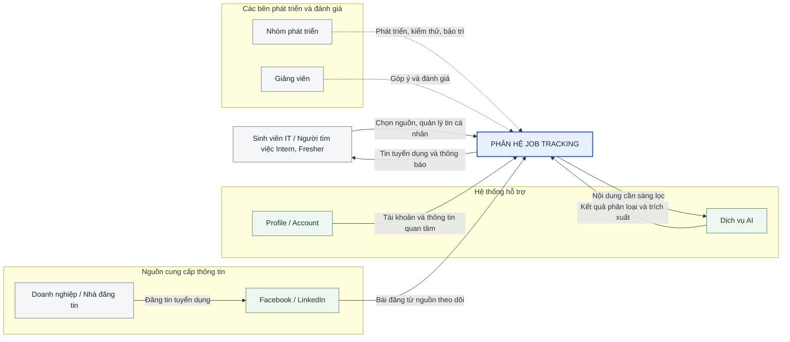
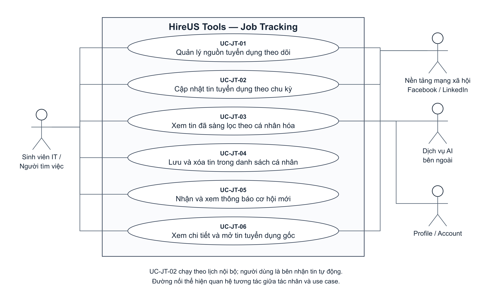
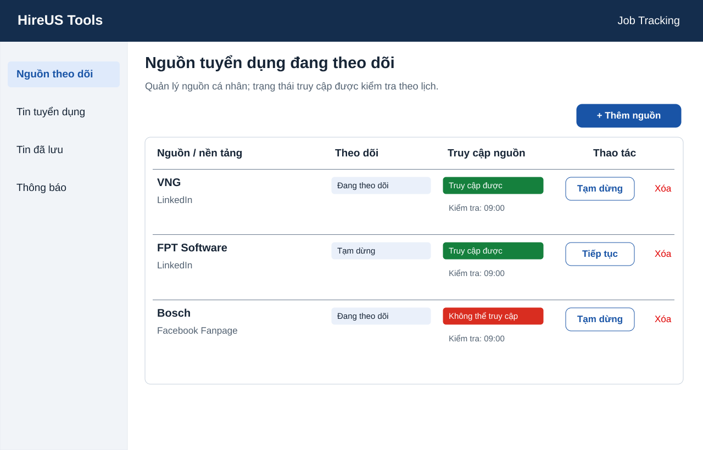
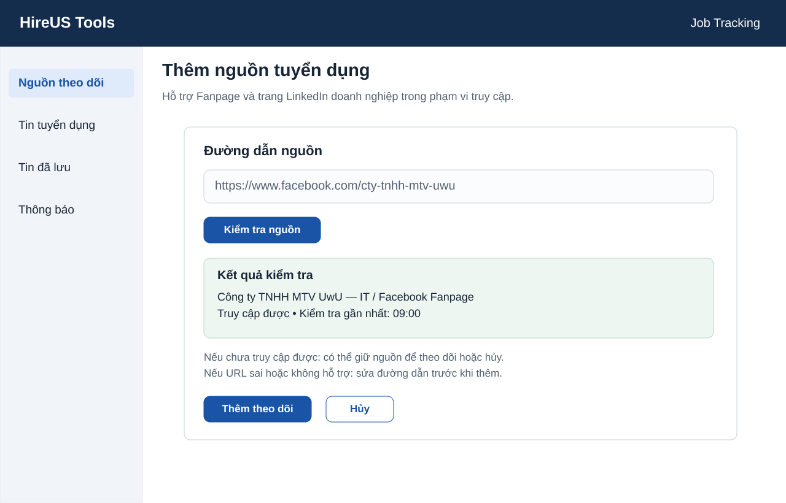
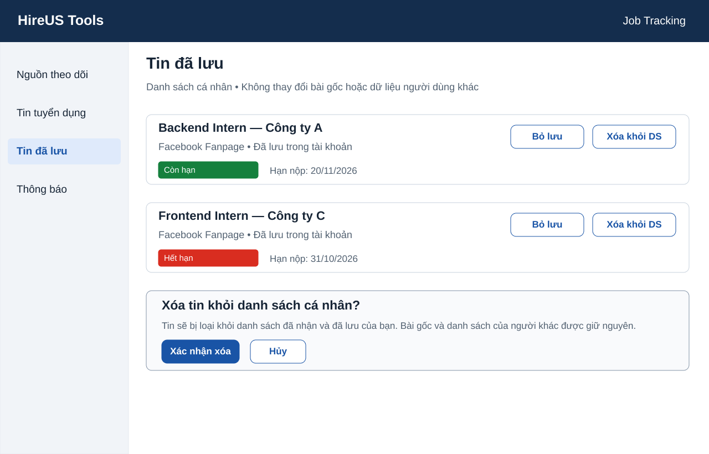
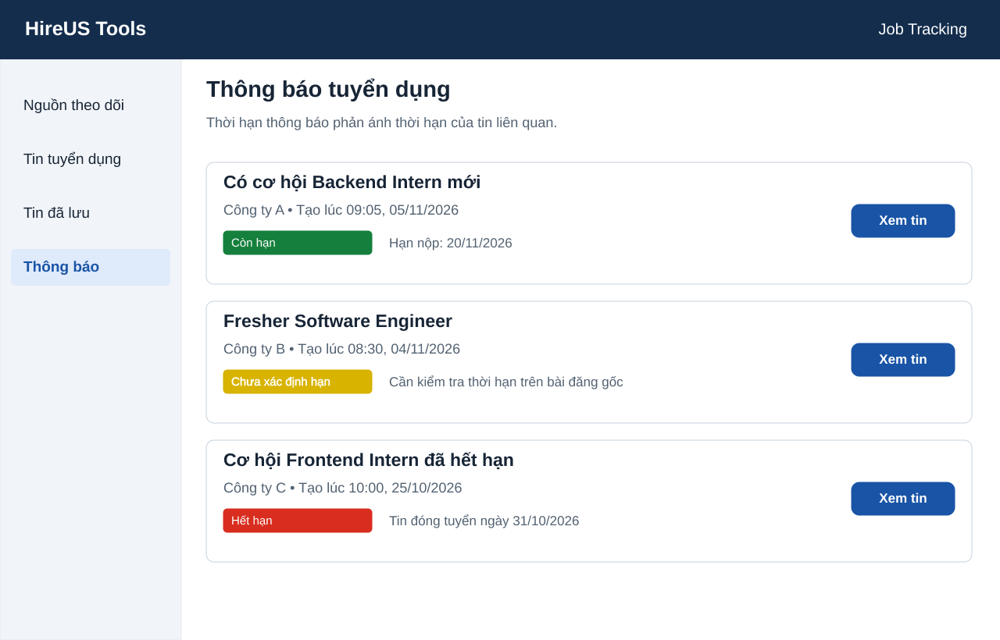

# 1. Mô tả kĩ bài toán

Sinh viên IT tìm việc Intern/Fresher thường khó cập nhật tin tuyển dụng từ nhiều Fanpage và trang LinkedIn doanh nghiệp. Tin dễ bị trôi hoặc lẫn với bài đăng không liên quan, khiến người dùng bỏ lỡ cơ hội ứng tuyển.

Phân hệ **Job Tracking** cho phép thêm/xóa nguồn, tạm dừng/tiếp tục theo dõi và kiểm tra nguồn còn hoạt động. Hệ thống định kỳ thu thập bài đăng, dùng AI sàng lọc tin tuyển dụng IT Intern/Fresher và trả kết quả theo nguồn theo dõi, thông tin quan tâm của người dùng.

Người dùng nhận thông báo khi có cơ hội mới, xem chi tiết, mở bài đăng gốc và lưu/xóa tin trong danh sách cá nhân. Hệ thống lưu và hiển thị trạng thái hết hạn của tin cùng thông báo liên quan; nếu chưa có căn cứ về thời hạn thì ghi **Chưa xác định**. Phân hệ được sử dụng trên trình duyệt web có kết nối Internet.

**Phạm vi:** Epic `SCRUM-9`, gồm năm Story `SCRUM-31` đến `SCRUM-35` và các subtask bắt buộc trong bảng sau. Các subtask được gộp vào nghiệp vụ của Story chính, không tách thành từng use case giao diện.

| Story | Nghiệp vụ | Subtask thuộc phạm vi |
| --- | --- | --- |
| SCRUM-31 | Quản lý nguồn tuyển dụng cần theo dõi | SCRUM-47: thêm/xóa nhà đăng tin; SCRUM-48: tạm dừng/tiếp tục theo dõi; SCRUM-67: kiểm tra nguồn còn hoạt động. |
| SCRUM-32 | Nhận tin mới từ nguồn đang theo dõi | SCRUM-44: kiểm tra theo chu kỳ; SCRUM-45: lưu/xóa tin đã nhận; SCRUM-43: lưu trạng thái hết hạn. |
| SCRUM-33 | Xem tin Intern/Fresher được AI sàng lọc | SCRUM-42: phân loại tin; SCRUM-41: lưu kết quả sàng lọc và thông tin tuyển dụng; SCRUM-68: trả kết quả theo cá nhân hóa người dùng. |
| SCRUM-34 | Nhận thông báo cơ hội mới | SCRUM-40: tạo thông báo từ tin mới; SCRUM-66: kiểm tra thông báo hết hạn. |
| SCRUM-35 | Xem chi tiết và mở tin gốc | SCRUM-37: lấy chi tiết tin; SCRUM-36: liên kết tới bài đăng gốc. |

# 2. Các bên liên quan (Stakeholder)

| Stakeholder | Vai trò |
| --- | --- |
| Sinh viên IT / người tìm việc Intern, Fresher | Người dùng chính; chọn nguồn, xem kết quả, lưu/xóa tin cá nhân, nhận thông báo và mở bài gốc. |
| Doanh nghiệp / nhà đăng tin | Cung cấp nội dung tuyển dụng trên Fanpage/LinkedIn; không mặc định có tài khoản hoặc đăng tin trực tiếp trong HireUS Tools. |
| Nền tảng Facebook / LinkedIn | Hệ thống ngoài lưu trữ bài đăng và cung cấp dữ liệu trong phạm vi truy cập được hỗ trợ. |
| Dịch vụ AI bên ngoài | Hỗ trợ phân loại bài đăng, trích xuất thông tin; không thay doanh nghiệp xác nhận cơ hội còn mở. |
| Phân hệ Profile/Account | Xác định tài khoản, quyền truy cập dữ liệu cá nhân và cung cấp thông tin quan tâm đã có phục vụ cá nhân hóa. |
| Nhóm phát triển | Phân tích, thiết kế, triển khai, kiểm thử và bảo trì phân hệ. |
| Giảng viên hướng dẫn / đánh giá | Góp ý và đánh giá tính đầy đủ, nhất quán của tài liệu, mô hình và prototype. |

Nhóm phát triển và giảng viên là stakeholder, không phải actor thực hiện nghiệp vụ trong sơ đồ use case. Doanh nghiệp tác động gián tiếp qua nền tảng mạng xã hội.

# 3. Đặc tả yêu cầu chức năng

## Quy ước mã

- **FR-JT**: yêu cầu chức năng của Job Tracking.
- **BR-JT**: quy tắc nghiệp vụ của Job Tracking.
- **NFR-JT**: yêu cầu phi chức năng của Job Tracking.
- **UC-JT**: use case của Job Tracking; dùng tiền tố riêng để tránh trùng mã khi ghép báo cáo nhóm.
- **SCRUM-xx**: Story hoặc subtask trong Jira.

## a. Quản lý nguồn tuyển dụng cần theo dõi

| Mã | Yêu cầu chức năng | Story / Subtask |
| --- | --- | --- |
| FR-JT-01 | Hệ thống hiển thị danh sách nguồn của người dùng gồm tên, nền tảng, đường dẫn, trạng thái theo dõi và tình trạng truy cập. | SCRUM-31 |
| FR-JT-02 | Hệ thống cho phép thêm nguồn bằng đường dẫn Fanpage/LinkedIn được hỗ trợ và thông báo khi đường dẫn rỗng, sai định dạng hoặc không hỗ trợ. | SCRUM-31 / 47 |
| FR-JT-03 | Hệ thống cho phép xóa quan hệ theo dõi nguồn khỏi tài khoản hiện tại mà không xóa nguồn hoặc quan hệ theo dõi của người khác. | SCRUM-31 / 47 |
| FR-JT-04 | Hệ thống cho phép tạm dừng và tiếp tục theo dõi; nguồn đã tạm dừng không phân phối thêm tin hoặc thông báo mới cho người dùng đó. | SCRUM-31 / 48 |
| FR-JT-05 | Hệ thống kiểm tra nguồn khi thêm và trong các lượt kiểm tra định kỳ, thể hiện trạng thái truy cập được, không truy cập được hoặc chưa kiểm tra cùng thời điểm kiểm tra gần nhất. | SCRUM-31 / 67 |

## b. Nhận và quản lý tin từ nguồn đang theo dõi

| Mã | Yêu cầu chức năng | Story / Subtask |
| --- | --- | --- |
| FR-JT-06 | Hệ thống kiểm tra nguồn đang được bật theo dõi theo chu kỳ cấu hình; việc kiểm tra không yêu cầu người dùng mở trang. | SCRUM-32 / 44 |
| FR-JT-07 | Hệ thống lưu bài đã nhận cùng nội dung, nguồn, liên kết gốc, thời gian đăng khi có và thời gian thu thập để phục vụ sàng lọc, xem lại. | SCRUM-32 / 45 |
| FR-JT-08 | Hệ thống cho phép người dùng lưu tin quan tâm vào danh sách cá nhân và bỏ lưu tin khi không còn nhu cầu. | SCRUM-32 / 45 |
| FR-JT-09 | Hệ thống cho phép xóa tin đã nhận khỏi danh sách cá nhân sau khi xác nhận; không xóa dữ liệu dùng chung hoặc tin của người khác. | SCRUM-32 / 45 |
| FR-JT-10 | Hệ thống lưu hạn ứng tuyển khi xác định được và cập nhật trạng thái thời hạn: Còn hạn, Hết hạn hoặc Chưa xác định. | SCRUM-32 / 43 |

## c. Sàng lọc và cá nhân hóa kết quả

| Mã | Yêu cầu chức năng | Story / Subtask |
| --- | --- | --- |
| FR-JT-11 | Hệ thống sử dụng AI để phân biệt cơ hội tuyển dụng IT Intern/Fresher với tin không liên quan hoặc chỉ tuyển cấp độ khác; bài thiếu căn cứ được giữ ở trạng thái chưa xác định. | SCRUM-33 / 42 |
| FR-JT-12 | Hệ thống lưu kết quả phân loại và các thông tin có trong nguồn, như vị trí, doanh nghiệp, cấp độ, địa điểm, yêu cầu, hạn nộp và cách ứng tuyển. | SCRUM-33 / 41 |
| FR-JT-13 | Hệ thống hiển thị danh sách tin đã sàng lọc, có nguồn và thời gian để đối chiếu, sắp xếp tin mới trước và cho phép mở chi tiết. | SCRUM-33 |
| FR-JT-14 | Hệ thống trả kết quả theo nguồn đang theo dõi và thông tin quan tâm đã có của đúng tài khoản; nếu chưa có thông tin quan tâm, trả danh sách IT Intern/Fresher từ nguồn theo dõi. | SCRUM-33 / 68 |
| FR-JT-15 | Hệ thống phân biệt các trường hợp đang tải, chưa có nguồn, chưa có tin phù hợp và không lấy được kết quả; không trình bày bài chưa phân loại thành tin phù hợp. | SCRUM-33 |

## d. Thông báo cơ hội tuyển dụng

| Mã | Yêu cầu chức năng | Story / Subtask |
| --- | --- | --- |
| FR-JT-16 | Hệ thống tạo thông báo cho người đang bật theo dõi khi có tin mới đã sàng lọc phù hợp và chưa được xác định hết hạn. | SCRUM-34 / 40 |
| FR-JT-17 | Thông báo thể hiện vị trí hoặc tiêu đề, doanh nghiệp/nguồn, thời điểm tạo và liên kết đến đúng tin chi tiết. | SCRUM-34 / 40 |
| FR-JT-18 | Hệ thống kiểm tra thời hạn tin khi tạo thông báo và khi mở danh sách/chi tiết thông báo; hiển thị Hết hạn nếu tin liên quan đã hết hạn, Chưa xác định nếu chưa có căn cứ thời hạn. | SCRUM-34 / 66 |

## e. Chi tiết tin và bài đăng gốc

| Mã | Yêu cầu chức năng | Story / Subtask |
| --- | --- | --- |
| FR-JT-19 | Hệ thống hiển thị nội dung đã lưu và các thông tin tuyển dụng được trích xuất, bao gồm trạng thái thời hạn; trường thiếu dữ liệu được ghi Chưa có thông tin. | SCRUM-35 / 37 |
| FR-JT-20 | Hệ thống phân biệt phần nội dung nguồn và phần AI tóm tắt/trích xuất, hiển thị nguồn và thời điểm cập nhật. | SCRUM-35 / 37 |
| FR-JT-21 | Hệ thống cho phép mở đúng bài đăng gốc bằng đường dẫn hợp lệ; nếu thiếu đường dẫn thì không tạo liên kết giả. | SCRUM-35 / 36 |
| FR-JT-22 | Nếu bài gốc đã xóa hoặc cần đăng nhập, hệ thống vẫn cho xem nội dung đã lưu còn thuộc quyền truy cập, kèm thời điểm cập nhật để người dùng đối chiếu. | SCRUM-35 / 36, 37 |

## Các quy tắc nghiệp vụ áp dụng

### BR-JT-01 — Quyền sở hữu dữ liệu cá nhân

Danh sách nguồn theo dõi, tin đã nhận/đã lưu và thông báo được gắn với đúng tài khoản. Backend phải kiểm tra quyền truy cập; việc ẩn nút trên giao diện không thay thế kiểm tra quyền.

### BR-JT-02 — Nguồn và nhà đăng tin

Nhà đăng tin trong phạm vi này được đại diện bằng nguồn Fanpage/LinkedIn doanh nghiệp. Thêm/xóa nhà đăng tin là thêm/xóa quan hệ theo dõi nguồn, không tạo/xóa tài khoản doanh nghiệp. Đang theo dõi và truy cập được là hai trạng thái độc lập; không truy cập được không đủ căn cứ kết luận doanh nghiệp ngừng tuyển hoặc trang đã đóng vĩnh viễn.

### BR-JT-03 — Theo dõi theo chu kỳ

Chỉ phân phối tin mới cho người đang bật theo dõi. Tạm dừng không xóa tin đã nhận, tin đã lưu hoặc thông báo cũ. Khi tiếp tục, nguồn trở lại các lượt kiểm tra tiếp theo. Chu kỳ và mốc lấy bài lần đầu sử dụng cấu hình thống nhất của nhóm, không cam kết cập nhật tức thời.

### BR-JT-04 — Lưu và xóa tin

Lưu bài đã thu thập là thao tác của hệ thống; lưu tin quan tâm là thao tác của người dùng. Xóa khỏi danh sách cá nhân không xóa bài gốc hoặc dữ liệu của người khác. Tin đã xóa không xuất hiện lại chỉ do tải lại danh sách; quy tắc phân phối lại nếu bài nguồn được cập nhật cần được thống nhất riêng.

### BR-JT-05 — Phân loại và dữ liệu AI

Chỉ bài có căn cứ tuyển IT Intern/Fresher mới được đưa vào danh sách phù hợp. Bài nhiều vị trí vẫn có thể được giữ nếu có vị trí thuộc phạm vi. Việc nhắc đến từ Intern/Fresher trong bài tổng kết chương trình không tự chứng minh đang tuyển. Không tự tạo doanh nghiệp, lương, thời hạn hoặc yêu cầu mà bài nguồn không cung cấp.

### BR-JT-06 — Cá nhân hóa kết quả

Cá nhân hóa sử dụng nguồn theo dõi và thông tin quan tâm đã có của người dùng, không mặc định đọc CV hoặc tính điểm phù hợp. Người chưa có thông tin quan tâm vẫn sử dụng được phân hệ. Tập trường sở thích và cách ưu tiên kết quả phải thống nhất với Profile/Account trước khi triển khai.

### BR-JT-07 — Thời hạn tuyển dụng

Nếu xác định được thời điểm đóng tuyển, tin còn hạn trước mốc đó và hết hạn khi đạt hoặc vượt mốc. Hạn chỉ ghi ngày được hiểu đến hết ngày tương ứng theo múi giờ Asia/Ho_Chi_Minh của ứng dụng. Bài không có hạn hoặc thời gian mơ hồ được ghi Chưa xác định; không tự đặt một số ngày tồn tại cho mọi tin. Thông báo đóng tuyển rõ ràng từ nguồn cũng là căn cứ xác định hết hạn.

### BR-JT-08 — Thời hạn của thông báo

Thông báo phản ánh trạng thái của tin liên quan: tin hết hạn thì thông báo ghi Hết hạn, không bị tự xóa. Không tạo thông báo cơ hội mới cho tin đã xác định hết hạn. Chưa xác định hạn phải được trình bày rõ, không đồng nghĩa còn hạn. Không áp dụng thời gian hết hạn độc lập cho thông báo trong phạm vi này.

### BR-JT-09 — Chi tiết và liên kết nguồn

Nội dung đã lưu là ảnh chụp dữ liệu tại thời điểm thu thập/cập nhật, không bảo đảm phản ánh thay đổi mới nhất trên mạng xã hội. Mở bài gốc là điều hướng sang nền tảng ngoài; Job Tracking không nộp hồ sơ thay người dùng hoặc xác nhận kết quả ứng tuyển.

# 4. Đặc tả yêu cầu phi chức năng

| Mã | Nhóm | Yêu cầu phi chức năng và cách kiểm tra |
| --- | --- | --- |
| NFR-JT-01 | Dễ sử dụng | Phân biệt rõ theo dõi/tạm dừng, truy cập nguồn và thời hạn tin; không chỉ dùng màu để thể hiện trạng thái. Các thao tác xóa có xác nhận và thông báo kết quả. |
| NFR-JT-02 | Bảo mật | Người dùng không xem hoặc thay đổi danh sách và thông báo cá nhân của tài khoản khác, kể cả khi thay định danh trong yêu cầu; khóa AI/nguồn ngoài chỉ nằm ở phía máy chủ. |
| NFR-JT-03 | Toàn vẹn dữ liệu | Tạm dừng/xóa theo dõi hoặc xóa tin cá nhân không làm mất dữ liệu của người khác. Khi lưu thất bại, hệ thống không hiển thị thành công. |
| NFR-JT-04 | Nhất quán | Danh sách, chi tiết và thông báo dùng cùng kết quả phân loại và căn cứ thời hạn. Khi tải lại tại cùng thời điểm, không hiển thị mâu thuẫn Còn hạn/Hết hạn giữa các màn hình. |
| NFR-JT-05 | Khả năng đáp ứng | Thu thập định kỳ và gọi AI không khóa thao tác xem dữ liệu đã lưu; giao diện thể hiện trạng thái đang tải. Chu kỳ quét và thời gian phản hồi mục tiêu được đo trên cấu hình thử nghiệm trước khi chốt. |
| NFR-JT-06 | Khả năng đọc | Hiển thị đúng tiếng Việt, nội dung dài và các trường thiếu; không che khuất nội dung hoặc nút thao tác khi đổi kích thước màn hình trong phạm vi thiết bị hỗ trợ. |
| NFR-JT-07 | Kiểm chứng được | Lưu nguồn gốc, thời điểm thu thập/kiểm tra và căn cứ thời hạn để đối chiếu. Đánh giá AI bằng tập bài có nhãn gồm tin phù hợp, không phù hợp và chưa rõ; không mặc định AI luôn đúng. |
| NFR-JT-08 | Khả năng bảo trì | Tách việc truy cập nguồn và gọi AI khỏi nghiệp vụ danh sách cá nhân; chu kỳ kiểm tra có thể cấu hình. FE sử dụng hợp đồng API do BE quản lý, không tự quy định một hợp đồng khác. |

# 5. Đặc tả yêu cầu

## 5.1 Sơ đồ Use Case

Sơ đồ thể hiện tác nhân bên ngoài ranh giới Job Tracking, các use case dạng hình oval và đường nối không hướng biểu thị quan hệ tương tác.

Sơ đồ gồm sáu use case nghiệp vụ, bao phủ năm Story. Sinh viên/người tìm việc là tác nhân chính; nền tảng mạng xã hội và dịch vụ AI là hệ thống hỗ trợ. Profile/Account cung cấp ngữ cảnh tài khoản và thông tin quan tâm cho cá nhân hóa. Bộ lập lịch là thành phần bên trong hệ thống, không được mô hình hóa thành người dùng hoặc dịch vụ ngoài.

UC-JT-02 chạy khi đến lịch và cung cấp bài cho quá trình sàng lọc của UC-JT-03; UC-JT-05 tạo thông báo khi có kết quả phù hợp. Đây là trình tự xử lý dữ liệu, không dùng mũi tên include/extend để biểu diễn thứ tự thời gian. Mở tin chi tiết từ danh sách hoặc thông báo là lựa chọn của người dùng, không phải bước bắt buộc của mọi lần xem danh sách.

## 5.2 Đặc tả Use Case

### 5.2.1. Quản lý nguồn tuyển dụng theo dõi

| Thành phần | Đặc tả |
| --- | --- |
| **Use Case ID** | UC-JT-01 |
| **Tên Use Case** | Quản lý nguồn tuyển dụng theo dõi |
| **Tóm tắt** | Thêm/xóa nguồn, tạm dừng/tiếp tục và xem tình trạng truy cập nguồn. |
| **Tác nhân** | Sinh viên/người tìm việc; nền tảng mạng xã hội hỗ trợ kiểm tra nguồn. |
| **Điều kiện tiên quyết** | Người dùng đã đăng nhập. |
| **Kết quả** | Quan hệ theo dõi của đúng tài khoản được cập nhật; nguồn và trạng thái được hiển thị. |
| **Kịch bản chính** | 1. Người dùng mở danh sách nguồn. 2. Hệ thống tải nguồn và trạng thái của tài khoản. 3. Người dùng chọn thêm, nhập đường dẫn Fanpage/LinkedIn. 4. Hệ thống kiểm tra định dạng, phạm vi hỗ trợ và khả năng truy cập. 5. Hệ thống lưu nguồn theo dõi cùng kết quả kiểm tra, hiển thị danh sách đã cập nhật. |
| **Kịch bản phụ** | A1 — Tại bước 3, chọn tạm dừng/tiếp tục: hệ thống đổi trạng thái của quan hệ theo dõi. A2 — Tại bước 3, chọn xóa: hệ thống yêu cầu xác nhận rồi xóa quan hệ theo dõi cá nhân. A3 — Tại bước 4, URL rỗng/sai/không hỗ trợ: báo lỗi và không lưu. A4 — Tại bước 4, nguồn không truy cập được: nêu trạng thái, cho người dùng chọn giữ nguồn để theo dõi hoặc hủy; không khẳng định nguồn đã đóng vĩnh viễn. A5 — Lưu thất bại: giữ dữ liệu nhập và không báo thành công. |
| **Ràng buộc phi chức năng** | NFR-JT-01, 02, 03, 07. |
| **Truy vết** | FR-JT-01–05; SCRUM-31 / 47, 48, 67. |

### 5.2.2. Cập nhật tin tuyển dụng theo chu kỳ

| Thành phần | Đặc tả |
| --- | --- |
| **Use Case ID** | UC-JT-02 |
| **Tên Use Case** | Cập nhật tin tuyển dụng theo chu kỳ |
| **Tóm tắt** | Thu thập bài từ nguồn đang theo dõi, lưu dữ liệu và căn cứ thời hạn. |
| **Tác nhân** | Sinh viên/người tìm việc là bên nhận lợi ích; nền tảng mạng xã hội cung cấp bài đăng. Kích hoạt bởi bộ lập lịch nội bộ. |
| **Điều kiện tiên quyết** | Có nguồn được bật theo dõi; phương thức truy cập và chu kỳ đã được cấu hình. |
| **Kết quả** | Bài thu thập được lưu để sàng lọc; thời điểm kiểm tra và thông tin thời hạn hiện có được ghi nhận. |
| **Kịch bản chính** | 1. Đến thời điểm kiểm tra. 2. Hệ thống lấy các nguồn đang có người bật theo dõi. 3. Hệ thống kiểm tra khả năng truy cập và lấy bài trong khoảng thu thập cấu hình. 4. Hệ thống lưu nội dung, nguồn, URL và các mốc thời gian hiện có. 5. Hệ thống xác định/lưu căn cứ thời hạn nếu có và chuyển bài sang sàng lọc. 6. Hệ thống ghi nhận kết quả kiểm tra. |
| **Kịch bản phụ** | A1 — Không có nguồn đang theo dõi: kết thúc lượt kiểm tra. A2 — Không có bài mới: ghi nhận đã kiểm tra, không tạo tin giả. A3 — Nguồn không truy cập được: cập nhật trạng thái nguồn, không ghi nhận thu thập thành công cho nguồn đó. A4 — Bài không có hạn rõ ràng: lưu trạng thái Chưa xác định. A5 — Người dùng đã tạm dừng trước khi phân phối: không thêm tin mới vào danh sách của tài khoản đó. |
| **Ràng buộc phi chức năng** | NFR-JT-03, 04, 05, 07, 08. |
| **Truy vết** | FR-JT-06, 07, 10; SCRUM-32 / 43, 44, 45. |

### 5.2.3. Xem tin đã sàng lọc theo cá nhân hóa

| Thành phần | Đặc tả |
| --- | --- |
| **Use Case ID** | UC-JT-03 |
| **Tên Use Case** | Xem tin đã sàng lọc theo cá nhân hóa |
| **Tóm tắt** | Phân loại bài và hiển thị tin IT Intern/Fresher theo ngữ cảnh của người dùng. |
| **Tác nhân** | Sinh viên/người tìm việc; dịch vụ AI; phân hệ Profile/Account. |
| **Điều kiện tiên quyết** | Người dùng đã đăng nhập; có nguồn theo dõi. Bài mới được sàng lọc trước khi xuất hiện trong danh sách phù hợp. |
| **Kết quả** | Người dùng xem kết quả thuộc phạm vi nguồn và thông tin quan tâm của mình. |
| **Kịch bản chính** | 1. Với bài mới thu thập, hệ thống gửi nội dung cần thiết đến AI để phân loại/trích xuất. 2. Hệ thống kiểm tra và lưu kết quả phân loại, thông tin có căn cứ. 3. Người dùng mở danh sách tin. 4. Hệ thống xác định nguồn theo dõi và thông tin quan tâm của tài khoản. 5. Hệ thống trả danh sách tin phù hợp, hiển thị nguồn, thời gian và trạng thái hạn. 6. Người dùng chọn tin để xem chi tiết hoặc lưu lại. |
| **Kịch bản phụ** | A1 — Bài không liên quan/chỉ tuyển cấp độ khác: không đưa vào danh sách phù hợp. A2 — Bài nhiều vị trí: giữ phần Intern/Fresher có căn cứ và cho xem toàn bài ở chi tiết. A3 — Bài chưa rõ hoặc AI không trả kết quả hợp lệ: chưa trình bày thành tin phù hợp; dữ liệu đã lưu không bị đổi thành kết quả giả. A4 — Không có thông tin quan tâm: hiển thị tin IT Intern/Fresher từ nguồn theo dõi. A5 — Chưa có nguồn hoặc chưa có tin phù hợp: hiển thị hướng dẫn tương ứng. |
| **Ràng buộc phi chức năng** | NFR-JT-01, 02, 04, 05, 06, 07. |
| **Truy vết** | FR-JT-11–15; SCRUM-33 / 41, 42, 68. |

### 5.2.4. Lưu và xóa tin trong danh sách cá nhân

| Thành phần | Đặc tả |
| --- | --- |
| **Use Case ID** | UC-JT-04 |
| **Tên Use Case** | Lưu và xóa tin trong danh sách cá nhân |
| **Tóm tắt** | Đánh dấu tin quan tâm để xem lại, bỏ lưu hoặc xóa khỏi danh sách cá nhân. |
| **Tác nhân** | Sinh viên/người tìm việc. |
| **Điều kiện tiên quyết** | Người dùng đã đăng nhập và có quyền xem tin cần thao tác. |
| **Kết quả** | Trạng thái lưu hoặc sự hiện diện trong danh sách cá nhân được cập nhật; dữ liệu của người khác giữ nguyên. |
| **Kịch bản chính** | 1. Người dùng chọn Lưu tin từ danh sách hoặc chi tiết. 2. Hệ thống lưu đánh dấu cho đúng tài khoản. 3. Người dùng mở danh sách Tin đã lưu. 4. Hệ thống hiển thị tin đã chọn cùng trạng thái thời hạn hiện tại. |
| **Kịch bản phụ** | A1 — Chọn Bỏ lưu: chỉ bỏ đánh dấu, tin có thể vẫn còn trong danh sách đã nhận. A2 — Chọn Xóa khỏi danh sách: hỏi xác nhận, sau đó loại khỏi danh sách cá nhân và đánh dấu lưu của người đó nếu có. A3 — Hủy xác nhận: giữ nguyên dữ liệu. A4 — Không thuộc quyền truy cập hoặc lưu/xóa thất bại: không thay đổi dữ liệu và thông báo phù hợp. A5 — Tin đã hết hạn: vẫn có thể xem/lưu để tham khảo nhưng phải giữ nhãn Hết hạn. |
| **Ràng buộc phi chức năng** | NFR-JT-01, 02, 03, 04. |
| **Truy vết** | FR-JT-08, 09; SCRUM-32 / 45. |

### 5.2.5. Nhận và xem thông báo cơ hội mới

| Thành phần | Đặc tả |
| --- | --- |
| **Use Case ID** | UC-JT-05 |
| **Tên Use Case** | Nhận và xem thông báo cơ hội mới |
| **Tóm tắt** | Tạo thông báo từ kết quả phù hợp và thể hiện thời hạn của cơ hội liên quan. |
| **Tác nhân** | Sinh viên/người tìm việc. |
| **Điều kiện tiên quyết** | Có tin mới đã sàng lọc phù hợp; người nhận đang bật theo dõi nguồn. Người dùng đăng nhập để xem thông báo cá nhân. |
| **Kết quả** | Thông báo thuộc đúng tài khoản được hiển thị với trạng thái thời hạn của tin; có thể mở chi tiết. |
| **Kịch bản chính** | 1. Hệ thống nhận kết quả sàng lọc tin mới. 2. Hệ thống xác định người còn theo dõi và kiểm tra hạn tuyển dụng. 3. Nếu chưa xác định hết hạn, hệ thống tạo thông báo gồm tiêu đề, nguồn, thời gian và liên kết tin. 4. Người dùng mở danh sách thông báo. 5. Hệ thống kiểm tra trạng thái hạn hiện tại và hiển thị tương ứng. 6. Người dùng chọn thông báo để xem chi tiết tin. |
| **Kịch bản phụ** | A1 — Tin đã hết hạn tại bước 2: không tạo thông báo cơ hội mới. A2 — Không có căn cứ hạn: hiển thị Chưa xác định hạn, không cam kết cơ hội còn mở. A3 — Tin hết hạn sau khi thông báo được tạo: giữ thông báo với nhãn Hết hạn. A4 — Người đã dừng theo dõi: không tạo thông báo mới cho người đó. A5 — Tin không còn khả dụng trong phạm vi truy cập: báo không xem được, không điều hướng sang tin khác. |
| **Ràng buộc phi chức năng** | NFR-JT-01, 02, 04, 06. |
| **Truy vết** | FR-JT-16–18; SCRUM-34 / 40, 66. |

### 5.2.6. Xem chi tiết và mở tin tuyển dụng gốc

| Thành phần | Đặc tả |
| --- | --- |
| **Use Case ID** | UC-JT-06 |
| **Tên Use Case** | Xem chi tiết và mở tin tuyển dụng gốc |
| **Tóm tắt** | Xem thông tin đã lưu và truy cập nguồn để kiểm tra cách ứng tuyển. |
| **Tác nhân** | Sinh viên/người tìm việc; nền tảng mạng xã hội tiếp nhận điều hướng sang bài gốc. |
| **Điều kiện tiên quyết** | Người dùng đã đăng nhập và được phép xem tin. |
| **Kết quả** | Tin chi tiết được hiển thị; khi người dùng chọn, bài gốc được mở trên nền tảng ngoài. |
| **Kịch bản chính** | 1. Người dùng chọn tin từ danh sách đã nhận, tin đã lưu hoặc thông báo. 2. Hệ thống kiểm tra quyền và lấy chi tiết đã lưu. 3. Hệ thống hiển thị nội dung nguồn, thông tin trích xuất, thời điểm cập nhật và trạng thái hạn. 4. Người dùng chọn Mở bài đăng gốc. 5. Hệ thống mở đúng URL của bài trên nền tảng ngoài. |
| **Kịch bản phụ** | A1 — Tin không tồn tại/không được phép xem: thông báo phù hợp, không tiết lộ dữ liệu tài khoản khác. A2 — Thiếu trường: hiển thị Chưa có thông tin. A3 — Thiếu URL: vô hiệu hóa thao tác mở bài gốc. A4 — Bài gốc bị xóa hoặc cần đăng nhập: người dùng vẫn có thể quay lại nội dung đã lưu; thời điểm cập nhật được giữ rõ. A5 — Tin hết hạn: vẫn cho xem nhưng hiển thị Hết hạn, không xác nhận đang mở tuyển. |
| **Ràng buộc phi chức năng** | NFR-JT-02, 04, 06, 07. |
| **Truy vết** | FR-JT-19–22; SCRUM-35 / 36, 37. |

# 6. Bản mẫu (Prototype)

Các hình dưới đây minh họa sáu màn hình Job Tracking được thiết kế trong Figma. Bảng và mô tả từng màn hình trình bày nội dung, thao tác tương ứng trong prototype.

| Frame | Màn hình | Story liên quan |
| --- | --- | --- |
| JT-F01 | Nguồn theo dõi: tên, nền tảng, tình trạng nguồn, tạm dừng/tiếp tục và xóa | SCRUM-31 / 47, 48, 67 |
| JT-F02 | Thêm nguồn: nhập URL và hiển thị kết quả kiểm tra nguồn | SCRUM-31 / 47, 67 |
| JT-F03 | Tin tuyển dụng: danh sách đã sàng lọc, thông tin cá nhân hóa và trạng thái hạn | SCRUM-32 / 43, 44; SCRUM-33 / 41, 42, 68 |
| JT-F04 | Tin đã lưu: xem lại, bỏ lưu và xác nhận xóa khỏi danh sách cá nhân | SCRUM-32 / 45 |
| JT-F05 | Thông báo: cơ hội mới, cơ hội đã hết hạn và trường hợp chưa xác định hạn | SCRUM-34 / 40, 66 |
| JT-F06 | Chi tiết tin: nội dung nguồn, phần trích xuất, thời hạn và liên kết bài gốc | SCRUM-35 / 36, 37 |

## JT-F01 — Nguồn theo dõi

Trạng thái Đang theo dõi/Tạm dừng thuộc quan hệ của người dùng; Truy cập được/Không truy cập được thuộc lần kiểm tra nguồn. Hai thông tin được trình bày riêng. Người dùng có thể mở form thêm hoặc thao tác trực tiếp trên từng nguồn.

## JT-F02 — Thêm nguồn

Người dùng nhập đường dẫn, kiểm tra nguồn, xem tên/nền tảng và quyết định thêm. Khi nguồn không truy cập được, giao diện nêu rõ kết quả và cho chọn giữ nguồn để theo dõi hoặc hủy; khi URL sai thì không cho lưu.

## JT-F03 — Danh sách tin tuyển dụng

Phần đầu thể hiện căn cứ cá nhân hóa đang dùng; mỗi tin có nguồn, cấp độ và trạng thái thời hạn bằng chữ. Người chưa có thông tin quan tâm vẫn xem được tin từ nguồn theo dõi. Việc cá nhân hóa không hiển thị phần trăm phù hợp CV.

## JT-F04 — Tin đã lưu

Bỏ lưu và Xóa khỏi danh sách là hai thao tác khác nhau. Hộp xác nhận xóa nêu rõ chỉ tác động đến tài khoản hiện tại. Tin hết hạn vẫn có thể được lưu để tham khảo nhưng không mất nhãn hết hạn.

## JT-F05 — Thông báo tuyển dụng

Thông báo dẫn đến tin tương ứng và thể hiện thời hạn của cơ hội tại lúc xem. Thông báo cũ chuyển sang Hết hạn khi có căn cứ; trường hợp không có hạn dùng nhãn Chưa xác định hạn.

## JT-F06 — Chi tiết và bài gốc

Người dùng kiểm tra các trường trích xuất, nội dung nguồn và thời điểm cập nhật trước khi mở bài gốc. Các nút lưu và quay lại hỗ trợ đi tiếp hoặc trở về danh sách; mở nguồn không phải thao tác nộp hồ sơ trong HireUS Tools.

**Luồng mẫu để đối chiếu prototype:** JT-F01 → JT-F02 → JT-F01 để thêm nguồn; JT-F03 → JT-F06 → JT-F04 để xem và lưu tin; JT-F05 → JT-F06 để xem cơ hội từ thông báo. Từ JT-F01, tạm dừng nguồn rồi kiểm tra rằng lượt xử lý sau không tạo thêm tin hoặc thông báo cho nguồn đó trong tài khoản hiện tại.
