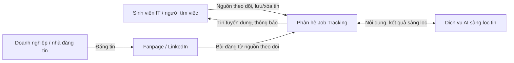
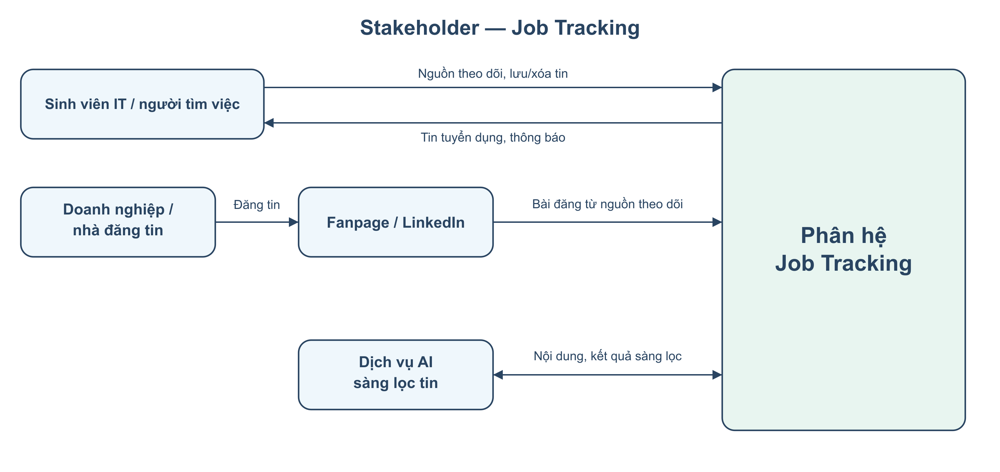

# 1. Mô tả bài toán

Sinh viên IT tìm việc Intern/Fresher thường khó cập nhật tin tuyển dụng từ nhiều Fanpage và trang LinkedIn doanh nghiệp. Tin dễ bị trôi hoặc lẫn với bài đăng không liên quan, khiến người dùng bỏ lỡ cơ hội ứng tuyển.

Phân hệ **Job Tracking** cho phép thêm/xóa nguồn, tạm dừng/tiếp tục theo dõi và kiểm tra nguồn còn hoạt động. Hệ thống định kỳ thu thập bài đăng, dùng AI sàng lọc tin tuyển dụng IT Intern/Fresher và trả kết quả theo nguồn theo dõi, thông tin quan tâm của người dùng.

Theo chu kỳ kiểm tra, người dùng nhận thông báo khi có cơ hội mới, xem chi tiết, mở bài đăng gốc và lưu/xóa tin trong danh sách cá nhân. Hệ thống lưu và hiển thị trạng thái hết hạn của tin cùng thông báo liên quan; nếu chưa có căn cứ về thời hạn thì ghi **Chưa xác định**. Phân hệ được sử dụng trên trình duyệt web có kết nối Internet.

**Phạm vi:** Epic `SCRUM-9`, gồm năm Story `SCRUM-31` đến `SCRUM-35` và các subtask bắt buộc trong bảng sau. Các subtask được gộp vào nghiệp vụ của Story chính, không tách thành từng use case giao diện.

| Story | Nghiệp vụ | Subtask thuộc phạm vi |
| --- | --- | --- |
| SCRUM-31 | Quản lý nguồn tuyển dụng cần theo dõi | SCRUM-47: thêm/xóa nhà đăng tin; SCRUM-48: tạm dừng/tiếp tục theo dõi; SCRUM-67: kiểm tra nguồn còn hoạt động. |
| SCRUM-32 | Nhận tin mới từ nguồn đang theo dõi | SCRUM-44: kiểm tra theo chu kỳ; SCRUM-45: lưu/xóa tin đã nhận; SCRUM-43: lưu trạng thái hết hạn. |
| SCRUM-33 | Xem tin Intern/Fresher được AI sàng lọc | SCRUM-42: phân loại tin; SCRUM-41: lưu kết quả sàng lọc và thông tin tuyển dụng; SCRUM-68: trả kết quả theo cá nhân hóa người dùng. |
| SCRUM-34 | Nhận thông báo cơ hội mới | SCRUM-40: tạo thông báo từ tin mới; SCRUM-66: kiểm tra thông báo hết hạn. |
| SCRUM-35 | Xem chi tiết và mở tin gốc | SCRUM-37: lấy chi tiết tin; SCRUM-36: liên kết tới bài đăng gốc. |

# 2. Các bên liên quan (Stakeholder)

Phần này xét các bên trực tiếp tham gia nghiệp vụ Job Tracking (SCRUM-31–35).

| Stakeholder | Vai trò trong Job Tracking |
| --- | --- |
| Sinh viên IT / người tìm việc Intern, Fresher | Quản lý nguồn theo dõi; xem, lưu/xóa tin; nhận thông báo và mở bài gốc. |
| Doanh nghiệp / nhà đăng tin | Đăng thông tin tuyển dụng trên Fanpage/LinkedIn để người dùng theo dõi. |
| Nền tảng Fanpage / LinkedIn | Cung cấp bài đăng và liên kết gốc trong phạm vi truy cập được hỗ trợ. |
| Dịch vụ AI sàng lọc tin | Phân loại tin IT Intern/Fresher và trích xuất thông tin tuyển dụng từ bài đăng. |

# 3. Đặc tả yêu cầu chức năng

## Quy ước mã

- **FR-JT**: yêu cầu chức năng của Job Tracking.
- **BR-JT**: quy tắc nghiệp vụ của Job Tracking.
- **NFR-JT**: yêu cầu phi chức năng của Job Tracking.
- **UC-JT**: use case của Job Tracking; dùng tiền tố riêng để tránh trùng mã khi ghép báo cáo nhóm.
- **SCRUM-xx**: Story hoặc subtask trong Jira.

## a. Quản lý nguồn tuyển dụng cần theo dõi

| Mã | Yêu cầu chức năng | Story / Subtask |
| --- | --- | --- |
| FR-JT-01 | Hệ thống hiển thị danh sách các nhà đăng tin tuyển dụng | SCRUM-31 |
| FR-JT-02 | Hệ thống cho phép thêm hoặc xóa nguồn theo dõi bằng đường dẫn Fanpage/LinkedIn được hỗ trợ. | SCRUM-31 / 47 |
| FR-JT-03 | Hệ thống cho phép tạm dừng và tiếp tục theo dõi nhà tuyển dụng cụ thể. | SCRUM-31 / 48 |
| FR-JT-04 | Hệ thống kiểm tra nguồn, cập nhật trạng thái: Truy cập được, Không truy cập được. | SCRUM-31 / 67 |

## b. Nhận và quản lý tin từ nguồn đang theo dõi

| Mã | Yêu cầu chức năng | Story / Subtask |
| --- | --- | --- |
| FR-JT-05 | Hệ thống nhận tin tuyển dụng từ nguồn đang được bật theo dõi theo chu kỳ. | SCRUM-32 / 44 |
| FR-JT-06 | Hệ thống lưu bài đã nhận cùng nội dung, nhà đăng tin, liên kết gốc, thời gian đăng tin. | SCRUM-32 / 45 |
| FR-JT-07 | Hệ thống cho phép lưu, bỏ lưu hoặc xóa tin trong danh sách cá nhân; xác nhận trước khi xóa. | SCRUM-32 / 45 |
| FR-JT-08 | Hệ thống lưu hạn ứng tuyển khi xác định được và cập nhật trạng thái thời hạn: Còn hạn, Hết hạn hoặc Chưa xác định. | SCRUM-32 / 43 |

## c. Sàng lọc và cá nhân hóa kết quả

| Mã | Yêu cầu chức năng | Story / Subtask |
| --- | --- | --- |
| FR-JT-09 | Hệ thống dùng AI sàng lọc tin IT Intern/Fresher và lưu kết quả cùng vị trí, địa điểm, yêu cầu, hạn nộp, cách ứng tuyển khi có. | SCRUM-33 / 41, 42 |
| FR-JT-10 | Hệ thống hiển thị danh sách tin đã sàng lọc. | SCRUM-33 |
| FR-JT-11 | Hệ thống trả tin theo nguồn theo dõi và thông tin quan tâm của đúng tài khoản. | SCRUM-33 / 68 |

## d. Thông báo cơ hội tuyển dụng

| Mã | Yêu cầu chức năng | Story / Subtask |
| --- | --- | --- |
| FR-JT-12 | Sau lượt kiểm tra định kỳ, hệ thống tạo thông báo khi có tin mới đã sàng lọc phù hợp và chưa được xác định hết hạn. | SCRUM-34 / 40 |
| FR-JT-13 | Thông báo gồm tiêu đề, nhà tuyển dụng, vị trí, thời điểm và liên kết đến đúng tin chi tiết. | SCRUM-34 / 40 |
| FR-JT-14 | Hệ thống kiểm tra thời hạn tin, cập nhật hạn tin tuyển dụng. | SCRUM-34 / 66 |

## e. Chi tiết tin và bài đăng gốc

| Mã | Yêu cầu chức năng | Story / Subtask |
| --- | --- | --- |
| FR-JT-15 | Hệ thống hiển thị nội dung đã lưu và các thông tin tuyển dụng được trích xuất. | SCRUM-35 / 37 |
| FR-JT-16 | Hệ thống gợi ý người dùng sử dụng AI trích xuất thông tin. | SCRUM-35 / 37 |
| FR-JT-17 | Hệ thống lưu đường dẫn của bài đăng gốc nếu người dùng muốn trực tiếp xem. | SCRUM-35 / 36 |
| FR-JT-18 | Nếu bài gốc đã xóa, cập nhật lên hệ thống: Tin không còn tồn tại. | SCRUM-35 / 36, 37 |

## Các quy tắc nghiệp vụ áp dụng

### BR-JT-01 — Dữ liệu cá nhân

Nguồn theo dõi, tin cá nhân và thông báo thuộc đúng tài khoản; Backend kiểm tra quyền truy cập. Xóa nguồn là bỏ quan hệ theo dõi, không xóa tài khoản doanh nghiệp. Lưu bài thu thập khác với đánh dấu tin quan tâm; bỏ lưu khác với xóa khỏi danh sách. Xóa chỉ tác động đến người thực hiện, không xóa bài gốc hoặc dữ liệu của người khác.

### BR-JT-02 — Nguồn và chu kỳ theo dõi

Nguồn là Fanpage/LinkedIn doanh nghiệp trong phạm vi truy cập hỗ trợ. Trạng thái theo dõi độc lập với khả năng truy cập; không truy cập được không chứng minh doanh nghiệp đã ngừng tuyển. Hệ thống kiểm tra theo chu kỳ cấu hình, chỉ phân phối tin mới cho người đang bật theo dõi. Tạm dừng giữ dữ liệu cũ; tiếp tục có hiệu lực từ lượt kiểm tra kế tiếp.

### BR-JT-03 — Sàng lọc và cá nhân hóa

AI dựa vào nội dung để chọn tin tuyển IT Intern/Fresher, kể cả bài tuyển nhiều cấp độ; không chỉ dựa vào từ khóa. Bài chưa rõ chưa được coi là phù hợp; không tự tạo thông tin thiếu. Kết quả dựa vào nguồn theo dõi và thông tin quan tâm; thiếu thông tin quan tâm thì dùng danh sách Intern/Fresher từ nguồn theo dõi. Job Tracking không tính điểm CV–JD hoặc Skill Gap.

### BR-JT-04 — Thời hạn tin và thông báo

Hạn rõ ràng hoặc thông báo đóng tuyển là căn cứ xác định hết hạn; hạn chỉ ghi ngày được hiểu đến cuối ngày theo múi giờ ứng dụng. Thiếu căn cứ thì ghi Chưa xác định, không mặc định còn hạn. Tin và thông báo dùng cùng trạng thái; tin hết hạn không tạo thông báo cơ hội mới, thông báo cũ vẫn được giữ và ghi Hết hạn.

### BR-JT-05 — Chi tiết và bài gốc

Thông tin trích xuất phải có căn cứ từ bài nguồn; dữ liệu lưu phản ánh thời điểm thu thập, không bảo đảm mới nhất. Mở bài gốc là điều hướng ra nền tảng ngoài, không nộp hồ sơ thay người dùng. Chỉ ghi Tin không còn tồn tại khi xác định bài đã bị xóa; lỗi truy cập hoặc yêu cầu đăng nhập không đồng nghĩa bài đã bị xóa. Bản đã lưu vẫn xem được nếu còn dữ liệu và quyền truy cập.

# 4. Đặc tả yêu cầu phi chức năng

| Mã | Nhóm | Yêu cầu |
| --- | --- | --- |
| NFR-JT-01 | Dễ sử dụng | Trạng thái có nhãn rõ ràng, không chỉ dùng màu; thao tác xóa có xác nhận và báo kết quả. |
| NFR-JT-02 | Bảo mật | Kiểm tra quyền theo tài khoản ở máy chủ; không lộ dữ liệu người khác hoặc khóa dịch vụ. |
| NFR-JT-03 | Toàn vẹn dữ liệu | Thao tác cá nhân không làm mất dữ liệu người khác; lưu lỗi không báo thành công. |
| NFR-JT-04 | Nhất quán | Danh sách, chi tiết và thông báo thống nhất kết quả phân loại và trạng thái thời hạn. |
| NFR-JT-05 | Khả năng đáp ứng | Thu thập/AI không chặn xem tin đã lưu; có trạng thái tải. Mục tiêu phản hồi được chốt qua thử nghiệm. |
| NFR-JT-06 | Khả năng đọc | Hiển thị rõ tiếng Việt, nội dung dài và trường thiếu trên kích thước màn hình hỗ trợ. |
| NFR-JT-07 | Kiểm chứng được | Lưu nguồn, thời điểm và căn cứ thời hạn; kiểm tra AI bằng bài mẫu đã gán nhãn. |
| NFR-JT-08 | Khả năng bảo trì | Tách tích hợp nguồn/AI khỏi nghiệp vụ cá nhân; cấu hình được chu kỳ; FE dùng hợp đồng API của BE. |

# 5. Đặc tả yêu cầu

## 5.1 Sơ đồ Use Case

Bốn use case bao phủ năm Story. UC-JT-02 gộp kiểm tra nguồn, sàng lọc và nhận thông báo mới theo chu kỳ. UC-JT-04 bao gồm xem chi tiết, lưu/bỏ lưu/xóa tin và mở bài gốc. Sinh viên là tác nhân chính; nền tảng mạng xã hội, AI và Profile/Account hỗ trợ. Bộ lập lịch nằm trong hệ thống; đường nối thể hiện tương tác, không phải thứ tự xử lý.

## 5.2 Đặc tả Use Case

**Xử lý chung:** các thao tác cá nhân yêu cầu đăng nhập và đúng quyền truy cập. Khi đang tải, danh sách rỗng hoặc xử lý lỗi, hệ thống thông báo phù hợp; không báo thành công khi chưa lưu và không làm mất dữ liệu đã có.

### 5.2.1. Quản lý nguồn tuyển dụng theo dõi

| Thành phần | Đặc tả |
| --- | --- |
| **Use Case ID** | UC-JT-01 |
| **Tên Use Case** | Quản lý nguồn tuyển dụng theo dõi |
| **Tóm tắt** | Thêm/xóa, tạm dừng/tiếp tục và kiểm tra nguồn. |
| **Tác nhân** | Sinh viên; nền tảng mạng xã hội. |
| **Điều kiện tiên quyết** | Người dùng đã đăng nhập. |
| **Kết quả** | Danh sách và trạng thái nguồn của tài khoản được cập nhật. |
| **Kịch bản chính** | 1. Người dùng nhập đường dẫn nguồn. 2. Hệ thống kiểm tra đường dẫn và khả năng truy cập. 3. Lưu nguồn theo dõi, hiển thị trạng thái. |
| **Kịch bản phụ** | • Tạm dừng/tiếp tục: đổi trạng thái; xóa: xác nhận bỏ theo dõi. • URL sai/không hỗ trợ: yêu cầu sửa; nguồn không truy cập được: cho giữ hoặc hủy. • Lưu lỗi: giữ dữ liệu nhập. |
| **Ràng buộc phi chức năng** | NFR-JT-01, 02, 03, 07. |
| **Truy vết** | FR-JT-01–04; SCRUM-31 / 47, 48, 67. |

### 5.2.2. Nhận thông báo mới theo chu kỳ

| Thành phần | Đặc tả |
| --- | --- |
| **Use Case ID** | UC-JT-02 |
| **Tên Use Case** | Nhận thông báo mới theo chu kỳ |
| **Tóm tắt** | Định kỳ thu thập, sàng lọc tin và thông báo cơ hội mới. |
| **Tác nhân** | Sinh viên nhận thông báo; nền tảng mạng xã hội; AI. Bộ lập lịch nội bộ kích hoạt. |
| **Điều kiện tiên quyết** | Có nguồn đang được bật theo dõi; chu kỳ và phương thức truy cập đã cấu hình. |
| **Kết quả** | Bài, kết quả sàng lọc và thời hạn được lưu; người đủ điều kiện nhận thông báo liên kết đúng tin. |
| **Kịch bản chính** | 1. Đến lịch, hệ thống thu thập bài mới từ nguồn theo dõi. 2. AI sàng lọc; hệ thống lưu kết quả và trạng thái hạn. 3. Tạo thông báo tin phù hợp cho người còn theo dõi; khi mở, cập nhật hạn và cho xem chi tiết. |
| **Kịch bản phụ** | • Không có bài/tin phù hợp hoặc AI chưa xác định được: không thông báo; nguồn lỗi thì cập nhật trạng thái. • Tin hết hạn/người dừng theo dõi: không thông báo mới; thiếu hạn: ghi Chưa xác định. • Tin hết hạn sau khi thông báo: giữ nhãn Hết hạn; tin không khả dụng: báo tương ứng. |
| **Ràng buộc phi chức năng** | NFR-JT-01, 02, 03, 04, 05, 06, 07, 08. |
| **Truy vết** | FR-JT-05, FR-JT-06, FR-JT-08, FR-JT-09, FR-JT-12–14; SCRUM-32 / 43, 44, 45; SCRUM-33 / 41, 42; SCRUM-34 / 40, 66. |

### 5.2.3. Xem tin đã sàng lọc theo cá nhân hóa

| Thành phần | Đặc tả |
| --- | --- |
| **Use Case ID** | UC-JT-03 |
| **Tên Use Case** | Xem tin đã sàng lọc theo cá nhân hóa |
| **Tóm tắt** | Xem danh sách tin Intern/Fresher theo nguồn và thông tin quan tâm. |
| **Tác nhân** | Sinh viên; Profile/Account. |
| **Điều kiện tiên quyết** | Người dùng đã đăng nhập; bài được sàng lọc qua UC-JT-02 trước khi xuất hiện trong danh sách phù hợp. |
| **Kết quả** | Người dùng xem tin phù hợp, có nguồn và trạng thái hạn. |
| **Kịch bản chính** | 1. Người dùng mở danh sách tin. 2. Hệ thống chọn tin đã sàng lọc theo nguồn và thông tin quan tâm. 3. Hiển thị danh sách, cho chọn xem chi tiết qua UC-JT-04. |
| **Kịch bản phụ** | • Thiếu thông tin quan tâm: dùng tin Intern/Fresher từ nguồn theo dõi. • Chưa có nguồn/tin phù hợp: hướng dẫn bổ sung; tin chưa phân loại hợp lệ không được hiển thị. |
| **Ràng buộc phi chức năng** | NFR-JT-01, 02, 04, 05, 06, 07. |
| **Truy vết** | FR-JT-09–11; SCRUM-33 / 41, 42, 68. |

### 5.2.4. Xem chi tiết và mở tin tuyển dụng gốc

| Thành phần | Đặc tả |
| --- | --- |
| **Use Case ID** | UC-JT-04 |
| **Tên Use Case** | Xem chi tiết và mở tin tuyển dụng gốc |
| **Tóm tắt** | Xem chi tiết, lưu/bỏ lưu/xóa tin cá nhân và truy cập bài gốc. |
| **Tác nhân** | Sinh viên; nền tảng mạng xã hội; AI hỗ trợ trích xuất khi được yêu cầu. |
| **Điều kiện tiên quyết** | Đã đăng nhập và có quyền xem tin. |
| **Kết quả** | Chi tiết được hiển thị; thao tác quản lý tin cá nhân được lưu hoặc bài gốc được mở theo lựa chọn. |
| **Kịch bản chính** | 1. Người dùng chọn tin từ danh sách hoặc thông báo. 2. Hệ thống kiểm tra quyền, hiển thị chi tiết, nguồn và trạng thái hạn. 3. Người dùng có thể mở bài gốc qua URL đã lưu. |
| **Kịch bản phụ** | • Lưu/bỏ lưu: cập nhật đánh dấu; xóa: xác nhận rồi bỏ khỏi danh sách cá nhân, không hiện lại khi tải lại trang. Hủy/lỗi giữ dữ liệu. • Thiếu trường: ghi Chưa có thông tin; thiếu URL: không cho mở; yêu cầu AI trích xuất chỉ dùng dữ liệu có căn cứ. • Bài gốc đã xóa: báo Tin không còn tồn tại; lỗi truy cập/đăng nhập: báo tương ứng. Bản lưu còn quyền vẫn xem được; tin hết hạn giữ nhãn và vẫn lưu được. • Tin không tồn tại/không có quyền: từ chối mở. |
| **Ràng buộc phi chức năng** | NFR-JT-01, 02, 03, 04, 06, 07. |
| **Truy vết** | FR-JT-07, FR-JT-15–18; SCRUM-32 / 45; SCRUM-35 / 36, 37. |
