# HireUS Tools — Tổng hợp bài làm Week02

> Bản ghép nguyên văn để xem chung bốn phân hệ. Nội dung từng bài, mã yêu cầu, số mục, bảng, sơ đồ Mermaid, liên kết và ghi chú được giữ nguyên từ các file nguồn. Chỉ thêm phần điều hướng và tiêu đề phân cách giữa các bài; chưa chuẩn hóa thành báo cáo chung theo template.

## Điều hướng

- [Phân hệ 1 — CV Builder & SeekerBot](#phan-he-1) — [Bai_lam_CV_Builder_SeekerBot.md](./Bai_lam_CV_Builder_SeekerBot.md)
- [Phân hệ 2 — Voice Mock Interview](#phan-he-2) — [Bai_lam_Voice_Mock_Interview.md](./Bai_lam_Voice_Mock_Interview.md)
- [Phân hệ 3 — Job Matching & Skill Gap](#phan-he-3) — [Bai_lam_Job_matching.md](./Bai_lam_Job_matching.md)
- [Phân hệ 4 — Job Tracking](#phan-he-4) — [Job_Tracking_Analysis.md](./Job_Tracking_Analysis.md)


---

<a id="phan-he-1"></a>

# Phân hệ 1 — CV Builder & SeekerBot

Nguồn: [Bai_lam_CV_Builder_SeekerBot.md](./Bai_lam_CV_Builder_SeekerBot.md)

# 1. Mô tả kĩ bài toán

Sinh viên IT, đặc biệt là người chuẩn bị ứng tuyển thực tập hoặc vị trí Fresher, thường gặp khó khăn khi xây dựng CV: chưa biết chọn thông tin nào, mô tả dự án ra sao, trình bày thành tựu thế nào và điều chỉnh nội dung cho từng vị trí. Các công cụ tạo CV thông thường hỗ trợ điền biểu mẫu nhưng chưa chắc giúp người mới chuyển kinh nghiệm học tập, đồ án thành nội dung rõ ràng, trung thực và phù hợp.

Phân hệ **CV Builder & SeekerBot** của HireUS Tools hỗ trợ tạo, chỉnh sửa, xem trước và lưu CV theo mẫu. Khi tạo CV hoặc mở CV để tiếp tục chỉnh sửa, hệ thống lấy **thông tin cơ bản từ Profile của chính người dùng** để tự điền các trường tương ứng còn trống, giúp tránh nhập lại; thông tin đã lưu/chỉnh sửa trong CV không bị tự động ghi đè. Với người mới, hệ thống cung cấp **tutorial hướng dẫn sử dụng CV Builder** (có thể mở lại hoặc bỏ qua), không phải một quy trình nhập CV độc lập. SeekerBot hỗ trợ hướng dẫn viết nội dung, cải thiện mô tả theo STAR và gợi ý diễn đạt theo JD. Mọi nội dung AI đề xuất chỉ áp dụng sau khi người dùng xác nhận.

Để tái sử dụng nội dung, phân hệ quản lý ngân hàng thành tựu cá nhân và hỗ trợ nhập thông tin dự án từ **repository GitHub công khai**. Thông tin GitHub là dữ liệu tham khảo, không tự chứng minh người dùng đã trực tiếp phát triển toàn bộ dự án. Phân hệ cũng hỗ trợ nội dung CV tiếng Việt và tiếng Anh. **Trước khi in**, người dùng được mở chế độ xem trước bố cục CV theo trang in để rà soát và quay lại chỉnh sửa nếu cần. SCRUM-49 **không** sử dụng AI để dò lỗi hay yêu cầu bổ sung nội dung; chức năng xuất PDF/in thật (SCRUM-16) vẫn cần được nhóm xác nhận riêng.

Hệ thống dự kiến hoạt động trên trình duyệt web, với giao diện và xử lý nghiệp vụ qua Frontend/Backend của HireUS Tools. Các chức năng cần dịch hoặc gợi ý nội dung có thể sử dụng dịch vụ AI bên ngoài thông qua phía máy chủ. Phân hệ **không** thực hiện chấm điểm phù hợp CV–JD, phân tích Skill Gap hoặc quyết định khả năng tuyển dụng; các nghiệp vụ đó thuộc Epic Job Matching & Skill Gap.

> **Phạm vi:** 11 Story đã giao: `SCRUM-10`, `14`, `15`, `17`, `18`, `19`, `49`, `50`, `52`, `54`, `55`. Việc xuất PDF (`SCRUM-16`) là điểm cần xác nhận với nhóm/Jira, không mặc định đã thuộc phạm vi.

# 2. Các bên liên quan (Stakeholder)

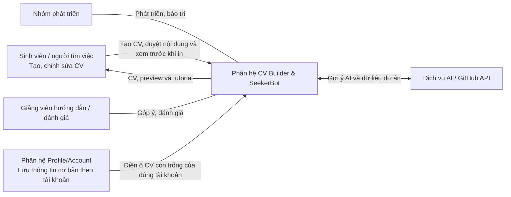

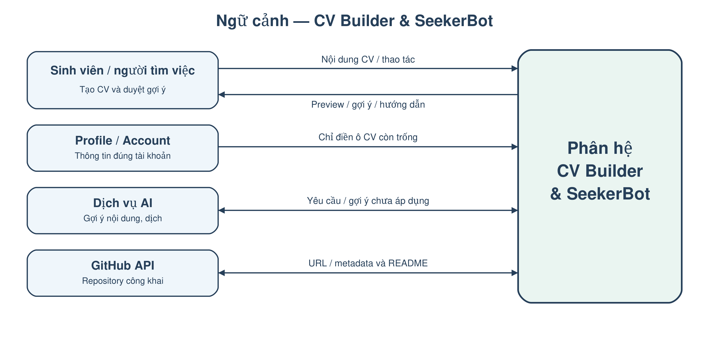

| Stakeholder | Vai trò |
| --- | --- |
| Sinh viên / người tìm việc | Người dùng chính; nhập, chỉnh sửa, lưu CV và xác nhận gợi ý. |
| Nhóm phát triển | Phân tích, triển khai, kiểm thử và bảo trì phân hệ. |
| Giảng viên hướng dẫn / đánh giá | Đánh giá tài liệu, nghiệp vụ và prototype của đồ án. |
| Dịch vụ AI, GitHub API | Hệ thống ngoài cung cấp hỗ trợ gợi ý hoặc dữ liệu dự án, không phải người dùng cuối. |
| Phân hệ Profile/Account | Cung cấp thông tin cơ bản của đúng tài khoản để điền ô CV còn trống khi tạo hoặc mở lại; không ghi đè giá trị CV đã có. |

# 3. Đặc tả yêu cầu chức năng

## Quy ước mã

- **FR** (*Functional Requirement*): yêu cầu chức năng; ví dụ `FR-CV-01`.
- **CV**: phân hệ CV Builder & SeekerBot.
- **BR** (*Business Rule*): quy tắc nghiệp vụ; ví dụ `BR-CV-01`.
- **SCRUM-xx**: mã Story trong Jira; các subtask được gộp vào nghiệp vụ của Story chính.

## a. Tạo, chỉnh sửa, xem trước và lưu CV

| Mã | Yêu cầu chức năng | Story |
| --- | --- | --- |
| FR-CV-01 | Hệ thống cho phép tạo CV theo các mục thông tin; những trường cơ bản có dữ liệu tương ứng trong Profile được tự điền để người dùng kiểm tra/chỉnh sửa. | SCRUM-10 |
| FR-CV-02 | Hệ thống cho phép thêm/sửa nội dung từng mục và phản ánh thay đổi trên Live Preview. | SCRUM-10 |
| FR-CV-03 | Hệ thống kiểm tra trường bắt buộc, định dạng dữ liệu cơ bản và báo lỗi tại vị trí cần sửa. | SCRUM-10 |
| FR-CV-04 | Hệ thống cho phép lưu CV của người dùng và mở lại để tiếp tục chỉnh sửa. | SCRUM-14 |
| FR-CV-05 | Hệ thống cho phép chọn mẫu trình bày và xem trước mẫu mà không làm mất nội dung CV. | SCRUM-15 |

## b. SeekerBot và cải thiện nội dung CV

| Mã | Yêu cầu chức năng | Story |
| --- | --- | --- |
| FR-CV-06 | Hệ thống cho phép người dùng yêu cầu SeekerBot hướng dẫn viết nội dung trong CV. | SCRUM-17 |
| FR-CV-07 | Hệ thống cho phép chọn mô tả dự án/kinh nghiệm và yêu cầu đề xuất cải thiện theo cấu trúc STAR. | SCRUM-18 |
| FR-CV-08 | Hệ thống cho phép cung cấp JD để nhận gợi ý điều chỉnh cách diễn đạt hoặc nhấn mạnh thông tin CV liên quan. | SCRUM-19 |
| FR-CV-09 | Hệ thống hiển thị gợi ý và nội dung gốc để người dùng xem, chấp nhận hoặc bỏ qua trước khi sửa CV. | SCRUM-17/18/19 |
| FR-CV-10 | Khi dịch vụ AI không phản hồi, hệ thống thông báo và giữ nguyên nội dung CV hiện có. | SCRUM-17/18/19 |

## c. Tutorial hướng dẫn người mới sử dụng

| Mã | Yêu cầu chức năng | Story |
| --- | --- | --- |
| FR-CV-11 | Hệ thống cung cấp tutorial giới thiệu cách sử dụng CV Builder cho người mới: tạo CV, chọn mẫu, chỉnh sửa, xem trước và lưu CV. | SCRUM-50 |
| FR-CV-12 | Hệ thống cho phép người dùng mở lại hoặc bỏ qua tutorial và chuyển đến CV Editor mà không cần nhập dữ liệu trong tutorial. | SCRUM-50 |

## d. Ngân hàng thành tựu và nhập dự án GitHub

| Mã | Yêu cầu chức năng | Story |
| --- | --- | --- |
| FR-CV-13 | Hệ thống cho phép người dùng tạo, xem, sửa và xóa các thành tựu cá nhân đã lưu. | SCRUM-52 |
| FR-CV-14 | Hệ thống cho phép đưa bản sao một thành tựu đã chọn vào CV để người dùng chỉnh sửa riêng. | SCRUM-52 |
| FR-CV-15 | Hệ thống cho phép nhập đường dẫn repository GitHub công khai và lấy thông tin dự án có thể truy cập. | SCRUM-55 |
| FR-CV-16 | Hệ thống hiển thị thông tin lấy từ GitHub để người dùng xác nhận vai trò/đóng góp và sửa nội dung trước khi thêm vào CV. | SCRUM-55 |
| FR-CV-17 | Hệ thống xử lý URL không hợp lệ, repository riêng tư/không tồn tại hoặc lỗi truy xuất bằng thông báo phù hợp. | SCRUM-55 |

## e. Nội dung CV song ngữ Việt – Anh

| Mã | Yêu cầu chức năng | Story |
| --- | --- | --- |
| FR-CV-18 | Hệ thống hỗ trợ lưu và chuyển xem nội dung tiếng Việt, tiếng Anh của cùng một CV. | SCRUM-54 |
| FR-CV-19 | Hệ thống cho phép tạo bản nháp nội dung ngôn ngữ còn lại và yêu cầu người dùng duyệt trước khi thay thế nội dung tương ứng. | SCRUM-54 |
| FR-CV-20 | Khi nội dung nguồn thay đổi, hệ thống phải giúp nhận biết bản dịch có thể đã cũ để người dùng kiểm tra lại. | SCRUM-54 |
| FR-CV-21 | Hệ thống giữ cấu trúc mục CV và cập nhật bản xem trước theo ngôn ngữ được chọn. | SCRUM-54 |

## f. Xem trước CV trước khi in

| Mã | Yêu cầu chức năng | Story |
| --- | --- | --- |
| FR-CV-22 | Hệ thống cho phép mở chế độ **Print Preview** để xem toàn bộ CV dưới bố cục trang in trước khi thực hiện thao tác in/xuất ở chức năng liên quan. | SCRUM-49 |
| FR-CV-23 | Hệ thống thể hiện bố cục, số trang/ngắt trang và nội dung thực tế theo template và ngôn ngữ đang chọn; cho phép người dùng quay lại Editor. | SCRUM-49 |
| FR-CV-24 | Print Preview dùng lại dữ liệu và bộ dựng CV/Preview, không kiểm tra nội dung bằng AI hoặc tự yêu cầu bổ sung thông tin. | SCRUM-49 |

## g. Tự điền thông tin cơ bản từ Profile/Account

| Mã | Yêu cầu chức năng | Story |
| --- | --- | --- |
| FR-CV-25 | Khi người dùng bắt đầu tạo CV, hệ thống chỉ lấy các trường cơ bản tương ứng từ Profile thuộc tài khoản đã đăng nhập (ví dụ: họ tên, email, số điện thoại), tự điền vào biểu mẫu để người dùng kiểm tra và sửa. | SCRUM-10 |
| FR-CV-26 | Khi người dùng mở CV đã lưu để chỉnh sửa, hệ thống giữ giá trị đã lưu/chỉnh sửa trong CV và tự điền các trường thông tin cơ bản còn trống từ Profile; không âm thầm ghi đè giá trị đã có trong CV. | SCRUM-14 |

## Các quy tắc nghiệp vụ áp dụng

### BR-CV-01 — Quyền sở hữu CV và thành tựu

Người dùng chỉ được xem, chỉnh sửa hoặc xóa CV và thành tựu thuộc quyền truy cập của mình; dữ liệu khác không tự động hiển thị.

### BR-CV-02 — AI chỉ đưa ra gợi ý

Gợi ý SeekerBot/STAR/JD phải được người dùng xem và chủ động áp dụng. Hệ thống không tự bịa dự án, vai trò, số liệu, chứng chỉ hoặc kinh nghiệm làm việc.

### BR-CV-03 — Phạm vi điều chỉnh theo JD

Điều chỉnh CV theo JD nhằm cải thiện **cách trình bày thông tin đã có**, không tính điểm phù hợp, không xác định Skill Gap và không thay thế phân hệ Job Matching.

### BR-CV-04 — Dữ liệu CV dùng chung

Editor, Template, Preview và chế độ xem trước khi in sử dụng cùng dữ liệu CV. Tutorial chỉ hướng dẫn sử dụng, không tạo hoặc lưu một CV riêng. Đổi template không được xóa nội dung; lưu và mở lại phải giữ nội dung đã lưu.

### BR-CV-05 — Tái sử dụng thành tựu

Khi đưa thành tựu vào CV, hệ thống sử dụng một bản sao nội dung tại thời điểm chọn. Việc sửa thành tựu trong thư viện về sau không tự sửa các CV đã có.

### BR-CV-06 — Nhập nội dung GitHub

Chỉ dùng dữ liệu repository công khai theo phạm vi truy cập được cấp. Metadata/README không tự chứng minh đóng góp cá nhân; người dùng phải xem và xác nhận trước khi đưa nội dung vào CV.

### BR-CV-07 — Chuyển đổi ngôn ngữ

Nội dung tiếng Việt và tiếng Anh được quản lý tách biệt theo cùng cấu trúc mục. Gợi ý dịch không tự ghi đè nội dung đã được người dùng duyệt; bản dịch cần được kiểm tra lại khi nội dung gốc thay đổi.

### BR-CV-08 — Phạm vi Print Preview

SCRUM-49 chỉ cho phép **xem trước CV theo bố cục trang in**, dùng chung nội dung và template của CV Editor. Không có cơ chế AI tự tìm lỗi hoặc yêu cầu người dùng bổ sung nội dung. Việc in thực tế/xuất PDF được xác nhận riêng với SCRUM-16.

### BR-CV-09 — Dữ liệu Profile và CV

Thông tin cơ bản được lấy từ **Profile thuộc tài khoản đang đăng nhập** khi tạo hoặc tiếp tục chỉnh sửa CV và chỉ tự điền vào trường tương ứng còn trống. Người dùng có thể chỉnh sửa riêng trên CV. Hệ thống không ghi đè những giá trị đã chỉnh sửa/lưu trong CV bằng thay đổi Profile mà không có xác nhận. Danh sách trường và ánh xạ cụ thể cần đối chiếu với schema Profile trước khi triển khai.

# 4. Đặc tả yêu cầu phi chức năng

| Mã | Nhóm | Yêu cầu phi chức năng |
| --- | --- | --- |
| NFR-CV-01 | Dễ sử dụng | Người dùng có thể xác định mục đang chỉnh sửa và thấy bản xem trước rõ ràng; thông báo lỗi có hướng dẫn khắc phục. |
| NFR-CV-02 | Bảo mật | CV và thành tựu được kiểm soát truy cập theo tài khoản; khóa dịch vụ AI/GitHub không được công khai ở Frontend. |
| NFR-CV-03 | Tin cậy | Nếu AI hoặc GitHub API lỗi, CV đã lưu vẫn giữ nguyên; không tự áp dụng nội dung chưa được người dùng duyệt. |
| NFR-CV-04 | Nhất quán | Editor, Template, chuyển ngôn ngữ và Print Preview dùng cùng dữ liệu CV; Tutorial không lưu CV; Profile phải thuộc đúng tài khoản. |
| NFR-CV-05 | Khả năng đọc | Print Preview phải hiển thị bố cục rõ ràng theo trang in, không cắt hoặc làm chồng lấn nội dung quan trọng trong phạm vi template hỗ trợ. |
| NFR-CV-06 | Khả năng bảo trì | Chức năng gợi ý AI và nhập GitHub được tách khỏi nghiệp vụ lưu/chỉnh sửa CV để xử lý lỗi độc lập. |

# 5. Đặc tả yêu cầu

## 5.1 Sơ đồ Use Case

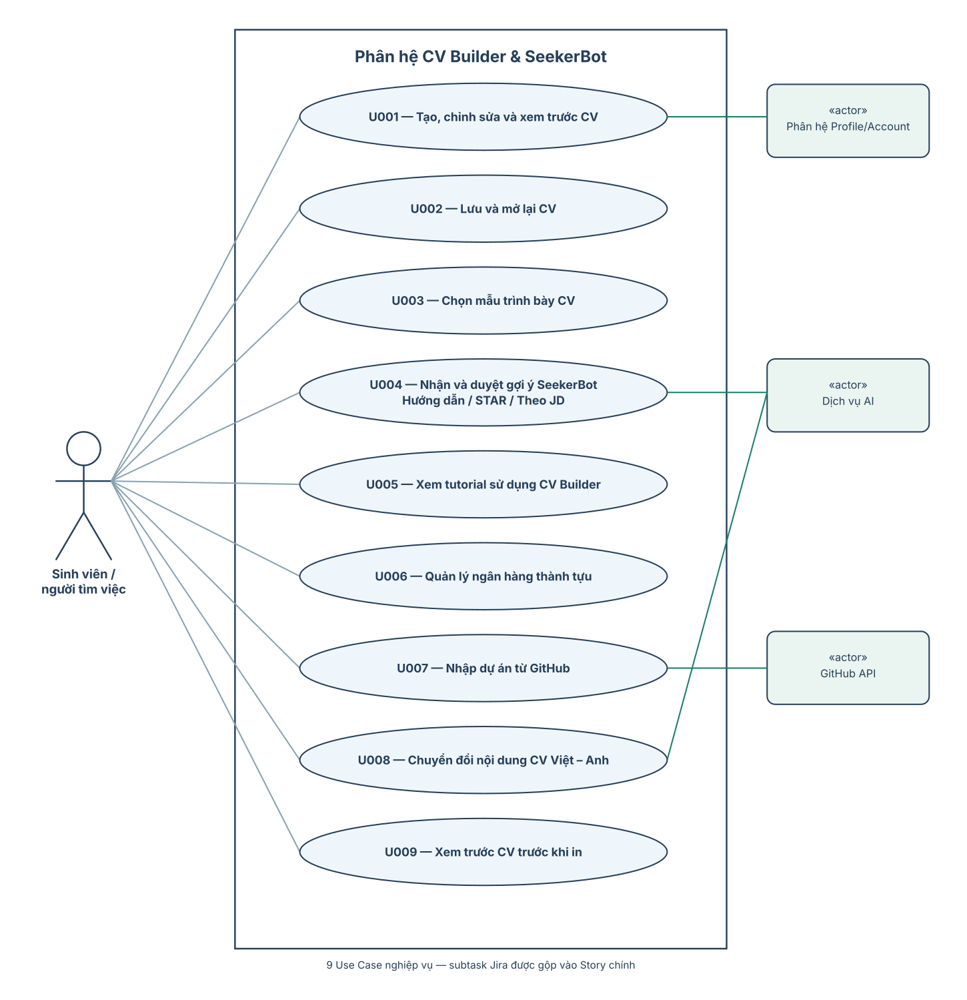

Sơ đồ mô tả chín Use Case nghiệp vụ chính, bao phủ 11 Story. **Sinh viên/người tìm việc** là tác nhân chính; **dịch vụ AI**, **GitHub API** và **phân hệ Profile/Account** là các hệ thống hỗ trợ. Không có Use Case riêng cho subtask hoặc các thao tác giao diện thuần túy.

## 5.2 Đặc tả Use Case

### 5.2.1. Tạo, chỉnh sửa và xem trước CV

| Thành phần | Đặc tả |
| --- | --- |
| **Use Case ID** | U001 |
| **Tên Use Case** | Tạo, chỉnh sửa và xem trước CV |
| **Tóm tắt** | Tạo/chỉnh sửa CV, tự điền thông tin cơ bản từ Profile và xem trước nội dung trong Editor. |
| **Tác nhân** | Sinh viên/người tìm việc (tác nhân chính); phân hệ Profile/Account (hệ thống hỗ trợ cung cấp thông tin cơ bản để tự điền vào CV). |
| **Điều kiện tiên quyết** | Người dùng đã đăng nhập. |
| **Kết quả** | Nội dung CV được cập nhật trong phiên chỉnh sửa và hiển thị ở Preview. |
| **Kịch bản chính** | 1. Người dùng tạo CV hoặc mở CV có sẵn.<br>2. Hệ thống lấy thông tin cơ bản từ Profile để điền các trường tương ứng còn trống; dữ liệu CV đã lưu được ưu tiên giữ nguyên.<br>3. Người dùng kiểm tra, nhập hoặc chỉnh sửa các mục CV.<br>4. Hệ thống cập nhật Live Preview theo dữ liệu đang chỉnh sửa. |
| **Kịch bản phụ** | • Profile chưa có thông tin: để trống các trường tương ứng để người dùng nhập.<br>• Thiếu/sai định dạng: báo trường cần sửa.<br>• Người dùng rời trang khi chưa lưu: cảnh báo mất thay đổi nếu phù hợp. |
| **Ràng buộc phi chức năng** | NFR-CV-01, 04, 05. |

### 5.2.2. Lưu và mở lại CV

| Thành phần | Đặc tả |
| --- | --- |
| **Use Case ID** | U002 |
| **Tên Use Case** | Lưu và mở lại CV |
| **Tóm tắt** | Lưu nội dung và tiếp tục chỉnh sửa ở lần truy cập sau. |
| **Tác nhân** | Sinh viên/người tìm việc. |
| **Điều kiện tiên quyết** | Người dùng đã đăng nhập và có CV cần lưu/mở. |
| **Kết quả** | CV được lưu vào tài khoản hoặc được tải để chỉnh sửa. |
| **Kịch bản chính** | 1. Người dùng chọn lưu CV.<br>2. Hệ thống ghi nội dung thuộc tài khoản.<br>3. Người dùng mở danh sách CV và chọn bản đã lưu.<br>4. Hệ thống hiển thị nội dung và Preview tương ứng. |
| **Kịch bản phụ** | • Lưu thất bại: báo lỗi và cho thử lại, không báo thành công giả.<br>• CV không thuộc quyền truy cập: từ chối mở. |
| **Ràng buộc phi chức năng** | NFR-CV-02, 03. |

### 5.2.3. Chọn mẫu trình bày CV

| Thành phần | Đặc tả |
| --- | --- |
| **Use Case ID** | U003 |
| **Tên Use Case** | Chọn mẫu trình bày CV |
| **Tóm tắt** | Chuyển cách trình bày mà giữ nguyên nội dung. |
| **Tác nhân** | Sinh viên/người tìm việc. |
| **Điều kiện tiên quyết** | Người dùng đang chỉnh sửa CV. |
| **Kết quả** | Preview áp dụng mẫu đã chọn. |
| **Kịch bản chính** | 1. Người dùng mở danh sách template.<br>2. Hệ thống hiển thị mẫu khả dụng.<br>3. Người dùng chọn một mẫu.<br>4. Hệ thống cập nhật Preview tương ứng. |
| **Kịch bản phụ** | • Mẫu không khả dụng: giữ mẫu hiện tại và thông báo. |
| **Ràng buộc phi chức năng** | NFR-CV-01, 04. |

### 5.2.4. Nhận và duyệt gợi ý từ SeekerBot

| Thành phần | Đặc tả |
| --- | --- |
| **Use Case ID** | U004 |
| **Tên Use Case** | Nhận và duyệt gợi ý từ SeekerBot |
| **Tóm tắt** | Hướng dẫn viết, cải thiện theo STAR hoặc đề xuất diễn đạt theo JD. |
| **Tác nhân** | Sinh viên/người tìm việc; dịch vụ AI bên ngoài (hỗ trợ). |
| **Điều kiện tiên quyết** | Người dùng có nội dung CV hoặc thông tin cần được hướng dẫn; với gợi ý theo JD thì đã cung cấp JD. |
| **Kết quả** | Người dùng xem và tùy chọn áp dụng gợi ý. |
| **Kịch bản chính** | 1. Người dùng chọn chế độ hướng dẫn/STAR/điều chỉnh theo JD.<br>2. Hệ thống gửi ngữ cảnh cần thiết tới dịch vụ AI.<br>3. Hệ thống hiển thị nội dung gốc và gợi ý.<br>4. Người dùng chấp nhận hoặc bỏ qua.<br>5. Khi được chấp nhận, nội dung liên quan trong CV được cập nhật. |
| **Kịch bản phụ** | • Thiếu dữ liệu hoặc JD: yêu cầu bổ sung.<br>• AI lỗi: giữ nguyên CV và cho thử lại.<br>• Gợi ý không đúng sự thật: người dùng bỏ qua/sửa trước khi áp dụng. |
| **Ràng buộc phi chức năng** | NFR-CV-02, 03, 06. |

### 5.2.5. Xem tutorial hướng dẫn sử dụng CV Builder

| Thành phần | Đặc tả |
| --- | --- |
| **Use Case ID** | U005 |
| **Tên Use Case** | Xem tutorial hướng dẫn sử dụng CV Builder |
| **Tóm tắt** | Hướng dẫn người mới hiểu các bước sử dụng công cụ, không tạo luồng nhập CV riêng. |
| **Tác nhân** | Sinh viên/người tìm việc. |
| **Điều kiện tiên quyết** | Người dùng mở CV Builder. |
| **Kết quả** | Người dùng hiểu cách thao tác và có thể vào Editor tạo/sửa CV. |
| **Kịch bản chính** | 1. Người dùng lần đầu vào CV Builder hoặc chọn mục Trợ giúp/Tutorial.<br>2. Hệ thống hiển thị các bước minh họa: tạo CV, chọn template, nhập/chỉnh sửa, xem trước và lưu.<br>3. Người dùng xem tiếp hoặc kết thúc hướng dẫn.<br>4. Hệ thống đưa người dùng về Dashboard/Editor. |
| **Kịch bản phụ** | • Người dùng chọn Skip/Đóng: thoát tutorial mà không làm mất dữ liệu CV.<br>• Muốn xem lại: có thể mở tutorial từ mục trợ giúp. |
| **Ràng buộc phi chức năng** | NFR-CV-01, 04. |

### 5.2.6. Quản lý ngân hàng thành tựu cá nhân

| Thành phần | Đặc tả |
| --- | --- |
| **Use Case ID** | U006 |
| **Tên Use Case** | Quản lý ngân hàng thành tựu cá nhân |
| **Tóm tắt** | Lưu và dùng lại thông tin thành tựu trong các CV. |
| **Tác nhân** | Sinh viên/người tìm việc. |
| **Điều kiện tiên quyết** | Người dùng đã đăng nhập. |
| **Kết quả** | Thành tựu được quản lý hoặc bản sao được đưa vào CV. |
| **Kịch bản chính** | 1. Người dùng mở thư viện thành tựu.<br>2. Người dùng tạo/sửa/xóa thành tựu.<br>3. Người dùng chọn thành tựu muốn sử dụng.<br>4. Hệ thống chép nội dung đã chọn vào CV để tiếp tục chỉnh sửa. |
| **Kịch bản phụ** | • Thư viện trống: hiển thị hướng dẫn tạo mới.<br>• Không có quyền: từ chối thao tác. |
| **Ràng buộc phi chức năng** | NFR-CV-02, 04. |

### 5.2.7. Nhập dự án từ GitHub

| Thành phần | Đặc tả |
| --- | --- |
| **Use Case ID** | U007 |
| **Tên Use Case** | Nhập dự án từ GitHub |
| **Tóm tắt** | Dùng dữ liệu repository công khai làm bản nháp mô tả dự án CV. |
| **Tác nhân** | Sinh viên/người tìm việc; GitHub API (hỗ trợ). |
| **Điều kiện tiên quyết** | Người dùng đã đăng nhập và cung cấp URL repository công khai hợp lệ. |
| **Kết quả** | Thông tin đã được duyệt được đưa vào mục dự án của CV. |
| **Kịch bản chính** | 1. Người dùng nhập URL repository.<br>2. Hệ thống lấy metadata và README khả dụng.<br>3. Hệ thống hiển thị bản nháp để kiểm tra.<br>4. Người dùng xác nhận vai trò, đóng góp và sửa mô tả.<br>5. Người dùng chọn đưa nội dung vào CV. |
| **Kịch bản phụ** | • URL sai/repository riêng tư/không tồn tại: báo lỗi.<br>• Không có README: vẫn hiển thị metadata khả dụng.<br>• API lỗi hoặc giới hạn truy cập: cho thử lại/nhập tay. |
| **Ràng buộc phi chức năng** | NFR-CV-02, 03, 06. |

### 5.2.8. Chuyển đổi nội dung CV Việt – Anh

| Thành phần | Đặc tả |
| --- | --- |
| **Use Case ID** | U008 |
| **Tên Use Case** | Chuyển đổi nội dung CV Việt – Anh |
| **Tóm tắt** | Duy trì hai phiên bản ngôn ngữ của cùng CV. |
| **Tác nhân** | Sinh viên/người tìm việc; dịch vụ AI bên ngoài (hỗ trợ). |
| **Điều kiện tiên quyết** | Người dùng đã có CV và chọn ngôn ngữ đích. |
| **Kết quả** | Nội dung ngôn ngữ đích được xem hoặc được người dùng duyệt/cập nhật. |
| **Kịch bản chính** | 1. Người dùng chọn VI/EN.<br>2. Hệ thống hiển thị bản tương ứng hoặc đề xuất tạo bản nháp dịch.<br>3. Người dùng xem và chỉnh bản dịch.<br>4. Người dùng xác nhận lưu; Preview hiển thị theo ngôn ngữ đã chọn. |
| **Kịch bản phụ** | • Dịch thất bại: giữ phiên bản hiện có.<br>• Bản nguồn thay đổi: đánh dấu nội dung dịch cần xem lại. |
| **Ràng buộc phi chức năng** | NFR-CV-03, 04, 05. |

### 5.2.9. Xem trước CV trước khi in

| Thành phần | Đặc tả |
| --- | --- |
| **Use Case ID** | U009 |
| **Tên Use Case** | Xem trước CV trước khi in |
| **Tóm tắt** | Hiển thị CV theo bố cục trang in để người dùng rà soát lần cuối. |
| **Tác nhân** | Sinh viên/người tìm việc. |
| **Điều kiện tiên quyết** | Người dùng có CV đang mở trong Editor. |
| **Kết quả** | Print Preview hiển thị theo template/ngôn ngữ hiện tại; người dùng có thể quay lại sửa nội dung. |
| **Kịch bản chính** | 1. Người dùng chọn Xem trước khi in.<br>2. Hệ thống dùng dữ liệu CV hiện có để dựng bố cục trang in, hiển thị phân trang và nội dung CV.<br>3. Người dùng xem lại tổng thể bố cục.<br>4. Người dùng quay về Editor hoặc tiếp tục tác vụ in/xuất nếu chức năng đó đã được xác nhận riêng. |
| **Kịch bản phụ** | • CV chưa có nội dung: hiển thị trang trống hoặc hướng dẫn quay lại Editor.<br>• Dựng preview lỗi: thông báo và cho thử lại, không thay đổi dữ liệu CV. |
| **Ràng buộc phi chức năng** | NFR-CV-01, 04, 05. |

# 6. Bản mẫu (Prototype)

Prototype Figma được xây dựng ở mức **low/mid-fidelity**, thể hiện luồng tương tác chứ chưa phải chức năng ứng dụng đã triển khai. Các nút Apply/Add/Save trong prototype có thể chỉ mô phỏng điều hướng.

**File thiết kế:** [HireUS — CV Builder & SeekerBot](https://www.figma.com/design/bMbUlGzrU298Icu0HoERU3/HireUS?node-id=55-184).

| Frame | Màn hình | Story liên quan |
| --- | --- | --- |
| F01 | CV Dashboard | SCRUM-14, SCRUM-50 |
| F02 | CV Editor + Live Preview; tự điền trường cơ bản còn trống từ Profile | SCRUM-10, SCRUM-14, SCRUM-15 |
| F03 | CV Editor + AI Panel | SCRUM-17, 18, 19 |
| F04 | Tutorial hướng dẫn sử dụng CV Builder (Next/Skip/Help) | SCRUM-50 |
| F05 | Achievement Library + GitHub Import | SCRUM-52, 55 |
| F06 | Editor VI/EN + Print Preview (không có AI quality check) | SCRUM-49, 54 |

### Hình chụp các frame Figma

**F01 — CV Dashboard:** tạo/mở CV và mở lại Tutorial.

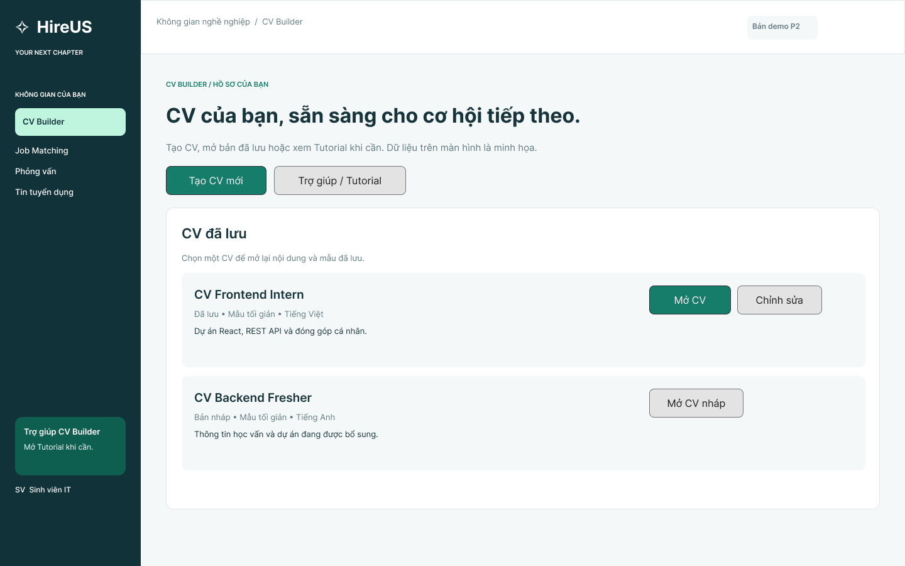

**F02 — CV Editor + Live Preview:** ví dụ các trường cơ bản còn trống được điền từ Profile; người dùng có thể sửa.

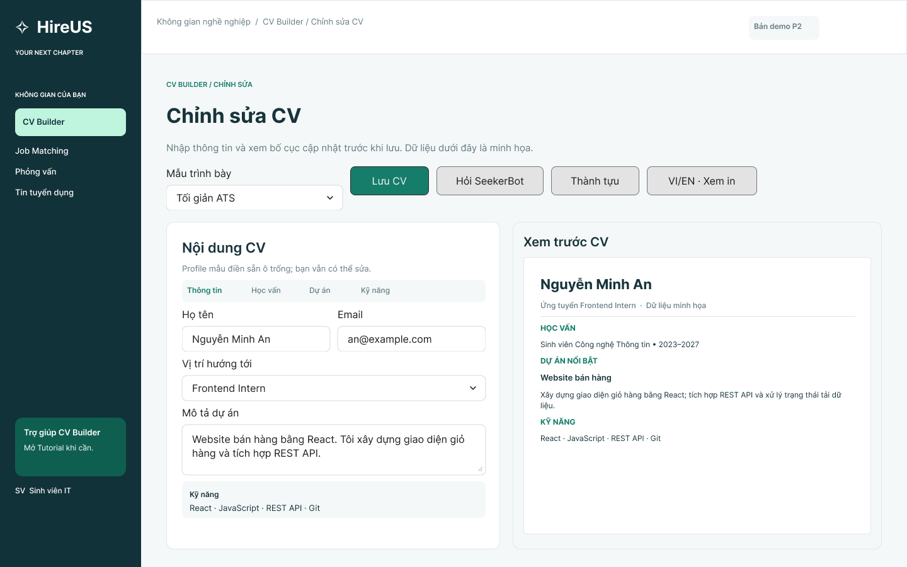

**F03 — CV Editor + AI Panel:** mô phỏng việc xem và duyệt gợi ý SeekerBot.

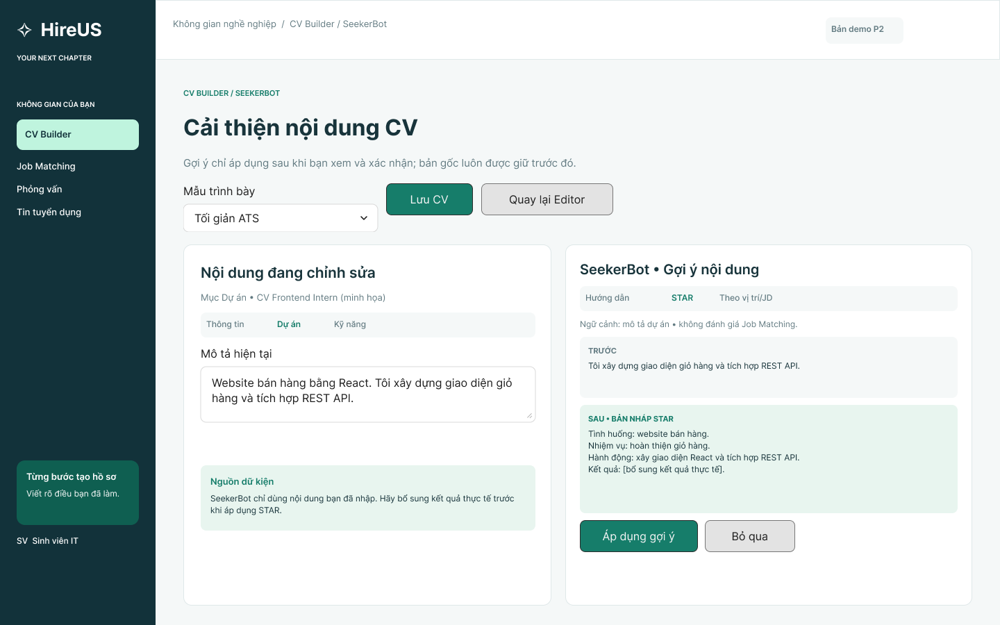

**F04 — Tutorial:** hướng dẫn thao tác CV Builder; các nút Back/Next hiện mới là mô phỏng hình ảnh.

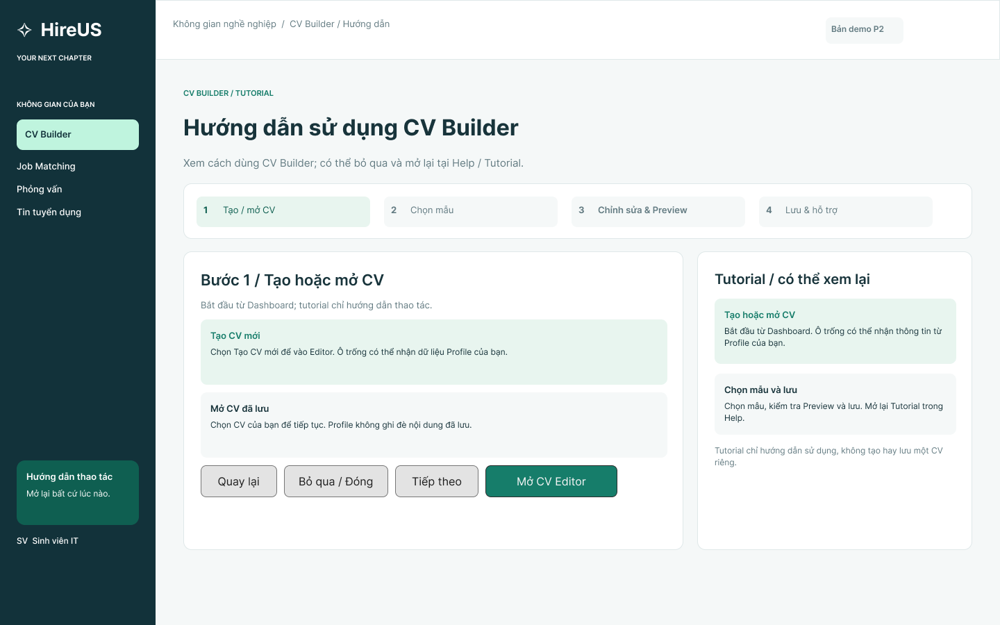

**F05 — Achievement Library + GitHub Import:** mô phỏng chọn thành tựu và rà soát dữ liệu repository.

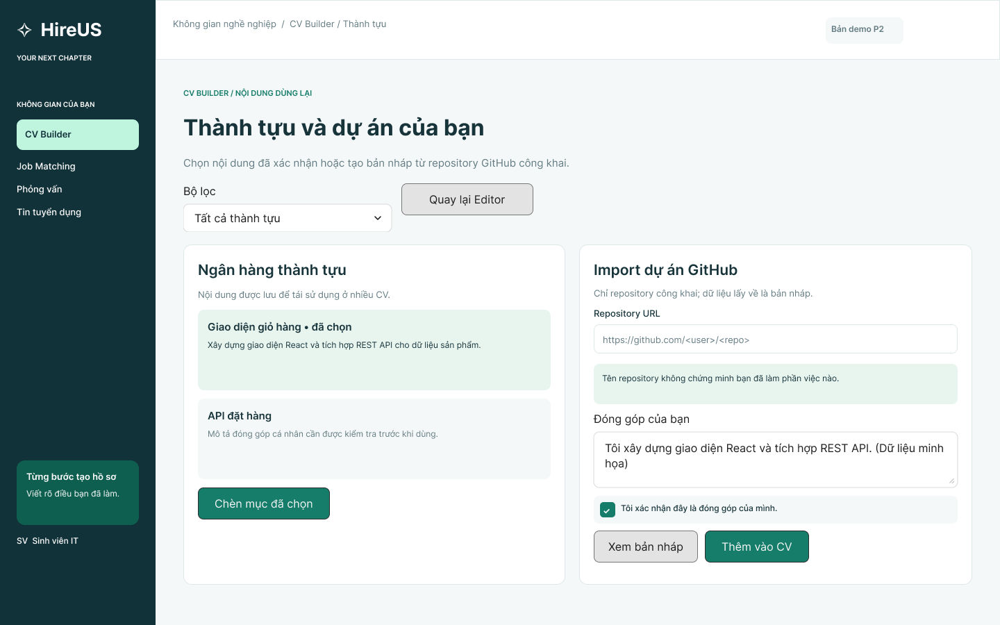

**F06 — CV Việt–Anh + Print Preview:** xem bố cục trang in theo ngôn ngữ đang chọn; chưa thể hiện thao tác in/xuất PDF.

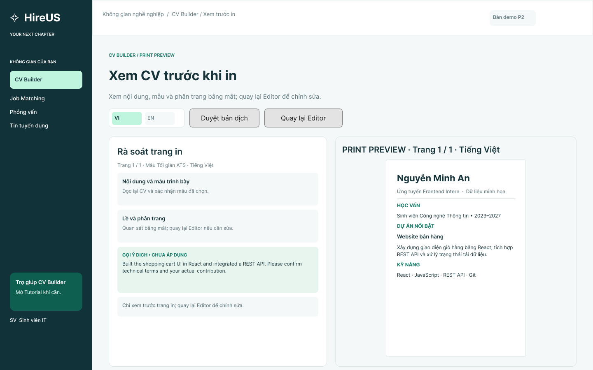

**Luồng mẫu cần thử trên Figma:** F01 → F02 (đã có thông tin cơ bản từ Profile nếu có) → F03 → F02; F01 → F04 (tutorial, có Skip) → F02; F02 → F05 → F02; F02 → F06 (Print Preview/VI–EN) → F02. Các nút mô phỏng điều hướng, không chứng minh dữ liệu được lưu hoặc in thực tế.

---

*Ghi chú rà soát trước nộp: (1) xác nhận phạm vi SCRUM-16; (2) thử các liên kết trong Figma Present, nhất là Tutorial và Print Preview, rồi thống nhất nội dung các bước; (3) đối chiếu ánh xạ trường với schema Profile; (4) nếu tài liệu được ghép vào báo cáo toàn nhóm, đưa bảng đánh giá thành viên theo template vào phần đầu của báo cáo chung, không tự khai % đóng góp.*


---

<a id="phan-he-2"></a>

# Phân hệ 2 — Voice Mock Interview

Nguồn: [Bai_lam_Voice_Mock_Interview.md](./Bai_lam_Voice_Mock_Interview.md)

# 1. Mô tả kĩ bài toán

Sinh viên công nghệ thông tin năm 3–4 khi chuẩn bị ứng tuyển các vị trí thực tập (Intern) hoặc Fresher thường gặp khó khăn lớn trong các vòng phỏng vấn kỹ thuật (Technical Interview). Dù đã tích lũy kiến thức qua các môn học chuyên ngành và hoàn thành đồ án, sinh viên phần lớn thiếu kinh nghiệm thực chiến và ít có cơ hội tham gia các buổi phỏng vấn mô phỏng 1:1 có áp lực như thực tế. Khi bước vào phỏng vấn, sinh viên dễ bị động, mất tự tin, khả năng phản xạ và diễn đạt câu trả lời kỹ thuật bằng lời nói còn lúng túng, đặc biệt là khi phỏng vấn bằng tiếng Anh hoặc khi người phỏng vấn đặt câu hỏi đào sâu vào các quyết định kỹ thuật trong dự án cá nhân.

Các nền tảng luyện phỏng vấn hiện nay thường bộc lộ những hạn chế đối với sinh viên IT Việt Nam: phần lớn chỉ hỗ trợ giao diện văn bản (text), công cụ có hỗ trợ giọng nói thì chỉ áp dụng tiếng Anh và giới hạn thời lượng nghiêm ngặt ở các gói miễn phí, hoặc câu hỏi được tạo theo kịch bản khuôn mẫu chung chung, hoàn toàn tách rời với CV và dự án kỹ thuật thực tế của ứng viên. Hơn nữa, sau khi kết thúc phỏng vấn, sinh viên không nhận được phản hồi chi tiết về việc câu trả lời của mình đã đạt hay chưa, còn thiếu hụt khái niệm chuyên môn nào và cần ưu tiên ôn tập nội dung gì để cải thiện.

Phân hệ Voice Mock Interview thuộc nền tảng HireUS Tools giải quyết bài toán trên bằng cách cung cấp môi trường phòng phỏng vấn kỹ thuật 1:1 tương tác hai chiều bằng giọng nói theo thời gian thực giữa sinh viên và AI Tech Lead. Hệ thống cho phép sinh viên thiết lập phiên phỏng vấn với các thông số cụ thể: lựa chọn vị trí chuyên môn (Frontend, Backend, Fullstack, Mobile, AI/Data, v.v.), cấp độ ứng tuyển (Intern hoặc Fresher), ngôn ngữ phỏng vấn (tiếng Việt hoặc tiếng Anh) và lựa chọn một CV hiện có trong hệ thống để cung cấp ngữ cảnh cá nhân hóa. Trước khi bắt đầu, hệ thống thực hiện kiểm tra thiết bị microphone và âm thanh nhằm đảm bảo chất lượng thu nhận tín hiệu.

Trong quá trình phỏng vấn, hệ thống chuyển câu hỏi từ văn bản sang giọng nói (Text-to-Speech) và phát cho sinh viên nghe. Sinh viên trả lời trực tiếp bằng giọng nói qua microphone; âm thanh được tiếp nhận và chuyển đổi thành văn bản (Speech-to-Text). Dịch vụ AI bên ngoài đóng vai trò Tech Lead sẽ phân tích nội dung câu trả lời dựa trên ngữ cảnh CV và vị trí ứng tuyển, từ đó đặt câu hỏi tiếp theo hoặc đặt câu hỏi đào sâu (follow-up questions) nhằm kiểm tra bản chất hiểu biết của sinh viên. Sau khi phiên phỏng vấn kết thúc, hệ thống tự động tổng hợp toàn bộ transcript hỏi đáp, đánh giá năng lực theo các tiêu chí kỹ thuật, tư duy giải quyết vấn đề và kỹ năng diễn đạt, đồng thời xuất báo cáo chi tiết chỉ rõ điểm mạnh, lỗ hổng kiến thức và gợi ý ôn tập trọng tâm. Toàn bộ phiên phỏng vấn và báo cáo được lưu trữ vào lịch sử để sinh viên theo dõi tiến trình cải thiện năng lực qua thời gian.

Kết quả đánh giá và điểm số trong báo cáo phản ánh chất lượng câu trả lời của sinh viên tại thời điểm diễn ra buổi phỏng vấn mô phỏng, phục vụ mục đích rèn luyện phản xạ và củng cố kiến thức chuyên môn; kết quả này không phải là sự cam kết hay khẳng định xác suất trúng tuyển tại các doanh nghiệp thực tế.

# 2. Các bên liên quan (Stakeholder)

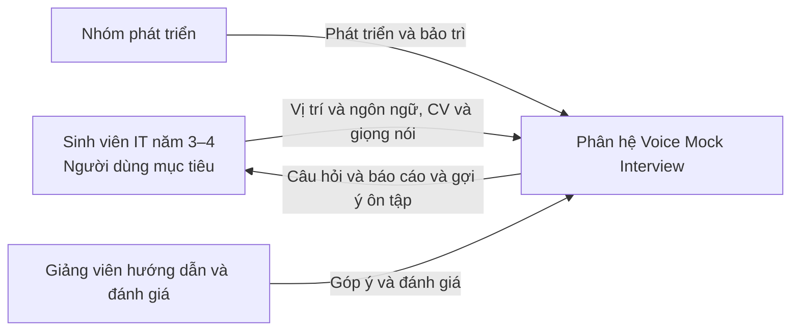

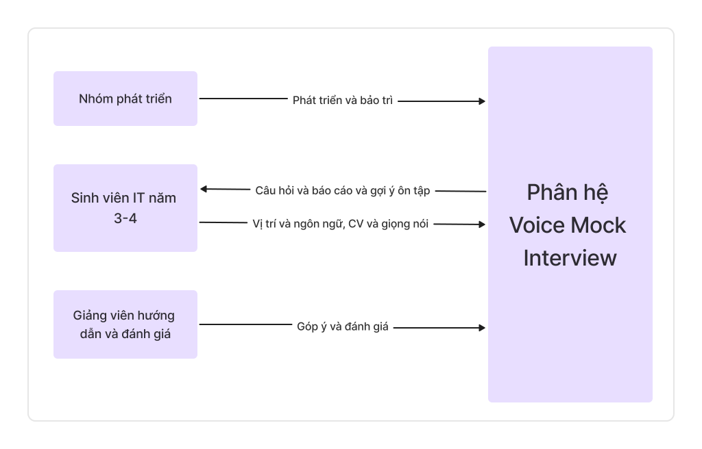

### Bảng mô tả vai trò các bên liên quan

| STT | Bên liên quan (Stakeholder) | Vai trò và tương tác với phân hệ |
|:---:|---|---|
| 1 | **Sinh viên IT năm 3–4** | Người dùng mục tiêu trực tiếp của phân hệ. Cung cấp thông tin cấu hình phỏng vấn (vị trí, cấp độ, ngôn ngữ), lựa chọn CV làm ngữ cảnh và tương tác trả lời bằng giọng nói qua microphone; tiếp nhận câu hỏi âm thanh từ hệ thống, xem transcript, nhận báo cáo đánh giá năng lực và các gợi ý ôn tập để cải thiện kỹ năng phỏng vấn. |
| 2 | **Nhóm phát triển** | Chịu trách nhiệm phân tích yêu cầu, thiết kế kiến trúc, lập trình giao diện Web Audio, xây dựng backend điều phối phiên, tích hợp mô hình AI âm thanh và ngôn ngữ, kiểm thử và bảo trì hệ thống vận hành ổn định. |
| 3 | **Giảng viên hướng dẫn và đánh giá** | Đóng vai trò giám sát học thuật, đánh giá tính đúng đắn của quy trình phân tích và đặc tả phần mềm, góp ý về kiến trúc kỹ thuật và đánh giá chất lượng sản phẩm qua các đợt nghiệm thu đồ án môn học. |

# 3. Đặc tả yêu cầu chức năng

## Quy ước mã

- **FR** (*Functional Requirement*): yêu cầu chức năng.
- **VMI** (*Voice Mock Interview*): phân hệ Voice Mock Interview.
- **FR-VMI-xx**: yêu cầu chức năng số xx của phân hệ.
- **BR** (*Business Rule*): quy tắc nghiệp vụ; ví dụ `BR-VMI-01`.

## a. Thiết lập buổi phỏng vấn

| Mã | Yêu cầu chức năng |
|---|---|
| FR-VMI-01 | Hệ thống phải cho phép người dùng lựa chọn vị trí chuyên môn ứng tuyển (Frontend, Backend, Fullstack, Mobile, AI/Data) và cấp độ ứng tuyển (Intern hoặc Fresher). |
| FR-VMI-02 | Hệ thống phải cho phép người dùng lựa chọn ngôn ngữ phỏng vấn (tiếng Việt hoặc tiếng Anh). |
| FR-VMI-03 | Hệ thống phải liên kết với Phân hệ CV / Profile để lấy danh sách các bản CV hiện có của người dùng và cho phép người dùng chọn một CV làm ngữ cảnh phỏng vấn. |
| FR-VMI-04 | Hệ thống phải cho phép người dùng lựa chọn chế độ phỏng vấn tiêu chuẩn theo vị trí mà không bắt buộc đính kèm CV khi tài khoản chưa có hồ sơ. |
| FR-VMI-05 | Hệ thống phải gửi thông tin cấu hình (vị trí, cấp độ, ngôn ngữ, dữ liệu tóm tắt CV) đến Dịch vụ AI bên ngoài để khởi tạo ngữ cảnh phiên phỏng vấn và bộ khung câu hỏi phù hợp. |
| FR-VMI-06 | Hệ thống phải kiểm tra tính hợp lệ của dữ liệu thiết lập trước khi chuyển sang bước kiểm tra thiết bị và khởi tạo phiên phỏng vấn. |

## b. Kiểm tra microphone và âm thanh

| Mã | Yêu cầu chức năng |
|---|---|
| FR-VMI-07 | Hệ thống phải yêu cầu quyền truy cập microphone từ trình duyệt và kiểm tra tính khả dụng của thiết bị thu âm trước khi bắt đầu phỏng vấn. |
| FR-VMI-08 | Hệ thống phải cung cấp giao diện trực quan đo cường độ tín hiệu âm thanh đầu vào để người dùng kiểm tra mức độ thu âm của microphone. |
| FR-VMI-09 | Hệ thống phải phát một đoạn âm thanh mẫu để người dùng kiểm tra thiết bị phát (loa hoặc tai nghe). |
| FR-VMI-10 | Hệ thống phải hiển thị thông báo lỗi cụ thể và hướng dẫn cấp lại quyền hoặc đổi thiết bị khi microphone không khả dụng hoặc bị người dùng từ chối cấp quyền. |
| FR-VMI-11 | Hệ thống chỉ cho phép bắt đầu phiên phỏng vấn khi bước kiểm tra thiết bị âm thanh đạt yêu cầu hoặc khi người dùng đã xác nhận sẵn sàng tiếp tục. |

## c. Tham gia phỏng vấn bằng giọng nói

| Mã | Yêu cầu chức năng |
|---|---|
| FR-VMI-12 | Hệ thống phải chuyển văn bản câu hỏi từ AI thành giọng nói (Text-to-Speech) và tự động phát âm thanh câu hỏi cho người dùng nghe theo ngôn ngữ đã thiết lập. |
| FR-VMI-13 | Hệ thống phải tiếp nhận âm thanh giọng nói trả lời của người dùng qua microphone khi người dùng bắt đầu nói. |
| FR-VMI-14 | Hệ thống phải gửi dữ liệu âm thanh trả lời đến Dịch vụ AI bên ngoài để chuyển đổi thành văn bản (Speech-to-Text). |
| FR-VMI-15 | Hệ thống phải hiển thị nội dung văn bản nhận diện được từ giọng nói để người dùng theo dõi và hỗ trợ xác nhận gửi câu trả lời hoặc yêu cầu nói lại nếu nhận diện bị lỗi do tiếng ồn. |
| FR-VMI-16 | Hệ thống phải gửi nội dung câu trả lời của người dùng đến Dịch vụ AI bên ngoài để phân tích theo ngữ cảnh phỏng vấn, bám sát các dự án và kỹ năng trong CV (nếu có chọn CV). |
| FR-VMI-17 | Hệ thống phải sinh câu hỏi tiếp theo theo diễn tiến logic của buổi phỏng vấn, bao gồm câu hỏi đào sâu kỹ thuật (follow-up) dựa trên câu trả lời trước đó hoặc chuyển tiếp sang chủ đề chuyên môn tiếp theo. |
| FR-VMI-18 | Hệ thống phải cho phép người dùng yêu cầu AI nhắc lại câu hỏi nếu chưa nghe rõ. |
| FR-VMI-19 | Hệ thống phải hiển thị trực quan trạng thái của phiên phỏng vấn (số thứ tự câu hỏi, thời gian diễn ra, trạng thái AI đang nói / đang nghe / đang phân tích). |
| FR-VMI-20 | Hệ thống phải cho phép người dùng chủ động bấm kết thúc buổi phỏng vấn bất kỳ lúc nào hoặc tự động chuyển sang bước đánh giá khi hoàn thành đủ số câu hỏi quy định. |

## d. Tổng hợp, đánh giá buổi phỏng vấn

| Mã | Yêu cầu chức năng |
|---|---|
| FR-VMI-21 | Khi buổi phỏng vấn kết thúc, hệ thống phải tổng hợp toàn bộ transcript gồm danh sách các câu hỏi của AI và các câu trả lời tương ứng của người dùng. |
| FR-VMI-22 | Hệ thống phải gửi transcript và ngữ cảnh cấu hình đến Dịch vụ AI bên ngoài để thực hiện phân tích và đánh giá năng lực toàn diện. |
| FR-VMI-23 | Hệ thống phải tính điểm và đánh giá chi tiết theo các tiêu chí: Kiến thức kỹ thuật chuyên môn, Tư duy giải quyết vấn đề, Kỹ năng diễn đạt và phản xạ giao tiếp. |
| FR-VMI-24 | Hệ thống phải phân tích và chỉ rõ các điểm mạnh (strengths) thể hiện tốt trong câu trả lời và các lỗ hổng kiến thức hoặc điểm yếu cần khắc phục (skill gaps). |
| FR-VMI-25 | Hệ thống phải đề xuất định hướng trả lời tốt hơn cho những câu hỏi người dùng trả lời chưa đầy đủ, kèm theo danh mục các chủ đề kiến thức kỹ thuật cần ôn tập bổ sung. |
| FR-VMI-26 | Hệ thống phải hiển thị báo cáo đánh giá hoàn chỉnh và nêu rõ kết quả mang tính chất tham khảo rèn luyện, không khẳng định xác suất trúng tuyển thực tế tại doanh nghiệp. |

## e. Xem lịch sử phỏng vấn

| Mã | Yêu cầu chức năng |
|---|---|
| FR-VMI-27 | Hệ thống phải lưu trữ đầy đủ dữ liệu của từng phiên phỏng vấn đã thực hiện (thời điểm, vị trí, cấp độ, ngôn ngữ, bản CV sử dụng, transcript hỏi đáp, điểm số và toàn văn báo cáo đánh giá). |
| FR-VMI-28 | Hệ thống phải hiển thị danh sách các phiên phỏng vấn của người dùng, sắp xếp theo thứ tự thời gian mới nhất. |
| FR-VMI-29 | Hệ thống phải cho phép người dùng xem lại chi tiết nội dung transcript hỏi đáp và báo cáo đánh giá của bất kỳ phiên phỏng vấn nào trong lịch sử. |
| FR-VMI-30 | Hệ thống phải cho phép người dùng tái sử dụng cấu hình (vị trí, ngôn ngữ, CV) của một phiên phỏng vấn cũ để khởi tạo nhanh một buổi phỏng vấn luyện tập mới. |
| FR-VMI-31 | Hệ thống phải giữ nguyên dữ liệu lịch sử và kết quả đánh giá cũ khi CV gốc của người dùng được chỉnh sửa hoặc cập nhật. |

## f. Xử lý sự cố và gián đoạn phiên phỏng vấn

| Mã | Yêu cầu chức năng |
|---|---|
| FR-VMI-32 | Khi xảy ra mất kết nối mạng hoặc Dịch vụ AI bên ngoài gặp sự cố trong phiên phỏng vấn, hệ thống phải thông báo nguyên nhân cụ thể và lưu lại toàn bộ các câu hỏi và câu trả lời đã hoàn tất trước đó. |
| FR-VMI-33 | Hệ thống phải cho phép người dùng thử lại lượt hỏi đáp bị gián đoạn hoặc chọn kết thúc sớm để nhận đánh giá trên phần câu hỏi đã hoàn thành; không tự động hủy phiên hoặc trả điểm 0%. |
| FR-VMI-34 | Khi bước tạo báo cáo tổng hợp đánh giá bị gián đoạn, hệ thống phải lưu trữ transcript an toàn và cho phép người dùng kích hoạt tạo lại báo cáo đánh giá mà không phải thực hiện lại buổi phỏng vấn. |

## Các quy tắc nghiệp vụ áp dụng

### BR-VMI-01 — Cá nhân hóa câu hỏi theo ngữ cảnh và cấp độ

Nội dung câu hỏi phỏng vấn được điều chỉnh linh hoạt theo thông tin thiết lập ban đầu:

- **Khi có CV ngữ cảnh:** Ít nhất 40% câu hỏi chuyên môn của phiên phỏng vấn phải được khai thác trực tiếp từ các dự án, công nghệ và kinh nghiệm được thể hiện trong CV (ví dụ: vai trò cụ thể trong dự án, lý do lựa chọn công nghệ, giải pháp xử lý lỗi hoặc tối ưu).
- **Cấp độ Intern:** Tập trung đánh giá kiến thức nền tảng (lập trình hướng đối tượng, cấu trúc dữ liệu và giải thuật, cú pháp ngôn ngữ, hiểu biết cơ bản về luồng hoạt động của framework hoặc thư viện phổ biến).
- **Cấp độ Fresher:** Mở rộng đánh giá tư duy thiết kế kiến trúc cơ bản, khả năng gỡ lỗi, kiểm thử phần mềm, kiến thức về cơ sở dữ liệu, tối ưu hiệu năng và quy trình làm việc nhóm (Git, Agile/Scrum).

### BR-VMI-02 — Điều kiện kiểm tra thiết bị âm thanh

- Quyền truy cập microphone là điều kiện bắt buộc trước khi bắt đầu phỏng vấn hai chiều bằng giọng nói.
- Nếu microphone không ghi nhận tín hiệu âm thanh (mức âm lượng bằng 0 trong suốt quá trình thử), hệ thống cảnh báo và yêu cầu kiểm tra lại thiết bị nhằm tránh tạo ra phiên phỏng vấn rỗng.

### BR-VMI-03 — Cấu trúc và thời lượng phiên phỏng vấn

Một phiên phỏng vấn chuẩn gồm 5 đến 8 câu hỏi, được cấu trúc theo 3 giai đoạn:
1. **Giai đoạn mở đầu (1 câu):** Chào hỏi và yêu cầu giới thiệu bản thân hoặc tóm tắt định hướng nghề nghiệp.
2. **Giai đoạn chuyên môn & tình huống (3–6 câu):** Các câu hỏi kỹ thuật cốt lõi, câu hỏi đào sâu theo CV và câu hỏi tình huống xử lý vấn đề kỹ thuật.
3. **Giai đoạn kết thúc (1 câu):** Câu hỏi tổng kết hoặc tạo cơ hội cho ứng viên đặt câu hỏi/nêu quan điểm.

Thời gian trả lời tối đa cho mỗi câu hỏi được quy định là **3 phút** để rèn luyện phản xạ trình bày súc tích, đúng trọng tâm. Hết thời gian quy định, hệ thống thông báo và đề nghị người dùng gửi câu trả lời để chuyển câu hỏi tiếp theo.

### BR-VMI-04 — Tiêu chí và công thức tính điểm đánh giá

Tổng điểm buổi phỏng vấn được tính theo thang điểm 100, dựa trên 3 tiêu chí chính với trọng số quy định:

| Tiêu chí | Trọng số | Nội dung đánh giá |
|---|:---:|---|
| **Kiến thức kỹ thuật (Technical Knowledge)** | 50% | Tính chính xác của các khái niệm, độ sâu hiểu biết về công nghệ, khả năng giải thích bản chất vấn đề kỹ thuật. |
| **Tư duy giải quyết vấn đề (Problem Solving)** | 30% | Cách tiếp cận bài toán logic, phương pháp phân tích yêu cầu, tư duy phản biện và khả năng xử lý tình huống phát sinh. |
| **Kỹ năng diễn đạt & Phản xạ (Communication & Fluency)** | 20% | Tính mạch lạc, rõ ràng, đúng trọng tâm của câu trả lời, sự tự tin và độ chuẩn xác khi sử dụng thuật ngữ chuyên môn theo ngôn ngữ phỏng vấn (Việt/Anh). |

Công thức tính điểm tổng hợp:

```text
Điểm phỏng vấn = (Điểm kỹ thuật × 0.5) + (Điểm tư duy × 0.3) + (Điểm diễn đạt × 0.2)
```

Mỗi tiêu chí thành phần được chấm trên thang điểm 100 dựa trên toàn bộ các câu trả lời trong transcript.

### BR-VMI-05 — Phân loại kết quả và định hướng ôn tập

Dựa trên điểm tổng hợp, kết quả phỏng vấn được phân thành 3 mức:

| Mức phân loại | Điểm tổng hợp | Khuyến nghị định hướng |
|:---:|:---:|---|
| **Đỏ (Cần cải thiện nhiều)** | Dưới 50 điểm | Nền tảng chuyên môn còn thiếu hụt hoặc phản xạ diễn đạt chưa rõ ràng; khuyến nghị ôn tập lại các khái niệm kỹ thuật cốt lõi và luyện tập trả lời các bộ câu hỏi cơ bản trước khi phỏng vấn thực tế. |
| **Vàng (Đạt mức cơ bản)** | Từ 50 đến dưới 75 điểm | Nắm được kiến thức căn bản nhưng câu trả lời chưa sâu, thiếu dẫn chứng cụ thể từ dự án hoặc diễn đạt còn ấp úng; khuyến nghị rà soát kỹ các chi tiết trong dự án CV và rèn luyện kỹ năng tóm tắt câu trả lời. |
| **Xanh (Tốt / Tự tin)** | Từ 75 điểm trở lên | Thể hiện kiến thức vững vàng, lập luận có chiều sâu và phản xạ giao tiếp tốt; sẵn sàng tham gia các vòng phỏng vấn kỹ thuật tại doanh nghiệp. |

Điểm số phản ánh phần thể hiện của sinh viên qua các câu trả lời trong phiên phỏng vấn cụ thể, không đại diện hay bảo đảm kết quả tuyển dụng chính thức của doanh nghiệp.

# 4. Đặc tả yêu cầu phi chức năng

| Mã | Nhóm | Yêu cầu phi chức năng |
|---|---|---|
| NFR-VMI-01 | Thời gian phản hồi (Performance) | Thời gian từ khi sinh viên hoàn thành câu trả lời đến khi hệ thống nhận diện xong văn bản (STT) và bắt đầu phát âm thanh câu hỏi tiếp theo (TTS) không vượt quá 4 giây trong điều kiện mạng ổn định. |
| NFR-VMI-02 | Dễ sử dụng (Usability) | Giao diện phải cung cấp trực quan hóa sóng âm thanh (audio visualizer) hiển thị rõ trạng thái đang nghe/đang nói; hỗ trợ song ngữ tiếng Việt và tiếng Anh đồng bộ từ câu hỏi, phiên âm đến báo cáo đánh giá. |
| NFR-VMI-03 | Bảo mật và quyền riêng tư (Security) | Dữ liệu âm thanh, transcript và báo cáo đánh giá phỏng vấn chỉ được truy cập bởi tài khoản sở hữu; khóa API của các dịch vụ AI bên ngoài phải được lưu trữ và bảo vệ nghiêm ngặt tại backend, không lộ ở phía client. |
| NFR-VMI-04 | Độ tin cậy và khôi phục (Reliability) | Khi phiên phỏng vấn bị ngắt quãng do sự cố đường truyền hoặc lỗi dịch vụ AI, hệ thống phải bảo toàn toàn bộ dữ liệu trao đổi trước đó và cho phép khôi phục tạo báo cáo mà không bị mất dữ liệu. |

# 5. Đặc tả yêu cầu

## 5.1 Sơ đồ Use Case

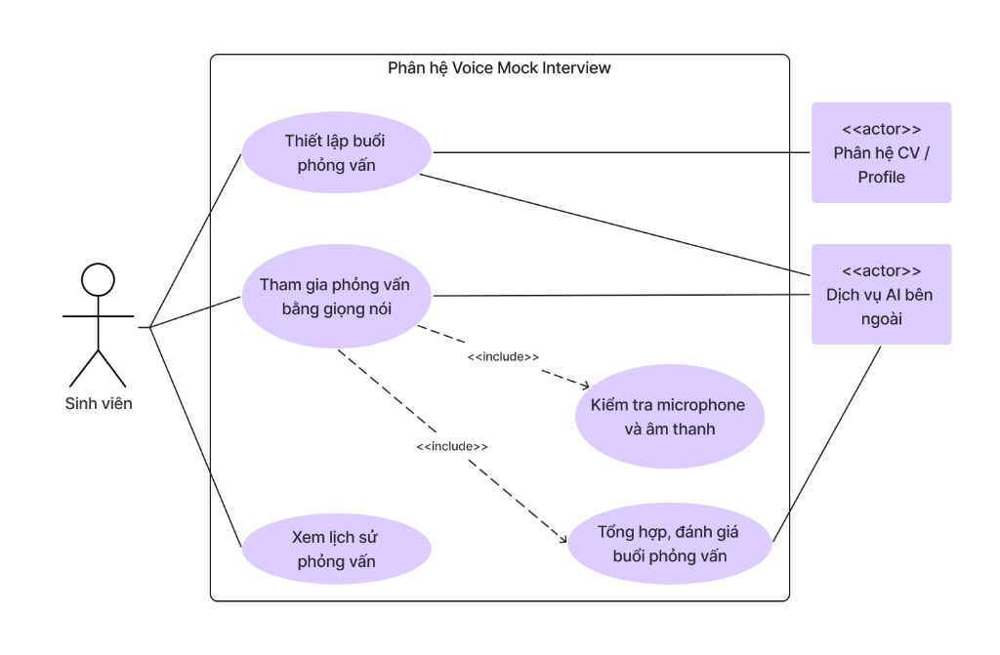

## 5.2 Đặc tả Use Case

### 4.2.1. Thiết lập buổi phỏng vấn

| Thành phần | Đặc tả |
|---|---|
| **Use Case ID** | U001 |
| **Tên Use Case** | Thiết lập buổi phỏng vấn |
| **Tóm tắt** | Cho phép sinh viên lựa chọn vị trí chuyên môn, cấp độ ứng tuyển, ngôn ngữ phỏng vấn và CV ngữ cảnh để hệ thống khởi tạo phiên phỏng vấn phù hợp. |
| **Tác nhân** | Sinh viên; Phân hệ CV / Profile; Dịch vụ AI bên ngoài. |
| **Điều kiện tiên quyết** | Sinh viên đã đăng nhập vào hệ thống HireUS Tools. |
| **Kết quả** | Cấu hình buổi phỏng vấn được xác nhận và phiên phỏng vấn được khởi tạo sẵn sàng cho bước kiểm tra thiết bị. |
| **Kịch bản chính** | 1. Sinh viên chọn chức năng "Phỏng vấn thử bằng giọng nói" từ giao diện chính.<br>2. Hệ thống hiển thị màn hình thiết lập buổi phỏng vấn.<br>3. Hệ thống gửi yêu cầu sang **Phân hệ CV / Profile** để tải danh sách các bản CV hiện có của sinh viên.<br>4. Sinh viên chọn vị trí ứng tuyển (Frontend, Backend, Mobile, Data/AI, v.v.), chọn cấp độ (Intern hoặc Fresher), chọn ngôn ngữ phỏng vấn (tiếng Việt hoặc tiếng Anh) và chọn 1 bản CV làm ngữ cảnh.<br>5. Sinh viên nhấn "Xác nhận và tiếp tục".<br>6. Hệ thống kiểm tra tính hợp lệ của cấu hình, gửi dữ liệu thiết lập sang **Dịch vụ AI bên ngoài** để chuẩn bị ngữ cảnh phỏng vấn.<br>7. Hệ thống chuyển sang màn hình kiểm tra thiết bị âm thanh. |
| **Kịch bản phụ** | • Sinh viên chưa có CV trong tài khoản: Hệ thống cho phép chọn chế độ phỏng vấn kiến thức chung theo vị trí mà không cần đính kèm CV.<br>• Dữ liệu chưa hợp lệ: Hệ thống thông báo các mục thông tin còn thiếu để sinh viên hoàn thiện.<br>• Dịch vụ AI không phản hồi: Hệ thống thông báo lỗi kết nối và cho phép sinh viên thử lại. |
| **Ràng buộc phi chức năng** | Giao diện lựa chọn rõ ràng, tải danh sách CV nhanh chóng; bảo vệ tính riêng tư của dữ liệu hồ sơ CV. |

Thông tin thiết lập là căn cứ để AI cá nhân hóa câu hỏi bám sát kinh nghiệm và dự án thực tế của ứng viên.

---

### 4.2.2. Tham gia phỏng vấn bằng giọng nói

| Thành phần | Đặc tả |
|---|---|
| **Use Case ID** | U002 |
| **Tên Use Case** | Tham gia phỏng vấn bằng giọng nói |
| **Tóm tắt** | Sinh viên tham gia quá trình hỏi đáp kỹ thuật trực tiếp bằng giọng nói hai chiều với AI Tech Lead và hoàn tất phiên phỏng vấn. |
| **Tác nhân** | Sinh viên; Dịch vụ AI bên ngoài. |
| **Điều kiện tiên quyết** | Buổi phỏng vấn đã được thiết lập (U001) thành công. |
| **Kết quả** | Buổi phỏng vấn hoàn thành; toàn bộ transcript hỏi đáp và báo cáo đánh giá được lưu trữ vào hệ thống. |
| **Kịch bản chính** | 1. Hệ thống thực hiện use case `<<include>>` **U003 – Kiểm tra microphone và âm thanh**.<br>2. Sau khi thiết bị sẵn sàng, hệ thống bắt đầu phiên phỏng vấn và hiển thị giao diện phòng phỏng vấn trực tuyến.<br>3. **Dịch vụ AI bên ngoài** sinh câu hỏi đầu tiên; hệ thống chuyển thành âm thanh (TTS) và phát cho sinh viên nghe.<br>4. Sinh viên lắng nghe câu hỏi và trả lời bằng giọng nói qua microphone.<br>5. Hệ thống thu âm thanh, gửi đến **Dịch vụ AI bên ngoài** để chuyển đổi thành văn bản (STT) và hiển thị cho sinh viên theo dõi.<br>6. Sinh viên xác nhận câu trả lời (hoặc hết thời gian trả lời quy định).<br>7. Hệ thống gửi nội dung trả lời đến **Dịch vụ AI bên ngoài** để phân tích và sinh câu hỏi tiếp theo (bao gồm câu hỏi đào sâu hoặc đổi chủ đề).<br>8. Lặp lại các bước 3–7 cho đến khi hoàn thành các câu hỏi trong phiên hoặc sinh viên chọn kết thúc.<br>9. Sinh viên chọn "Kết thúc phỏng vấn" và xác nhận.<br>10. Hệ thống thực hiện use case `<<include>>` **U004 – Tổng hợp, đánh giá buổi phỏng vấn**.<br>11. Hệ thống hiển thị báo cáo đánh giá hoàn chỉnh cho sinh viên. |
| **Kịch bản phụ** | • Nhận diện giọng nói chưa chính xác: Sinh viên chọn nói lại trước khi gửi câu trả lời.<br>• Sinh viên nghe chưa rõ câu hỏi: Sinh viên nhấn nút yêu cầu AI nhắc lại câu hỏi.<br>• Gián đoạn kết nối giữa phiên: Hệ thống lưu lại các câu hỏi/câu trả lời đã hoàn thành, hiển thị thông báo lỗi mạng và cho phép kết nối lại hoặc kết thúc sớm.<br>• Sinh viên hủy phiên phỏng vấn: Hệ thống cảnh báo phiên chưa hoàn thành sẽ không được tính điểm chính thức. |
| **Ràng buộc phi chức năng** | Độ trễ xử lý âm thanh hai chiều không quá 4 giây; hiển thị trực quan sóng âm thanh (audio visualizer); bảo mật đường truyền âm thanh. |

---

### 4.2.3. Kiểm tra microphone và âm thanh

| Thành phần | Đặc tả |
|---|---|
| **Use Case ID** | U003 |
| **Tên Use Case** | Kiểm tra microphone và âm thanh |
| **Tóm tắt** | Kiểm tra quyền truy cập thiết bị thu âm (microphone) và thiết bị phát âm thanh (loa/tai nghe) trước khi bước vào phỏng vấn. |
| **Tác nhân** | Sinh viên. |
| **Điều kiện tiên quyết** | Sinh viên đã hoàn tất thiết lập buổi phỏng vấn (U001). |
| **Kết quả** | Thiết bị âm thanh được xác nhận hoạt động bình thường, sinh viên được phép vào phòng phỏng vấn. |
| **Kịch bản chính** | 1. Hệ thống yêu cầu quyền truy cập microphone trên trình duyệt của sinh viên.<br>2. Sinh viên đồng ý cấp quyền truy cập.<br>3. Hệ thống hiển thị thanh đo âm lượng trực quan và yêu cầu sinh viên thử nói vào micro.<br>4. Sinh viên nói thử và quan sát mức dao động của thanh âm lượng.<br>5. Hệ thống tự động phát một đoạn âm thanh mẫu ngắn và yêu cầu sinh viên xác nhận đã nghe rõ qua loa/tai nghe.<br>6. Sinh viên xác nhận âm thanh rõ ràng và nhấn "Sẵn sàng phỏng vấn".<br>7. Hệ thống lưu trạng thái thiết bị hợp lệ và chuyển quyền điều khiển lại cho use case **U002**. |
| **Kịch bản phụ** | • Trình duyệt bị từ chối cấp quyền: Hệ thống hiển thị hướng dẫn chi tiết cách mở lại quyền microphone trong cài đặt trình duyệt.<br>• Không nhận được tín hiệu âm thanh: Hệ thống khuyến nghị kiểm tra lại kết nối micro hoặc đổi thiết bị đầu vào.<br>• Sinh viên không nghe thấy âm thanh mẫu: Hệ thống hướng dẫn kiểm tra âm lượng loa hoặc chọn thiết bị đầu ra khác. |
| **Ràng buộc phi chức năng** | Giao diện hướng dẫn trực quan, phản ứng đo âm lượng tức thì theo thời gian thực (real-time feedback). |

Use case này là bước bắt buộc (`<<include>>`) trong use case U002 nhằm loại trừ các sự cố kỹ thuật âm thanh làm ảnh hưởng đến chất lượng phỏng vấn.

---

### 4.2.4. Tổng hợp, đánh giá buổi phỏng vấn

| Thành phần | Đặc tả |
|---|---|
| **Use Case ID** | U004 |
| **Tên Use Case** | Tổng hợp, đánh giá buổi phỏng vấn |
| **Tóm tắt** | Phân tích transcript buổi phỏng vấn, tính điểm theo các tiêu chí và sinh báo cáo đánh giá năng lực chi tiết kèm định hướng cải thiện. |
| **Tác nhân** | Sinh viên; Dịch vụ AI bên ngoài. |
| **Điều kiện tiên quyết** | Phiên phỏng vấn kết thúc (đã hoàn thành các câu hỏi hoặc sinh viên chủ động kết thúc sau khi đã trả lời). |
| **Kết quả** | Báo cáo đánh giá hoàn chỉnh được tạo, hiển thị cho sinh viên và lưu trữ vào cơ sở dữ liệu. |
| **Kịch bản chính** | 1. Hệ thống tổng hợp toàn văn transcript của phiên phỏng vấn (gồm danh sách câu hỏi và các câu trả lời tương ứng).<br>2. Hệ thống gửi transcript cùng cấu hình phỏng vấn đến **Dịch vụ AI bên ngoài**.<br>3. **Dịch vụ AI bên ngoài** phân tích dữ liệu, chấm điểm theo các tiêu chí (Kiến thức kỹ thuật, Tư duy giải quyết vấn đề, Kỹ năng diễn đạt) và xác định điểm mạnh, điểm yếu.<br>4. **Dịch vụ AI bên ngoài** tạo các gợi ý trả lời mẫu và danh mục chủ đề kiến thức cần ôn tập bổ sung.<br>5. Hệ thống tiếp nhận kết quả, tính toán điểm tổng hợp theo quy tắc nghiệp vụ BR-VMI-04 và phân loại mức kết quả theo BR-VMI-05.<br>6. Hệ thống lưu báo cáo đánh giá kèm trạng thái hoàn thành vào cơ sở dữ liệu.<br>7. Hệ thống hiển thị báo cáo chi tiết cho sinh viên trên giao diện. |
| **Kịch bản phụ** | • Dịch vụ AI gặp sự cố khi tạo báo cáo: Hệ thống lưu trữ an toàn transcript đã có, hiển thị thông báo chưa thể tạo báo cáo và cung cấp nút "Tạo lại báo cáo đánh giá".<br>• Phiên phỏng vấn kết thúc quá sớm (chưa trả lời câu nào): Hệ thống thông báo không đủ dữ liệu để đánh giá năng lực và không lưu kết quả đánh giá. |
| **Ràng buộc phi chức năng** | Báo cáo trình bày rõ ràng, phân loại bằng màu sắc (Đỏ/Vàng/Xanh); công thức tính điểm nhất quán; thông tin đánh giá mang tính khách quan và xây dựng. |

Báo cáo phỏng vấn là sản phẩm đầu ra cốt lõi của use case U002, giúp sinh viên nhận diện rõ lỗ hổng kiến thức để có kế hoạch ôn tập đúng trọng tâm.

---

### 4.2.5. Xem lịch sử phỏng vấn

| Thành phần | Đặc tả |
|---|---|
| **Use Case ID** | U005 |
| **Tên Use Case** | Xem lịch sử phỏng vấn |
| **Tóm tắt** | Cho phép sinh viên xem lại danh sách và nội dung chi tiết của các buổi phỏng vấn đã thực hiện trước đây. |
| **Tác nhân** | Sinh viên. |
| **Điều kiện tiên quyết** | Sinh viên đã đăng nhập vào hệ thống HireUS Tools. |
| **Kết quả** | Danh sách lịch sử hoặc báo cáo chi tiết của một phiên phỏng vấn trong quá khứ được hiển thị. |
| **Kịch bản chính** | 1. Sinh viên chọn mục "Lịch sử phỏng vấn" trên thanh điều hướng.<br>2. Hệ thống truy vấn cơ sở dữ liệu và hiển thị danh sách các phiên phỏng vấn của sinh viên (gồm ngày thực hiện, vị trí ứng tuyển, ngôn ngữ, điểm tổng hợp và mức phân loại).<br>3. Sinh viên chọn một phiên phỏng vấn cụ thể để xem chi tiết.<br>4. Hệ thống hiển thị toàn bộ nội dung của phiên đã chọn: thông tin thiết lập, bản CV đã sử dụng, transcript chi tiết từng câu hỏi - câu trả lời và toàn văn báo cáo đánh giá.<br>5. Sinh viên có thể chọn tính năng "Phỏng vấn lại với cấu hình này" để khởi tạo một buổi phỏng vấn mới dựa trên thông số của phiên cũ. |
| **Kịch bản phụ** | • Tài khoản chưa có lịch sử phỏng vấn: Hệ thống hiển thị thông báo trống kèm nút điều hướng đến chức năng tạo phỏng vấn mới.<br>• Không có quyền truy cập: Hệ thống từ chối hiển thị dữ liệu không thuộc tài khoản của người dùng. |
| **Ràng buộc phi chức năng** | Dữ liệu lịch sử được bảo toàn nguyên vẹn ngay cả khi CV gốc bị sửa đổi; chỉ người dùng sở hữu tài khoản mới có quyền truy cập lịch sử của mình. |


---

<a id="phan-he-3"></a>

# Phân hệ 3 — Job Matching & Skill Gap

Nguồn: [Bai_lam_Job_matching.md](./Bai_lam_Job_matching.md)

# 1. Mô tả kĩ bài toán

Sinh viên công nghệ thông tin năm 3–4 khi tìm kiếm vị trí thực tập hoặc Fresher thường đã có CV và lựa chọn được tin tuyển dụng phù hợp với định hướng chuyên môn. Tuy nhiên, việc tự đối chiếu CV với mô tả công việc còn gặp khó khăn do yêu cầu tuyển dụng được diễn đạt theo nhiều cách, bao gồm kỹ năng chuyên môn, kỹ năng mềm, kinh nghiệm, dự án, ngoại ngữ và học vấn. Sinh viên khó xác định CV hiện tại đã thể hiện mức độ đáp ứng như thế nào, còn thiếu bằng chứng cho yêu cầu nào và cần ưu tiên cải thiện điều gì.

Phân hệ Job Matching & Skill Gap hỗ trợ người dùng lựa chọn CV hiện có trong hệ thống và cung cấp nội dung mô tả công việc thuộc cùng nhóm vị trí. Hệ thống đối chiếu các yêu cầu tuyển dụng với thông tin được thể hiện trong CV, đưa ra điểm đánh giá theo phần trăm và phân loại kết quả thành ba mức. Mức đỏ khuyến nghị ưu tiên cải thiện trước khi ứng tuyển; mức vàng khuyến khích cân nhắc ứng tuyển đồng thời bổ sung những điểm còn thiếu; mức xanh thể hiện CV đáp ứng tốt các yêu cầu được đánh giá. Kết quả đi kèm giải thích cho từng yêu cầu. Nếu còn yêu cầu bắt buộc chưa có bằng chứng đáp ứng, kết quả tối đa ở mức vàng dù điểm tổng đạt ngưỡng xanh.

Sau bước đánh giá, hệ thống sử dụng thông tin trong profile kết hợp xác nhận của người dùng để phân biệt năng lực đã có nhưng chưa được thể hiện rõ trong CV với năng lực cần tiếp tục bổ sung. Đối với trường hợp thứ nhất, hệ thống chỉ ra vị trí cần cải thiện và cung cấp ví dụ trình bày dựa trên thông tin đã xác nhận. Đối với trường hợp thứ hai, hệ thống đề xuất nội dung cần học, hoạt động thực hành và nguồn tài liệu có thể kiểm chứng, ưu tiên theo yêu cầu của công việc. Người dùng chủ động cập nhật CV và thực hiện phân tích lại để nhận kết quả mới.

Điểm đánh giá phản ánh mức độ đáp ứng được thể hiện trong CV tại thời điểm phân tích, không phải xác suất được tuyển dụng. Thông tin bổ sung trong profile phục vụ việc hướng dẫn cải thiện và không tự làm thay đổi điểm của CV hiện tại.

# 2. Các bên liên quan (Stakeholder)

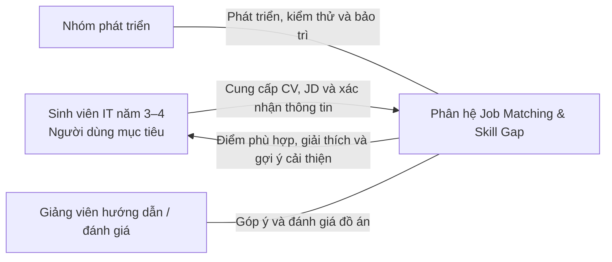

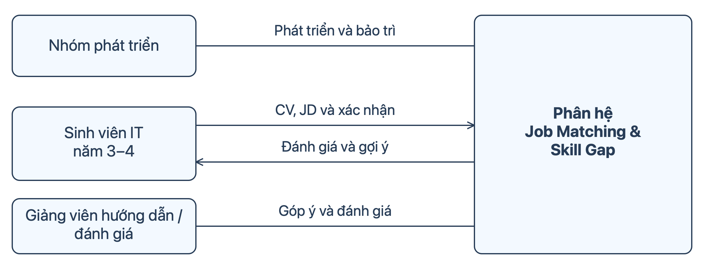

# 3. Đặc tả yêu cầu chức năng

## Quy ước mã

- **FR** (*Functional Requirement*): yêu cầu chức năng.
- **JM** (*Job Matching*): phân hệ Job Matching & Skill Gap.
- **FR-JM-01**: yêu cầu chức năng số 01 của phân hệ.
- **BR** (*Business Rule*): quy tắc nghiệp vụ; ví dụ `BR-JM-01`.

## a. Tiếp nhận dữ liệu và xác định hướng chuyên môn

|     Mã    | Yêu cầu chức năng |
|---|---|
| FR-JM-01 | Hệ thống phải cho phép người dùng lựa chọn một CV hiện có trong tài khoản để phân tích. |
| FR-JM-02 | Hệ thống phải cho phép người dùng nhập nội dung mô tả công việc (JD) cần đối chiếu. |
| FR-JM-03 | Hệ thống phải kiểm tra dữ liệu đầu vào và thông báo những nội dung cần bổ sung khi chưa có CV, JD hoặc dữ liệu không đủ để phân tích. |
| FR-JM-04 | Hệ thống phải đề xuất hướng chuyên môn của CV và JD dựa trên title và nội dung, đồng thời cho phép người dùng xác nhận hoặc sửa kết quả nhận diện. |
| FR-JM-05 | Hệ thống phải cho phép tiếp tục phân tích khi CV và JD có cùng hướng chuyên môn hoặc có phần chuyên môn giao nhau. Nếu khác hướng hoàn toàn, hệ thống phải giải thích và yêu cầu lựa chọn lại CV hoặc JD. |
| FR-JM-06 | Khi CV và JD có phần chuyên môn giao nhau, hệ thống phải đánh giá toàn bộ yêu cầu trong JD và chỉ rõ phần liên quan cũng như phần yêu cầu mở rộng so với CV. |

## b. Bóc tách và xác nhận thông tin

| Mã | Yêu cầu chức năng |
|---|---|
| FR-JM-07 | Hệ thống phải nhận diện các yêu cầu được nêu trong JD, bao gồm kỹ năng chuyên môn, kỹ năng mềm, kinh nghiệm, dự án, ngoại ngữ, học vấn và các điều kiện liên quan. |
| FR-JM-08 | Hệ thống phải phân loại từng yêu cầu thành bắt buộc, ưu tiên hoặc không nêu rõ mức độ, dựa trên nội dung JD. |
| FR-JM-09 | Hệ thống phải nhận diện thông tin trong CV có thể làm bằng chứng đáp ứng từng yêu cầu và lưu đoạn nội dung nguồn tương ứng. |
| FR-JM-10 | Hệ thống phải chuẩn hóa các cách viết có cùng nghĩa và nhận diện quan hệ “và”, “hoặc” giữa các điều kiện trong yêu cầu. |
| FR-JM-11 | Hệ thống phải hiển thị dữ liệu bóc tách cùng nội dung nguồn để người dùng kiểm tra và xác nhận trước khi đánh giá. |
| FR-JM-12 | Hệ thống phải cho phép sửa lỗi bóc tách dựa trên thông tin có trong CV/JD gốc. Thông tin bổ sung chưa có trong CV không được sử dụng để tăng điểm của CV đang phân tích. |

## c. Đánh giá mức độ phù hợp

| Mã | Yêu cầu chức năng |
|---|---|
| FR-JM-13 | Hệ thống phải đối chiếu từng yêu cầu trong JD với bằng chứng trong CV và xác định mức đáp ứng theo quy tắc đánh giá. |
| FR-JM-14 | Đối với yêu cầu về năng lực thực hành, hệ thống phải đánh giá nội dung công việc và đóng góp cá nhân trong dự án hoặc kinh nghiệm làm việc; việc chỉ liệt kê tên kỹ năng, dự án hoặc chức danh không được xem là bằng chứng đáp ứng đầy đủ. |
| FR-JM-15 | Hệ thống phải tính điểm phù hợp theo phần trăm dựa trên trọng số yêu cầu và mức đáp ứng, đồng thời áp dụng giới hạn điểm khi yêu cầu bắt buộc chưa được đáp ứng đầy đủ. |
| FR-JM-16 | Hệ thống phải phân loại kết quả thành ba mức đỏ, vàng và xanh dựa trên điểm cuối. |
| FR-JM-17 | Hệ thống phải hiển thị bảng đối chiếu, mức đáp ứng và bằng chứng cho từng yêu cầu, đồng thời giải thích cách hình thành điểm và lý do áp dụng giới hạn điểm nếu có. |
| FR-JM-18 | Hệ thống phải cung cấp khuyến nghị ứng tuyển tương ứng với mức phân loại và thông báo rằng kết quả không phải xác suất được tuyển dụng. |

## d. Xác định khoảng trống và hướng cải thiện

| Mã | Yêu cầu chức năng |
|---|---|
| FR-JM-19 | Hệ thống phải xác định các yêu cầu chưa có bằng chứng đáp ứng đầy đủ trong CV và sắp xếp các yêu cầu bắt buộc trước các yêu cầu còn lại. |
| FR-JM-20 | Hệ thống phải tham chiếu profile để tìm thông tin năng lực liên quan chưa được thể hiện rõ trong CV, đồng thời cho phép người dùng xác nhận hoặc bổ sung tình trạng năng lực của mình. |
| FR-JM-21 | Dựa trên profile và xác nhận của người dùng, hệ thống phải phân biệt trường hợp cần cải thiện cách thể hiện trong CV với trường hợp cần học hoặc thực hành thêm. Nếu chưa đủ thông tin, hệ thống phải thể hiện trạng thái chưa xác định. |
| FR-JM-22 | Với năng lực đã có nhưng CV thể hiện chưa đầy đủ, hệ thống phải chỉ rõ nội dung cần bổ sung và cung cấp ví dụ trình bày dựa trên thông tin được xác nhận. |
| FR-JM-23 | Với năng lực cần bổ sung, hệ thống phải đề xuất nội dung học và hoạt động thực hành phù hợp với yêu cầu JD. |
| FR-JM-24 | Khi cung cấp tài liệu học tập, hệ thống phải hiển thị nguồn và đường dẫn đã được kiểm tra, có liên quan đến nội dung đề xuất; không cung cấp đường dẫn chưa kiểm chứng. |
| FR-JM-25 | Hệ thống không được tự động sửa CV hoặc tạo thêm kinh nghiệm, kỹ năng, chứng chỉ và thành tích không có căn cứ từ thông tin người dùng cung cấp. Thông tin ngoài CV chỉ phục vụ hướng dẫn cải thiện, không tự làm thay đổi điểm hiện tại. |

## e. Lưu lịch sử và phân tích lại

| Mã | Yêu cầu chức năng |
|---|---|
| FR-JM-26 | Hệ thống phải lưu nội dung CV/JD tại thời điểm phân tích, dữ liệu bóc tách đã xác nhận, bảng đối chiếu, điểm ban đầu, điểm cuối, mức phân loại và các gợi ý đã tạo. |
| FR-JM-27 | Hệ thống phải cho phép người dùng xem danh sách và chi tiết các lần phân tích của mình. |
| FR-JM-28 | Hệ thống phải cho phép tạo lần phân tích mới sau khi người dùng cập nhật CV, bao gồm khả năng sử dụng lại JD đã phân tích trước đó. |
| FR-JM-29 | Hệ thống phải giữ nguyên dữ liệu và kết quả lịch sử khi CV gốc được chỉnh sửa. |

## f. Xử lý trường hợp không thể hoàn thành phân tích

| Mã | Yêu cầu chức năng |
|---|---|
| FR-JM-30 | Khi dữ liệu không đủ hoặc quá trình phân tích thất bại, hệ thống phải thông báo chưa thể đánh giá, nêu lý do và cho phép bổ sung dữ liệu hoặc thử lại; không trả điểm 0% như một kết quả đánh giá. |
| FR-JM-31 | Khi chỉ bước tạo gợi ý hoặc lấy nguồn tài liệu thất bại, hệ thống phải giữ và hiển thị kết quả matching đã có, đồng thời cho phép thử lại phần bị lỗi. |

## Các quy tắc nghiệp vụ áp dụng

### BR-JM-01 — Xác định hướng chuyên môn

CV và JD không cần có title trùng nhau. Hai bên được phép phân tích khi có cùng hướng chuyên môn hoặc có phần chuyên môn giao nhau.

Ví dụ:

- React Developer và Angular Intern: cùng hướng Frontend.
- Frontend và Fullstack: có phần chuyên môn giao nhau; phải đánh giá cả các yêu cầu Backend trong JD.
- Frontend và Backend: khác hướng nếu không có nội dung chuyên môn giao nhau.

### BR-JM-02 — Diễn giải yêu cầu kết hợp

- Với quan hệ **“và”**, từng điều kiện phải được đánh giá; chỉ đáp ứng đầy đủ khi tất cả điều kiện được đáp ứng.
- Với quan hệ **“hoặc”**, chỉ cần đáp ứng đầy đủ một lựa chọn; không trừ điểm vì thiếu các lựa chọn còn lại.

### BR-JM-03 — Trọng số yêu cầu

| Loại yêu cầu | Trọng số |
|---|---:|
| Bắt buộc | 2 |
| Ưu tiên | 1 |
| Không nêu rõ | 1 |

Yêu cầu không nêu rõ mức độ không được tự xem là bắt buộc để áp dụng giới hạn điểm.

### BR-JM-04 — Mức đáp ứng

| Mức đáp ứng | Căn cứ đánh giá |
|---|---|
| **0%** | Chưa có bằng chứng liên quan trong CV. |
| **25%** | Có nhắc đến nhưng chưa chứng minh đáp ứng yêu cầu. |
| **50%** | Có bằng chứng cụ thể nhưng chỉ đáp ứng một phần yêu cầu. |
| **100%** | Có bằng chứng cụ thể đáp ứng đầy đủ yêu cầu. |

Bằng chứng phải phù hợp với nội dung yêu cầu. Mô tả dài hoặc có tên dự án không tự động được đánh giá cao. Với học vấn, ngoại ngữ và các điều kiện khác, sử dụng thông tin tương ứng trong CV.

### BR-JM-05 — Công thức điểm và giới hạn

```text
Điểm ban đầu =
Σ(trọng số yêu cầu × mức đáp ứng)
÷ Σ(trọng số yêu cầu)
× 100
```

Mức đáp ứng trong công thức sử dụng các giá trị `0`, `0.25`, `0.5` và `1`.

Nếu có bất kỳ yêu cầu bắt buộc nào chưa đáp ứng đầy đủ:

```text
Điểm cuối = min(Điểm ban đầu, 79%)
```

Nếu tất cả yêu cầu bắt buộc được đáp ứng đầy đủ, điểm cuối bằng điểm ban đầu.

### BR-JM-06 — Phân loại và khuyến nghị

| Mức | Điểm cuối | Khuyến nghị |
|---|---|---|
| **Đỏ** | Dưới 50% | Ưu tiên cải thiện trước khi ứng tuyển. |
| **Vàng** | Từ 50% đến dưới 80% | Khuyến khích cân nhắc ứng tuyển, đồng thời cải thiện những điểm còn thiếu. |
| **Xanh** | Từ 80% trở lên | CV thể hiện mức đáp ứng tốt đối với các yêu cầu được đánh giá. |

Điểm phản ánh **bằng chứng được thể hiện trong CV tại thời điểm phân tích**, không khẳng định toàn bộ năng lực thực tế của người dùng. Các trọng số và ngưỡng trên là quy tắc dự kiến của đồ án, cần được kiểm tra bằng bộ CV/JD mẫu.


# 4. Đặc tả yêu cầu phi chức năng

| Mã | Nhóm | Yêu cầu phi chức năng |
|---|---|---|
| NFR-JM-01 | Dễ sử dụng | Giao diện phải sử dụng tiếng Việt dễ hiểu, giải thích điểm và mức đánh giá bằng cả nhãn chữ lẫn màu sắc. |
| NFR-JM-02 | Bảo mật | CV, profile và lịch sử phân tích chỉ được truy cập bởi người có quyền; khóa dịch vụ AI phải được giữ ở phía máy chủ. |
| NFR-JM-03 | Nhất quán | Cùng dữ liệu đối chiếu đã xác nhận và cùng phiên bản công thức phải cho cùng điểm và mức phân loại. |
| NFR-JM-04 | Tin cậy | Khi bước tạo gợi ý hoặc lấy tài liệu thất bại, hệ thống phải giữ kết quả matching đã hoàn thành và lưu thành công. |


# 5. Đặc tả yêu cầu

## 5.1 Sơ đồ Use Case

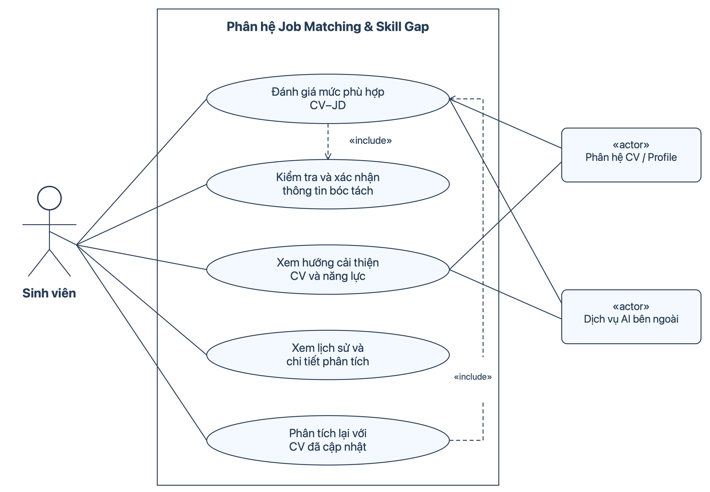

## 5.2 Đặc tả Use Case 

### 4.2.1. Đánh giá mức phù hợp CV–JD

| Thành phần | Đặc tả |
|---|---|
| **Use Case ID** | U001 |
| **Tên Use Case** | Đánh giá mức phù hợp CV–JD |
| **Tóm tắt** | Đối chiếu CV với JD, trả điểm phù hợp, mức phân loại và giải thích. |
| **Tác nhân** | Sinh viên; phân hệ CV/Profile; dịch vụ AI bên ngoài. |
| **Điều kiện tiên quyết** | Sinh viên đã đăng nhập và có CV trong hệ thống. |
| **Kết quả** | Kết quả đánh giá được hiển thị và lưu vào lịch sử. |
| **Kịch bản chính** | 1. Sinh viên chọn CV và nhập JD.<br>2. Hệ thống bóc tách thông tin, đề xuất hướng chuyên môn.<br>3. Thực hiện **U002 – Kiểm tra và xác nhận thông tin bóc tách**.<br>4. Hệ thống kiểm tra tính liên quan chuyên môn, đối chiếu và tính điểm theo quy tắc nghiệp vụ.<br>5. Hệ thống hiển thị điểm, mức màu, bằng chứng, giải thích và lưu kết quả. |
| **Kịch bản phụ** | • Thiếu dữ liệu: yêu cầu bổ sung.<br>• Khác hướng hoàn toàn: yêu cầu chọn lại CV hoặc JD.<br>• Phân tích thất bại: thông báo và cho thử lại, không trả điểm 0%. |
| **Ràng buộc phi chức năng** | Bảo vệ dữ liệu; kết quả có nhãn chữ và màu; cùng dữ liệu đối chiếu và phiên bản công thức cho cùng điểm. |

### 4.2.2. Kiểm tra và xác nhận thông tin bóc tách

| Thành phần | Đặc tả |
|---|---|
| **Use Case ID** | U002 |
| **Tên Use Case** | Kiểm tra và xác nhận thông tin bóc tách |
| **Tóm tắt** | Cho sinh viên kiểm tra và sửa lỗi đọc hiểu trước khi hệ thống đánh giá. |
| **Tác nhân** | Sinh viên. |
| **Điều kiện tiên quyết** | Hệ thống đã bóc tách được thông tin CV/JD. |
| **Kết quả** | Dữ liệu được sinh viên xác nhận để sử dụng khi đánh giá. |
| **Kịch bản chính** | 1. Hệ thống hiển thị hướng chuyên môn, yêu cầu JD và bằng chứng CV kèm nội dung nguồn.<br>2. Sinh viên kiểm tra và sửa lỗi nếu có.<br>3. Sinh viên xác nhận thông tin.<br>4. Hệ thống tiếp tục quá trình đánh giá. |
| **Kịch bản phụ** | • Thông tin chưa rõ: sinh viên điều chỉnh theo nội dung gốc.<br>• Sinh viên chưa xác nhận hoặc hủy: hệ thống chưa tính điểm. |
| **Ràng buộc phi chức năng** | Thông tin dễ hiểu, có thể đối chiếu với nguồn; chỉ người có quyền được truy cập. |

Việc sửa dữ liệu chỉ khắc phục lỗi bóc tách. Thông tin chưa có trong CV không được bổ sung tại đây để tăng điểm, và CV gốc không tự thay đổi.

### 4.2.3. Xem hướng cải thiện CV và năng lực

| Thành phần | Đặc tả |
|---|---|
| **Use Case ID** | U003 |
| **Tên Use Case** | Xem hướng cải thiện CV và năng lực |
| **Tóm tắt** | Xác định nội dung cần bổ sung vào CV hoặc năng lực cần học và thực hành thêm. |
| **Tác nhân** | Sinh viên; phân hệ CV/Profile; dịch vụ AI bên ngoài. |
| **Điều kiện tiên quyết** | Sinh viên đã có kết quả đánh giá CV–JD. |
| **Kết quả** | Hướng cải thiện được hiển thị và lưu cùng lần phân tích. |
| **Kịch bản chính** | 1. Sinh viên yêu cầu xem hướng cải thiện.<br>2. Hệ thống xác định các yêu cầu chưa đáp ứng đầy đủ và tham chiếu profile.<br>3. Sinh viên xác nhận tình trạng năng lực.<br>4. Hệ thống đề xuất bổ sung cách trình bày CV hoặc nội dung học, thực hành và nguồn tham khảo, ưu tiên yêu cầu bắt buộc.<br>5. Hệ thống hiển thị và lưu gợi ý. |
| **Kịch bản phụ** | • Chưa đủ thông tin năng lực: ghi rõ chưa xác định, không kết luận người dùng chưa biết.<br>• Không có khoảng trống: thông báo không ghi nhận yêu cầu cần bổ sung.<br>• Lỗi tạo gợi ý hoặc lấy nguồn: giữ kết quả matching, cho thử lại phần lỗi. |
| **Ràng buộc phi chức năng** | Bảo vệ profile; gợi ý dễ hiểu; lỗi gợi ý không làm mất kết quả matching đã lưu. |

Gợi ý không tự sửa CV hoặc làm thay đổi điểm hiện tại. Nguồn tài liệu chỉ được cung cấp khi đã kiểm chứng.

### 4.2.4. Xem lịch sử và chi tiết phân tích

| Thành phần | Đặc tả |
|---|---|
| **Use Case ID** | U004 |
| **Tên Use Case** | Xem lịch sử và chi tiết phân tích |
| **Tóm tắt** | Cho sinh viên xem lại các lần phân tích đã lưu. |
| **Tác nhân** | Sinh viên. |
| **Điều kiện tiên quyết** | Sinh viên đã đăng nhập. |
| **Kết quả** | Danh sách hoặc chi tiết kết quả phân tích được hiển thị. |
| **Kịch bản chính** | 1. Sinh viên mở lịch sử phân tích.<br>2. Hệ thống hiển thị các lần phân tích của sinh viên.<br>3. Sinh viên chọn một lần phân tích.<br>4. Hệ thống hiển thị CV/JD đã sử dụng, điểm, giải thích và các gợi ý đã lưu. |
| **Kịch bản phụ** | • Chưa có lịch sử: hiển thị thông báo.<br>• Không có quyền truy cập: từ chối hiển thị kết quả. |
| **Ràng buộc phi chức năng** | Chỉ truy cập kết quả thuộc quyền người dùng; dữ liệu lịch sử giữ nguyên khi CV gốc thay đổi. |

### 4.2.5. Phân tích lại với CV đã cập nhật

| Thành phần | Đặc tả |
|---|---|
| **Use Case ID** | U005 |
| **Tên Use Case** | Phân tích lại với CV đã cập nhật |
| **Tóm tắt** | Đánh giá CV đã chỉnh sửa với JD của một lần phân tích trước. |
| **Tác nhân** | Sinh viên; phân hệ CV/Profile; dịch vụ AI bên ngoài. |
| **Điều kiện tiên quyết** | Sinh viên đã đăng nhập, có kết quả phân tích trước và đã cập nhật CV. |
| **Kết quả** | Một kết quả phân tích mới được tạo; kết quả cũ được giữ nguyên. |
| **Kịch bản chính** | 1. Sinh viên mở kết quả trước và chọn phân tích lại.<br>2. Hệ thống sử dụng lại JD, cho sinh viên chọn CV đã cập nhật.<br>3. Thực hiện **U001 – Đánh giá mức phù hợp CV–JD**.<br>4. Hệ thống hiển thị và lưu kết quả thành lần phân tích mới. |
| **Kịch bản phụ** | • CV không khả dụng: yêu cầu chọn lại.<br>• Không thể đánh giá: xử lý theo các kịch bản phụ của U001. |
| **Ràng buộc phi chức năng** | Bảo vệ dữ liệu; không ghi đè kết quả cũ; tính điểm nhất quán theo dữ liệu và phiên bản công thức. |

---

<a id="phan-he-4"></a>

# Phân hệ 4 — Job Tracking

Nguồn: [Job_Tracking_Analysis.md](./Job_Tracking_Analysis.md)

# 1. Mô tả kĩ bài toán

Sinh viên IT tìm việc Intern/Fresher thường khó cập nhật tin tuyển dụng từ nhiều Fanpage và trang LinkedIn doanh nghiệp. Tin dễ bị trôi hoặc lẫn với bài đăng không liên quan, khiến người dùng bỏ lỡ cơ hội ứng tuyển.

Phân hệ **Job Tracking** cho phép thêm/xóa nguồn, tạm dừng/tiếp tục theo dõi và kiểm tra nguồn còn hoạt động. Hệ thống định kỳ thu thập bài đăng, dùng AI sàng lọc tin tuyển dụng IT Intern/Fresher và trả kết quả theo nguồn theo dõi, thông tin quan tâm của người dùng.

Người dùng nhận thông báo khi có cơ hội mới, xem chi tiết, mở bài đăng gốc và lưu/xóa tin trong danh sách cá nhân. Hệ thống lưu và hiển thị trạng thái hết hạn của tin cùng thông báo liên quan; nếu chưa có căn cứ về thời hạn thì ghi **Chưa xác định**. Phân hệ được sử dụng trên trình duyệt web có kết nối Internet.

**Phạm vi:** Epic `SCRUM-9`, gồm năm Story `SCRUM-31` đến `SCRUM-35` và các subtask bắt buộc trong bảng sau. Các subtask được gộp vào nghiệp vụ của Story chính, không tách thành từng use case giao diện.

| Story | Nghiệp vụ | Subtask thuộc phạm vi |
| --- | --- | --- |
| SCRUM-31 | Quản lý nguồn tuyển dụng cần theo dõi | SCRUM-47: thêm/xóa nhà đăng tin; SCRUM-48: tạm dừng/tiếp tục theo dõi; SCRUM-67: kiểm tra nguồn còn hoạt động. |
| SCRUM-32 | Nhận tin mới từ nguồn đang theo dõi | SCRUM-44: kiểm tra theo chu kỳ; SCRUM-45: lưu/xóa tin đã nhận; SCRUM-43: lưu trạng thái hết hạn. |
| SCRUM-33 | Xem tin Intern/Fresher được AI sàng lọc | SCRUM-42: phân loại tin; SCRUM-41: lưu kết quả sàng lọc và thông tin tuyển dụng; SCRUM-68: trả kết quả theo cá nhân hóa người dùng. |
| SCRUM-34 | Nhận thông báo cơ hội mới | SCRUM-40: tạo thông báo từ tin mới; SCRUM-66: kiểm tra thông báo hết hạn. |
| SCRUM-35 | Xem chi tiết và mở tin gốc | SCRUM-37: lấy chi tiết tin; SCRUM-36: liên kết tới bài đăng gốc. |

# 2. Các bên liên quan (Stakeholder)

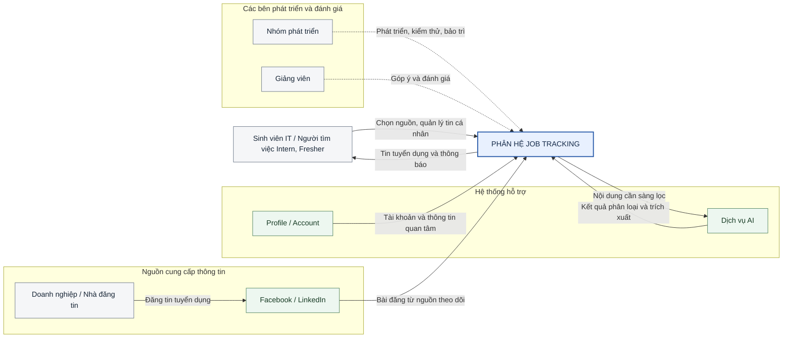


| Stakeholder | Vai trò |
| --- | --- |
| Sinh viên IT / người tìm việc Intern, Fresher | Người dùng chính; chọn nguồn, xem kết quả, lưu/xóa tin cá nhân, nhận thông báo và mở bài gốc. |
| Doanh nghiệp / nhà đăng tin | Cung cấp nội dung tuyển dụng trên Fanpage/LinkedIn; không mặc định có tài khoản hoặc đăng tin trực tiếp trong HireUS Tools. |
| Nền tảng Facebook / LinkedIn | Hệ thống ngoài lưu trữ bài đăng và cung cấp dữ liệu trong phạm vi truy cập được hỗ trợ. |
| Dịch vụ AI bên ngoài | Hỗ trợ phân loại bài đăng, trích xuất thông tin; không thay doanh nghiệp xác nhận cơ hội còn mở. |
| Phân hệ Profile/Account | Xác định tài khoản, quyền truy cập dữ liệu cá nhân và cung cấp thông tin quan tâm đã có phục vụ cá nhân hóa. |
| Nhóm phát triển | Phân tích, thiết kế, triển khai, kiểm thử và bảo trì phân hệ. |
| Giảng viên hướng dẫn / đánh giá | Góp ý và đánh giá tính đầy đủ, nhất quán của tài liệu, mô hình và prototype. |

Nhóm phát triển và giảng viên là stakeholder, không phải actor thực hiện nghiệp vụ trong sơ đồ use case. Doanh nghiệp tác động gián tiếp qua nền tảng mạng xã hội.

# 3. Đặc tả yêu cầu chức năng

## Quy ước mã

- **FR-JT**: yêu cầu chức năng của Job Tracking.
- **BR-JT**: quy tắc nghiệp vụ của Job Tracking.
- **NFR-JT**: yêu cầu phi chức năng của Job Tracking.
- **UC-JT**: use case của Job Tracking; dùng tiền tố riêng để tránh trùng mã khi ghép báo cáo nhóm.
- **SCRUM-xx**: Story hoặc subtask trong Jira.

## a. Quản lý nguồn tuyển dụng cần theo dõi

| Mã | Yêu cầu chức năng | Story / Subtask |
| --- | --- | --- |
| FR-JT-01 | Hệ thống hiển thị danh sách nguồn của người dùng gồm tên, nền tảng, đường dẫn, trạng thái theo dõi và tình trạng truy cập. | SCRUM-31 |
| FR-JT-02 | Hệ thống cho phép thêm nguồn bằng đường dẫn Fanpage/LinkedIn được hỗ trợ và thông báo khi đường dẫn rỗng, sai định dạng hoặc không hỗ trợ. | SCRUM-31 / 47 |
| FR-JT-03 | Hệ thống cho phép xóa quan hệ theo dõi nguồn khỏi tài khoản hiện tại mà không xóa nguồn hoặc quan hệ theo dõi của người khác. | SCRUM-31 / 47 |
| FR-JT-04 | Hệ thống cho phép tạm dừng và tiếp tục theo dõi; nguồn đã tạm dừng không phân phối thêm tin hoặc thông báo mới cho người dùng đó. | SCRUM-31 / 48 |
| FR-JT-05 | Hệ thống kiểm tra nguồn khi thêm và trong các lượt kiểm tra định kỳ, thể hiện trạng thái truy cập được, không truy cập được hoặc chưa kiểm tra cùng thời điểm kiểm tra gần nhất. | SCRUM-31 / 67 |

## b. Nhận và quản lý tin từ nguồn đang theo dõi

| Mã | Yêu cầu chức năng | Story / Subtask |
| --- | --- | --- |
| FR-JT-06 | Hệ thống kiểm tra nguồn đang được bật theo dõi theo chu kỳ cấu hình; việc kiểm tra không yêu cầu người dùng mở trang. | SCRUM-32 / 44 |
| FR-JT-07 | Hệ thống lưu bài đã nhận cùng nội dung, nguồn, liên kết gốc, thời gian đăng khi có và thời gian thu thập để phục vụ sàng lọc, xem lại. | SCRUM-32 / 45 |
| FR-JT-08 | Hệ thống cho phép người dùng lưu tin quan tâm vào danh sách cá nhân và bỏ lưu tin khi không còn nhu cầu. | SCRUM-32 / 45 |
| FR-JT-09 | Hệ thống cho phép xóa tin đã nhận khỏi danh sách cá nhân sau khi xác nhận; không xóa dữ liệu dùng chung hoặc tin của người khác. | SCRUM-32 / 45 |
| FR-JT-10 | Hệ thống lưu hạn ứng tuyển khi xác định được và cập nhật trạng thái thời hạn: Còn hạn, Hết hạn hoặc Chưa xác định. | SCRUM-32 / 43 |

## c. Sàng lọc và cá nhân hóa kết quả

| Mã | Yêu cầu chức năng | Story / Subtask |
| --- | --- | --- |
| FR-JT-11 | Hệ thống sử dụng AI để phân biệt cơ hội tuyển dụng IT Intern/Fresher với tin không liên quan hoặc chỉ tuyển cấp độ khác; bài thiếu căn cứ được giữ ở trạng thái chưa xác định. | SCRUM-33 / 42 |
| FR-JT-12 | Hệ thống lưu kết quả phân loại và các thông tin có trong nguồn, như vị trí, doanh nghiệp, cấp độ, địa điểm, yêu cầu, hạn nộp và cách ứng tuyển. | SCRUM-33 / 41 |
| FR-JT-13 | Hệ thống hiển thị danh sách tin đã sàng lọc, có nguồn và thời gian để đối chiếu, sắp xếp tin mới trước và cho phép mở chi tiết. | SCRUM-33 |
| FR-JT-14 | Hệ thống trả kết quả theo nguồn đang theo dõi và thông tin quan tâm đã có của đúng tài khoản; nếu chưa có thông tin quan tâm, trả danh sách IT Intern/Fresher từ nguồn theo dõi. | SCRUM-33 / 68 |
| FR-JT-15 | Hệ thống phân biệt các trường hợp đang tải, chưa có nguồn, chưa có tin phù hợp và không lấy được kết quả; không trình bày bài chưa phân loại thành tin phù hợp. | SCRUM-33 |

## d. Thông báo cơ hội tuyển dụng

| Mã | Yêu cầu chức năng | Story / Subtask |
| --- | --- | --- |
| FR-JT-16 | Hệ thống tạo thông báo cho người đang bật theo dõi khi có tin mới đã sàng lọc phù hợp và chưa được xác định hết hạn. | SCRUM-34 / 40 |
| FR-JT-17 | Thông báo thể hiện vị trí hoặc tiêu đề, doanh nghiệp/nguồn, thời điểm tạo và liên kết đến đúng tin chi tiết. | SCRUM-34 / 40 |
| FR-JT-18 | Hệ thống kiểm tra thời hạn tin khi tạo thông báo và khi mở danh sách/chi tiết thông báo; hiển thị Hết hạn nếu tin liên quan đã hết hạn, Chưa xác định nếu chưa có căn cứ thời hạn. | SCRUM-34 / 66 |

## e. Chi tiết tin và bài đăng gốc

| Mã | Yêu cầu chức năng | Story / Subtask |
| --- | --- | --- |
| FR-JT-19 | Hệ thống hiển thị nội dung đã lưu và các thông tin tuyển dụng được trích xuất, bao gồm trạng thái thời hạn; trường thiếu dữ liệu được ghi Chưa có thông tin. | SCRUM-35 / 37 |
| FR-JT-20 | Hệ thống phân biệt phần nội dung nguồn và phần AI tóm tắt/trích xuất, hiển thị nguồn và thời điểm cập nhật. | SCRUM-35 / 37 |
| FR-JT-21 | Hệ thống cho phép mở đúng bài đăng gốc bằng đường dẫn hợp lệ; nếu thiếu đường dẫn thì không tạo liên kết giả. | SCRUM-35 / 36 |
| FR-JT-22 | Nếu bài gốc đã xóa hoặc cần đăng nhập, hệ thống vẫn cho xem nội dung đã lưu còn thuộc quyền truy cập, kèm thời điểm cập nhật để người dùng đối chiếu. | SCRUM-35 / 36, 37 |

## Các quy tắc nghiệp vụ áp dụng

### BR-JT-01 — Quyền sở hữu dữ liệu cá nhân

Danh sách nguồn theo dõi, tin đã nhận/đã lưu và thông báo được gắn với đúng tài khoản. Backend phải kiểm tra quyền truy cập; việc ẩn nút trên giao diện không thay thế kiểm tra quyền.

### BR-JT-02 — Nguồn và nhà đăng tin

Nhà đăng tin trong phạm vi này được đại diện bằng nguồn Fanpage/LinkedIn doanh nghiệp. Thêm/xóa nhà đăng tin là thêm/xóa quan hệ theo dõi nguồn, không tạo/xóa tài khoản doanh nghiệp. Đang theo dõi và truy cập được là hai trạng thái độc lập; không truy cập được không đủ căn cứ kết luận doanh nghiệp ngừng tuyển hoặc trang đã đóng vĩnh viễn.

### BR-JT-03 — Theo dõi theo chu kỳ

Chỉ phân phối tin mới cho người đang bật theo dõi. Tạm dừng không xóa tin đã nhận, tin đã lưu hoặc thông báo cũ. Khi tiếp tục, nguồn trở lại các lượt kiểm tra tiếp theo. Chu kỳ và mốc lấy bài lần đầu sử dụng cấu hình thống nhất của nhóm, không cam kết cập nhật tức thời.

### BR-JT-04 — Lưu và xóa tin

Lưu bài đã thu thập là thao tác của hệ thống; lưu tin quan tâm là thao tác của người dùng. Xóa khỏi danh sách cá nhân không xóa bài gốc hoặc dữ liệu của người khác. Tin đã xóa không xuất hiện lại chỉ do tải lại danh sách; quy tắc phân phối lại nếu bài nguồn được cập nhật cần được thống nhất riêng.

### BR-JT-05 — Phân loại và dữ liệu AI

Chỉ bài có căn cứ tuyển IT Intern/Fresher mới được đưa vào danh sách phù hợp. Bài nhiều vị trí vẫn có thể được giữ nếu có vị trí thuộc phạm vi. Việc nhắc đến từ Intern/Fresher trong bài tổng kết chương trình không tự chứng minh đang tuyển. Không tự tạo doanh nghiệp, lương, thời hạn hoặc yêu cầu mà bài nguồn không cung cấp.

### BR-JT-06 — Cá nhân hóa kết quả

Cá nhân hóa sử dụng nguồn theo dõi và thông tin quan tâm đã có của người dùng, không mặc định đọc CV hoặc tính điểm phù hợp. Người chưa có thông tin quan tâm vẫn sử dụng được phân hệ. Tập trường sở thích và cách ưu tiên kết quả phải thống nhất với Profile/Account trước khi triển khai.

### BR-JT-07 — Thời hạn tuyển dụng

Nếu xác định được thời điểm đóng tuyển, tin còn hạn trước mốc đó và hết hạn khi đạt hoặc vượt mốc. Hạn chỉ ghi ngày được hiểu đến hết ngày tương ứng theo múi giờ Asia/Ho_Chi_Minh của ứng dụng. Bài không có hạn hoặc thời gian mơ hồ được ghi Chưa xác định; không tự đặt một số ngày tồn tại cho mọi tin. Thông báo đóng tuyển rõ ràng từ nguồn cũng là căn cứ xác định hết hạn.

### BR-JT-08 — Thời hạn của thông báo

Thông báo phản ánh trạng thái của tin liên quan: tin hết hạn thì thông báo ghi Hết hạn, không bị tự xóa. Không tạo thông báo cơ hội mới cho tin đã xác định hết hạn. Chưa xác định hạn phải được trình bày rõ, không đồng nghĩa còn hạn. Không áp dụng thời gian hết hạn độc lập cho thông báo trong phạm vi này.

### BR-JT-09 — Chi tiết và liên kết nguồn

Nội dung đã lưu là ảnh chụp dữ liệu tại thời điểm thu thập/cập nhật, không bảo đảm phản ánh thay đổi mới nhất trên mạng xã hội. Mở bài gốc là điều hướng sang nền tảng ngoài; Job Tracking không nộp hồ sơ thay người dùng hoặc xác nhận kết quả ứng tuyển.

# 4. Đặc tả yêu cầu phi chức năng

| Mã | Nhóm | Yêu cầu phi chức năng và cách kiểm tra |
| --- | --- | --- |
| NFR-JT-01 | Dễ sử dụng | Phân biệt rõ theo dõi/tạm dừng, truy cập nguồn và thời hạn tin; không chỉ dùng màu để thể hiện trạng thái. Các thao tác xóa có xác nhận và thông báo kết quả. |
| NFR-JT-02 | Bảo mật | Người dùng không xem hoặc thay đổi danh sách và thông báo cá nhân của tài khoản khác, kể cả khi thay định danh trong yêu cầu; khóa AI/nguồn ngoài chỉ nằm ở phía máy chủ. |
| NFR-JT-03 | Toàn vẹn dữ liệu | Tạm dừng/xóa theo dõi hoặc xóa tin cá nhân không làm mất dữ liệu của người khác. Khi lưu thất bại, hệ thống không hiển thị thành công. |
| NFR-JT-04 | Nhất quán | Danh sách, chi tiết và thông báo dùng cùng kết quả phân loại và căn cứ thời hạn. Khi tải lại tại cùng thời điểm, không hiển thị mâu thuẫn Còn hạn/Hết hạn giữa các màn hình. |
| NFR-JT-05 | Khả năng đáp ứng | Thu thập định kỳ và gọi AI không khóa thao tác xem dữ liệu đã lưu; giao diện thể hiện trạng thái đang tải. Chu kỳ quét và thời gian phản hồi mục tiêu được đo trên cấu hình thử nghiệm trước khi chốt. |
| NFR-JT-06 | Khả năng đọc | Hiển thị đúng tiếng Việt, nội dung dài và các trường thiếu; không che khuất nội dung hoặc nút thao tác khi đổi kích thước màn hình trong phạm vi thiết bị hỗ trợ. |
| NFR-JT-07 | Kiểm chứng được | Lưu nguồn gốc, thời điểm thu thập/kiểm tra và căn cứ thời hạn để đối chiếu. Đánh giá AI bằng tập bài có nhãn gồm tin phù hợp, không phù hợp và chưa rõ; không mặc định AI luôn đúng. |
| NFR-JT-08 | Khả năng bảo trì | Tách việc truy cập nguồn và gọi AI khỏi nghiệp vụ danh sách cá nhân; chu kỳ kiểm tra có thể cấu hình. FE sử dụng hợp đồng API do BE quản lý, không tự quy định một hợp đồng khác. |

# 5. Đặc tả yêu cầu

## 5.1 Sơ đồ Use Case

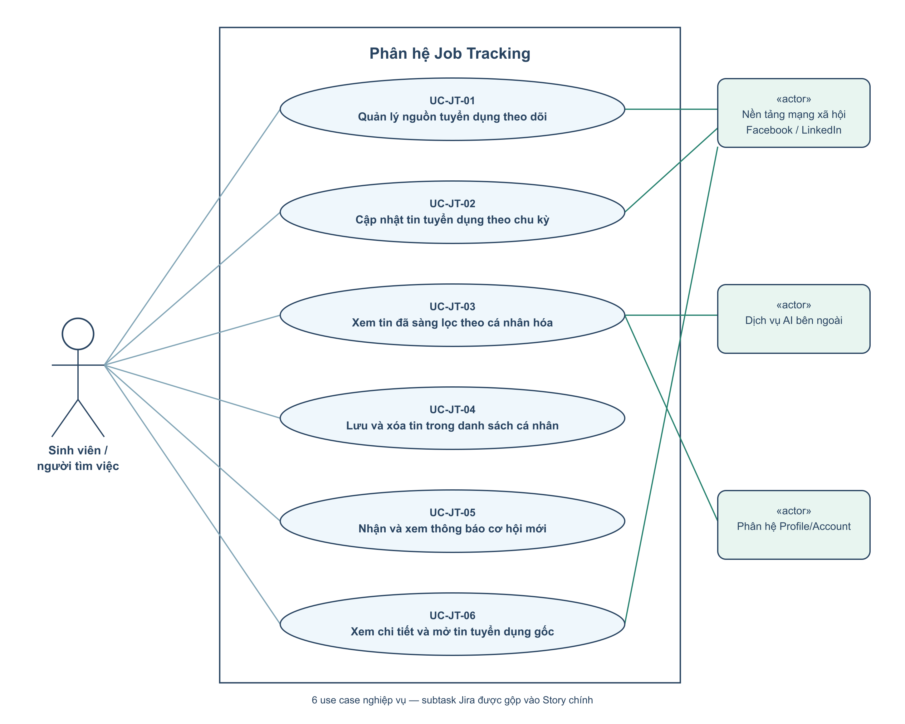


Sơ đồ thể hiện tác nhân bên ngoài ranh giới Job Tracking, các use case dạng hình oval và đường nối không hướng biểu thị quan hệ tương tác.

Sơ đồ gồm sáu use case nghiệp vụ, bao phủ năm Story. Sinh viên/người tìm việc là tác nhân chính; nền tảng mạng xã hội và dịch vụ AI là hệ thống hỗ trợ. Profile/Account cung cấp ngữ cảnh tài khoản và thông tin quan tâm cho cá nhân hóa. Bộ lập lịch là thành phần bên trong hệ thống, không được mô hình hóa thành người dùng hoặc dịch vụ ngoài.

UC-JT-02 chạy khi đến lịch và cung cấp bài cho quá trình sàng lọc của UC-JT-03; UC-JT-05 tạo thông báo khi có kết quả phù hợp. Đây là trình tự xử lý dữ liệu, không dùng mũi tên include/extend để biểu diễn thứ tự thời gian. Mở tin chi tiết từ danh sách hoặc thông báo là lựa chọn của người dùng, không phải bước bắt buộc của mọi lần xem danh sách.

## 5.2 Đặc tả Use Case

### 5.2.1. Quản lý nguồn tuyển dụng theo dõi

| Thành phần | Đặc tả |
| --- | --- |
| **Use Case ID** | UC-JT-01 |
| **Tên Use Case** | Quản lý nguồn tuyển dụng theo dõi |
| **Tóm tắt** | Thêm/xóa nguồn, tạm dừng/tiếp tục và xem tình trạng truy cập nguồn. |
| **Tác nhân** | Sinh viên/người tìm việc; nền tảng mạng xã hội hỗ trợ kiểm tra nguồn. |
| **Điều kiện tiên quyết** | Người dùng đã đăng nhập. |
| **Kết quả** | Quan hệ theo dõi của đúng tài khoản được cập nhật; nguồn và trạng thái được hiển thị. |
| **Kịch bản chính** | 1. Người dùng mở danh sách nguồn.<br>2. Hệ thống tải nguồn và trạng thái của tài khoản.<br>3. Người dùng chọn thêm, nhập đường dẫn Fanpage/LinkedIn.<br>4. Hệ thống kiểm tra định dạng, phạm vi hỗ trợ và khả năng truy cập.<br>5. Hệ thống lưu nguồn theo dõi cùng kết quả kiểm tra, hiển thị danh sách đã cập nhật. |
| **Kịch bản phụ** | A1 — Tại bước 3, chọn tạm dừng/tiếp tục: hệ thống đổi trạng thái của quan hệ theo dõi.<br>A2 — Tại bước 3, chọn xóa: hệ thống yêu cầu xác nhận rồi xóa quan hệ theo dõi cá nhân.<br>A3 — Tại bước 4, URL rỗng/sai/không hỗ trợ: báo lỗi và không lưu.<br>A4 — Tại bước 4, nguồn không truy cập được: nêu trạng thái, cho người dùng chọn giữ nguồn để theo dõi hoặc hủy; không khẳng định nguồn đã đóng vĩnh viễn.<br>A5 — Lưu thất bại: giữ dữ liệu nhập và không báo thành công. |
| **Ràng buộc phi chức năng** | NFR-JT-01, 02, 03, 07. |
| **Truy vết** | FR-JT-01–05; SCRUM-31 / 47, 48, 67. |

### 5.2.2. Cập nhật tin tuyển dụng theo chu kỳ

| Thành phần | Đặc tả |
| --- | --- |
| **Use Case ID** | UC-JT-02 |
| **Tên Use Case** | Cập nhật tin tuyển dụng theo chu kỳ |
| **Tóm tắt** | Thu thập bài từ nguồn đang theo dõi, lưu dữ liệu và căn cứ thời hạn. |
| **Tác nhân** | Sinh viên/người tìm việc là bên nhận lợi ích; nền tảng mạng xã hội cung cấp bài đăng. Kích hoạt bởi bộ lập lịch nội bộ. |
| **Điều kiện tiên quyết** | Có nguồn được bật theo dõi; phương thức truy cập và chu kỳ đã được cấu hình. |
| **Kết quả** | Bài thu thập được lưu để sàng lọc; thời điểm kiểm tra và thông tin thời hạn hiện có được ghi nhận. |
| **Kịch bản chính** | 1. Đến thời điểm kiểm tra.<br>2. Hệ thống lấy các nguồn đang có người bật theo dõi.<br>3. Hệ thống kiểm tra khả năng truy cập và lấy bài trong khoảng thu thập cấu hình.<br>4. Hệ thống lưu nội dung, nguồn, URL và các mốc thời gian hiện có.<br>5. Hệ thống xác định/lưu căn cứ thời hạn nếu có và chuyển bài sang sàng lọc.<br>6. Hệ thống ghi nhận kết quả kiểm tra. |
| **Kịch bản phụ** | A1 — Không có nguồn đang theo dõi: kết thúc lượt kiểm tra.<br>A2 — Không có bài mới: ghi nhận đã kiểm tra, không tạo tin giả.<br>A3 — Nguồn không truy cập được: cập nhật trạng thái nguồn, không ghi nhận thu thập thành công cho nguồn đó.<br>A4 — Bài không có hạn rõ ràng: lưu trạng thái Chưa xác định.<br>A5 — Người dùng đã tạm dừng trước khi phân phối: không thêm tin mới vào danh sách của tài khoản đó. |
| **Ràng buộc phi chức năng** | NFR-JT-03, 04, 05, 07, 08. |
| **Truy vết** | FR-JT-06, 07, 10; SCRUM-32 / 43, 44, 45. |

### 5.2.3. Xem tin đã sàng lọc theo cá nhân hóa

| Thành phần | Đặc tả |
| --- | --- |
| **Use Case ID** | UC-JT-03 |
| **Tên Use Case** | Xem tin đã sàng lọc theo cá nhân hóa |
| **Tóm tắt** | Phân loại bài và hiển thị tin IT Intern/Fresher theo ngữ cảnh của người dùng. |
| **Tác nhân** | Sinh viên/người tìm việc; dịch vụ AI; phân hệ Profile/Account. |
| **Điều kiện tiên quyết** | Người dùng đã đăng nhập; có nguồn theo dõi. Bài mới được sàng lọc trước khi xuất hiện trong danh sách phù hợp. |
| **Kết quả** | Người dùng xem kết quả thuộc phạm vi nguồn và thông tin quan tâm của mình. |
| **Kịch bản chính** | 1. Với bài mới thu thập, hệ thống gửi nội dung cần thiết đến AI để phân loại/trích xuất.<br>2. Hệ thống kiểm tra và lưu kết quả phân loại, thông tin có căn cứ.<br>3. Người dùng mở danh sách tin.<br>4. Hệ thống xác định nguồn theo dõi và thông tin quan tâm của tài khoản.<br>5. Hệ thống trả danh sách tin phù hợp, hiển thị nguồn, thời gian và trạng thái hạn.<br>6. Người dùng chọn tin để xem chi tiết hoặc lưu lại. |
| **Kịch bản phụ** | A1 — Bài không liên quan/chỉ tuyển cấp độ khác: không đưa vào danh sách phù hợp.<br>A2 — Bài nhiều vị trí: giữ phần Intern/Fresher có căn cứ và cho xem toàn bài ở chi tiết.<br>A3 — Bài chưa rõ hoặc AI không trả kết quả hợp lệ: chưa trình bày thành tin phù hợp; dữ liệu đã lưu không bị đổi thành kết quả giả.<br>A4 — Không có thông tin quan tâm: hiển thị tin IT Intern/Fresher từ nguồn theo dõi.<br>A5 — Chưa có nguồn hoặc chưa có tin phù hợp: hiển thị hướng dẫn tương ứng. |
| **Ràng buộc phi chức năng** | NFR-JT-01, 02, 04, 05, 06, 07. |
| **Truy vết** | FR-JT-11–15; SCRUM-33 / 41, 42, 68. |

### 5.2.4. Lưu và xóa tin trong danh sách cá nhân

| Thành phần | Đặc tả |
| --- | --- |
| **Use Case ID** | UC-JT-04 |
| **Tên Use Case** | Lưu và xóa tin trong danh sách cá nhân |
| **Tóm tắt** | Đánh dấu tin quan tâm để xem lại, bỏ lưu hoặc xóa khỏi danh sách cá nhân. |
| **Tác nhân** | Sinh viên/người tìm việc. |
| **Điều kiện tiên quyết** | Người dùng đã đăng nhập và có quyền xem tin cần thao tác. |
| **Kết quả** | Trạng thái lưu hoặc sự hiện diện trong danh sách cá nhân được cập nhật; dữ liệu của người khác giữ nguyên. |
| **Kịch bản chính** | 1. Người dùng chọn Lưu tin từ danh sách hoặc chi tiết.<br>2. Hệ thống lưu đánh dấu cho đúng tài khoản.<br>3. Người dùng mở danh sách Tin đã lưu.<br>4. Hệ thống hiển thị tin đã chọn cùng trạng thái thời hạn hiện tại. |
| **Kịch bản phụ** | A1 — Chọn Bỏ lưu: chỉ bỏ đánh dấu, tin có thể vẫn còn trong danh sách đã nhận.<br>A2 — Chọn Xóa khỏi danh sách: hỏi xác nhận, sau đó loại khỏi danh sách cá nhân và đánh dấu lưu của người đó nếu có.<br>A3 — Hủy xác nhận: giữ nguyên dữ liệu.<br>A4 — Không thuộc quyền truy cập hoặc lưu/xóa thất bại: không thay đổi dữ liệu và thông báo phù hợp.<br>A5 — Tin đã hết hạn: vẫn có thể xem/lưu để tham khảo nhưng phải giữ nhãn Hết hạn. |
| **Ràng buộc phi chức năng** | NFR-JT-01, 02, 03, 04. |
| **Truy vết** | FR-JT-08, 09; SCRUM-32 / 45. |

### 5.2.5. Nhận và xem thông báo cơ hội mới

| Thành phần | Đặc tả |
| --- | --- |
| **Use Case ID** | UC-JT-05 |
| **Tên Use Case** | Nhận và xem thông báo cơ hội mới |
| **Tóm tắt** | Tạo thông báo từ kết quả phù hợp và thể hiện thời hạn của cơ hội liên quan. |
| **Tác nhân** | Sinh viên/người tìm việc. |
| **Điều kiện tiên quyết** | Có tin mới đã sàng lọc phù hợp; người nhận đang bật theo dõi nguồn. Người dùng đăng nhập để xem thông báo cá nhân. |
| **Kết quả** | Thông báo thuộc đúng tài khoản được hiển thị với trạng thái thời hạn của tin; có thể mở chi tiết. |
| **Kịch bản chính** | 1. Hệ thống nhận kết quả sàng lọc tin mới.<br>2. Hệ thống xác định người còn theo dõi và kiểm tra hạn tuyển dụng.<br>3. Nếu chưa xác định hết hạn, hệ thống tạo thông báo gồm tiêu đề, nguồn, thời gian và liên kết tin.<br>4. Người dùng mở danh sách thông báo.<br>5. Hệ thống kiểm tra trạng thái hạn hiện tại và hiển thị tương ứng.<br>6. Người dùng chọn thông báo để xem chi tiết tin. |
| **Kịch bản phụ** | A1 — Tin đã hết hạn tại bước 2: không tạo thông báo cơ hội mới.<br>A2 — Không có căn cứ hạn: hiển thị Chưa xác định hạn, không cam kết cơ hội còn mở.<br>A3 — Tin hết hạn sau khi thông báo được tạo: giữ thông báo với nhãn Hết hạn.<br>A4 — Người đã dừng theo dõi: không tạo thông báo mới cho người đó.<br>A5 — Tin không còn khả dụng trong phạm vi truy cập: báo không xem được, không điều hướng sang tin khác. |
| **Ràng buộc phi chức năng** | NFR-JT-01, 02, 04, 06. |
| **Truy vết** | FR-JT-16–18; SCRUM-34 / 40, 66. |

### 5.2.6. Xem chi tiết và mở tin tuyển dụng gốc

| Thành phần | Đặc tả |
| --- | --- |
| **Use Case ID** | UC-JT-06 |
| **Tên Use Case** | Xem chi tiết và mở tin tuyển dụng gốc |
| **Tóm tắt** | Xem thông tin đã lưu và truy cập nguồn để kiểm tra cách ứng tuyển. |
| **Tác nhân** | Sinh viên/người tìm việc; nền tảng mạng xã hội tiếp nhận điều hướng sang bài gốc. |
| **Điều kiện tiên quyết** | Người dùng đã đăng nhập và được phép xem tin. |
| **Kết quả** | Tin chi tiết được hiển thị; khi người dùng chọn, bài gốc được mở trên nền tảng ngoài. |
| **Kịch bản chính** | 1. Người dùng chọn tin từ danh sách đã nhận, tin đã lưu hoặc thông báo.<br>2. Hệ thống kiểm tra quyền và lấy chi tiết đã lưu.<br>3. Hệ thống hiển thị nội dung nguồn, thông tin trích xuất, thời điểm cập nhật và trạng thái hạn.<br>4. Người dùng chọn Mở bài đăng gốc.<br>5. Hệ thống mở đúng URL của bài trên nền tảng ngoài. |
| **Kịch bản phụ** | A1 — Tin không tồn tại/không được phép xem: thông báo phù hợp, không tiết lộ dữ liệu tài khoản khác.<br>A2 — Thiếu trường: hiển thị Chưa có thông tin.<br>A3 — Thiếu URL: vô hiệu hóa thao tác mở bài gốc.<br>A4 — Bài gốc bị xóa hoặc cần đăng nhập: người dùng vẫn có thể quay lại nội dung đã lưu; thời điểm cập nhật được giữ rõ.<br>A5 — Tin hết hạn: vẫn cho xem nhưng hiển thị Hết hạn, không xác nhận đang mở tuyển. |
| **Ràng buộc phi chức năng** | NFR-JT-02, 04, 06, 07. |
| **Truy vết** | FR-JT-19–22; SCRUM-35 / 36, 37. |

# 6. Bản mẫu (Prototype)

Các hình dưới đây minh họa sáu màn hình Job Tracking được thiết kế trong Figma. Bảng và mô tả từng màn hình trình bày nội dung, thao tác tương ứng trong prototype.

| Frame | Màn hình | Story liên quan |
| --- | --- | --- |
| JT-F01 | Nguồn theo dõi: tên, nền tảng, tình trạng nguồn, tạm dừng/tiếp tục và xóa | SCRUM-31 / 47, 48, 67 |
| JT-F02 | Thêm nguồn: nhập URL và hiển thị kết quả kiểm tra nguồn | SCRUM-31 / 47, 67 |
| JT-F03 | Tin tuyển dụng: danh sách đã sàng lọc, thông tin cá nhân hóa và trạng thái hạn | SCRUM-32 / 43, 44; SCRUM-33 / 41, 42, 68 |
| JT-F04 | Tin đã lưu: xem lại, bỏ lưu và xác nhận xóa khỏi danh sách cá nhân | SCRUM-32 / 45 |
| JT-F05 | Thông báo: cơ hội mới, cơ hội đã hết hạn và trường hợp chưa xác định hạn | SCRUM-34 / 40, 66 |
| JT-F06 | Chi tiết tin: nội dung nguồn, phần trích xuất, thời hạn và liên kết bài gốc | SCRUM-35 / 36, 37 |

## JT-F01 — Nguồn theo dõi

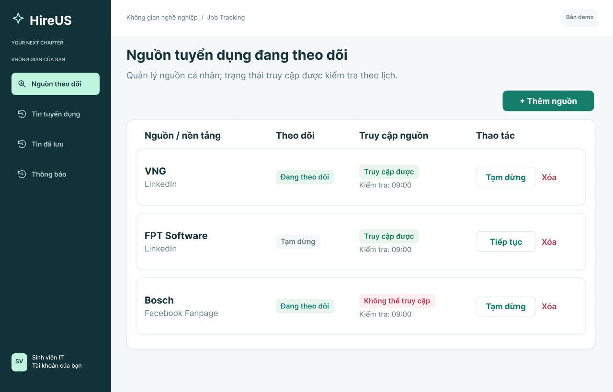

Trạng thái Đang theo dõi/Tạm dừng thuộc quan hệ của người dùng; Truy cập được/Không truy cập được thuộc lần kiểm tra nguồn. Hai thông tin được trình bày riêng. Người dùng có thể mở form thêm hoặc thao tác trực tiếp trên từng nguồn.

## JT-F02 — Thêm nguồn

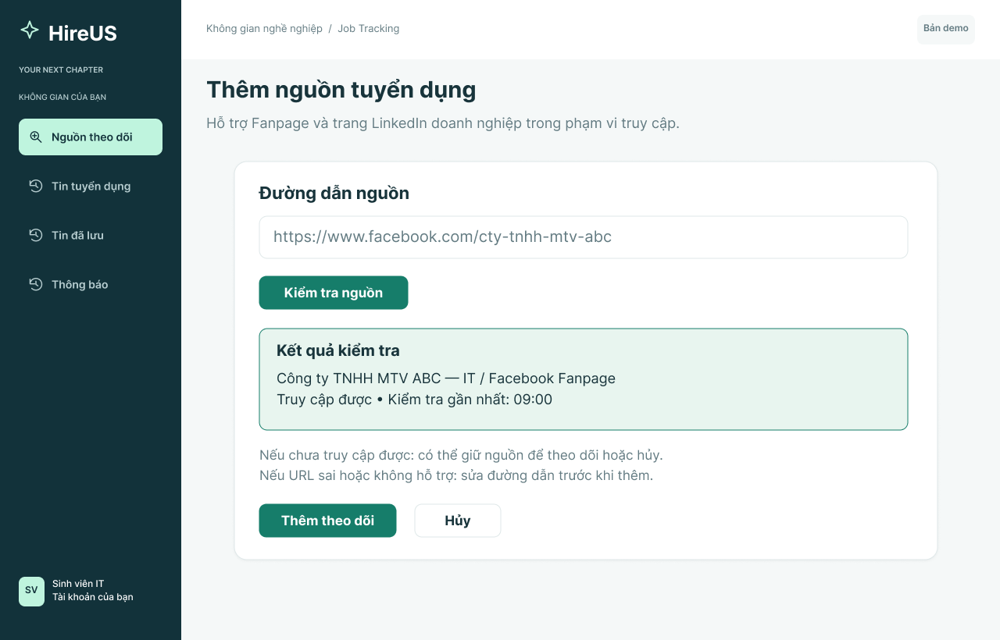

Người dùng nhập đường dẫn, kiểm tra nguồn, xem tên/nền tảng và quyết định thêm. Khi nguồn không truy cập được, giao diện nêu rõ kết quả và cho chọn giữ nguồn để theo dõi hoặc hủy; khi URL sai thì không cho lưu.

## JT-F03 — Danh sách tin tuyển dụng

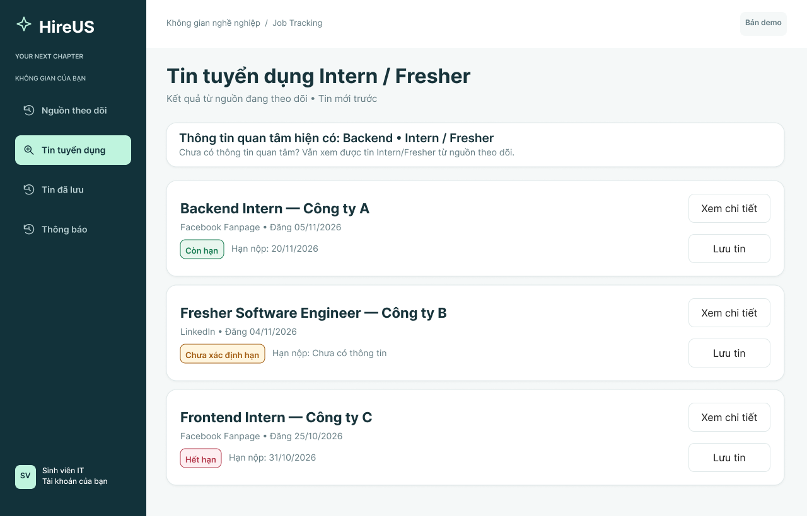

Phần đầu thể hiện căn cứ cá nhân hóa đang dùng; mỗi tin có nguồn, cấp độ và trạng thái thời hạn bằng chữ. Người chưa có thông tin quan tâm vẫn xem được tin từ nguồn theo dõi. Việc cá nhân hóa không hiển thị phần trăm phù hợp CV.

## JT-F04 — Tin đã lưu

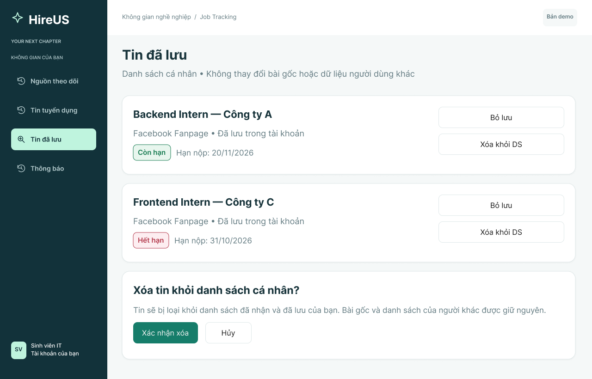

Bỏ lưu và Xóa khỏi danh sách là hai thao tác khác nhau. Hộp xác nhận xóa nêu rõ chỉ tác động đến tài khoản hiện tại. Tin hết hạn vẫn có thể được lưu để tham khảo nhưng không mất nhãn hết hạn.

## JT-F05 — Thông báo tuyển dụng

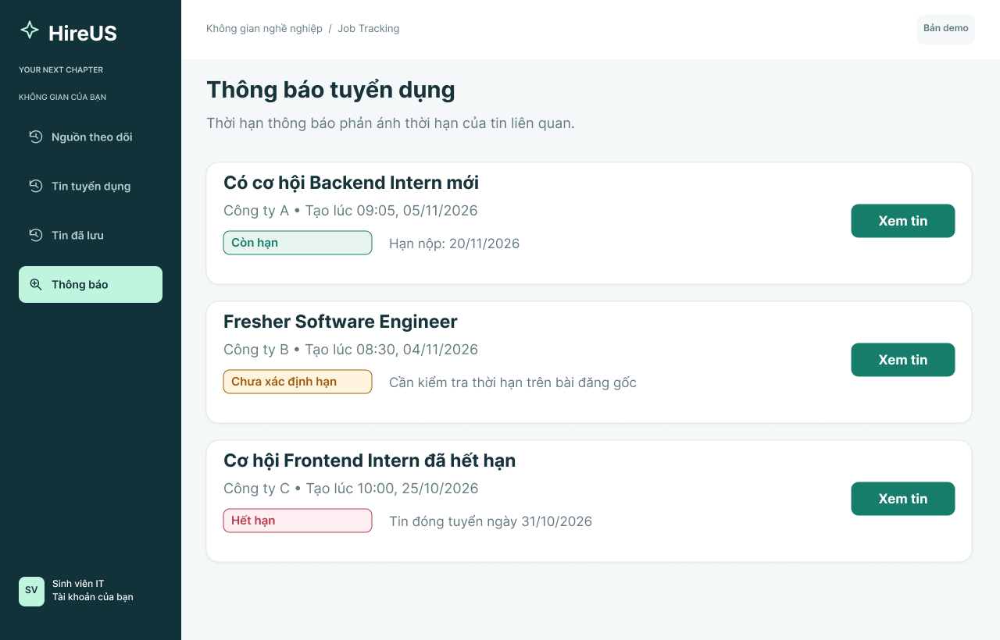

Thông báo dẫn đến tin tương ứng và thể hiện thời hạn của cơ hội tại lúc xem. Thông báo cũ chuyển sang Hết hạn khi có căn cứ; trường hợp không có hạn dùng nhãn Chưa xác định hạn.

## JT-F06 — Chi tiết và bài gốc

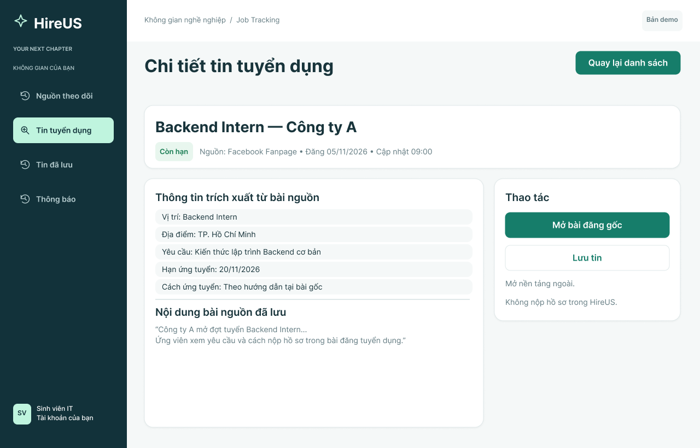

Người dùng kiểm tra các trường trích xuất, nội dung nguồn và thời điểm cập nhật trước khi mở bài gốc. Các nút lưu và quay lại hỗ trợ đi tiếp hoặc trở về danh sách; mở nguồn không phải thao tác nộp hồ sơ trong HireUS Tools.

**Luồng mẫu để đối chiếu prototype:** JT-F01 → JT-F02 → JT-F01 để thêm nguồn; JT-F03 → JT-F06 → JT-F04 để xem và lưu tin; JT-F05 → JT-F06 để xem cơ hội từ thông báo. Từ JT-F01, tạm dừng nguồn rồi kiểm tra rằng lượt xử lý sau không tạo thêm tin hoặc thông báo cho nguồn đó trong tài khoản hiện tại.

